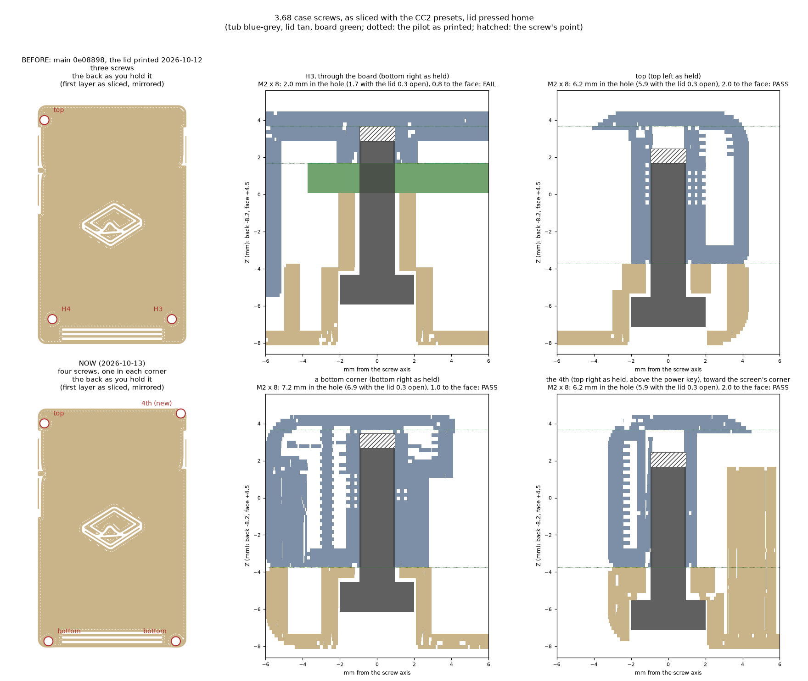
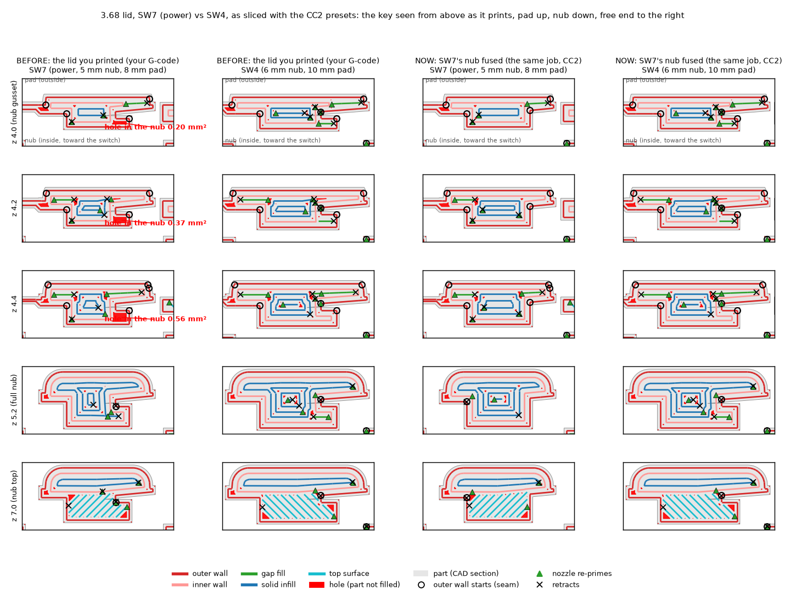
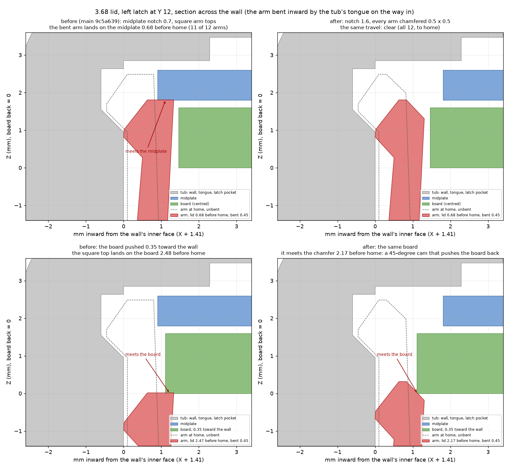
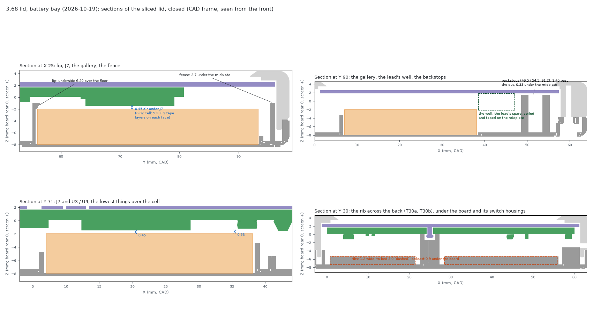
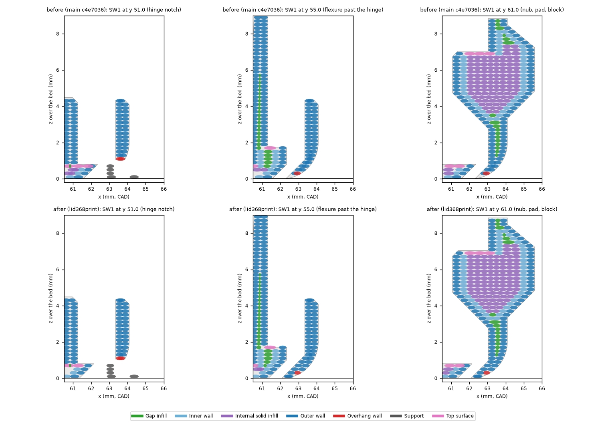
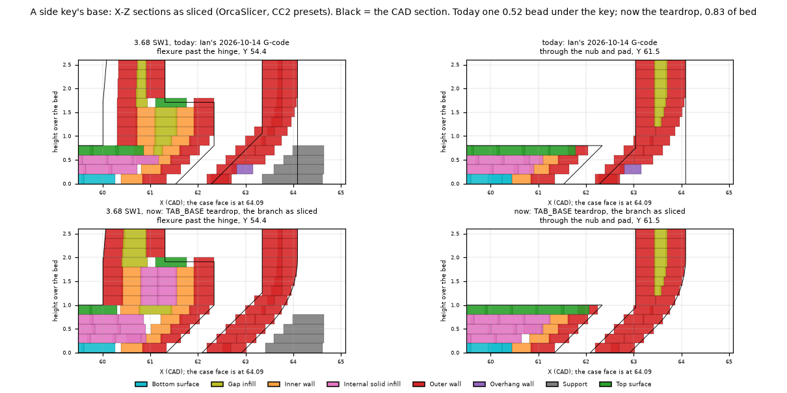

# Silkscreen x3 enclosure

> [!IMPORTANT]
> AI-assisted, not the official Silkscreen enclosure: see the notice at the top of the
> [main README](../../README.md) and https://silkscreenreader.com/ai.

**This folder is `enclosures/case-368`.** What it makes to print is
in the repo's [`print/`](../../print/) folder: `print/silkscreen-368-plates.3mf` and `print/3.68/`. The generic OrcaSlicer
project the website serves for the 3.68 is described in the [top-level README](../../README.md#the-368-1-file). The
light-strip build below is in development and not released. It has no `.venv`:
run it with a Python 3.11 virtual environment made from `requirements.txt`, from this folder (`python` below).

**Board parts named in this file.** The board prints its reference designators on its back (H5's on the front). On the trimmed x3 board
SW7, the left upper page key, is the power key; SW4 and SW1 are the right upper and lower page keys; SW5, the left lower
one, is left off; SW10, the board's own power button, goes with the cut; SW11 is the reset button; SW9, SW8, SW3 and
SW2 are the bottom-row buttons, left to right (Back, OK, Left, Right). J1 is the USB-C socket; J2 and J3 are the display and frontlight
connectors, J5 the battery connector and J7 the microSD socket; J6, the expansion header, goes with the cut. U1 and U9 are
the microSD ESD arrays, U3 is the 3.3 V regulator and L1 the display's boost inductor (all named where the lid and bay
clearances are measured); Q2 is the charger's enable switch. H1-H6 are
the mounting holes (H1 goes with the cut; H3 and H4 are the bottom two). The power rework (R36, R62, R72, R73, R74) and the
two fixes of a pre-Rev 1.01 board (the charge-enable wire to Q2 and R81; the ground wire
from C6, the 3.3 V regulator's output capacitor, to C21; R40 is a 3V3 point for the first) name the parts they solder;
silkscreen-pcb's README ("Cutting the board down") and docs/HARDWARE.md describe them.

## Two builds: standard and light strip

This project builds the 3.68-inch case two ways, from one code base (`src/variant.py`, `SILKSCREEN_VARIANT`):

- **standard:** x3 as described below, but with its front face 0.4 mm higher for the screen bevel (2026-10-10; see
  *Screen bevel*) and its back 1.0 mm lower so that the lid closes (2026-10-12; see *The lid closing*):
  68.2 × 108.0 × 12.9 mm, with the front face at Z 4.47 and the back at Z −8.435 (x3: 11.3 mm, Z 4.07 and −7.235; the
  back was at −8.235, 12.7 mm, until the bay's 2026-10-19 change: *The battery bay (2026-10-19)*).
- **light-strip:** x3 with the Silkscreen light strip beside the panel's left edge. The front is 1.2 mm higher than
  x3's (0.8 higher than the standard build's), and the back is the standard build's, so the shell is 13.7 mm (13.5
  until 2026-10-19, 12.5 until 2026-10-12). See *Light-strip variant*.

**The tub and the bottom keys differ.** The lid (with its three side keys), the midplate, the cranks and the rod
are the same in both builds. The bottom keys stand 1.5 over their own tub's face, so each build has its own
(`key-x3std`, `key-x3ls`; see *Bottom keys*). A light-strip owner prints the other tub and four other keys.

`src/build.py` checks this on every run and stops if it fails. Each shared part must have the same volume in both
builds and an empty boolean difference both ways, or identical files. At present both hold: the STLs and STEPs also
match byte for byte, apart from the STEP timestamp. The tub and the keys are listed too, and differ. The result is in
`out/shared-parts.json`.

The shared parts are the light-strip ones. Two of them therefore changed for the standard build too, compared
with x3's own build (the original project's `out/x3/`):

| Part | Change | What it means for the standard build |
|---|---|---|
| Midplate | Notched through at its left edge, out to X 1.3, in two places: under the strip's fold (Y 73.4–92.7, running into SW7's two front lead holes) and under the light-strip tub's corner stops (Y 7.3–9.45 and 92.7–93.74). Its left upper detent strip moves from Y 86.0 to 58.0. | The standard tub's left upper detent pocket moves with the strip, and that is the tub's only change. A boolean difference against x3's `tub.step` finds just the old pocket filled and the new one cut, 1.06 mm³ each. Over the notched spans the plate no longer backs the glass's left border out to X 1.3: 0.17 of glass on a centred nominal panel, at most 0.42 with the panel against the pocket's wall. The springs, posts, other detents and latch notches are x3's. |
| Lid | The left wall's latch arm at Y 83 has its inner top corner chamfered 0.5 × 0.5 (since 2026-10-12 every arm has it: *The lid closing*). | The barb, its catch and its lead-in are x3's, so the latch figures are unchanged. |

Since 2026-09-26 both builds also have the new bottom keys (bell cranks, a filament rod and a 1.0 mm deeper chin),
which changed the tub and the lid's chin wall in both. See *Bottom keys*.

The side keys are part of the lid, and are x3's in both builds.

**Building:**

```powershell
python -B src/build.py        # both builds -> out/standard/, out/light-strip/, then ../../print/3.68/
```

- **Checks:** each build runs its own. The standard build runs x3's checks. The light-strip build adds the strip's
  checks (see *Checks (light strip)*). Both run the bottom keys' checks (see *Bottom keys*, *Checks*).
- **One build only:** set `SILKSCREEN_VARIANT` to `standard` or `light-strip`, and `build.py` runs just that build.
- **Other scripts:** `mechanics.py`, `dummy.py`, `plates.py` and `slice_check.py` run one build per call. They take
  it from `SILKSCREEN_VARIANT`, which defaults to `light-strip`. `strip_sections.py` runs for the light-strip build
  only. See *Rebuilding*. The showcase is built from this project by the repo's `showcase/gen/adapt_368.py`.

**Print files:** the repo's `print/3.68/` holds every part to print, and `print/silkscreen-368-plates.3mf` the standard
build laid out on three plates (below; the light-strip build is in the author's CC2 file only).

- `lid` and `midplate`, once each.
- `tub-standard` and `tub-light-strip`: print the one for your build.
- `key-x3std` and `key-x3ls`: four of the one for your build.
- `crank-T` (JLC boards, TS365ZJ switches) or `crank-M` (MJTP1117 switches): four.
- `gate`: the rod's left stop, the same in both builds: two (one is a spare).
- `coupon-strip-x3std` (or `-x3ls`): the hook keys' optional fit check for your build, printed with one key (see
  *Bottom keys*, *Assembly*).
- `coupon-gate-x3std` or `coupon-gate-x3ls`: the gate's proof coupon for your build, printed with a gate, once (see
  *Bottom keys*, *The gate*).

Each part comes as `<name>.stl`, oriented as it prints, and `<name>.step`, in the CAD frame (the gate's STEP is
in its print pose, as its STL). Not printed: the rod (63.25 mm of 1.75 mm PLA filament; `print/3.68/ROD.txt`). No screw
closes the rod's hole any more: the gate does.

`print/silkscreen-368-plates.3mf` is a generic OrcaSlicer project with the standard build laid out (Generic Marlin Printer
0.4 nozzle, 0.20mm Standard, Generic PLA, a 220 x 210 mm bed, no brim, a one-loop skirt; keys, cranks and gates at
elephant-foot compensation 0, the cranks with Arachne walls, and every key and crank on a 2-layer raft; since
2026-10-21; it holds OrcaSlicer's whole key set, because OrcaSlicer 2.3.2 and later crash on a project without
`filament_colour`). Plate 1 is the case (tub, lid, midplate, 4 `key-x3std`, 4 crank-T, 2 gates, the rod jig); plate 2 holds
4 crank-M for APEM MJTP1117 boards; plate 3 the test prints (the coupon strip with a key, the gate coupon with a gate, the
PCBA dummy). Print the gate coupon first (the chin fit check is optional), then plate 1. Regenerate with
`enclosures/make_plates.py` after `plates.py` has run for both variants. The author's Elegoo Centauri Carbon 2 version, with
the light-strip build too (plate 1 standard, plate 2 light-strip, plate 3 test prints and extras), is
`make_plates.py --printer cc2`, into `print/cc2-local/` (git-ignored).

**The standard build's own OrcaSlicer project, any printer** (2026-10-11; what the website serves for the 3.68): the
3.68 has one released configuration, the standard build (the light-strip build is not released and has no project),
and `out/configs/standard.3mf` holds what it prints and nothing else, made the same way as the 4.26's per-configuration
projects (`../case-426/README.md`, "One OrcaSlicer project per configuration"). Plate 1 "Case: standard: bare x3
panel, bottom keys, three side keys": the tub and the lid (one support enforcer per side key, 3) side by side at the
back, the midplate turned crosswise in front of them, 4 `key-x3std`, 4 `crank-T` and 2 gates (one spare) beside the
midplate and the rod jig beside the lid: x 28.3-191.7, y 16.3-193.7, inside 220 x 210 with 5 mm to spare. Plate 2:
4 `crank-M`, only for APEM MJTP1117 boards. No test prints (they stay on plate 3 of the plate file). It carries
OrcaSlicer's generic presets (`MyMarlin 0.4 nozzle`, `0.20mm Standard @MyMarlin`, `Generic PLA @System`, no brim,
a one-loop skirt since 2026-10-13),
and the plate file's per-object settings plus the 4.26 projects' three (no brim on every object, the lid's 1 mm
support grid, `tree(auto)` on the keys and cranks so the raft's first-layer expansion of 1 holds), so the user picks
their own printer and keeps a 0.4 nozzle and 0.2 mm layers. 1.08 MB; plate 1 slices to 33.4 g (3 h 6 min at the
generic profile's cautious speeds, skirt included; 32.5 g and 2 h 56 min before the four screws, 31.7 g and 2 h 49
min before the 2026-10-12 lid; with the CC2 presets, the `--printer cc2` version, 32.2 g and 1 h 39 min, was 31.7 g
and 1 h 34 min), plate 2 0.8 g. Make it, after
`plates.py` for the standard build, from `enclosures/` with the 4.26's Python:

```powershell
$py = '<path to a venv>\Scripts\python.exe'
& $py -B make_plates.py configs --size 368                       # -> case-368/out/configs/standard.3mf (not in git)
& $py -B case-426/src/configs_slice.py --size 368                # slice it and read it back -> out/configs/slice-report.json
```

`--printer cc2` writes Ian's Elegoo CC2 version into `out/configs-cc2/` (not for the site). The read-back checks that
Orca slices both plates, every extrusion lies on an object, a raft (two layers, no higher than 0.5) sits under every
key and crank, supports appear only inside the lid's 3 enforcers (each used), each `key-x3std` prints 50 layers
over its raft (as `slice_check.py`'s key fit has it), and (2026-10-12) the lid's side keys print on what is under
them (*The side keys' first layer*; run it with `--printer cc2` too, for Ian's presets). Checked with the OrcaSlicer CLI only: not yet opened in the GUI,
and not printed.

## Four screws, and the lid where it really sits (2026-10-13)

Ian, after printing the 2026-10-12 lid: the bottom pair of M2 × 8 screws "never bite", and the lid does not stay
closed at the top-left (the corner above the power key). A read-only study round read the G-code of the lid he
printed and OrcaSlicer slices of the plate file with its CC2 presets. It found three causes, all invisible from
outside:

- **The bottom screws had 2.0 mm of hole.** They went through the board's H3/H4 holes into bosses in front of it, and
  the tub has only 2.87 mm in front of the board. As printed the pilot ran from 1.67 to 3.67, and a pressed-home
  M2 × 8 ended exactly at its end: about 1.2 mm of full thread. No screw length does better there (an M2 × 10 bites
  only because it drills through to the face). It had been so since x3 was laid out.
- **The lid does not sit where the CAD puts it.** The slicer keeps a layer only if its mid-plane is inside the part, so
  the lid's rim prints to Z −3.835 and the tub's to −3.73 (the parting plane is −3.75), and the board's posts and
  bosses lose the same between them. Pressed home, the lid sits **0.105 forward** of its CAD position
  (`params.LID_HOME_DZ`; the 4.26's sits 0.10 behind). From there:
  - the four backstops and the top rib, drawn 0.1 behind the midplate (1.70), printed to the next layer (1.765) and
    stood **0.07 into a nominal panel's midplate** (0.17 into the thickest's) before the rims met. That was the only
    place in the closed case where two printed parts met, and it ran all along the top edge;
  - every latch let the lid lift **0.20** before it took any load: each barb step stood 0.005 inside the pocket step
    under it (the 4.26's sit on theirs). The midplate's springs (about 10 N) push the lid back through that wherever
    no screw bites.

Ian decided (2026-10-13), and this build does:

| # | Change | Part | Seen? |
|---|---|---|---|
| 1 | The backstops and the top rib to Z 1.565 (`lid.BACKSTOP_TOP`, on the lid's layer grid; were 1.70, printed 1.765). With the lid home: 0.13 clear of a nominal panel's midplate, 0.03 of the thickest's | lid | no |
| 2 | The latch barbs one layer lower (`params.LATCH_PHASE`). At the lid's home each barb's face meets its pocket's (0.005 apart) and its steps sit on the pocket's, as the 4.26's do: no free lift (was 0.20). The pockets are unchanged. The arms are 0.2 shorter to the barb: 3.2 N on and 4.7 N off each, 0.87 % strain (were 3.0, 4.35, 0.83). **2026-10-19:** the arms are 1.3 at the root, straight to today's section (0.79) at Z −0.5, and today's from there up (`params.SNAP` `t_root` 1.3, `mid`): 5.45 N on and 8.0 N off each, 0.89 % strain; Ian's 1.2 / 0.85 would have met the board's edge on the way in (*The battery bay (2026-10-19)*) | lid | no |
| 3 | The bottom pair into the chin's two bottom corners, (2.0, −5.25) and (58.0, −5.25). In the tub each corner is now solid (`tub.corner_blocks`): from the side wall to the end web, from the chin wall to 0.2 under the rod's hole, from the parting plane to the skin. In the lid each screw has a 6.0 post, D-shaped into its bottom wall, with a 3.6 counterbore (seat −4.635; 3.8 deep since 2026-10-19, the seat unchanged). As printed: **7.2 mm of screw in the pilot**, the tip 0.2 short of the pilot's end, 1.0 from the face (1.8 on the light strip). The study put them at Y −5.05; that left 0.45 mm of plastic between the pilot and the block's face under the rod, so they sit 0.2 lower (0.65 there). H3/H4: the counterbores and holes are filled; the lid's posts stay and carry H5's pin (1.9, into the board's 2.2 hole: the board's X/Y stop at its bottom edge); the tub's bosses stay, without a pilot | tub, lid | **yes**: the two lower heads move 8.25 down and 1.75 out |
| 4 | A 4th screw in the top-left corner, (−0.2, 94.95) (as the back is held: the top-right, above the power key). In the tub: a block in the corner, merged into the left and top walls, flat on the panel's pocket (it fills the pocket's corner relief there; 0.70 of wall toward the glass's corner). In the lid: a 5.0 post with the top screw's 2.6 counterbore (seat −5.635; 2.8 deep since 2026-10-19) and its 6.0 round through the bridge layers. As printed: 6.2 mm in the pilot. The left tongue now ends at Y 91.9 (was 93.2) and the top one starts at X 2.8 (was 1.3), clear of the post. The midplate's corner is notched round the block (5.9 mm³) | tub, lid, midplate | **yes**: one more head; its counterbore opens a notch in the back's edge round on the first two layers (about 0.4 mm high), as the 4.26's top screw does (Ian: OK) |

**Screws: four M2 × 8 socket head caps** (ISO 4762, Ian's); a pan head (ISO 7045) also fits. Never M2 × 10: in the
corners it would end 1.0 mm past the face. The counterbores take either head below the back as they are: as sliced,
the bottom pair's are 3.6 deep (a socket head's top 1.6 below the back, a pan head's 2.0) and the top two's 2.6 (0.6
and 1.0). The 4.26's were 0.2 too shallow for a socket head and are now 2.0 deep (`../case-426/README.md`, "Socket
head screws").
Where, with the back toward you and the chin down: one in each corner. The two bottom ones sit in the chin's corners
(where H3/H4's were, but 8.25 mm lower and 1.75 mm further out), the top-left one is the old top screw, and the
top-right one, above the power key, is new.



**Reprint:** the lid, your build's tub and the midplate, together. The keys, cranks, gate and rod are unchanged. The
gate's proof coupon is cut from the built tub, so it now carries part of the left corner block; it need not be
reprinted. The same lid also has SW7's nub fused to its key (*SW7's nub*, below), and every OrcaSlicer project now
prints a one-loop skirt first (*Printing*).

**Checks** (`slice_check.py` with `asprinted.py`, both builds; a FAIL makes `slice_check.py` exit 1). The tub, the
lid and the midplate as sliced (each layer's lines at their widths) are put back together at the lid's as-printed
home, read from the rims and from the posts, board and bosses:

- **screws:** each screw's seat for a socket head cap (3.8 x 2.0) and for a pan head (4.0 x 1.6), clearance hole,
  pilot (mouth, end, laid diameter) and the face, read from the G-code, and an M2 × 8 on the seat. FAIL if either
  head's top stands proud of the back (since 2026-10-13: Ian's screws are socket heads), under 3.0 mm in the pilot
  (also with the lid 0.3 open), with the tip past the pilot's end, under 0.8 from the face, or with a pilot laid
  wider than 1.75;
- **the lid at home** against the tub and the midplate (nominal and thickest panel): FAIL on any overlap;
- **the latches:** each one's dead band from home. FAIL over 0.05, or if a barb cannot drop in.

On 0e08898, and on the plate file Ian printed from, all three FAIL: H3/H4 have 2.0 mm in the pilot, the backstops
stand 58 mm² into the midplate, and every latch has 0.20 of play. Now all three PASS, on `slice_check.py`'s slices
and on the plate file's own (plate 1, OrcaSlicer CLI): 7.2 / 6.2 mm in the pilots, 0.13 / 0.03 clear of the
midplate, no play.

Also: `lid_close.py` now takes the lid to its as-printed home (0.105 past CAD), where the barbs drop in (0.06 past
CAD). `build.py`'s interference lists the barbs' 0.1 in their pockets at the CAD position, which the lid never
reaches, as designed (2.43 mm³). `slice_check.py`'s gate-slot bridge check counts bridges over air; the left
corner block makes the wall beside the slot wide enough for sparse infill, and Orca lays one layer of internal bridge
in it (19 mm, reported).

Not proven: only a print shows these.
- That the backstops were what held the top-left open.
- That the thinnest pilot walls (the 4th screw's 0.70 toward the glass's corner, the corner screws' 0.65 toward the
  rod) take an M2 without splitting.
- That the pins hold the board's bottom edge where the screws did. The bottom keys' read-back is unchanged.

## SW7's nub, fused to its key (2026-10-13)

Ian: SW7 (power) still prints badly, and the damage is at the nub or the pad (not at the hinge end, not along the bar
or the foot). The G-code of the lid he printed (ElegooSlicer, the CC2 presets) and OrcaSlicer's slice of the same job
were read layer by layer in each key's own frame, SW7 against SW4 and SW1:

- **The pad** prints as SW4's and SW1's do, minus 2 mm of flat: the same lines, speeds, fan and time between layers,
  no hole, nothing over air. Nothing in the G-code singles out SW7's pad.
- **The nub had a hole that no other key has** (no 4.26 key either): in its corner toward the free end, at the key
  bar, on the three layers under its tip (bed z 4.0, 4.2 and 4.4: 0.19, 0.37 and 0.56 mm²). The key's inner face is
  relieved from the plunger toward the free end (`TAB_RELIEF_MAX`, 0.4), but the nub's base stayed on the full face,
  so for its last 2.0 mm the nub stood free of the key across a slit 0.07-0.19 mm wide. SW4 and SW1 fill that corner
  with a 1.1 mm gap fill (their relief runs over 5.2 mm); SW7 is 1.0 shorter (its 8 mm pad), its relief runs over 4.2,
  the pocket was too short and the slicer dropped it. The slit also put SW7's outer-wall seam on the nub: 22 loop
  starts and 44 re-primes there, against SW4's 8 and 26.

**The fix** (`params.NUB_BOND`, `sidekeys.nub`): SW7's nub reaches 0.05 into the relieved face at its free-end end,
so it is fused to the key over its whole width: 0.79 mm³ more, in the slit; nothing else on the lid moves. SW1 and
SW4 keep theirs (bonded, the core of their block turns to sparse infill at z 5.2-6.0). The keys press as before
(SW7: 0.87 N/mm, 2.29 N at the pad's centre, 0.25 off its plunger, its stop at 0.7): the added material lies past the
plunger and outside the full face, and clears the tub, the midplate, the board and the switch at home, on the way on
and pressed (`mechanics.py`'s side-key figures are the same to the last digit). As sliced with the CC2 presets
(this lid in the job Ian printed, the lid with the small parts, and on the whole of plate 1): no hole in SW7's nub
(0.01 mm² at most at z 4.0-4.4), nothing of it over air, and 2 loop starts and 9 re-primes on it (19 retracts, were
43). SW4 reads as on the lid Ian printed. SW1 has no new hole and nothing new over air, but its outer-wall seam now
starts on the nub's side of its slit, where SW7's used to: 21 loop starts, 32 re-primes and 45 retracts on the nub
(8, 17 and 30 on the lid Ian printed). It is the same loop with its start moved 0.5 mm, across the slit's closed end
from the bar to the nub. No change made here causes it: the slicer's two candidate corners there score almost the
same, and any change to the lid's mesh can tip it either way (main's own lid with nothing but its back face
re-triangulated puts SW1's seam on its nub; a re-triangulation of this lid puts SW4's on its nub). So no change of
shape pins it off for good, and a seam enforcer painted on the bar's side does not move it (it reaches the nub's
corner too). The 4.26 lid Ian printed on 10-11 has the same seam on two of its nubs (SW1: 18 loop starts and 30
re-primes; SW5: 17 and 29), and its keys print fine.

Not proven: that this hole is the damage Ian saw. SW1 has the same hole on one layer (0.58 mm² at z 4.2) and printed
acceptably. A photo settles it; if the damage is on the pad, its cause lies outside the G-code. If it was the seam
and not the hole, this lid's SW1 will show it (see "To verify on the first print").



## The lid closing (2026-10-12)

Ian's first print (the standard build, printed 2026-10-11 from `print/` as it was then) would not shut: "the lid does
not shut on the 368, and I am unsure why. It is worse with the battery inserted but still doesn't close even if the
battery is not present." It rocked about a high spot and stopped about 1 mm short at whichever end he pressed. His
board: a Rev 1.0 cut for the x3, R72 and R74 fitted, R36, R73 and SW5 off, J5's leads and the switch pins trimmed, and
the two charging wires (*Board notes* under *Light-strip variant*) laid against the back of the board. There were two
causes. `src/lid_close.py` now checks both on every build.

- **The latch arms landed on the midplate.** This was in every lid and needed no battery. Over the last ~8 mm each
  barb rides the tub's tongue and sliver, which bends its arm 0.45 mm inward (about 0.53 at its top) until the barb
  drops into its pocket just before home. The midplate's notch for the arm was only 0.7 deep. A bent arm's flat top
  therefore stood 0.42 over the plate's edge and met its back face 0.68 mm before home. That happened at 11 of the 12
  arms: all but the left Y-83 one, where the light strip's fold relief already cuts the plate back. The stops ran
  along both side walls and the top, so pressing an end rocked the lid about the nearest row of arms. The build's
  sweep (`build.later_moves`) moves the lid as a rigid body with its arms unbent, so it never saw this.
- **No room for the charging wires.** This is why the battery made it worse. The pack's face was 0.1 from J7 and 0.3
  from C6. The GND wire (C6 pad 2 to C21 pad 2) lies under the pack, over C6, a 22 µF 0805 that stands 1.335 deep.
  Laid on C6, a 1.0 mm hookup wire stands 0.7 into a 5.2 mm pack, and a 0.5 mm wire 0.2.

Ian: "we can survive with a slightly thicker device with some more air in it so long as it closes snugly". The fix:

- **Midplate: the latch notches are 1.6 deep** (were 0.7). Every arm now clears the plate all the way home, even with
  the plate pushed its 0.2 of play toward the arm. The notch's edge is still 0.74 (left), 1.0 (top) and 2.2 (right)
  outside the glass, so the plate backs all of it.
- **Lid: 1.0 mm more air behind the board** (`params.LID_DROP`, five layers). The back and the floor drop 1.0. The
  pack's pocket, lip and hooks drop with them, so a 5.2 pack is held as before (0.15 under the lip and the hooks).
  Its face is now 1.1 from J7, 1.185 from U1, U3 and U9, and 1.3 from C6. What holds the board stays where it was:
  - the five posts at Z 0 and the backstops;
  - the screw heads' seats, with counterbores 3.8 and 2.6 deep (were 2.8 and 1.6): the same M2 × 8 screws and the
    same thread;
  - the latch arms, which stand on a 1.0 pedestal tied to the rim; each arm is 0.09 longer, so its forces are about
    3 % lower (about 2.9 N on and 4.3 N off each, were 3.0 and 4.4).
  The side keys' bars are 1.0 taller, so their flexures are 0.74 thick (were 0.85) and the keys press as before:
  0.86, 0.90 and 0.88 N/mm, 2.20, 2.22 and 2.30 N (0.84, 0.88 and 0.87; 2.20, 2.21 and 2.29 since *The side keys'
  first layer*).
- **Every arm's inner top corner is chamfered 0.5 × 0.5** (until now only the left Y-83 arm's). With the board pushed
  toward a wall (0.15 of play on the snap posts, plus the midplate's 0.2), a bent arm's square top landed on the
  board's back face 2.48 mm before home. Now it meets the board's edge on the chamfer, a 45° cam that pushes the board
  back.
- **The case is 12.7 mm deep** (12.9 since 2026-10-19; was 11.7; 14.2 at the bottom keys, was 13.2). The light-strip build is 13.5 (13.7; was
  12.5).
- **Reprint the lid and the midplate only.** The tubs, keys, cranks, gate and rod are unchanged and fit the new lid.
  The new lid prints in 33 min, 11.3 g (was 29 min, 10.3 g). The build rewrites `tub-standard`, `tub-light-strip`
  and the four coupons in `print/3.68/` too, but they are the same solids (their boolean difference with the old
  files is 0 both ways). Only their files' encoding changed, which follows the case's back plane.

What the check finds (`lid_close.py`; results in `out/<build>/insertion.json`, `_lid_close`):

| | Before the fix (9c5a639) | Now |
|---|---|---|
| Latch arms bent; midplate nominal and 0.2 toward the wall | 11 of 12 land on it 0.68 before home | all 12 clear all the way home |
| Board 0.15 / 0.35 toward a wall | 7 arms' flat tops land on it 2.47–2.48 before home | 7 arms meet it on the chamfer, a cam, 1.96–2.22 before home |
| GND wire (1.0 mm) on C6, to a 5.2 pack | 0.70 into it | 0.30 clear |
| 3V3 wire, R40 pad 2 to R81 pad 2: to the pack, to the lid | 0.10, 0.60 | 1.10, 1.60 |
| 3V3 wire across the cut's two 3V3 stubs | clear (beside the pack, 5.4 over the lid) | clear |

The wires are modelled as 1.0 mm wire on its straight route, lying on the deepest part under it.

**Quick test on the old parts, before reprinting.**
1. Cut the midplate's latch notches 0.9 mm deeper, to 1.6 mm from the plate's edge, over each notch's 5.1 mm length.
   Do all 11: every one but the left one near the top, which is already cut back. Use a knife or flush cutters; the
   plate is 0.8 mm PLA.
2. Check that the board sits centred between the side walls (not pushed toward one), then close the lid without the
   battery. It should go fully home.
3. Re-lay the GND wire beside C6 (*Assembly*, step 1) and try with the pack. With the old lid's 0.1 of air, the pack
   may still hold it open.



## The battery bay (2026-10-19)

**What was found.** The datasheet allows a 503035 5.3 mm thick; with two layers of tape on each face that is 6.02 mm
(`params.BATT_ENV_T`). Under J7 that cell had 0.245 mm of air, and the lip and the two hooks left it only 5.40 mm, so
even the old README's 5.2 mm cell with tape (5.56) did not fit under them. The lid could press the cell or its lead for
days, and PLA creeps under a steady load, so a lid that had done so may have taken a set (unproven; only a reprint
fixes it). The lead had no safe place to go: the top rib and the backstop post at (43.2, 89.2) stood 0.13 mm under the
midplate, right where the lead and its spare lie, and the old text invited winding the spare round the two posts above
J5. Two backstop posts stood 1.15 and 1.45 mm past the cut in the board, as tall as the board's front face: a sliver of
board, or the 3V3 bodge wire at the cut, would sit on them (the geometry is confirmed; whether Ian's board has one
there is not). The read-backs below are `src/bayread.py`.

**What changed (the lid only; the tub, the midplate, the keys, cranks and gate are unchanged).**

- **One layer deeper.** The back drops 0.2 and is one layer thicker (`LID_DROP` 1.2, `LID_T` 1.0: five layers). The case
  is **12.9 mm** deep (light strip 13.7; 14.4 / 15.2 with the bottom keys). The 6.02 mm cell has 0.445 mm of air under
  J7 (U9 0.53, the gallery 1.98). The screws' seats print where they did (Z −4.635 and −5.635), so the same four
  M2 × 8 screws bite as before; the counterbores are 0.2 deeper (3.8 and 2.8).
- **The lip is raised and the hooks are gone.** The lip's underside is 6.20 over the pocket's floor (was 5.40), so the
  cell tucks under it. Nothing on the lid presses the cell: push it to the right, and down only until it stops under the lip, and tape it.
- **The lead's route.** It is laid on the midplate's bare back above J5 and held by one strip of tape (the tape point T,
  `refs.LEAD_T`). Any spare is coiled flat in a well beside it. The top rib became a fence 2.6 under the midplate
  (two leads pass over it); the right posts moved to (49.5, 91.2) and (54.5, 91.2) and every post keeps 0.33 mm under the
  midplate (was 0.13); nothing of the lid stands above Z −1.5 within 3.0 mm past the cut.
- **Six internal ribs** (`lid.RIBS`; 1.2 wide, from the floor to bed 3.0, +0.81 g): across at Y 30 (in two pieces, either
  side of H6's post) and at Y 52, along at X 3, 41 and 55.5. They stay out of the cell's pocket, the lead's zone, the
  posts, the screws and J5's plug; as printed every rib has at least 0.907 mm of room over it (a switch housing's body
  over T30b and L55.5). The grillage model (±30 % absolute, sound as a comparison) puts the springs' bow at 0.148 → 0.113
  mm and 1 N on the back's centre at 0.176 → 0.107 mm; Ian's spot (42, 82) barely improves (0.067 → 0.062 mm/N), because
  no rib can go there (the lead's route and the plug).
- **Thicker latch arms below the board.** Ian decided 1.2 root / 0.85 tip; `lid_close` showed that cannot be built as a
  lid-only change: 6 of the 12 arms meet the board's edge at its nominal place 1.6 mm before home (today's bent arm clears
  it by 0.16 mm; 1.2 / 0.85 leaves 0.009). The arm is therefore 1.3 at the root, straight to today's section (0.79) at
  Z −0.5, and today's arm above (`SNAP` `t_root` 1.3, `mid` (−0.5, 0.79)); nothing changes outside. Pull-off 4.8 → 8.0 N an
  arm, push-on 3.3 → 5.45 N (all twelve: 65.4 N), root strain 0.90 → 0.89 %. Prying a long edge, it lets go at 19–22.5 N
  (was 12–16 N) and first opens 0.1 mm at 3.5–4.5 N (was 2.5–3.5).
- **Logo and grip grooves** 0.2 deep (0.3 sat on a layer's mid-plane; today's lid printed 0.2, a new back would have
  printed 0.4). **Bay walls** 0.1 lower (bed 5.0), the **end stop** 1.4 tall, **backstops** 0.3 under the plate.

The lid weighs 13.5 g (was 11.4) and prints in 40 min on the CC2 (was 36); the case is 12.905 mm (13.705 light strip).
The side keys' bars are 0.2 taller (their flexures stay 0.74 thick), so they press a little firmer: k 0.84 / 0.88 /
0.87 → 0.90 / 0.94 / 0.92 N/mm, the force at the click +0.02 to +0.03 N (2.20 / 2.21 / 2.29 → 2.22 / 2.23 / 2.32 N);
`side_key_reach`'s checks all pass as before (the base added the same day lifts them a little more: *The side keys' base*). The reference lead model (`refs.lead_waypoints`) was re-routed to the tape
point; its U-turn is 0.1 lower and its fixed run 0.4 further from the board's corner so that it clears the fence and the
board in `build.mesh_interference`.

**Read-backs** (`bayread.py`, run by `slice_check` on both builds; each was shown FAILing on the previous lid and PASSing
on this one): `bay_air` ≥ 0.40 over a 6.02 cell (−0.62 at the hooks / 0.245 at J7 → 0.445); `lip_underside` ≥ 6.17
(5.40 → 6.20); `lead_reach` (no lid feature closer than two leads, the coil well three, under what is over it, anywhere a
lead can lie from an exit at X 17–36 to a tape point at (40.0, 92.5), (39.6, 90.0) or (39.5, 88.0)); `cut_zone` ≤ −1.5
(1.67 → −3.73); `backstop_gap` ≥ 0.30 / 0.20 (0.13 / 0.03 → 0.33 / 0.23); `midplane_ties` (no height in the bay on a
layer's mid-plane: the bay walls 5.1, the end stop 1.9, the logo and the grooves 0.3 were); `ribs` (printed to bed 3.0,
at least 0.5 under what is over them, including the switch housings and the bodge wires); `latch_arm_root_*` (the 12
arms' roots print their thick section); `mechanics.latches` (pull-off ≥ 7.5 N, strain ≤ 1.0 %).



**Unproven.** That Ian's lid crept; that a sliver or wire sat on the old posts; the lead's reach (a limp string with 10 %
slack, the lid stood up at 90 degrees). None of this is printed yet.

## The side keys' first layer (2026-10-12)

Ian printed that lid the same day: "the 368 lid is unfortunately not print friendly, it really messed up around the
side switches. They may need more support". Read back from the slicer, the plate file's lid as he printed it (the
Elegoo CC2 presets, the lid's supports and its 3 enforcers), in each side key's zone, layer by layer:

- **No side key had a first layer.** A key stands on its foot, the 45° fillet along its inside at the bed. The foot's
  inner edge was 1.79 in from the case face (the 0.74 flexure and the 1.05 foot), and the lid's 2.0 back round leaves
  only a 0.31 strip of it on the bed. The CC2 process (classic walls, elephant-foot compensation 0.1) printed nothing
  there. So each key started on the second layer, 0.2 over the bed: a loop of 7.2-7.5 mm² with nothing under it, up to
  1.9 mm from anything below. From the hinge notch to the free end, its first four layers were tied to nothing (the
  notch parts them from the root, the slot from the wall), and the nozzle built the 4.3 mm bar, the nub, the pad and
  the block on top of them.
- **The first lid had the same fault.** Its 0.85 flexure left a 0.42 strip, which did not print either (8.3-9.1 mm² a
  key). But that bar was 1.0 shorter and 15 % thicker; the new one, 4.3 tall and 0.74 thick, bends about three times
  as far under the same push from the nozzle. The **4.26**'s foot stands 2.0 in (0.95 + 1.05): a 0.52 strip, which
  prints, and nothing of its keys floats. The **generic project** (Arachne walls, no compensation) printed the 0.31
  strip as a 0.38 bead, so nothing floated there either.
- **The supports were not the cause.** The enforcers still sat round each notch's roof (1.05 over the bed in both
  lids), the grid stood under it, and the roof printed within 0.5 of it, as on the 4.26.

**The fix** (`params.TAB_FOOT_BED`, `TAB_FOOT`, `TAB_NOTCH`, `TAB_HINGE`; `sidekeys.bar`):

- The foot's inner edge stands **2.0 in from the case face on the bed, as the 4.26's** (TAB_FOOT 1.26, was 1.05): a
  0.52 strip, which the CC2 prints as each key's first layer along its whole length. The lid's cut behind the foot
  moves with it (still 0.75 behind it, opening to 1.20 at the free end), so the key's travel and its stops are
  unchanged (`mechanics.side_key_reach`: 0.40, 0.40 and 0.395 left to the click, as before).
- The hinge notch keeps its height, 1.05 (TAB_NOTCH; until now it was TAB_FOOT), so its roof prints in the layer
  1.0-1.2 under the same enforcers and grid as before (bed z 0.95-1.20, 4 layers to z 0.8), as on the 4.26. With the
  notch 1.26 tall (its roof in the layer 1.2-1.4), Orca also laid a loose patch of support (about 1 mm²) one layer
  over the grid beside each key's root, standing on nothing: tried, read back, and dropped.
- The foot starts where the hinge ends (in the hinge it would stand 0.21 over the notch's roof), and the deeper foot
  stiffens the key past the hinge, so the **hinge is 3.4 long** (was 3.0; its enforcer 3.9, was 3.5). The keys press
  as before: 0.84, 0.88 and 0.87 N/mm, 2.20, 2.21 and 2.29 N (were 0.86, 0.90 and 0.88; 2.20, 2.22 and 2.30), 0.85 %
  strain at the stop at most (0.87). `mechanics.side_keys` reads the key's sections 0.25 apart, so a hinge of 3.2 to
  3.35 reads 0.88, 0.92 and 0.91.
- Nothing else changes: the lid's outside, the latch arms, the screw seats and every other part are as they were.
  The lid alone slices to 32 min 34 s and 11.26 g with the CC2 profiles (33 min, 11.3 g before).

**As sliced now** (`print/silkscreen-368-plates.3mf`, plates 1 and 2, with its CC2 presets; and both projects,
generic and CC2): every key prints a first layer along its foot, from the hinge's end to the free end, and nothing in
any key's zone floats. The worst reach past the layer below is 0.75, over 0.15 mm² (a nub gusset's corner, as on the
4.26), where main's keys floated 7.2-7.5 mm² each, up to 1.9 from anything under them. The grid stands 4 layers tall under each notch's
roof (z 0.2-0.8, nothing above it) and the roof prints at z 1.0-1.2 over it, as before. Plate 1 slices to 27.9 g and
1 h 25 min 32 s (1 h 25 min 30 s before).

The read-back that would have caught it (`case-426/src/configs_slice.py`, both cases' projects, 2026-10-12): in each
side key's zone (`make_plates.side_key_zones`, written into `index.json`: the key's box 0.3 wider in x and 1.0 in y),
every layer of the lid, its lines thickened to their widths, must stand on the layer below or on the support lines
just under it (nothing floats: no piece with less than a fifth of it on them), and reach no more than 0.5 past them
(Ian's no-support rule) but for 0.25 mm² a layer (the nub gussets' corners: 0.15 here, 0.14 on the 4.26); and each
piece of support there must stand on the support under it. So a face over air passes only with the enforcer's
support under it, or at 45° or steeper. main's lid fails it with the CC2 presets (each key 7.2-7.5 mm² floating at z
0.4) and passes with the generic ones; the 1.26 notch failed it on its loose support; this lid passes both. The
4.26's 64 existing project slices (32 generic, 32 CC2) pass it too. Run it on Ian's presets with `--printer cc2`
(*Rebuilding*): the generic project never had the fault.

**Reprint the lid** (both builds share it). Keep the new midplate; nothing else changed.



## The side keys' base (2026-10-19)

**The photos.** Ian photographed scraggly side keys, on both sizes: the free half of each key, from about the nub to
its end, came out as loops and strings. The 2026-10-12 fix gave each key a first layer, so the question was what that
layer stands on.

**What the slicer lays** (Ian's 2026-10-14 G-code, 3.68 and 4.26, every key; the same on the study's reslices): from the
hinge to the free end each key stands on one **0.52 mm** bead, two 0.45 passes 0.07 apart. The back's 2.0 round meets
the foot's 45 degree face 2.0 in from the case face, so the bed under a key is a line, and the first layer is whatever
the slicer lays beside it. Its second layer stands only **43 %** on that bead (the section steps 0.43 out per layer).
Almost nothing on a key is over air (0.13 to 0.63 mm² a key), and the one part that is, the hinge notch's roof on its
support, prints clean in every photo. So more support cannot help, which is why it was dropped.

**The fix** (`params.TAB_BASE`, `sidekeys.bar`): the corner of the back's round under each key is filled, from the
hinge's end to the free end, so the key stands on more than the one bead. On 2026-10-19 it was filled to a right angle
(`'square'`): **1.70 mm** of bed as sliced with the CC2 presets, its second layer **94 %** on the first (the generic
project: 1.9 mm and 99.9 %), for 34 mm³ more lid. The fill's long side is the foot's own 45 degree face, so nothing new
overhangs. The hinge, nub, travel and stop are unchanged (`side_key_reach` unchanged). The square edge was the lid's
only sharp one, and it lasted a day (next paragraph). A 1.0 mm chamfer (80 %) and the teardrop (76 %) were sliced
beside it.

**2026-10-20: teardrop.** Ian chose `'teardrop'` (2026-10-20): the square edge looked sharp next to the bevels
everywhere else, and the round had printed fine most of the time, so a small change was enough.
`params.TAB_BASE = 'teardrop'`: the back's R2 round is kept down to its 45 degree point (0.59 over the bed), then a 45
runs to the bed 1.17 in from the face, and the bed runs on to the foot's edge at 2.0. As sliced: **0.83 mm** of bed in
two beads, the second layer **76 %** on it, on both the CC2 and the generic presets (the round: 0.52 mm / 43 %; the
square: 1.70 / 94 %). Outside, the key's bottom edge is the lid's round with a 0.6 mm 45 at the bed; beside the key the
round runs on to the bed. Nothing over air is new: `side_key_read` is OK on every key (no floating piece, no floating
support; the largest over-air area, 0.152 mm² at SW1's nub gusset corner, is the lid's own and unchanged), and the lid's
support enforcers stay at 3 (the 45 facet's normal, nz -0.71, is above the finder's -0.85). The lid is 3 mm³ heavier
than with the round (31 lighter than with the square): 11534.8 mm³. The 4.26 has the same change
(`../case-426/README.md`).



**What it does to the press** (`mechanics.side_keys`, with the bay's taller bars): k 0.84 / 0.88 / 0.87 on main before
2026-10-19, 0.90 / 0.94 / 0.92 with the 0.2 mm taller bars, 0.91 / 0.95 / 0.94 N/mm with the square base, and
**0.90 / 0.94 / 0.93 N/mm with the teardrop** (SW1 / SW4 / SW7); at the pad's centre 2.20 / 2.21 / 2.29 N before,
2.22 / 2.23 / 2.32 with the bars, 2.23 / 2.24 / 2.33 with the square, **2.22 / 2.24 / 2.33 N with the teardrop**; strain
at the stop **0.83 / 0.85 / 0.84 %** (square 0.84 / 0.86 / 0.85). The base alone is about +0.01 N at the click.
`TAB_FLEX_T` is untouched: 0.73 would give the firmness back but is below what the slicer resolves, and a mesh change
can move a seam onto a nub.

**The read-back** (`case-426/src/configs_slice.py`, `side_key_base`; the zones carry a `base` box from
`make_plates.side_key_bases`): the key's first layer at least 0.68 mm wide (0.75 until 2026-10-20) over at least 95 % of
its length, its second layer at least 60 % on it. It FAILs on every key of the round (3.68: SW1, SW4, SW7 at 0.523 mm
and 43 %, as in Ian's G-code; the 4.26: 112 key reads a printer across its 32 configurations) and PASSes on the
teardrop (0.828 mm / 76 %, both printers) and on the square (1.70 / 94 %). 0.68 sits midway between the round (every
sample at most 0.523) and the teardrop (every sample at least 0.818); 0.75 would have passed the teardrop by only 0.07.

**Unproven.** That the bead letting go was the cause: it is the leading explanation, and the base removes the one weak
point the slicer's own lines show. The photo that decides it: a failed lid turned over, a scraggly key's bottom edge
from the hinge notch to the free end (a flat, bed-textured strip all the way, or missing, curled or ragged?), and
whether a thin strip of plastic was left on the plate under it. If keys still print scraggly, the next step is a
per-key speed modifier (walls 40, overhangs 25 / 15 / 10), which needs modifier-part support in `make_plates.py`.

## The long sides: the board floats at H3/H4 (2026-10-21)

**Reprint the tub only** (`3.68/tub-standard` or `3.68/tub-light-strip`; the lid, midplate, keys, cranks, gate and rod
are unchanged). Nothing shows from outside.

**What Ian saw.** With all four screws in, each long side is closed at the screws and bows open in the middle between
them (the bay lid he printed).

**What was found** (a read-only study round on the G-code of the slices and of Ian's 2026-10-14 tub; the cause of the
bow is **not proven**, this is the one rigid chain it found):

- At H3/H4 the board was clamped **line to line**: the tub's two bosses printed to Z 1.67 and the lid's two posts to
  0.07 at the as-printed home (`params.LID_HOME_DZ`), so 1.600 of room for a 1.600 board.
- That clamp is 8.25 mm above the bottom corner screws and 1.75 mm inboard of them, and **no screw passes through
  it** (the 4.26's do). So any extra thickness in the chain levers the lid: the board's tolerance (+-10 %, +-0.16), its
  plated pads, a thick panel closing the springs' room (0.13 mm, 0.03 with the thickest panel). The models put it at
  0.07-0.10 mm of lift on the long edges per 0.1 mm of extra, most in the lower third, and about 78 N on each post.
- Not shown: whether it is what bows Ian's sides (the latches not catching, or a lid or tub that took a set, are still
  in the running). The cell does not press the lid (the bay has 1.1 mm of air over a taped 503035).

**What changed (the tub only).** The two bosses' faces stand two whole layers lower, counted from the tub's bed:
`params.H34_FLOAT` 0.4, `params.H34_FACE` 2.07 in both builds (printed 1.67 before; 2.07 is a layer line, not a
mid-plane). Drawn in `tub.screw_bosses`. As printed the board has **0.40 of room to the bosses** at H3/H4, and **0.24
with a board 0.16 thicker**. The board does not move: it sits on the lid's posts under the midplate's springs, and the
posts' 1.9 mm pins in its holes still hold its X and Y. The springs push it back onto the posts; the bosses no longer
touch it. The case is 12.9 mm (light strip 13.7), as before.

**The bosses are not the first stop, the midplate is.** The midplate's back face stands at CAD 1.80 over the whole
bottom edge of the board (built STL, ray read: 1.80 at every X from 3.7 to 59 for Y 7.5-15; the midplate starts at
Y 7.3, 2.1 mm past the bosses' edge at 5.2), and the board's front at home is 1.67. So the board's real float at its
bottom edge is **0.13 (0.03 with the thickest panel)**, set by the midplate, not 0.40. A board more than about **+0.13
thick (+0.03 with a thick panel)** meets the midplate first; the stack board, midplate, panel, tub lip then goes solid,
and the board, still resting on the lid's H3/H4 posts, props the lid as before. This change removes the line-to-line
clamp at a nominal board and is never worse than main; it does **not** cover the +0.16 board the check names, until the
parked **+0.4 spring room** (`PLAN.md` 2(b), `MID_REAR` +0.4: tub, midplate and the four bottom keys reprinted, 13.3 mm)
is built. Nothing is lost by trying this first, but do not read "0.24" as the board's float.

**Read-back** (`asprinted.board_room`, run by `slice_check` on both builds and part of its exit status): the room
between the board and the **bosses only** (it does not read the midplate's 0.13 / 0.03 above) at the lid's as-printed home, from the sliced lid posts and tub bosses
(`bosses' face - (posts' top + dz) - board`), FAIL if it is under `BOARD_ROOM_MIN` 0.20 with a board `BOARD_PLUS` 0.16
thicker. **main a55c3b1: 0.000 room, -0.160 with the thick board, FAIL** (both builds, both bosses; shown by running the
new check on main's own slices). **Now 0.400 / 0.240 to the bosses, PASS.** (`home`'s "posts / board / bosses" reads 0.505 now; the
lid's home is still read from the rims, +0.105.) The check is in the 4.26's `asprinted.py` too (the two files are kept
identical) but only the 3.68 calls it: the 4.26's screws go through H3/H4.

**Proof that only the tub changed** (the 3.68 chain run on main a55c3b1 first as the reference, then on this branch):
- the tub is 14.3 mm3 lighter (two bosses, two layers each; 9539.8 -> 9525.5, light strip 11369.0 -> 11354.7). Nothing
  else in the model changed. The gate coupons are cut from the built tub and carry a 0.02 mm3 sliver of the left boss
  (they need not be reprinted);
- `lid`, `midplate`, `crank-*`, `gate`, `key-x3std`, `coupon-strip-*` and the lid-only slices are the same: STLs of
  `out/*/print` byte for byte, `key-x3ls` (the light strip's keys) the same mesh with other vertex noise (restored);
  `lid_close`, `mechanics` and `dummy` print the same text on both builds; `slice_check`'s report differs only in
  the new check, `posts / board / bosses`, the tub's grams (10.73 -> 10.72 g; 12.40 -> 12.39) and 0.1 mm of a few tub
  slot roofs' extrusion per layer (mesh noise); the restored bottom keys' read-back (`_key_fit`, `_key_side_sweep`,
  `_crank_sections`, the key seams, the side keys' bases) is unchanged;
- **nothing new over air on the tub**: the tub's G-code has the same Bridge (984.6 mm), Internal Bridge, Overhang wall,
  Bottom and Top surface and Sparse infill extrusion on both builds. What it loses is 40 mm of inner wall, 50 mm of outer
  wall and 62 mm of solid infill (the two columns, 0.4 shorter; the new top of each column is a flat face on a solid
  stack). The screen-pocket corner the bosses are flattened against is unchanged above the new face (area round H3 at
  every layer from Z 2.37 up is the same to 0.01 mm2, 22.1 mm2 from the lip); the column's last layer, under the new face,
  is 12.1 mm2, as the old column's last layer was, and no wall thinner than 0.3 mm appears that was not there;
- the 3.68 plate file `print/silkscreen-368-plates.3mf` changes in four mesh objects, the two tubs and the two gate
  coupons; the standard 3.68's OrcaSlicer project (`out/configs/standard.3mf`, generic and CC2) changes in its tub
  only (`library/tub-0023169d8ea1.dfl` -> `tub-1a37c92353cc.dfl`; every other part file is byte for byte the same). Its
  slice (`configs_slice --size 368`, both printers) still reads back clean: 35.52 -> 35.50 g, 3 h 14 min.

**Unproven.** That this is what bows Ian's long sides (the invisible change is tried first because it costs nothing to
look at; if the sides still bow, the next options are in [`../OPEN-WORK.md`](../OPEN-WORK.md)). That the stack is not solid
through the midplate: with only 0.13 (0.03 with a thick panel) before the board meets it, a thick board or panel still
props the lid, and then the +0.4 spring room is the next step. That the board, held by the
springs and the pins alone at its bottom edge, does not rock: the bottom keys press mostly in Y, so it should not.

## Screen bevel (the standard build, 2026-10-10)

Ian asked for a "longer and more exaggerated chamfer, rounded at the corners too"; the 4.26 took a 35° bevel, and for
the 3.68: "go with +0.4 on the 3.68". **Not printed yet.** The standard tub's screen window now has the 4.26's bevel
(`tub.window`, params `WINDOW_*`):

- **One slope** at 35° from the face, 0.9 deep, down to the last skin layer's mid-plane (0.1 over the lip), so that
  layer prints on the lip line, where x3's window was; below it the window goes straight to the lip. On the face it is
  **1.29 mm wide** by the CAD. Each layer prints its window edge where the slope crosses the layer's mid-plane: as
  sliced, 1.242 / 0.857 / 0.571 / 0.285 / 0.000 mm out from the lip line, face layer first. The face's layer is 1.143
  out at its mid-plane and stands 0.1 further out as printed, the profile's elephant-foot compensation pulling the
  first layer back from the window. x3's window was a 0.3 straight land and 0.3 at 45°, whose last two layers printed
  straight at the window's edge, a small step.
- **Round corners:** R0.4 at the screen, R1.69 on the face, a cone tangent to the sides (it prints like them). Not the
  4.26's R0.5: this window is only 0.5 past the active area, and with the smallest panel pushed into a corner R0.4
  keeps the corner pixel 0.046 in view by the CAD, about 0.035 as sliced (Orca prints a concave corner about 0.01
  inside its arc); R0.5 keeps 0.005, none as sliced. Both are within FDM hole accuracy, so it is a margin choice; on
  the face R1.69 and R1.79 look alike.
- **The face is 0.4 higher** (Z 4.07 → 4.47, `STD_FACE_RAISE`: whole layers, asserted, and one plane, since it prints
  on the bed). In x3's 0.6 skin a 35° bevel is only 0.71 wide (0.5 / tan 35°). The skin over the panel's border is
  now 1.0 (the 4.26's 1.02), the screen sits 1.0 under the face (0.6), and the case is **11.7 mm** deep (x3: 11.3),
  13.2 over the bottom keys (12.8). Since 2026-10-12, 12.7 and 14.2 (*The lid closing*); since 2026-10-19, 12.9 and 14.4.
- **The screen you see is x3's:** the window at the lip is unchanged (the active area + 0.5), and the lip's layer
  prints on the lip line (read back, below). The wider face opening shows more bevel, not more panel.
- **What follows the face** (all computed from it): `key-x3std` is 0.4 taller (6.17, 170.6 mm³; x3 5.77, 157.2), the
  hook slots' roof 0.4 higher (`slot_roof` 2.67) and the hooks with it (z 0.87–1.67 at rest); the two coupons cut from
  the tub (`coupon-strip-x3std`, `coupon-gate-x3std`) follow the tub. The key's guide is 0.4 longer, so it tilts
  less: 3.3° on its chin side (3.7°), its top edge 1.80 × at μ 0.45 (1.92), its hooks 1.07 off the cranks (0.67), the
  largest click on a crank's cheek 4.29 N (4.56). The wordmark is engraved 0.4 deep (0.3), which on the raised face
  still prints two layers deep, with 1.32 of plastic over the cheek slots' roofs (0.92; 1.00 since 2026-10-12, when
  the slots went up to the skin: *Bottom keys*, the crank well). The screw pilots keep their
  depth (`Z_FRONT_BASE`), so 0.8 of plastic stands over their ends (0.4).
- **Unchanged:** the lid, the midplate, the cranks, the gate, the rod and the whole light-strip build (its tub, keys
  and coupons; its face is now 0.8 over the standard's instead of 1.2).
- **Old and new parts don't mix:** a tub, `key-x3std` or coupon printed before 2026-10-10 does not fit one printed
  after it (the keys' hooks and the slots' roof moved 0.4). Reprint the tub, its four keys and the coupons together.
- **Print:** the tub 28 min 57 s and 10.54 g (x3's 26 min 33 s and 9.27 g, sliced the same day), a key 2 min 33 s and
  0.22 g (2 min 26 s, 0.20 g), the chin strip 2 min 38 s (2 min 28 s), the gate coupon 3 min 24 s (3 min 13 s). No
  supports and no slicer change: face down the bevel is an overhang, and at 35° each layer steps 0.29 past the one
  below (68 % of the 0.42 outer wall; the second layer 0.39, past the face's pulled-back edge), which Orca lays as an
  outer wall slowed to 36 mm/s on the slope (the face's layer at the first-layer speed), as on the 4.26; at 25° it
  becomes an overhang wall.
- **Checked** (`slice_check.window_bevel`, every run): each skin layer's window edge read back from the G-code on all
  four edges and corners, from the face: 1.24 / 0.86 / 0.57 / 0.29 / 0.00 from the lip line, each within 0.03 of the
  CAD at the layer's mid-plane but the face's layer, which stands 0.09-0.10 further out (the elephant-foot
  compensation; up to 0.15 allowed); the corners 0.008–0.012 inside their arcs on the lip's layer; the steps 0.39 /
  0.29 / 0.29 / 0.29 (≤ 0.5), nothing floating, no support, bridge or overhang line. `mechanics.screen_stack` gives the
  bevel's face width, angle and corners (`window_bevel_face_mm`, `window_bevel_deg`, `window_corner_r_mm`).
  `build.py`, `mechanics.py` and `slice_check.py` pass as before, the bottom keys' checks included.

## Bottom keys

**2026-09-26: the rocker keys are replaced** by a straight key over a bell crank, in both builds (Ian's decisions in
`enclosures/BUTTONS.md`; the numbers are the reviewed crank spec's). Code: `src/crank.py`, `src/keys.py`, the tub's
rail in `src/tub.py`; checks in `src/crank_checks.py` (run by `build.py`) and `src/mechanics.py`.

**2026-09-27: fixes from the independent check.** The crank's crossbar is deeper (underside at z −2.2, with 45°
lines to the bed face and to the belly, and R0.3–0.4 in every inside corner), so its torsion at a 20 N press is
6.9 MPa (it was 9.6–10.6, over the 8 limit). The leg's 45° underside is drawn tangent to each nose, so no face of
the crank looks down more steeply than 45° as printed. A second trim on each cheek keeps a crank that hangs free
(−17.5°) off a board edge at −0.4. The rod's holes in the tub are Ø2.10 (a 1.95 hole printed only 1.79 free). The
key's leaf now joins the key from the first layer (its root stays square, and the first layer is widened into the
slit). The cranks and keys print with elephant-foot compensation 0. The crank is the same in the 4.26 project. The drag
bump sits 0.2 further toward the leaf's free end (dx 4.2–5.1), so the leaf stays under 8 MPa untuned (7.9).

**2026-09-28: the M2.5 side screw is replaced by a printed gate** (SPEC2 rev 3; Ian: each case uses only its own M2
lid screws, and the rod must be easy to place and have somewhere to sit before the lid goes on). A small T-shaped gate
drops into a slot in the tub's left wall from the open back; its bevel cams the rod the last 1.75 mm home and its flat
is the rod's stop; the lid's rim closes over it. The rod is 63.25 long with a tapered tip. The cranks, keys, lid and
midplate are unchanged. See *The gate*.

**2026-09-29: the key fit (Ian's first full print).** The keys needed a lot of force to go in and then would not
press freely. The cause was in Y, not X. The key's +Y face rides the rail with no play (the leaf holds it there),
so every bit of print error in Y lands on the chin side. There, the foot and the cap's chin face had only 0.15, and
a print takes 0.15–0.35 of it: 0.10 of interference, typically, against the rigid chin wall. The key's square
first-layer edges also flared as they were pushed through.

Only the key changes (reprint the four keys; the tub, cranks, rod, gate, lid and midplate stay):

- The chin side now has 0.40, at the pusher's chin end (the foot is gone) and at the cap's chin face.
- The sides have 0.35 per side (cap 9.90 wide; 0.45 to the webs). (0.30, 10.00 and 0.40 since 2026-10-03: the
  50-layer key, below.)
- The drag bump is drawn 0.07 short of the chin wall, so as printed it presses 0.08–0.28 into it.
- The key's first-layer X ends are chamfered (0.4 at +X, 0.2 at −X). (Test 1 replaced this: the key now prints on
  its −X end; see below.)
- The key's body between the crank's cheeks is 6.60 wide (was 6.90): 0.45 to each cheek, more than the key's 0.35 of
  side play (0.30 since 2026-10-03), so a key pushed sideways stops on its opening, not on its crank.

As printed, at worst, the key keeps 0.05 on the chin side and 0.175 per side (0.30 since test 1: printed on its end,
its X does not grow). It always touches the wall with its bump, and its leaf stays under 8 MPa and never bottoms in
its slit. The fit no longer depends on the drag coupon; the coupon only tunes how firm the keys feel. (That held
until test 2; the hook keys have no leaf, bump or drag coupon.)
(`mechanics.key_fit`, `slice_check.key_fit`.) A caliper check on a new key (printed on its −X end since test 1): cap
length along X 10.0 (50 layers since 2026-10-03; the 9.90 key printed 49 layers, about 9.8), and cap depth (chin face to +Y face) 3.37–3.48 (CAD 3.325). The back
icon moved to the middle of the back at the same time (see *The design*); the old lid is fine.

**2026-09-29: test 1 (Ian printed the 4.26 case, whose crank and key are this case's).** The cranks' open C (the
"hook" round the rod) cracked off at the bore and some cranks came off the rod. The C's jaw was a curved cantilever
loaded across the print layers: about 8 MPa per newton per cheek, 8–36 MPa at an ordinary click. Each cheek is now a
closed ring round the rod over its outer 1.20 mm (|dx| 4.05–5.25). The open C is left only in the inner 0.30, beside
the TS365's housing, whose corner is 1.04 from the rod's axis. The top is taller (R 2.20 about the rod, z 2.80, 0.35
under the slot's roof) and a fill ties the ring's −Z side into the belly. That is 1.3 MPa per newton, 1.3–5.9 MPa at a
click, and the crank can no longer leave the rod: the rod goes in along its axis through the closed holes, as it
always did. The cranks print with Arachne walls (per object; the plate file sets it): classic walls left voids in the
1.5 mm cheeks. The key's slit showed on the button face, so the key now prints standing on its −X end, and the slit
stops under a closed roof 0.50 under the face (x3std) or 0.70 (x3ls), with a 0.50 roof slot over the leaf that opens
on the chin face. The right-hand side keys (SW1, SW4) did not click on the 4.26 case: their nubs now stop 0.15 from
the plungers, not 0.25 (see *The design*, side keys). The chin, tub, rod, gate, board and key travel are unchanged.
The 3.68 has not been printed: print it from these files.

**2026-09-30: the crank's ring is thicker where it holds the rod** (Ian, after test 1). The ring's bore is round (the
lip keeps its teardrop); its top, at y −1.50, is a layer boundary, so 4 layers (0.80) print over the rod where 3 (0.60)
did. The cheeks' +Y face is drawn at −0.70, where the 0.2 layers put the old −0.75 anyway, and the fill runs forward
under the rod as far as the MJTP's housing allows. The least wall round the bore goes from 0.57 to 0.75 (0.41 to 0.58
as sliced), and the stress across the layers from 1.32 to 1.26 MPa per newton on a cheek (5.9 to 5.7 MPa at the largest
click; 24.5 at the 20 N over-press, was 25.8). The top, the 45° roof and the key's side of the ring stay as they were:
the key and the slot's roof leave no room there. Only the cranks change; they still print with no supports.

**2026-09-30: test 2, the hook keys** (Ian printed the 4.26 case again: keys tilted, sat low or fell out, and the
cranks sat out of place until the lid was on; the key study's recommendation, concept C4-A; Ian: "build the hook
keys", face-down drop 1.00). The drag leaf, its slit, its roof slot and its bump are gone: nothing on the key rubs.
Each key has two rigid hooks on its chin side, one at each end, that run up two slots in the chin wall's inner face (8
in the tub, open to the rim) and stop flat under the slots' roof. The key still rests on its crank and the crank on
the switch, so face up it sits on its switch with no free travel before the click; face down it drops 1.00
(`KEY_W_OUT`) outward onto its hooks, level, 2.5 proud. Only the keys and the tub change: reprint the tub for your
build and its four keys; the cranks, rod, gate, lid and midplate stay (the crank is still the 4.26's). The drag
coupon's four keys are gone; the coupon strip is now an optional fit check of the hooks in their slots. Where this
build differs from the recommendation, each change is the least that makes its number work here:

- **x3std's slot roof is at z 2.27, not 2.40.** At 2.40 the chin's R1.8 front round leaves 0.445 of wall behind the
  slot (the rule is 0.45), and 2.40 is off the face-down tub's layer grid, so it would print at 2.47 (0.44 of wall,
  1.07 of drop). 2.27 is where the round starts and a layer line (`params.slot_roof`: the highest roof that keeps 0.45,
  on the layers). The hooks move down with it: z 0.47–1.27 at rest (was 0.60–1.40). x3ls keeps the skin's
  underside, 3.47, and the recommendation's numbers. (2026-10-10: the standard face went up 0.4 for the screen bevel,
  and `slot_roof` with it, to 2.67; the hooks are at z 0.87–1.67. See *Screen bevel*.)
- **x3std's hook tip is at −8.55, not −8.60:** 0.40 off the slot's back (−8.95), as the pusher is off the chin
  wall, which leaves 0.05 at the print's worst (0.35 would print 0.00: a key clamped between the rail and the slot's
  back). Its bearing under the roof is 0.35.
- **The slots run |dx| 2.65–5.40, not 3.20–5.30.** The outer side is flush with the web's face (5.40 in this build),
  and the inner side clears the +X hook's 45° lead with the key at its chin stop and pushed sideways by its play.
- **The key's chin side above z 0.55 is cut to the cap's own chin face** (−7.55; the recommendation's −7.53 is the
  4.26 key's).
- **A root at the key's bed end** (`KEY_ROOT` 0.60, as the 4.26's; added in the integration check of 2026-09-30):
  over its first 0.60 from the −X end the chin side is solid out to the hooks' tip, from the pusher's underside up to
  the hooks' top, inside the −X slot. Without it the bed end's chamfer left only a 0.25 stub of the −X hook in layer 1,
  and layer 2 printed the hook 0.98 (x3std) / 1.10 (x3ls) past layer 1 with nothing under it: a free overhang the
  slicer lays as plain wall, so no support or overhang line showed it (`slice_check.islands` now reads the reach).

**2026-10-03: the 50-layer key** (Ian, of his printed 4.26 hook keys: "a bit too much left-right wiggle"; his choice
from the 4.26 key-fit audit). The key prints on its −X end, so its X length is a stack of 0.20 layers. At `KEY_SIDE_GAP` 0.35 it was
drawn 9.90, and Orca dropped the 50th layer: it printed 9.80, 0.40 a side to the opening as sliced (the 0.35 was set
for the key printed cap down, before test 1 stood it on its end). `KEY_SIDE_GAP` is now 0.30: the key is 10.00, exactly
50 layers (X −5.00..+5.00 in the G-code), 0.30 a side to the opening and 0.40 to the webs and to the slots' outer sides
(0.299 / 0.399 as sliced, 0.199 / 0.299 at the model's worst). The hooks' outer faces follow it (|dx| 3.95–5.00).
Nothing in Y or Z changes (the hooks' heights, `KEY_W_OUT`, the cap's height). Only the four keys change (the
coupon strip is printed with one of them); the tub, cranks, rod, gate, lid and midplate stay. On this case the cap's
+Y corners changed with it: R1.0, was R0.5 (the opening's own radius). The key's X is a stack of layers, each its
section at the layer's mid-plane carried 0.10 past it, so with R0.5 corners its end layers came 0.20 off the opening's
R0.5 arcs as sliced (0.10 at the model's worst; the 49-layer key had 0.26 there), against the flat sides' 0.30. With
R1.0 the corners keep 0.46 as sliced (0.36 at worst), and the least side play anywhere is the flat sides' 0.30, 0.305 a
side centred (`key_side_sweep`; the 49-layer key: 0.26 one side, 0.29 centred, both at its +Y corners). At the bed end
(−X) the corner's arc starts with its 45° tangent, so it prints with no flat overhang (no layer reaches more than 0.30
past the one below, as before). In CAD the gap round each +Y corner opens to 0.44 at most, against 0.30 on the sides. Not
printed on a 3.68 yet: this is CAD and slicer only. Three checks came with it: `mechanics.key_fit`'s E (the key's body
to its crank's cheek) now takes the body's ±3.30 faces where Orca prints them, ±3.40 (they lie on layer mid-planes;
the worse case); `slice_check.key_side_sweep` pushes the key sideways all along its travel, both parts as sliced
(*Checks*); and `slice_check` now finds where Orca put each sliced part layer by layer (each layer read by its
lines' centres and by their deposited edges, the median of all; every part reads Orca's real shift within 0.001). It
matched the case parts on their first layer, which comes in 0.35 on three sides but 0.25 on the fourth: that put the
tub 0.05 off in Y (and the lid 0.05 off in X), and the side sweep's first numbers, on the R0.5 corners, were 0.04 too
generous (0.24 one side and 0.26 centred; with the tub registered right about 0.20 and 0.21–0.235, so 0.11–0.135 centred at the
model's worst, under the check's own 0.15: hence the R1.0 corners). No other check's pass or fail changed (the coupon strip's hook
reading moved by 0.001).

**2026-10-12: the crank well** (Ian, from his printed and assembled cases, both sizes: "The crank hits a friction point
when rotating from its button side to its switch side. I think it may be the loop colliding with the tub. Perhaps the
well where this area sits can be made deeper?"). He was right.
- **Where it rubs.** In the open tub, face down before the board is in, a crank turned by hand swings from lying on
  its key (−11.4°) to its nose on the rail's +Y face (about +98° for crank-M, +106° for crank-T). At about +40° the
  corner where each cheek's flat top (z 2.5) meets its second trim passes under the roof of the cheek's slot. That
  corner is 2.42 from the rod, and 2.48 as sliced.
- **Why it rubbed.** The roof was at z 3.15, under 0.32 of rail. It is off the face-down tub's layer grid, so it printed
  at 3.07. Face down, gravity takes the crank and the rod through their bores' play toward the roof (up to 0.195), and
  each face of the crank prints up to 0.075 large. So the corner went into it: it already touched as sliced on the
  axis (−0.01), and reached −0.28 at worst, against 0.13 clear as drawn.
- **Not in use.** The switch stops the crank at +16° at most, so a key pressed in the closed case never met it. Even
  there the margin was thin: the arc top to the printed roof, 0.25 as sliced, about 0 at the worst stack.
- **The fix.** `SLOT_ROOF` = `LIP` (3.47; was 3.15): the rail strip over each cheek slot is gone (`tub.rail`), so the
  slot runs up to the skin's underside. That is 0.32 deeper as drawn and 0.40 as printed. 3.47 is on the layer grid
  in both builds, a floor in the face-down print, with the skin over it (1.0 standard, 1.8 light strip). The
  wordmark does not reach over the slots.
- **What did not change.** The rod's rings and open seats, the webs, the slot's side walls (the seat and the ring
  block, which run up to the skin), the hooks and their slots, and the switch side. The key's +Y guide loses only the
  0.32 band over |dx| 3.60–5.40, where its cheek zone (from z 2.70) already rides the opening's edge.
- **The new check** (`crank_checks.free_swing`, in `crank.json` and the failures list) sweeps the crank's cheek zones
  against the tub across the whole free swing. Both parts are taken as sliced, and the crank is grown 0.075 a face
  and sagged 0.195 toward the face. Pass: ≥ 0.05. It reads 0.120 at +40.1° in both builds (0.390 as sliced on the
  axis, 0.450 drawn); the old 3.15 roof fails it at −0.280.
- **Reprint the tub** of your build. The cranks (still the 4.26's), keys, rod, gate, lid and midplate stay. The tub is
  17.4 mm³ lighter (8 strips of 1.80 x 3.775 x 0.32). The chin coupon (`coupon-strip`) carries a stub of the rail
  (0.72 mm³ less) and the gate coupon's STEP is rewritten with the tub (its geometry is the same); neither needs a
  reprint.

### How it works

- **The finger presses a straight key** toward the back of the case. The key slides between the rail's face (its
  +Y face rides it) and the chin wall.
- **The key's flat pusher rides the crank's crowned pad.** The crank turns on a rod of 1.75 mm PLA filament that
  lies under the skin, just in front of the board's edge.
- **The crank's crowned nose pushes the switch's plunger** down the board, which is the push the right-angle
  switches need.
- **Lever 4.95 : 2.95 (1.678).** Before friction the key needs 0.596 × the switch force. The rocker had no lever at
  all: its pivot had to sit on the board's face, and it needed 1.4–2.8 × the switch force.
- **No spring and no preload.** Each key rests on its crank's crowned pad and the crank on the switch's plunger, so the
  key sits where its switch puts it: about 1.5 mm proud (1.17–1.84 over ±0.2 mm of tub-to-board play), with no free
  travel before the click face up or held to read. Nothing rubs (test 2: no drag leaf).
- **The hooks** (test 2): two per key, |dx| 3.95–5.00 (centres 8.95 apart), 0.80 tall, from the chin face out to −8.55
  (x3std) / −8.45 (x3ls). They run in two slots in the chin wall's inner face (|dx| 2.65–5.40, back −8.95 / −8.85,
  open to the rim) and stop flat under the slots' roof: z 2.67 (x3: 2.27), inside the chin wall, on x3std; the skin's underside,
  3.47, on x3ls. At rest each hook's top is 1.00 under its roof (`KEY_W_OUT`): face down the key drops that far onto
  both hooks, level, and falls back when the case is turned over. At the bed end (−X) a 0.60 root fills the chin side
  out to the hooks' tip, so the −X hook prints from the first layer.
- **The crank's cheeks** (test 1) are closed rings round the rod over |dx| 4.05–5.25; the open C that clears the
  TS365's housing is left only in the inner 0.30 (|dx| 3.75–4.05).
- **The fit** (2026-09-29): the key's +Y face rides the rail face, so the chin side takes all the print's error in Y.
  It has 0.40 there: at the cap's chin face (to the opening's chin edge), at the pusher's chin end, which is the
  chin-side stop (to the chin wall), and at each hook's tip (to its slot's back). The cap is 10.00 wide (50 layers on
  its end; 2026-10-03): 0.30 a side to the opening, 0.40 to the webs and to the slots' outer sides. The body under it is 6.60 wide, 0.45 to the crank's
  cheeks, so a key pushed sideways meets its opening first.
- **Retention.** Outward, both hooks bear flat under the roof (0.35 on x3std, 0.50 on x3ls), 1.00 above rest. They
  cannot come out through the face: the key's +Y face rides the rail, so a hook can only move toward the chin, deeper
  under the roof. Inward nothing stops a key but its crank, and the crank nothing but the board: keep the tub face
  down until the board is in (*Assembly*). Keys go in and come out from the inside only, and only one way round.
- **No over-press stop.** The switch takes a hard press: a 20 N press puts 33.6 N on the plunger (see *Open items*).
- **The chin is 1.0 mm deeper** (the case is 108.0 tall): the chin wall moved 1.0 down in Y on the tub and the lid.

**Two switch families, two cranks.** The crank's nose is 0.28 shorter on crank-T.

| Crank | Switch | Boards |
|---|---|---|
| `crank-M` | APEM MJTP1117 (1.27–1.86 N, black stem) | the DigiKey build |
| `crank-T` | SHOU HAN TS365ZJ (1.96–2.94 N, white stem) | every JLC board |

A crank of the wrong variant shifts the key's rest height by about ±0.47 (crank-M with a TS365: 0.48 higher;
crank-T with an MJTP: 0.46 lower). Check the stem colour before printing.

**The keys are tub-specific.** Each key stands 1.5 over its own tub's face, so the builds have their own keys:
`key-x3std` (6.17 tall since the screen bevel raised the standard face 0.4; x3: 5.77) and `key-x3ls` (6.97 tall). The
cranks, the rod, the gate and everything else are the same in both. A `key-x3std` printed before 2026-10-10 does not
belong in a tub printed after it, nor the other way round: reprint the tub and its keys together.

### What to print

| Part (`print/3.68/`) | How many | Orientation |
|---|---|---|
| `key-x3std` (standard) or `key-x3ls` (light strip) | 4 | on its −X end (+X up), on a 2-layer raft, elephant-foot compensation 0 |
| `crank-T` (JLC boards) or `crank-M` (MJTP1117 boards) | 4 | on its pad end (the flat 1.1 × 10.5 face), nose up, on a 2-layer raft; elephant-foot compensation 0, Arachne walls |
| `gate` | 2 (one is a spare) | inner face down (the flange's face on the bed), web up |
| `coupon-strip-x3std` (or `-x3ls`), with one key of that build | optional: a 15-minute fit check of the hooks | strip face down, key on its −X end |
| `coupon-gate-x3std` or `coupon-gate-x3ls`, with a `gate` | once | coupon face down, gate inner face down |

No supports, except under the lid's three side keys' hinge notches (set in the plate file; `print/README.md`,
"Supports"), and **no brim**. **Set elephant-foot compensation to 0 for the keys, the cranks and the gates, and Arachne
walls for the cranks**
(OrcaSlicer: right-click the object, *Add settings* → *Quality*, *Elephant foot compensation* = 0, and for a crank
*Strength*, *Wall generator* = Arachne; the plate file has them. The tub, lid, midplate and coupon strip keep the
profile's 0.1 and its classic walls). With the profile's 0.1, a crank's 1.10 bed face prints only 0.96 wide; at 0 its
first layer is 1.09 wide as sliced (Arachne; 1.23 with classic walls). With classic walls a 1.5 mm cheek is under the
1.74 that two loops need, so Orca drops the inner loop and leaves voids beside the bore; Arachne fills them. The key
prints standing on its −X end (test 1): its bed end has a 0.4 × 45° chamfer all round (the outline comes in 0.30 in
layer 1 and 0.10 in layer 2), so the first layer's flare stays inside the key's outline. Its −X hook starts on its
root at the bed and its +X hook's −X face is a 45° lead, so the key builds up with nothing past 45°: no support,
bridge or overhang line in its G-code, and no layer reaches more than 0.30 past the one below (`slice_check`). The
button face is a side wall (fine layer lines, not the PEI texture).
The key stands 10.0 tall (50 layers) on its 8.3 (x3std) / 11.9 (x3ls) mm² end (its first layer as sliced on the bed;
8.4 / 12.4 over the raft), like the cranks on theirs. The tub's
hook slots print as open slots on a flat floor (their roof) in the face-down tub.

**Rafts** (2026-10-06, Ian: "maybe add 2-layer rafts to the buttons/cranks. That's what I've been doing so that they
don't unstick from the build plate"): every key and crank prints on a 2-layer raft, set per object in the plate file
(`make_plates.RAFT`): *Raft layers* 2, *Raft contact Z distance* 0.2 (one 0.2 layer of air, so it lifts off; Orca's
default is 0.1), the raft's *Initial layer expansion* 1 (Orca's 2 runs neighbouring rafts on the plate into each
other), *Raft expansion* left at 1.5. Up to 0.1 of residue on the pad end is tolerated (the crank spec); don't sand
the key's −X end, whose length is its side play. Sliced from the plate file, each key is still 50 layers (10.00) above
its raft, and the key fit, the side sweep, the hooks, the cranks' cheeks and bores and the no-supports read-backs are
what they were on the bed (`slice_check.py` slices these parts on the raft and reads them from their own bed face).
Only the first layer differs: laid with the layers' own 0.42-0.47 lines instead of the bed's 0.5, to the same
outline, so it no longer flares; the key's bed-end chamfer stays (it costs the fit nothing, and the key is still
right printed without a raft).

**Also needed:** 63.25 mm of 1.75 mm PLA filament (the rod; `print/3.68/ROD.txt`) and, to take it apart, a straightened
paperclip. No screw.

### The rod

- **Make it in the rod jig**: 63.25 ± 0.2 mm of 1.75 mm PLA filament (real filament is 1.72–1.78), straight (a bowed
  rod binds the cranks) and square at both ends (the tail bears on the gate). The jig (`print/rod-jig.stl` at the repo root, also
  on plate 1 of `print/silkscreen-368-plates.3mf`; `../rod_jig.py` makes it) is an 86 x 12 x 5 bar with a straight groove
  and two slots for the printer scraper's razor blade, 63.5 apart (the rod plus one blade's thickness); it prints in
  9 minutes (3.9 g). Cut about 80 mm of filament and warm it until it goes limp: about 10 s in hot water (a kettle left
  to stand a minute), or lay it in the groove and set the jig on the bed at 60 °C for 5 minutes. Press it into the
  groove, let it cool there for half a minute, and while it is still warm cut at both slots. Lift it out at the
  window in the middle.
- **Taper one end** (the one that goes in first) in a pencil sharpener, stopping while the tip still has a flat about
  0.8 across (0.7–0.9; about half the rod's width). Not a chamfer and not a needle point: the flat still lands in a
  crank's 2.5 lead-in mouth up to 0.80 off (a dropped crank lies at most 0.445 off), and it carries the rod's hit on
  the +X wall at a drop (42–70 MPa at 27 N; a 0.3 point would dent the wall).
- **It is held on both sides of every crank cheek**: closed teardrop rings beside the cranks (at the ends and between
  the keys) and open seats under the switches, whose mouths face the switch. It works in shear and bearing.
- **End play** 0.3–0.7 from the cut (0.05–0.95 with the gate's, the slot's and the tail's squareness stacked): the
  gate's flat on the left (X −2.34), the right wall's inner face on the right (X 61.41).
- **Insertion** is along its axis from the left side, on the rod's line, y −2.5, 6.9 up from the case's chin edge:
  along the Ø2.10 teardrop channel at the bottom of the gate's slot, through the Ø2.10 bore in the sliver behind the
  slot (X −2.19 to −1.41, a 0.5 lead-in on its face) and on through the rings. Nothing snaps. The rings and seats are
  Ø2.10 as well: printed face down, these horizontal holes stair-step, and they come out about 1.92 free (the G-code
  read-back), a slip fit for the 1.72–1.78 filament.

### The gate

The rod's left stop since 2026-09-28 (SPEC2 rev 3; `crank.gate`, params `GATE` and `GATE_SLOT`). It is the same part in
both builds and in the 4.26 case: it depends only on the case side (X −4.09 in both sizes), the rim and the rod's axis.

- **Shape:** a T, 6.2 tall (z −3.55 to 2.65). Its web (2.50 wide, 1.10 thick) fills a mouth in the case's left side,
  flush with it, with a Ø1.3 × 1.0 pull hole in its outer face. Its flange (3.40 wide, 0.65 thick) sits behind the
  tub's two lips (1.10 thick). Its flat inner face (X −2.34) is the rod's stop, down to 0.3 past the rod's axis; from
  there a 45° bevel runs to a sharp tip at the case side.
- **The slot** is open to the rim (the back of the face-down tub): the mouth (the web's, 0.10 a side), the flange's
  cavity behind the lips (0.15 a side and behind, its ends R0.40 semicircles: the lips' root relief, with no fillets
  for the flange's corners to meet), and a floor that is the gate's own bevel plane. The rod's channel runs through
  the floor, with 0.30 chamfers where it breaks it. The tub's tongue is notched over the cavity; the lid is unchanged,
  and its rim closes 0.20 over the gate's top (0.125 with the gate seated centred in X, 0.05 at the furthest it can
  sit, its flat on the sliver).
- **Going in:** dropped in bevel first right after the rod, the gate cams the rod's square tail the last 1.75 mm home
  and seats on the floor, and its flat then holds the rod. Gravity keeps it seated in the face-down tub for any tilt
  short of 90°; the lid's rim holds it after that.
- **Loads** (`mechanics.py`, `gate`: SPEC2 §7's strip model on the flat bearing read off the built parts, 0.30 a
  side centred and 0.20 at the gate's full 0.10 shift): the rod's axial load goes rod → flat → flange → the tub's lips,
  never into the lid. At a 1.5 m drop (27 N): lip SF 2.32 centred / 2.08 shifted (on 25 MPa), flange 3.68 / 2.97 (on
  50 MPa, in its layers), the flange's interlayer shear 2.83 / 2.74 (on 25). A stiff stop (33 N): lip 1.90 / 1.70,
  accepted. Sideways over-presses (9 N, and 17.6 N at the extreme): SF 6.2 and 3.2 or more. The rod's end on the flat:
  19.6 MPa at 27 N.
- **Print:** inner face on the bed, so the first layer is the flange (no ledges); the bevel is a 45° overhang and the
  pull hole is vertical. The flange's bed-side edges have 0.40 × 45° for elephant foot, its outer edges only a 0.05
  break (they bear on the lips). Elephant-foot compensation 0, no brim. About 24 mm³; print two.
- **The gate coupon** (`coupon-gate-x3std` or `-x3ls`, printed with a gate before the first full print): a piece of the left wall
  (X −4.09 to +2.0, y −7 to +2, full height) with the slot and its lips, the floor, the sliver, the channel and the start
  of the left ring, printed face down like the tub, and a gate. Two 1.0 mm feet on its outer face stand it with the lips
  and the gate's web 1 mm off the table.
  - **Fit:** the gate slides in at 0.10 a side, cams a 20 mm piece of rod home, and lifts out with a straightened
    paperclip. If 0.10 a side is too tight, go to 0.15 (the lip stays at SF 2.32 centred, 1.97 at the full shift).
  - **Proof test:** stand the coupon on its feet on a kitchen scale, a strip of tape over the rim for the lid. Push the
    rod piece (at most 8 mm standing out) straight down with a flat tool. At 2.8 kg (27 N) nothing may crack or take a
    visible set, and the gate must still lift out. Then take it to 5.5 kg (54 N, SF 2 on the real print): nothing may
    break. If the gate cracks where its web meets its flange, go to lips 1.05 / flange 0.70 (the flat, the gate's face
    and the tongue's notch do not move). If a lip cracks, there is no fix inside a 1.75 gate.

### Assembly (tub face down)

0. **Chin fit check** (optional, 15 minutes; nothing is tuned from it): print `coupon-strip-x3std` (or `-x3ls`) face
   down, with one key. From inside, the key's hooks slide up the strip's two slots with no binding, the key stops
   level about 2.5 proud and falls back freely. The gate coupon comes before the first full print (see *The gate*).
1. **Prep.** Make the rod in the rod jig and taper its tip. Ream the 8 crank bores with a 1.9 mm
   drill: the rod must slide and turn freely. Pick the crank for the board's switches (crank-T for JLC boards).
2. **Support the tub** face down on a soft cloth, or on a spacer about 3 mm thick under the screen area, or with the
   chin over the table edge, so the caps can stand out of their openings. **Keep it face down from here until the
   board is in** (step 7). Turned face up before then, the keys sink (up to 2.1 below the face once the rod is in) or
   fall into the case (before it); turning it face down again puts them back.
3. **Keys.** From inside, put each key in with its two hooks in the two slots behind its opening (it only fits one
   way: turned round, its hooks meet the rail) and let it slide out until both hooks stop under the roof: it stands
   about 2.5 proud and level. This comes first: at rest height the keys would block the cranks' way in. Each key
   should slide freely; if one binds, check its bed end (the −X end, on which it printed) for a lip.
4. **Cranks:** drop each in from the open back, cheeks into their slots, at 0 to +10° (pad toward the face, nose
   toward the board side; not tipped back past −10°), and let go. It tips pad first toward its key and lies on its
   pusher (about −8 to −11° on this case): every crank the same. Don't hold or straighten them: the rod's tapered
   tip picks each one up.
5. **Rod:** tub still face down. From the left side, lay the tapered end in the channel at the bottom of the slot
   beside the chin. Push it straight in (hole, rings, four cranks) until its square tail is flush with the case side or
   just inside it; a fingertip leaves it about 0.3 mm in. You can watch it cross the slot from above. Go straight on to
   step 6: until the gate is in, only friction holds the rod.
6. **Gate:** drop it into the slot from the open back, bevel down, small hole outward, and press its top level with
   the rim. Its bevel pushes the rod the last 1.75 mm to its stop. If it stops proud, lift it out, push the tail a
   little further in and press again. Check that the gate's web fills the opening in the case side, flush, with its
   small hole showing. From here nothing can fall out, however the tub is turned (the gate needs its back never to
   face down), but the tub stays face down until the board is in.
7. **The rest of the case** as in *Assembly*: midplate, board, battery, lid. When the board goes in, each plunger
   slides past its crank's nose; nothing clicks. The lid's rim closes over the gate. If the case side shows an open
   slot instead of the gate, the gate is missing: the rod would walk out.
8. **Turn it over.** Face up, each key and its crank settle onto the switch: about 1.5 proud, and every key clicks
   after the same short press with no free play first. Face down (reading lying on your back), the keys drop 1.0 onto
   their hooks, all four level, and the first press travels 0.5–1.5 (0.3–1.6 at the extremes) before the switch.

**Taking it apart:** lid off (its four screws), lift the board off the midplate's snap posts (the plungers slide off
the noses). Hook a straightened paperclip into the small hole in the gate's outside face and lift the gate out toward
the back. Push the rod's right end (bare at X 56.3–61.4) toward −X with a small screwdriver until it stops at the last
ring; since 2026-10-13 the right corner block (a screw's boss) stands 0.375 under the rod there, so keep a 2 mm blade
centred on the rod (it clears the block by about 0.25), or use the tip of the paperclip. 2.7–3.1 mm
of rod then stands out of the slot: pull it out with fingers or flat-nose pliers. Lift out the cranks, then push each
key in from the face and it drops out inside. A rod that still rolls straight can be used again.

### Forces and travel

Finger force at the click at friction 0.3 (`mechanics.py`, `key_forces`; no drag since test 2). Each cell is the
cap's chin edge / centre / top edge (y −7.45 / −6.20 / −4.60):

| Switch | Standard (guide 4.47) | Light strip (guide 5.27) |
|---|---|---|
| MJTP1117 1.27 N | 0.93 / **1.08** / 1.37 | 0.93 / **1.06** / 1.29 |
| MJTP1117 1.86 N | 1.36 / **1.58** / 2.00 | 1.36 / **1.55** / 1.89 |
| TS365ZJ 1.96 N | 1.44 / **1.67** / 2.11 | 1.44 / **1.64** / 1.99 |
| TS365ZJ 2.94 N | 2.15 / **2.50** / 3.17 | 2.15 / **2.45** / 2.99 |

(Test 2: with the drag gone each is 0.02–0.04 N lower than before. 2026-10-10: the standard face's 0.4 for the
screen bevel makes its key's guide 0.4 longer, so it tilts less: x3's guide 4.07 gave 1.10 / 1.61 / 1.69 / 2.54 at
the centre and 1.42 / 2.08 / 2.20 / 3.30 at the top edge.)

- At friction 0.45 the centre rises about 20 %. The standard key's top edge then reaches 1.80 × (the tilt factor; x3 1.92);
  that is the part of the cap to avoid pressing. The light-strip key is taller, so it tilts less (1.64 ×).
- The rocker needed 2.21 / 2.55 / 3.11 N at its centre for a 1.57 N switch (with the fingertip's loss to the case
  face); the crank key needs about 1.35 N for the same switch before that loss.
- **Travel:** 0.40–0.43 to the click, 0.70–0.75 to the switch's bottom. At the click the key is still ≥ 0.77 proud,
  at the switch's bottom ≥ 0.46.
- **At rest** the key and its crank lie on the plunger under their own weight: 0.004 N (standard) / 0.005 N (light
  strip), against 0.38 N, 0.3 × the MJTP's least operating force.
- **At a 20 N over-press** (`crank_stress`): 33.6 N on the plunger, 39.1 N on the rod. Rod bending 14.2 MPa
  (17.9 with bearings a third as stiff), shear 5.6, bearing 7.6 / 7.8. Over the rod's whole new length (63.25 from the
  gate's flat, `gate`, `rod_new_span`): 14.2–14.5 MPa centred (SW9 to SW2; 14.6 allowed). **Pressed at the cap's
  edge** (the edge-press study's coupled rod–crank–key model, recorded in `mechanics.EDGE_PRESS`; the gate does not
  change it): 18.9–19.6 MPa at 1× bearing stiffness and 24.4–26.9 at 0.3× (SW2 on its +X edge the worst); centred
  14.1–14.4; a click at the cap's edge 2.0–2.1. The crossbar with its belly, as a beam along X,
  20.6 MPa in its layers; its root 9.9 and the leg's root 6.7 across them. **Crossbar torsion**, solved with
  Prandtl's stress function on the crank's own section (7.34 mm², J 3.80 mm⁴, every inside corner rounded so the
  peak converges): 3.40 MPa at the worst cut (beside the leg, 7.4 N·mm), plus 3.47 of shear, 6.9 against the 8
  limit. **The cheeks** (test 1, `cheek_stress`): each is a closed ring round the rod at |dx| 4.65 with a
  round bore (2026-09-30), its wall 0.80 over the bore (its top at −1.50 to the face at −0.70: 4 layers; ≥ 0.80) and
  0.75 at its least (the R1.75 outline in front of the bore, and under the 45° roof; ≥ 0.70; the teardrop's was 0.57);
  the least layer through the bore (0.2 layers, pad end on the bed) 3.87 mm² per cheek (as built 1.29, open; ≥ 3.4).
  Across the layers, from the ring study's 2D FE of the section (recorded in `mechanics.CHEEK_FE_PER_N`,
  `CHEEK_FE_20N`): 1.26 MPa per N on a cheek (the teardrop ring 1.32, the open C 8.0), so the largest click (4.29 N at
  the standard key's top edge, TS365 2.94 N at friction 0.45; 1.95 × that on the rod; x3's shorter guide: 4.56 N) is
  5.3 MPa (x3 5.6; light strip 4.9; the open C 34 / 31), under 12. At the 20 N over-press 24.5 peak, 18.8 across a layer on average: under 25, but over
  BELL-CRANK-SPEC's 12 for crank roots. Accepted: the band under the 45° roof cannot grow (the key's cheek zone and the
  roof leave 0.142 at +16°), a click is 2.1 × under 12, and a band cracked by a jab still leaves the rod captive in the
  closed ring.
- **The hooks** (test 2, `key_hooks`), a firm 5 N push outward from inside on one key: 3.0 MPa of shear at their roots,
  18.4 / 14.5 MPa in bending (x3std / x3ls; in their layers, the key printing on its end; ≤ 25), 9.5 / 6.7 MPa of bearing
  under the roof.

### Checks

`build.py` (`crank_checks.py`, `out/<build>/crank.json`), `mechanics.py` and `slice_check.py`:

- **Interference at rest** (3D; each key with its crank, the rod, the tub, the lid, the midplate, the board and the
  switch, at tub-to-board offsets of −0.2 / 0 / +0.2, the MJTP1117 on crank-M and the TS365ZJ's envelope on crank-T):
  nothing overlaps at all (the drag bump's designed overlap in the chin wall went with the bump, test 2). The crown on
  the pusher and the nose on the plunger touch without overlap. **The gate** is an expected contact of zero volume (`build.contacts`): it touches the tub
  only on the slot's floor and on the lips' faces (every point of its section outlines within 0.001 of the tub lies on
  one of those two planes).
- **Crank sweep** −13° to +16°, the key riding the crown (YZ, the spec's shadow method; min, then inside −4..+13):
  leg and belly to the rail 0.067 / 0.236, crank to the chin wall 0.196 / 0.377, the cheeks (their lip, |dx|
  3.75–4.05, and their closed ring beyond it; test 1) to the rail 0.631 / 0.670 (0.311 / 0.350 under the old 3.15
  slot roof, before 2026-10-12), to a board edge at −0.2 / −0.4:
  0.334 / 0.134, belly to the TS365's housing 0.248 / 0.438, the lip to it 0.162 / 0.257 (the ring is beyond it in X),
  the crank to the lid 1.62. The key clears the crank but for the crown: 0.236 (leg), 0.205 (belly), 0.142 (cheeks).
  With the plunger following the nose, the leg and belly stay 0.65 or more from it. **The ring and the MJTP1117's
  housing** (test 1, `ring_mj`): no zone's shadow sees them together (this STEP model's housing ends at |dx| about
  3.6, the 4.26's envelope at 4.04, the ring starts at 4.05), so with the crank's 0.15 float toward the housing and
  the board 0.2 nearer, the housing's widest outline is taken as reaching the ring: 0.089 over the sweep (at +16°,
  the fill under the rod; 2026-09-30) and the free hang (≥ 0.03).
- **Free hang.** In the face-down tub a crank falls pad first toward the face: onto its key's pusher with the key at
  its stop (−11.4°), or, with no key under it, until its belly meets the rail (−17.5°). The sweep runs on down to
  −17.5° with no key: the rail is the stop there, and the crank keeps 0.156 off the chin wall, 0.10 off a board edge
  at −0.4 (the second cheek trim), 0.060 off the TS365's housing (≥ 0.05) and 2.7 off the lid.
- **Free swing** (`free_swing`, 2026-10-12: the crank well, under *Bottom keys*). The board is out and the tub face
  down, as in assembly. Each crank turns from lying on its key (−11.4°) to its first tub contact going + (CAD on the
  axis: +97.94° crank-M, +106.19° crank-T, the nose on the rail's +Y face).
  - What is swept: the crank's cheek zones (lip and ring), against the tub's shadow over them (the slot, its roof, the
    skin), in 0.5° steps.
  - Both parts as sliced: the face-down tub in 0.2 layers from the face, the crank in 0.2 layers from its pad end,
    each layer its mid-plane's section. That puts the roof on its printed layer (3.15 printed at 3.07; the skin's
    underside, 3.47, prints at 3.47) and the cheek's top corner on its stair (r 2.48, the CAD's 2.42).
  - The crank grown 0.075 a face (`KEY_FDM` part / 2) and moved 0.195 toward the face, the bores' play:
    (1.90 − 1.72)/2 + (1.93 − 1.72)/2.
  - Pass: ≥ 0.05. It reads 0.120 at +40.1° (as sliced on the axis 0.390, drawn 0.450), both builds and all four keys.
    The old tub (roof 3.15) fails it: −0.280 (as sliced already −0.010; drawn 0.130).
- **Key sweep** (`mechanics.py`) from the stop (+1.00, the hooks under the roof) to the lowest in use (+16°, −1.31)
  and on down to −3.4 (a key sunk before the board), in 3D: nothing touches the key, hooks and all (centred in X;
  pushed sideways: `key_hooks`' stop in CAD and `slice_check.key_side_sweep` as sliced). The key's +Y face
  stays on its guide over 3.07 (standard; x3 2.67) / 3.87 (light strip) or more where the body is whole (dx −1.00 to
  +3.30); over dx −3.30..−1.00, where the body's −X step is cut 45° for the on-end print (test 1), the face starts
  higher, as it always has over the cheek zones: 1.77 / 2.57 at rest and 0.77 / 1.57 at the stop (reported; x3's standard 1.37 / 0.37). The
  crown's contact stays on the pusher's flat, 0.16 or more from its ends (`key_fit`).
- **Key fit** (`mechanics.py`, `key_fit`; 2026-09-29; the hooks' pairs since test 2): every key-to-tub pair in CAD and
  as printed at best / typical / worst (holes 0.10 / 0.15 / 0.20 small, parts 0.05 / 0.10 / 0.15 large). The key
  prints on its −X end (test 1), so its X is a whole number of layers (50, 10.00 long since 2026-10-03) and does not
  grow: cap to opening 0.30 → 0.25 / 0.225 / 0.20 a side; key to web, and a hook to its slot's outer side, 0.40 →
  0.35 / 0.325 / 0.30. The cap's chin face, the pusher's chin end and each hook's tip (to its slot's back) 0.40 → 0.25 / 0.15 / 0.05
  (Y and Z are in the print's plane, as before). With the key at its chin stop and pushed sideways by its whole play,
  the +X hook's 45° lead keeps 0.25 (standard) / 0.35 (light strip) to its slot's inner side,
  0.075 / 0.175 at worst. The key's body to its crank's cheeks: its ±3.30 faces lie on layer mid-planes of the
  50-layer key and Orca prints them at ±3.40 (the check takes that, the worse case), and the cheek grows, so pushed
  sideways by its play the key keeps 0.075 at best / typical / worst (≥ 0.05; 0.15 in CAD): the opening, not the
  crank, stops it (with the crank sitting fully toward the key in its slot: 0 / 0.05 / 0.075; 0 at CAD sizes, a
  touch on a crank that is free to move); its −X side is cut 45° under the
  cap, clear of the cheek. The first-layer rows are gone: the key's first layer is its −X end, inside its outline.
  The key rocks at most 0.25 on its chin side (about 3.3° on the standard key, x3's 3.7°; 2.8° on the light strip's).
- **Assembly paths:** the rod's path (a Ø1.90 cylinder from 0.2 outside the case side, along the gate slot's
  channel, to the right wall) is clear, and nothing but the gate comes within 0.1 of the rod, the gate only up to its
  flat (X −2.34). A crank dropped in at 0° / +4° / +10° passes the rail by 0.33 / 0.35 / 0.40 and the keys at their
  stop by 1.00 / 1.21 / 1.44 (at −10°, 0.12: avoid). **The board goes in** past the cranks hanging free: at −11.4°
  (on a key at its stop), at −17.5° (no key under it) and at every rest angle, each plunger either passes clear of
  the nose or meets only its crown at 64–85° from the board's motion (so it cams the crank aside), and the housings
  and the board's edge clear the cranks and the rail by 0.06 or more. *Accepted finding:* held at 0° (the design
  angle, which nothing holds a crank at while the board goes in), a wrong-variant crank-M under a worst-case TS365
  meets the plunger's tip at only 20–33° from its motion, under the 40° the check asks for; it would push rather than
  turn the crank. Each key goes in from inside, its hooks up their slots,
  and touches nothing up to its stop; 0.05 past the stop only its hooks meet the tub, under the roof.
- **A crank dropped in with no rod** (SPEC2 checks 2 and 3; review 2's method on the built parts, the keys at their
  stop, gravity toward the face): at 0 / +4 / +10° and dy −0.4..+0.4 it first meets the rail's open seat with its body
  at dz +0.11..+0.41 past its place, never blocked (until 2026-10-12 some landed on the 3.15 slot roof, at up to
  +0.35). Frictionless, it settles at
  −10°, its bore 0.208 from the sagged rod (the 0.3 lead-ins alone take 0.30); every pose from landing to rest is
  within 0.627 of it (landings 0.445 or less; 0.625 and 0.437 before), inside the 0.80 at which the rod's 0.8 flat
  still lands in a crank's 2.5 lead-in mouth.
  Both cranks, all four keys.
- **The gate** (SPEC2 checks 5–7): lowered into its slot centred in X, it keeps 0.075 from the lips' faces, 0.10 from
  the mouth and 0.15 from the cavity all the way, and first touches the floor only; the lid's rim is 0.20 over it
  installed, 0.125 seated centred and 0.05 on the sliver (the furthest it can sit), and the board 3.24 away. Its bevel cams a rod whose tail is flush with the case side or 0.3 inside to X −2.34,
  the flat then over the rod's end 0.125 past its axis face down (still past it face up, with the gate resting on the lid); a tail 0.2 proud stops the gate
  2.75 proud. In plan (with every chamfer and the round ends) it bears flat on each lip 0.30 centred, 0.25 at ±0.05 and
  0.20 at ±0.10 of the web's play, with no overlap and no travel. Its loads are under *The gate*: every limit passes,
  33 N accepted.
- **Forces, preload, stress:** see above. Every limit passes.
- **The hooks** (`mechanics.py`, `key_hooks`; test 2), both builds:
  - **The stop:** each key at rest, pressed to −0.8 / −1.6 / −2.6 / −3.4 and 0.02 short of its stop, centred, 0.29 to
    either side (its play less 0.01), 0.38 toward the chin and both at once (0.17 to a side at 0.38: there the cap's
    R0.3 chin corners meet the opening's R0.5 ones; derived from the gaps since 2026-10-03), overlaps the built tub nowhere; 0.05 past the stop only its two hooks meet it, under the
    roof.
  - **The window:** 1.00 ≥ the worst rest (0.696: the board 0.2 toward the chin and a TS365 tip 0.2 out) + 0.14 of
    the chain's print + 0.15 = 0.986, so the stop never presses a plunger. Face down the first press travels
    0.30–1.65 before the switch.
  - **The walls,** read off the built tub every 0.1 over each slot: at least 0.449 (standard) / 0.549 (light
    strip) behind every slot (≥ 0.45) in every layer from the rim up, and 1.20 / 1.30 over the roof at the slot's
    back (≥ 0.5). The tub has no seam chamfer on the chin over the key row (x 5.6–54.4): with it, the wall behind
    each slot thinned to 0.17–0.37 in the rim's last one or two layers, which Orca does not print (eight slits into
    the slots, above the lid's rim; found by slicing, 2026-09-30).
  - **Tilt:** on its hooks a key is level within 0.64° (0.1 between the two, 8.95 apart: 0.11 end to end at the cap).
    With nothing under it, it could rock 12.0° / 10.0° between the opening's sides and the webs and slots
    (reported): face down the hooks level it, face up the crown does, which runs the key's whole width (10.5 under
    a 10.0 cap), so a corner press needs no guide.
  - **Pull-out:** 0.35 / 0.50 of bearing under the roof, 0.04 / 0.19 of it flat once the print rounds the
    hook's tip (0.21) and the roof's edge (0.10): the pull stays along Z, and unhooking would need the key to move
    that far toward the rail, which it rides. At 5 N (a firm push from inside) the hooks' roots see
    3.0 MPa of shear and 18.4 / 14.5 MPa of bending in their layers (≤ 8, ≤ 25).
  - **The crank:** the hooks clear both cranks by 1.07 (standard; x3 0.67) / 1.87 (light strip) or more from −11.4° (a crank on
    a key at its stop) to +60° (a key sunk before the board), the key riding the crown or at its stop. From −20°
    (the crank's belly on the rail) to −11.4° no crank can be while a key is in. The root (`KEY_ROOT`), where it
    reaches past the pusher's chin end, clears everything of the crank but its crown by 0.829; its underside is the
    pusher's plane, which rides the crown, and the crown's circle falls away from it (0.036 at −10°, reported).
  - **Gravity:** face up the chain closes on the plunger (0.0026 N at the key on the standard build; x3 0.0025); face down the key drops 1.00
    onto its hooks and its crank follows it; upright (chin down) the crank pulls the chain open with
    0.0005 N and the key's friction on its chin side holds it 1.35 × / 1.55 × over that at μ 0.3
    (2.02 × / 2.33 × at 0.45; x3's standard key 1.24 × / 1.86 ×); upside down it closes; on either side it is neutral.
- **Slicing** (`slice_check.py`): the webs, the rings round each bore, the open seats' lips, the plastic over the
  cheek slots (since 2026-10-12 the skin, the slots' roof; the slot is read empty up to it), the ledge, the chin wall behind each hook slot (from the rim up, across the slot's whole width,
  in the tub and the coupon's strip) and the plastic over its roof, the key's hooks, its root, the +X hook's lead and
  the pusher's chin-side stop, and the cranks' bore walls, crown, nose and belly print in every layer through them; the cheek slots, the hook slots (from the rim to their roofs), the lead-in, and the space over
  the key's stop and over its hooks stay empty. **No supports** (test 2): no support, bridge or overhang line anywhere
  in the key, and none round the tub's 8 hook slots or the coupon strip's 2. **The key on its −X end** (test 1): each
  hook's section is at least 82 % (standard; x3's 86 %) / 88 % (light strip) covered by lines in every layer through it
  (≥ 75 %); the seams sit off the button face and off the chin face where it shows; the first layer (the −X end) is
  9.5 / 12.4 mm² over the raft (x3's standard key 8.4; on the bed, before the screen bevel, 8.3 / 11.9; ≥ 7.5) and lies
  wholly inside the key's outline; about 2m 33s / 2m 51s, 0.22 / 0.25 g a key with its raft (x3's standard key 2m 26s,
  0.20 g; without the raft, before the screen bevel, 2m 16s / 2m 42s, 0.18 / 0.23 g; 50 layers, X −5.00..+5.00). In every
  layer of the keys and the cranks each piece stands on the layer below (Orca splits off the pusher's 0.28 strip over
  the cheek zones in a few layers), and no layer reaches more than 0.5 past the one below (`islands`, since the
  integration check: the keys 0.30, the cranks 0.48; before the root the −X hook's second layer reached 0.98 / 1.10). **The cranks** (Arachne walls): the ring closed where the lip's C is open and its
  fill print in every layer, the lip's C stays open, and in every layer through the bore the sliced cheek covers at
  least 91.0 % of its designed section (≥ 0.90; classic walls leave about 83 %). **The key's fit, read back** (`key_fit`,
  from the sliced tub, coupon strip and key, as differences within one part's G-code): standard and light strip
  alike, cap to opening 0.299 a side (the key's 50 layers; 0.399 with the 49-layer key before 2026-10-03), to the
  webs 0.399 and to the hook slots' outer sides 0.399, the chin side 0.399 in the skin, 0.400 at the stop and
  0.400 at the hooks, the ledge 0.250. Less the model's worst: 0.199 a side, 0.049–0.050 on the chin side (0.05 to the G-code's 0.001). The
  coupon's strip reads the same as the tub's opening to 0.001. **The key pushed sideways along its travel**
  (`key_side_sweep`, 2026-10-03; both parts as sliced, rasterised to 0.01): from the stop to −3.4 in 0.05 steps,
  centred on each of the 4 openings, the key overlaps the tub nowhere, in both builds. Its free X each way is
  least on the flat sides: 0.30–0.31 each way (0.30 at the least). Nothing centres the key in X, so the check takes its play per
  side as half the two ways' sum: 0.305 as sliced, 0.205 at the model's worst (≥ 0.15), both builds. At the cap's +Y
  corners (the rows of the opening's R0.5 arcs) each side keeps 0.45–0.47 round the arcs (where each arc starts, the
  flat side's 0.30), 0.35 at worst (≥ 0.15, judged on its own):
  the key's last layer at each end is its section at the layer's mid-plane carried 0.10 past it, and with the cap's
  old R0.5 corners that came 0.20 off the opening's arcs, 0.10 at worst (the R1.0 corners, 2026-10-03). The tub's
  G-code is placed by matching every layer to the tub's own sections (the first layer alone put it 0.05 off in Y).
  The rod's holes read back from the perimeters,
  each layer's chord taken at its edge nearer the axis (a layer is solid over its whole 0.2): 1.92 free in the tub
  (≥ 1.90) and 1.82 in the cranks (≥ 1.80 before reaming; the ring's round bore as its teardrop). The cranks' first
  layer is 1.23 wide as laid with Arachne walls, on the raft as on the bed (≥ 1.0; its lines at their own widths: until
  2026-10-06 it read 1.09, the line centres plus 0.5, but Arachne lays the bed's first layer as one 0.63 loop). Keys, cranks and gates are sliced with elephant-foot
  compensation 0, the cranks with Arachne walls, everything with no brim. **The gate's slot** (SPEC2 check 9, in the
  tub and in the gate coupon, both builds): the mouth, the cavity and its round ends stay empty, the lips print in all
  27 layers from the rim to the floor, the floor prints under the flange's wing, the sliver's bore reads back 1.92 free
  (≥ 1.90) and no line in the slot is a bridge. **The gate:** its first layer is the flange (4.05 × 2.30 as
  sliced), nothing overhangs past 45° (the bevel is the 45), the pull hole reads back 1.28 free (≥ 1.15), and
  its walls (0.60 at the thinnest) and flange wings print in every layer.
- **Other:** the wordmark (Y 2.05–9.16) does not reach over the cheek slots (1.00 / 1.80 of plastic over their
  roofs, the skin since 2026-10-12; 1.32 / 2.12 over the old 3.15 roofs); the X gaps are set by the parameters: cheek to slot side and to web 0.15, cap to opening 0.30, cap to web
  0.40, a hook to its slot's outer side 0.40 (0.35 / 0.45 / 0.45 to 2026-10-03), the key's body to the crank's cheeks 0.45 (it must stay 0.05 or more over the cap-to-opening gap). The back
  icon leaves 0.5 of the lid's floor under its engraving (≥ 0.4), 1.83 clear of the battery pocket.

### Open items

- **Wrong-variant crank held at 0° while the board goes in** (accepted): see *Checks*.
- **TS365ZJ.** Its body width (±3.65), plunger width (up to 3.7) and height are from its drawing. Measure a real part
  before printing crank-T.
- **Over-press.** Neither switch publishes a static limit. A 20 N press puts 33.6 N on the plunger; the SKHL's
  29.4 N is reached at 17.5 N. There is no hard stop: none works across the tub-to-board play and the TS365's tip
  tolerance.
- **Face down, the keys have free travel** (test 2): they drop 1.00 onto their hooks, so the first press in that pose
  travels 0.5–1.5 (0.3–1.6 at the extremes) before the switch, the same on all four. `KEY_W_OUT` sets it, and it has
  to clear the switch's rest scatter at the key (0.70 at worst, board ±0.2 and the TS365's tip ±0.2, + 0.14 of the
  chain's print + 0.15). Measure four real TS365s (tip to the signal-pin row): at ±0.05, `KEY_W_OUT` can come down to
  about 0.70; with a board datum near the switches, about 0.46. A rebuild, not a tuning print.
- **The rest height still follows the switch:** ±0.37 key to key with the TS365 datasheet's tip tolerance (±0.17 if
  the real part holds ±0.05), and the row moves ±0.34 with the board. A key that sits low will sit still and click
  in the same place.
- **Upright** (chin down, face vertical), the key is held closed on its switch only by its own friction on its chin
  side: 1.2 × (x3std) / 1.5 × (x3ls) the crank's opening pull at μ 0.3, 1.8 × / 2.3 × at 0.45. A shake can let a key
  walk up to its hooks; tilted back to read, gravity closes it again.
- **No inward stop before the board:** before the rod a key turned face up falls into the case, and after it sinks up
  to 2.1 below the face; the assembly keeps the tub face down until the board is in.
- **x3std's hooks bear on a roof inside the chin wall** (0.35 wide, 0.04 of it flat once the print rounds the hook's
  tip and the roof's edge; the pull stays along Z, and the rail keeps the hook from moving off it).
- **The seam's V is half as deep on the chin under the keys** (x 5.6–54.4, both builds): the tub's half of it is left
  off there, so the 0.45 / 0.55 of chin wall behind the hook slots prints right up to the rim. The lid's half is
  unchanged, and the step at each end of the span is vertical, 0.4 × 0.4.
- **The gate's flush 2.5 × 6.2 web and its 1.3 mm pull hole** show on the left side face at y −2.5. On the standard
  build the mouth's floor meets the front edge's round in its last 0.04 mm, a 0.25-tall notch that the gate's tip
  fills, and the gate's outer bottom corner stands about 0.09 past the round (cosmetic; the tip is left sharp, since a
  chamfered tip would meet a flush tail on its blunt part instead of the bevel).
- **The gate's fit and strength** are hand models on the built geometry; the gate coupon's fit and proof test decide
  (see *The gate*). Printed convex corners (the flange's ends, the lips' tips) come out about R0.2, so the real bearing
  is narrower than 0.30 and nearer the lips' roots, and the web-to-flange corners print sharp (the flange's numbers
  carry no Kt there).
- **Until the lid is on, only gravity holds the gate**: don't turn the tub back-down before then (assembly never does).
  A detent strip can be added if wanted. Between the rod and the gate only friction holds the rod: fit the gate at once.
- **The rod's tail must be square**: friction on a chisel end adds a small Z force, which the floor and the lid's rim
  carry. **Rattle:** the end play reaches 0.95 at the worst stack.
- **Edge over-press** (pre-existing, not the gate's): 24.4–26.9 MPa in the rod at 0.3× bearing stiffness, against the
  15–20 limit (see *Forces and travel*).
- **SPEC2 open item 10.5, settled (pre-existing, no change):** at the free hang with no key (−17.5°), every crank
  cheek, not only SW2's +X one, overlaps the rail by 0.013 mm² if its bore is also 0.265 off toward 211°, and clears it
  by 0.156 centred or 0.265 off toward +Z. That pose is not real: the bore goes toward 211° only under a press (a key on
  the crown and a plunger on the nose, the crank at its rest angle or beyond), and at the free hang nothing presses
  (the board goes in clear of the noses there); gravity in the face-down tub moves it toward +Z.
- **Rod straightness:** the rod jig sets it (untested in print: check the first rod rolls freely). A bowed rod binds the cranks.
- **The button face is a side wall** (test 1: the key prints on its −X end): fine layer lines, not the PEI texture
  the tub's face has.
- **The side keys' reach** (test 1): the +X keys' 0.15 gap is set from the 4.26's print (see *The design*); the 3.68's
  side keys have not been printed.
- **Changes from SPEC2 rev 3** (`enclosures/SIDE-GATE-SPEC.md`): `print/3.68/` has `gate.stl` and `gate.step`, both
  on the gate's inner face. The gate coupon is built in `tub.py` (`gate_coupon`) and exported per build like the chin
  strip (no `coupons.py` here). Its feet reach
  into the wall past the chin corner's round (at y −7 the case side is at X −2.56). README step 4 says about −8 to
  −10° (the crank rests at −8 on the open seat; −10 on its key is the next rest, 0.012 higher). The gate's
  top is 0.20 under the rim, not 0.10, and its top chamfer 0.20, not 0.30 (still ending at z −3.35, level with the
  seam chamfer; 0.70 of wall over the pull hole at the face): at 0.10 the lid came within 0.025 of a gate seated
  centred and met one sitting on its flat, and as printed the floor's stairs lift the gate 0.05–0.13, which
  left the lid landing on it. Both cases' gates change together.
- **Changes from the spec:** the webs stop 0.15 short of the cheeks (the spec's came within 0.05 of the cheeks'
  sweep); the caps' vertical corners are rounded (R1.0 at +Y since 2026-10-03, R0.5 before; R0.3 at the chin), inside
  the openings' R0.5 corners;
  the chin wall stays x3's 1.2 thick (the spec's 1.0 is the 4.26's), so the case is 108.0 tall. From 2026-09-27: the
  crank's underside is at −2.2 (the spec's −1.8, with its step at y −7.0, left the torsion over its limit), the
  belly's and the leg's undersides are 45°, the section's inside corners are rounded, the cheeks have a second trim,
  the rod's holes are Ø2.10 (spec 1.95). From
  2026-09-29: the key's chin-side gaps are 0.40 and the foot is gone (the spec's 0.15 jammed as printed); the cap is
  9.90 wide (0.35 a side to the opening, 0.45 to the webs; 10.00, 0.30 and 0.40 since 2026-10-03) and the body under it 6.60 (0.45 to the crank's cheeks;
  the spec's 6.90 left 0.30, under the key's new side play). From test 1 (2026-09-29): the crank's cheeks are closed
  rings over |dx| 4.05–5.25 with a taller top (R2.20) and a fill (the spec's open C cracked off as printed; it stays
  only in the inner 0.30), printed with Arachne walls; the key prints on its −X end (the spec's face slit, "the price
  of a leaf that prints in-layer from the bed", is gone with the leaf), its body's −X step cut 45° for that print.
  From test 2 (2026-09-30): the hook keys replace the drag leaf and its bump (see the dated note under *Bottom keys*).

## x3

A 3D-printed case for the Silkscreen board with the 3.68-inch 528 × 792 panel, the board trimmed above the battery connector (J5), power
moved to the left upper page key (UP2, SW7), and a 500 mAh battery inside. It is Rev K (the case refined over five prints) rebuilt for the new
panel. It is not a patch of the Codex attempt, which was kept in `archive/codex/` until 2026-09-28 and is now in git history only.

**Status, 2026-09-24:** modelled, checked, sliced; not yet printed. Third pass: the second pass's 12.3 mm case
(500 mAh is the minimum) squeezed to 11.3 mm by trading margin for thickness (see *The squeeze*). **2026-09-26:** new
bottom keys (bell cranks), and the chin 1.0 mm deeper (see *Bottom keys*). **2026-10-10:** the standard build's
screen bevel, with its face 0.4 mm higher: 11.7 mm (see *Screen bevel*). **2026-10-12:** the first print's lid would
not close; 1.0 mm more air behind the board and deeper latch notches in the midplate: 12.7 mm (see *The lid closing*).
**2026-10-19:** the battery bay one layer deeper for a 6.02 mm cell: 12.9 mm (see *The battery bay (2026-10-19)*).

| | x3 (this) | Codex x3 | Rev K |
|---|---|---|---|
| Shell (W × H × D) | **68.2 × 108.0 × 12.9 mm** (12.7 until the bay's change, 11.7 until the lid's fix, 11.3 until the screen bevel) | 68.2 × 105.8 × 12.76 | 68.2 × 124.0 × 12.7 |
| With the keys | 14.4 mm (1.5 proud; 14.2 until the bay's change, 13.2 until the lid's fix, 12.8 until the screen bevel; x3's rockers: 12.35) | 13.52 | 14.6 |
| Battery | 503035, 500 mAh, in the lid behind the board | 402050, 500 mAh, over the ESP32 module | 503035 in the board's notch |
| Lead to the battery connector (J5) | 34 mm routed from a centre exit (22 from a right-end exit), taped at one point on the midplate above it | 20 mm | wound on cleats |
| Printed parts | 12 (tub, lid + 3 side keys, midplate, 4 keys, 4 cranks, gate) + a filament rod | 8 (+ battery keeper) | 7 |
| Screws | 4 × M2 × 8 (3 until 2026-10-13) | 5 (M2 × 10, × 8, × 4) | 3 × M2 × 10 |

For how it compares with the Xteink X3 in the RetroCase, see *Against the RetroCase* at the end.

**The light-strip build** (2026-09-25): the strip's bar beside the panel's left edge, its top pair folded back, the
tail into J3. The front is 1.2 mm thicker than x3's (13.7 mm shell since the bay's change, 13.5 since the lid's fix, 12.5 before). The tub and the
midplate change, the bottom keys are 1.2 taller (`key-x3ls`), and one of the lid's latch arms has a small chamfer (every
arm since 2026-10-12). The midplate and the chamfer are in the
standard build too (see *Two builds*). See *Light-strip variant* below. The rest of this README describes x3, which is the standard build but for those shared parts and,
since 2026-10-10, its screen bevel on a face 0.4 higher (*Screen bevel*). Where it gives the case as 11.3 mm or the
front stack as 4.07 (x3's), read 12.9 and 4.47 for the standard build, and 13.7 and 5.27 for the light-strip build
(the back is 1.2 lower than x3's since 2026-10-19, 1.0 from 2026-10-12: *The lid closing*, *The battery bay*).

## Light-strip variant

The light-strip build is x3 with the Silkscreen light strip fitted. The strip is the warm/cool edge-light flex from
`hardware/reference/light-strip/strip-geometry.json`:

- **Bar:** lies beside the panel's left glass edge, on a seat in the panel-front plane, against six small stop ribs.
- **Top pair:** folds back under the bar at the hinge. This was Ian's choice; that pair's light is hidden.
- **Foot:** sits on the panel's bottom border.
- **Neck:** folds over the glass's bottom edge and goes through the board's FPC slot.
- **Tail:** plugs into **J3**. J3 is fitted on the x3 board but was unused until now; this case uses it.

The **tub** and the **midplate** carry the strip. There are two small changes elsewhere. The midplate and the lid
are shared with the standard build (see *Two builds*):

- **Bottom keys:** `key-x3ls`, 1.2 taller than x3's (0.8 taller than the standard build's since its screen bevel),
  so it stands 1.5 proud of the raised face too (6.97 tall, 196.9 mm³; `key-x3std` 6.17, 170.6 mm³). The cranks and the rod
  are the same. See *Bottom keys*.
- **Lid:** the left latch arm at Y 83 has its inner top corner chamfered 0.5 × 0.5, clear of the folded pair's LEDs.
  See *Checks*. Against x3's lid.step it loses 0.56 mm³ there and nothing else (a boolean difference both ways).

The side keys are x3's.

### What changed and why

| Where | Change | Why |
|---|---|---|
| Front face | **1.2 mm higher everywhere** (Z 4.07 → 5.27). Still one plane. | The bar's LED tops are at 4.655 (3.47 + 0.385 stack + 0.8 LED). The skin over them needs its underside ≥ 0.1 above that and 0.4 of plastic: at least 5.155. The face prints on the bed, so a planar face needs no support; a local hood would put a step in the bed face. 1.2 rather than 1.1 keeps the lip and the land on 0.2 layer lines from the face. At +1.1 the slicer put the lip, which is the panel's stop and the bar's seat, 0.1 off. The LEDs now clear the skin by 0.215. |
| Bar channel | Under the skin from the side wall (its face in the channel at X −1.42) to the window's edge (2.8375), Y 12.85–92.7, Z 3.47–4.87 | Holds the bar and lets its light reach the screen under the skin. **The left lip over the panel's border is gone.** |
| Stop ribs | Six ribs on the channel's side wall, X −1.42 to −1.24 (0.18 thick), each 2.0 long, at Y 19.0 / 32.75 / 46.75 / 61.25 / 75.75 / 87.5, from the seat up to the channel's ceiling. The two on the fold zone reach down to Z 3.07. | They stop the bar where every check places it: its left edge at X −1.24. Against the bare wall it would sit 0.17 further left, and the folded pair's D1 would then pass 0.20 from the lid's latch arm at Y 83, 0.10 with a 0.9 LED on a thick stack (see *Checks*). The fold-zone ribs also stop the hand-folded piece, and hold the bar's top end, which is soft sideways. The ribs sit between the lid's left latch arms. Each prints as a jog in the wall's outer perimeter; the G-code shows it on every layer. |
| Seat | A strip of the old frame along the wall, X −1.41 to −0.70, top at 3.47, over Y 14.5–73.4. Below it, under the foot's pocket and on to Y 14.5 (Y 9.1–14.5), the frame is removed from the wall. | The bar's tape side rests on the seat. The bar goes in sideways (see *Fitting*), which needs the rest of the frame out of the way. While it slides, the foot rests on the pocket's roof, which holds the bar's end 0.015 over the seat's level, or 0.03 **under** it with a strip stack 0.045 over nominal. Past the roof's end (Y 12.85) the bar bends up to D6, whose body rests on the skin from Y 16.6. Started at 12.85 the seat's edge met a thick bar by 0.03. Started at 14.0 it would still touch a thick bar carrying a 0.9 LED. From 14.5 every case clears it (see *Where the seat starts* under *Checks*), and D6 still lies wholly on the seat: its copper starts at 15.95. The foot carries the bar's end below the seat. |
| Fold zone | Frame removed over Y 73.4–92.7 | The folded pair hangs below the bar there: its LEDs reach Z 2.285, the loop 2.375. |
| Midplate | **Notched right through** from its left edge to X 1.3, Y 73.4–92.7, and on into SW7's two front lead holes (to X 2.75 over Y 73.4–74.25 and 76.75–79.25). The left upper detent strip moves from Y 86.0 to 58.0. | The folded LEDs clear the board by 0.685 and the loop clears it by 0.775; no lead stands proud at X < 2 there. The glass's edge (X ≥ 1.1) overhangs the notch by ≤ 0.2. A 0.5-deep relief would leave 0.3 of plate, which slices as a single 0.2 layer. The notch used to stop 0.2–0.28 short of SW7's lead holes, leaving webs narrower than one printed line; it now runs into them. The old detent's bump (Y 90.3–91.9) was under the loop. |
| Midplate, under the corner stops | **Notched right through** from its left edge to X 1.3, over Y 7.3–9.45 and 92.7–93.74 (the second carries the fold notch on) | The corner stops now reach down to Z 2.47, past the plate's front face (2.5–2.7 over the panel's ±0.1). See *Panel retention*. |
| Foot pocket | Lip underside raised to 3.87 over X −1.41 to 14.5, from Y 6.8 up to the window's bottom edge (13.13) | Clears the foot by 0.015; the foot's top is at 3.855. **The foot is the panel's stop there**, because no lip is left over the panel's bottom-left border. The pocket opens into the window. The 0.38 between the foot's edge and the window cannot hold a printable strip of lip with clearance; a 0.28 strip sliced to nothing. The midplate spring at (8.5, 11.5) presses that corner up. With the roof at 3.87 it deflects 0.04–0.33 (0.2–1.8 N) over the panel's ±0.1 and a ±0.045 strip stack, inside its 0.4 of travel. The next layer line up (4.07) would let the corner rise 0.215, past the spring's own 0.2 of preload. The pocket runs 0.77 past the foot's end, for the sideways insertion. |
| Neck gap | Opening in the chin's web, X 7.7–14.6, Y 5.2–6.9, Z 1.75–3.67 | Room for the 90° fold over the glass edge, a slack loop in the chin up to 1.65 past the edge, and the insertion shift. Its left edge (X 7.7) is left of SW9's pin (centre X 8.0), but the pin (centre Y 4.3) is 0.9 below the gap's bottom edge (Y 5.2), so the gap stays clear of it. |
| Corner stops | A block from the side wall out to X 1.1, **Z 2.47–3.27**, at the panel's two left corners: Y 7.1–9.1 and 92.7–93.39. Until 2026-09-26 they stood from the frame's rear (2.85). | With no wall beside the bar, these locate the panel's left edge. With the panel pushed left, the glass stays 0.04 clear of the folded piece and 0.14 clear of the folded LEDs. A max-width panel still has 0.077 of play. From 2.47 they face the glass's whole edge on every panel (see *Panel retention*). |
| Hold-down pads | 5 pads, X 1.70–2.8375, 1.0 long, from the skin down to the panel's front, at Y 29.675 / 45.225 / 60.775 / 76.325 (midway between pairs) and 92.3 (top border) | Hold the panel's left border now that the lip is gone. They hang from the skin over X 1.70–2.03, where the window's bevel meets the channel's roof, and follow the bevel beyond. They shade **4.7 % of the bar's in-plane light** (4.3 % of what reaches the window's edge). All of it is steep rays, 65–81° off the LEDs' axis, so the shadows are faint wedges along the edge between pairs. **Pads 1–4 each have a rib** back to the side wall under the channel's ceiling (Z 4.27–4.87, 2.0 long), which makes them 5 times stiffer; the ribs add 0.15 % to the shading. See *Panel retention*. |
| Window | 0.6 straight land, then a 45° bevel of 1.2 (x3: 0.3 + 0.3). **One exception:** along the bottom edge over the foot's pocket (Y 13.13, X 2.83–14.5), the land is 0.2, one layer. | The border skin is now 1.8 thick. The land's top is on a layer line. The bevel meets the channel's ceiling at X 2.03, which leaves the pads 0.33 of full-depth skin to hang from. At 45° the land hides 0.1 of the active area beyond the 0.5 margin. Over the pocket, the roof (3.87) is 0.4 above the lip's plane, so only 0.2 of land is left under the bevel. That single layer prints: the roof layer reaches the window's edge. Before the pocket opened into the window, that edge had no land at all. |
| Bottom keys | `key-x3ls`: the standard key 1.2 taller, 1.5 proud of the raised face. Straight openings through the 1.8 skin; the rockers' 45° wells are gone. | Each build's keys stand the same height over its own face (see *Bottom keys*). |
| Screw pilots | Kept at x3's depth | Same 8 mm screws. The raise only adds skin over their ends. |

**Checked, unchanged by the front's 1.2 mm raise:**

- The USB-C divot and its floor are on the side wall at Z −4.96 to 1.04, below the front edge's round, which now
  starts at 3.47.
- The reset hole, the screw heads (in the lid) and the side-key slots (below Z 0.8) are unchanged.
- The wordmark is still engraved 0.3 into the face. It has 1.1 of skin under it over the foot pocket (x3 had 0.3
  over the panel's bottom border) and 1.3 over the neck gap.

### Panel retention (2026-09-26)

A review of how the panel is held found two weak spots on its left side, where the lip is gone. Both are fixed.

**1. Ribs behind hold-down pads 1–4**

- **The problem:** pads 1–4 hung from the thin, tapered edge of the 0.4 channel skin. Each held the panel's border
  at about 7 N/mm (10 by the review's lighter model). The midplate springs therefore lifted the left border
  0.07–0.13 proud of the lip's plane on a nominal panel, 0.10–0.19 on a +0.1 panel, and 0.18–0.35 in a 200 g knock.
  PLA would creep under that.
- **The change:** each of pads 1–4 now has a rib under the channel's ceiling. It runs from the side wall (X −1.42)
  to the pad (X 1.70) and is joined to the wall, the ceiling and the pad. It is Z 4.27–4.87 (0.6 deep) and 2.0 long
  in Y, centred on the pad (`params.PAD_RIBS`). Pad 5, beside the channel's closed end, holds at about 300 N/mm and
  has no rib.
- **Why 0.6 deep, not the proposed 0.7:** a rib ending at 4.17 would end half a layer from the face, and the
  slicer would put that edge 0.1 off. While the bar slides in on its LEDs, its flex lies at 4.07, so 4.07 is too
  low. At 4.27 the flex passes 0.2 under the rib (0.3 with a 0.9 LED).
- **Why 2.0 long, not the proposed 1.0:** a longer rib is stiffer: 21 N/mm at 1.0, 29 at 1.5, 37 at 2.0. It costs
  no extra light (below). A 2.0 rib leaves 1.475 to the LED bodies on either side and 0.825 to their solder pads.
  That is more than the strip can shift along Y: −0.67 to +0.38 with its foot on the PS film's border, out of the
  window, and the panel's ±0.25 of play. A 2.5 rib would leave only 0.575 to the solder pads.
- **Merges:** the ribs on pads 2–4 merge with the stop ribs at Y 46.75, 61.25 and 75.75. Below 4.27 the stop faces
  are unchanged.

Pad stiffness comes from `skin_plate.pad_stiffness`, reported in `mechanics.json` under `channel_skin`. The model is
the skin plate carried on to the pad's far edge, with the pad block solid. It applies 1 N over the pad's contact on
the panel.

The panel's response comes from the review's glass-plate model (ACM plate, grid 0.7; run outside this repo), with
pads 1–4 as springs of that stiffness. It covers the 7 springs, the foot under its roof, and the lip elsewhere. The verifier's independent
Ritz plate gives the same within 0.01. Figures are at E 3000 / E 2000 (PLA warm or creeping).

| | before | after |
|---|---|---|
| Pad stiffness, each (N/mm) | 6.9 / 4.6 (review's model: 10.1 / 6.7) | **36.6 / 24.4** (a 3D solid model: 30.5 / 20.3) |
| Left border lift, nominal panel | 0.093 / 0.129 (review: 0.069 / 0.096) | **0.026 / 0.034** |
| Left border lift, +0.1 panel | 0.140 / 0.193 (review: 0.104 / 0.144) | **0.038 / 0.051** |
| Left border lift, 200 g face-down knock (−0.1 panel) | 0.252 / 0.350 (review: 0.184 / 0.259) | **0.064 / 0.089** |
| Largest pad load (pad 3), nominal / +0.1 / knock (N) | 0.62 / 0.93 / 1.62 | 0.77 / 1.16 / 1.86 |

The stiffness comes from `skin_plate` (a plate model of the skin with the rib as a strip on its mid-plane). The
verification built a 3D solid model of one pad and the wall round it, and got about 17 % less both before and after
(5.7 -> 30.5 N/mm, the same 5.3x). Read the lifts as up to about 15 % higher: about 0.030 / 0.039 nominal and
0.073 / 0.10 in the knock. The border still lifts about 3.5 times less than before.

- **Other supports:** the foot's corner bears less: 0 on a nominal panel (0.043 N before) and 0.05 N on a +0.1 panel
  (0.15 N before). Pads 1 and 4 carry about what they did, and pads 2 and 3 a little more.
- **Glass:** the largest glass stress barely moves: 11 / 15.6 / 20.4 MPa (nominal / +0.1 / knock), against 11.2 /
  15.3 / 19.9 before.
- **Light:** the ribs add **0.15 %** to the pads' shading, or 0.32 % if they were full height. They hang only from
  the ceiling down to 4.27, above about half of each LED's height. The total is **4.8 %** of the bar's in-plane
  light (4.4 % of what reaches the window's edge), from 4.7 % / 4.2 %.
  - This uses the same 2D ray model as the pads' 4.7 %. Only rays that cross a whole pad's span before reaching
    its face (80° or more off the LEDs' axis) are added. Any ray that meets the part of a rib beyond the pad's span
    would have met the pad anyway, so the figure is the same for ribs 1.0, 1.5 or 2.0 long.

**2. Deeper corner stops**

- **The problem:** the two left corner stops stood from the frame's rear (Z 2.85). They faced only the front
  0.25 of the glass's 0.5 edge (2.60–3.10), and 0.15 on a +0.1 panel (2.50–3.00). A sideways knock would bear on a
  thin strip at the glass's front corner.
- **The change:** each stop is now a block from the side wall out to X 1.1, **Z 2.47–3.27** (14 and 10 layers from
  the face). It faces the whole edge on every panel.
- **The midplate:** its front face is at 2.5–2.7 over the panel's ±0.1, so it is notched right through under the
  stops (`midplate.stop_notches`). Each notch runs from its left edge to X 1.3, over Y 7.3–9.45 and 92.7–93.74.
  - The bottom notch ends where the first left latch notch starts (9.45), so no web is left between them. The top
    notch carries the fold notch on.
  - Each clears its stop by 0.2 in X and 0.35 in Y, more than the plate's ±0.3 of play in its detent pockets.
  - Springs, detents, latch notches, posts and printing are unchanged. The nearest spring window starts at X 2.5.
    Plate volume goes from 4056.9 to 4051.1 mm³.
  - The glass loses its backing over X 1.13–1.3 at the two corners.

A 200 g leftward knock is 16.3 N on the 8.32 g panel (friction ignored). The contact is the stops' 2.69 mm of edge
times the glass edge they face:

| Panel | Edge faced, before → after | Contact, before → after | Bearing, shared / top stop alone: before → after |
|---|---|---|---|
| −0.1 | 0.35 → 0.5 | 0.94 → 1.345 mm² | 17 / 68 → **12 / 47 MPa** |
| nominal | 0.25 → 0.5 | 0.67 → 1.345 mm² | 24 / 95 → **12 / 47 MPa** |
| +0.1 | 0.15 → 0.5 | 0.40 → 1.345 mm² | 40 / 158 → **12 / 47 MPa** |

"Top stop alone" is a slightly rotated panel meeting only the 0.69-long top stop. The bottom stop alone would take
16 MPa.

**Checks for these changes**

- **Interference:** unchanged: the same 6 designed contacts, and 0 unexpected strip contacts in all three cases.
  The midplate × thick-panel overlap (the springs' travel) is smaller by the notches.
- **Insertion:** new legs `slide_on_leds` sweep the whole bar sliding in on its LEDs under the ribs. They cover the
  nominal case, a +0.045 stack with a 0.9 LED, and on to the wall in the rib-less tub. All are clear, and the existing
  legs are unchanged. The panel and midplate paths are clear: the midplate's path includes the new notches.
- **Print:** see *Printing*. The ribs, the stops' new rear part and the midplate's notches read back from the G-code
  as intended.

### Thickness

The shell is **68.18 × 108.0 × 13.705 mm** (13.505 until the bay's 2026-10-19 change, 12.505 until the lid's 2026-10-12 fix; x3: 11.305; the standard build:
12.905). With the keys, 1.5 proud at rest, it is 15.2 (the standard build: 14.4; `summary.json`'s `keys_top_z` is
6.77 / 5.97). In front of the board's back,
the stack is:

| Layer | mm |
|---|---|
| Skin over the border (0.4 over the channel) | 1.8 |
| Panel | 0.87 |
| Midplate | 0.8 |
| Spring gap | 0.2 |
| Board | 1.6 |
| **Total** | **5.27** |

### Printing

Same orientations and settings as x3: tub face down, lid back face down, midplate screen side down, no supports
(but for the lid's side-key notches, as in x3), no brim. The bottom keys print on their −X end and the cranks on their pad end (see *Bottom keys*).

- **Files:** `print/3.68/` (see *Two builds*): `tub-light-strip`, `key-x3ls`, its coupons and the shared parts, each
  as a print-oriented STL and a STEP in the CAD frame; or plate 2 of the author's CC2 plate file. `src/build.py`
  regenerates them from `out/light-strip/` and `out/standard/`.

- **Lid:** the latch arm's chamfer faces up and inward, so it needs no support. The lid's overhang area is unchanged
  (428.8 mm²).

| Part | Sliced | x3 |
|---|---|---|
| Tub | 32 min, 12.3 g | 22 min, 8.6 g |
| Lid | 29 min, 10.3 g | 29 min, 10.2 g |
| Midplate | 12 min, 5.0 g | 12 min, 5.1 g |
| Bottom key `key-x3ls` (each) | 2 min 29 s, 0.22 g | (x3's rocker: 3 min 9 s, 0.27 g) |
| Crank (each) | 1 min 33 s, 0.17 g | – |
| Coupon strip (once) | 2 min 59 s, 0.26 g | – |

`slice_check.py` reads these back from the G-code:

- **Channel skin (0.4):** 2 of 2 layers extruded.
- **Seat:** 3 layers, its top on the layer line at 3.47. Below its start, down to the corner stop, nothing prints
  beside the wall (0 of 4 layers).
- **Where the seat starts** (a separate read of the G-code, not a `slice_check.py` box): its lines start at
  Y 14.72, one half-line past its end face at 14.51.
- **Pads:** 3 of 3 layers.
- **Pad ribs:** 3 of 3 layers under the channel's ceiling, and nothing prints under them, where the bar's flex
  passes (0 of 4). They grow off the skin's second layer, so they need no support.
- **Corner stops:** the new part below the frame (Z 2.47–2.85) prints at both stops (2 of 2).
- **Midplate under the corner stops:** nothing prints (0 of 4, both notches).
- **Stop ribs:** every rib on every layer: 7 layers, 9 for the fold-zone ones. The wall's outer perimeter jogs out to
  the rib; the same box on the plain wall beside it gets nothing, and nothing prints past the rib's face. (The control
  box now sits 2.5 above the rib at Y 46.75: 2.5 below it is under pad 2's rib.)
- **Foot pocket:** its roof layer prints, and the pocket under it is empty right up to the window's edge.
- **Midplate beside SW7's lead holes:** nothing prints. Before, 0.3–0.8 mm of scraps per layer printed there.
- **Y-83 latch arm's chamfer:** nothing prints over the chamfered corner in the arm's top two layers (0 of 2). The
  same box on the Y-68.5 arm, which has no chamfer, prints in both (2 of 2).
- **The arm's top layer drops out.** The 0.2 flat left on top prints in the lower of the two layers only (1 of 2).
  The top layer's section is 0.235 wide, so the slicer leaves it out, and the arm ends at Z 2.365 instead of
  x3's 2.565. The latch is not affected: its lead-in meets the wall's face at Z 2.34, below that layer. In every
  layer the barb's side prints line for line like the Y-68.5 arm's.
- **Bottom keys:** see *Bottom keys*, *Checks*. Every new box reads back as it should (keys and cranks sliced with
  elephant-foot compensation 0; the hook slots in both tubs).

To look at on the first print:

- **The seat** is a 0.71 mm overhang off the side wall in the face-down tub, which is where the bar lies. Check
  that its underside is flat.
- **The pads, their ribs and the stop ribs** are small: 1.14 × 1.0, 3.1 × 2.0 (0.6 deep) and 0.18 × 2.0 in plan.
  The corner stops are now blocks from the wall, 2.5 × 2.0 and 2.5 × 0.69, 0.8 deep.
- **The window bevel** is 45°. `plates.py` counts it in the tub's overhang area: 450 mm²
  against x3's 354 (the wells round the old rocker caps are gone).

### Fitting the strip (before the panel)

Handle the strip ESD-safe with the board unpowered; see *Board notes*.

1. **Fold the top pair back.** Peel the liners on the top pair's piece and on the bar's upper 16 mm. Fold the
   piece back under the bar, tape to tape, so the bare hinge (3.6 mm) forms an open loop at the bar's end. Do not
   crease it. Keep the piece's long edges in line with the bar's.
   - **Designed fold:** the case is built round a loop of inside radius about 0.63, sitting right at the bar's
     stiffener end. The folded piece then lies on Y 74.0–89.2, with the pair's LEDs at 76.7–80.7 and 83.3–87.3,
     facing the back.
   - **Tighter folds also fit:** the fold zone takes down to about R0.35, where the piece moves up to 76.6–91.7
     and the loop reaches Y 92.66.
   - **Why not the brief's 0.6–0.75:** a 3.625 mm hinge cannot make a 180° loop with that inside radius and still
     return tape to tape. Anything above 0.63 needs more hinge than there is.
2. **Leave the liner on the rest of the bar.** It cannot be pressed onto the seat from inside a closed tub. The
   bar is held anyway: it is trapped between the seat and the skin with 0.215 of play, the ribs place it sideways,
   and its foot places it along its length.
3. **Put the strip in.** With the tub face down and before the panel goes in:
   1. Lay the bar in 0.54 mm right of its place, LEDs down on the skin. It drops past the seat's edge.
   2. Slide it left, under the seat, **against the ribs**: six small ribs on the side wall. The foot comes with it
      into its pocket, where it rests on the pocket's roof.
   3. The folded pair and its loop drop straight into the fold zone, which is open from the back. The two ribs
      there also keep the folded piece off the wall.
   4. Let the neck and tail hang out past the pocket's bottom edge.

   `build.py` sweeps this path (drop, slide, settle) for both fold radii: clear. It also sweeps the slide with the
   bar bent up off the foot, as it really lies, for a strip stack up to 0.045 over nominal: clear (see *Where the seat
   starts*). Slid on past its place, the bar meets the ribs within 0.01.
4. **Peel the foot's liner.** Then fit the panel as in x3: glass to the lip, the panel's own FPC at the bottom,
   its left edge against the two corner stops. The midplate springs press the PS film onto the foot's tape, and
   the foot against its pocket's roof.
5. **Midplate, then the board.**
   - Thread the strip's tail through the board's slot, 6.5 mm left of the panel's FPC.
   - On the back, plug it into the **frontlight connector (J3)** with its contacts facing away from the board, and
     close the connector's latch.
   - This panel leaves 4–5.6 mm of slack in the tail (`tools/foldpath.py`). Leave it as a loop between the slot
     and the connector. On the back it hangs to about Z −3.2; the lid's floor is at −7.4 (−6.4 until 2026-10-12). Part of it can instead sit in the
     chin, where the gap takes a loop up to 1.65 past the glass edge.

### Board notes (x3 board with the strip): flagged, not fixed

- **No ESD clamps on the strip's nets.** On the x3 board the trim removed D3 (SMAJ26A, on LED_SW) and D8
  (PESD2IVN-UX, on C− and W−). They were the only clamps on the three nets that go to J3. Handle and insert the
  strip ESD-safe, with the board unpowered.
- **The cut edge needs sealing.** It exposes the LED_SW stub and the W−/C− stubs, 0.35 mm apart, beside GND pours.
  LED_SW sits at VIN − ~0.4 V, up to 22–25.5 V with the strip lit.
- **On boards made before silkscreen-pcb Rev 1.01 (including the 2026-09-21 order), the trim cuts 3V3 to Q2 and R81
  (charge enable) and splits the ground.** The only 3V3 feed to Q2/R81 ran above the cut (KiCad y 60.3–60.8): with
  Q2's source floating, R82 holds the TP4056's CE low, so **such a board will not charge.** The cut also leaves the
  power section's ground (U3, U2, Q1, so the battery return) joined to the rest only through one shell tab of the
  microSD socket J7. Neither depends on the strip.
  - Fix on a built board: one wire from a retained 3V3 point to Q2 pad 2 / R81 pad 2 (for example R40 pad 2, or
    between the two cut 3V3 stubs at the edge), and one from C6 pad 2 to C21 pad 2.
  - Verify CE = 3V3 on the bench.
  - Rev 1.01 (2026-09-30) has a 3V3 link and GND stitching vias below the cut and needs neither wire.
- **J3 is now used.** The x3 case used only J2. J3 is fitted on the x3 board and no x3 rework step touches it.

### Checks (light strip)

**The model.** `refs.strip()` builds the strip from `strip-geometry.json`:

- the bar and foot, with 10 LEDs;
- the hinge loop, solved so the bare hinge is exactly its 3.625;
- the folded piece and its 2 LEDs;
- the neck and bare tail as straights and arcs, their bare length exactly the drawing's 13.615;
- the stiffened tail in J3's mouth (Z −0.77 to −0.435), and the two diodes.

**Interference** (`build.py`, `strip_interference`). Three cases are checked:

- the R0.63 fold with all the slack on the back, the bar against the ribs;
- the R0.45 fold with a chin loop;
- **at the wall:** the R0.63 fold with the bar, the folded pair and the neck 0.17 further left, against a tub
  without its ribs, as if they had not printed.

Each case is checked against every printed part, every board part, the panel at three thicknesses (and a −0.1
panel pushed to the stops), and the battery. In all three, the only contacts are the designed ones: the tail in
J3, and the neck resting on a −0.1 panel's glass ledge, which sits 0.1 higher. Before the latch arm's chamfer, the
at-the-wall case had one more: the folded D1 grazed the inner top corner of the lid's latch arm at Y 83 (0.0013 mm³).

**The Y-83 latch arm's chamfer.** The arm (Y 80.75–85.25, top Z 2.485, 0.7 thick at the top) stands right under the
folded pair's D1. Its inner top corner is now chamfered **0.5 × 0.5**: 0.5 along the top toward the barb, 0.5 down
the inner face (`params.SNAP_INNER_CHAMFER`; only this arm). It leaves a 0.2 flat on top, and ends 0.29 above the
barb's flat, so the barb, its catch and its lead-in are x3's. `mechanics.py`'s latch figures are unchanged: 0.45
catch, 0.83 % root strain, 2.97 N on and 4.35 N off per latch.

It was sized in a cross-section study over 16 cases: the bar at the ribs or at the wall, a 0.8 or 0.9 LED, a
nominal or +0.045 stack, the lid seated or snapping on (the arm turning about its root as the barb rides over).
Each was run as modelled and as printed (each 0.2 layer from the back face at its mid-height section).

| Chamfer | worst, as modelled | worst, as printed |
|---|---|---|
| none (x3) | overlaps | overlaps |
| 0.2 × 0.2 | overlaps (at the wall) | overlaps |
| 0.4 × 0.4 | 0.030 | overlaps (at the wall, 0.9 LED, +0.045) |
| 0.45 × 0.45 | 0.065 | 0.016 |
| **0.5 × 0.5** | **0.100** | **0.052** |

0.5 is the smallest that leaves at least 0.05 as printed in every case, and the largest that still leaves a 0.2 flat.
Read back from the sliced lid's G-code, the arm clears D1 by **0.066** at worst (at the wall, 0.9 LED, +0.045
stack, seated or snapping on) and by 0.19 or more at the ribs. That is more than the layer model gives, because the
top layer drops out (see *Printing*). This read places the G-code by the outer edges of mid-height layers:
`slice_check.py` (x3's) centres the lid's first layer instead, which puts the lid 0.049 off in X. Its feature
counts are the same either way, and the tub's placement is exact.

**Folded LEDs to the Y-83 latch arm**, every fold the zone takes (`clearances.json`, nominal LED and stack):

| Fold | at the ribs | at the wall |
|---|---|---|
| R0.63 | 0.322 | 0.204 |
| R0.45 | 0.322 | 0.204 |
| R0.35 | 0.322 | 0.204 |

**Insertion** (`strip_insertion`): drop, slide and settle are clear for both folds and for the at-the-wall case
(rib-less tub). That sweep holds the whole stiff front at the foot's height: the pocket's roof lets the bar lift only
0.015 while it slides. Slid on past its place, the bar meets the ribs at 0.01.

**Under the pad ribs** (`strip_insertion`, `slide_on_leds`). Laid in face down, the bar rests on its LEDs, so its
flex lies at 4.07 (an 0.8 LED), 0.2 under the ribs (0.3 with a 0.9 LED). The LED bodies sit between the ribs:
1.475 clear on either side, and 0.825 from their solder pads. `bent_slide` run over the bar's whole length is clear
in three cases: the nominal stack, a +0.045 stack with a 0.9 LED, and on to the wall in the rib-less tub (the pad
ribs are kept there; they are not stop ribs).

**Where the seat starts** (`mechanics.py`, `seat_entry`; `build.py`, `bent_slide`). A strip stack 0.045 over
nominal puts the foot's lift at −0.03, below the seat's level, so the rigid sweep cannot judge the seat's start.
While it slides, the bar lies flat on the pocket's roof up to the roof's end (Y 12.85) and flat on the skin from
D6's body (Y 16.6), and bends between the two. Modelled as a beam held flat at both ends, its tape side clears the
seat's level where the seat starts (Y 14.5) by:

| Strip stack | 0.8 LED | 0.9 LED |
|---|---|---|
| −0.045 | 0.142 | 0.101 |
| nominal | 0.097 | 0.056 |
| +0.045 | 0.052 | 0.011 |

`bent_slide` sweeps the bar bent this way along the slide. It cuts the bar into slices along Y and sets each at the
bend's lowest point over it. The result is clear for the nominal stack, the +0.045 stack, and the +0.045 stack with
a 0.9 LED. Run against the seat's old start (Y 12.85), the same sweep finds the snag (0.0024 mm³ with the thick
stack). From 14.0, the thick stack with a 0.9 LED still touches (0.0005 mm³). Every case clears from 14.25 on.

**The skin over the channel** (`mechanics.py`, `channel_skin`; a plate model in `src/skin_plate.py`). A 5 N fingertip
press is spread over a 6 mm disc, all of it on the 0.4 skin and none on the wall beside it, with PLA at E 3000. It
bends the skin 0.09 over the LEDs when centred on them, and 0.10 at worst, centred further out at X 1.4. That leaves
0.11 of the 0.215 gap. At E 2000 it is 0.15. A 4 mm disc gives 0.15, or 0.22 at E 2000, which would just reach an
LED top. The skin works as a cantilever off the side wall. The pads, at its thin edge, carry at most 0.2 N and hardly
stiffen it: pads between the LEDs of each pair would only bring 0.10 down to 0.07, and would shade far more. None
were added. The pad ribs (see *Panel retention*) leave these figures as they were: the worst place is over D6, below
pad 1's rib.

**x3's own checks** give the same results as before. The panel's insertion path now starts from the stops.

**Clearances** (`src/strip_sections.py`, written to `out/light-strip-sections/clearances.json`):

| Pair | mm |
|---|---|
| LED tops – skin | 0.215 |
| bar – stop ribs | 0 (it rests on them) |
| hinge loop – side wall | 0.17 |
| hinge loop – midplate | 0.24 |
| folded LEDs – Y-83 latch arm (at the ribs / at the wall) | 0.322 / 0.204 |
| folded LEDs – midplate notch edge | 0.34 |
| folded LEDs – board | 0.685 |
| folded LEDs – glass (nominal / pushed to the stops) | 0.167 / 0.14 |
| folded piece – glass pushed to the stops | 0.04 |
| foot – pocket roof | 0.015 |
| flex – pad ribs, sliding in on the LEDs (0.8 / 0.9 LED) | 0.2 / 0.3 |
| LED bodies – pad ribs, along Y | 1.475 (0.825 to their solder pads) |
| glass edge faced by the corner stops (every panel) | all 0.5 of it |
| corner stops – midplate notches | 0.2 (X), 0.35 (Y) |
| bar – seat's start while it slides in (nominal / +0.045 stack / +0.045 with a 0.9 LED) | 0.097 / 0.052 / 0.011 |
| neck – tub | 0.023 |
| neck – SW9 | 0.87 (0.73 with the chin loop) |
| neck – board at the slot | 0.54 (0.33 with the chin loop) |
| tail – R50 | 0.56 |
| tail – lid | 5.6 |
| diodes – lid | 4.6 |

**Sections** with the strip drawn in are in `out/light-strip-sections/`:

- through LED D4;
- at a stop rib;
- through a pad and its rib, and along the bar past a rib, seated and sliding in on its LEDs;
- across the bottom-left corner stop;
- through the foot and neck, and a close-up of the foot's pocket;
- through the neck beside SW9, with the chin loop;
- across and along the fold, both fold radii;
- across the Y-83 latch arm, with the bar at the ribs and at the wall.

### Open for Ian

- **Bottom keys: new, untested** (see *Bottom keys*, *Open items*): the coupon first, and the TS365ZJ's real
  dimensions before cutting crank-T.
- **The Y-83 latch arm: fixed** by a 0.5 × 0.5 chamfer on its inner top corner (see *Checks*). The folded D1 now
  clears it in every case, seated and while the lid snaps on, with the bar at the ribs or against the wall. The
  worst case is at the wall with a 0.9 LED and a +0.045 stack: 0.100 as modelled, 0.052 by the layer model, 0.066
  read from the G-code.
- **Panel retention: fixed** (see *Panel retention*). Pads 1–4 have ribs, and the left border now lifts 0.026–0.030
  (0.064–0.073 in a 200 g knock; the range is the two stiffness models). The corner stops face the whole glass edge. Still open:
  - PLA creep under the pads' steady 0.3–0.8 N has not been modelled over time. The E 2000 figures (0.034 / 0.089)
    are the stand-in.
  - The top corner stop is only 0.69 long: the fold zone below it and the pocket's corner relief above it fix that.
    If a knock meets it alone, it bears 47 MPa.
- **The Q2/R81 3V3 feed and the power-section ground** on an x3 board made before silkscreen-pcb Rev 1.01: as
  trimmed, the board will not charge and its battery return rests on one J7 shell tab. Two wires fix a built board
  (see the board notes above); Rev 1.01 fixes both on the board.
- **On the first print,** check:
  - the seat's underside and the stop ribs;
  - that the bar sits against the ribs;
  - whether the bar's light looks even past the pads and their ribs;
  - that the bar lies flat as it slides in under the pad ribs, and that the left border sits flat on the pads;
  - that a hard press on the bezel over the LEDs does not reach them.

## Where the thickness goes

**The depth is set by what is under the battery, not by the battery alone.** Behind the board only five things
are deep: J5 (4.94 mm), the switches (4.49), L1 (4.09), USB-C (3.54) and the ESP32 module (3.19). Under the bay,
the deepest part is the microSD socket J7 (1.54). The bay sits over that shallow middle, between the module and
J5, and runs up past the trimmed edge, so the cell costs only its own thickness:

- in front of the board's back: 0.6 skin + 0.87 panel + 0.8 midplate + 0.2 spring gap + 1.6 board = 4.07 mm
- behind it: 1.54 of parts + 0.1 clearance + 5.2 for the cell + a 0.4 floor = 7.24 mm

Total 11.3 mm. Everything but the battery fits in 6.1; the 500 mAh is the other 5.2. The Codex version put its
cell over the ESP32 module (3.19 mm deep) and came out 12.76 mm. Since 2026-10-10 the standard build's skin is 1.0
for its screen bevel (*Screen bevel*): 4.47 in front of the board's back, 11.7 mm in all. Since 2026-10-12 the
clearance over the cell is 1.1 (*The lid closing*): 8.24 behind the board's back, 12.7 mm in all. Since 2026-10-19 the
back is one layer deeper still, for a 6.02 mm cell with its tape (*The battery bay*): 8.44 behind the board's back, 12.9 mm in all.

### The squeeze

The second pass was 12.26 mm. Ian asked for thinner at the cost of some margin; each change and what it gives up:

| Change | Saves | What it gives up |
|---|---|---|
| Floor under the cell 0.4 mm (two layers; the rest of the lid stays 0.8): the cell's pocket is sunk into it | 0.40 | the back over the pack flexes, and pressing it pushes the pack toward the board |
| Cell 0.1 mm from the parts over it (was 0.2) | 0.10 | the pack has 0.12 mm to swell (with the next row) before it touches J7 |
| Cell allowance 5.20 mm (was 5.25; Rev K's pack is 5.18) | 0.05 | a fully charged or aged pack may touch J7 |
| U1, U3, U9 at TI's datasheet height, 1.45 mm (the board's models say 1.64): J7 now sets the cell's face | 0.10 | nothing, if the parts are TI's (they are: TPD4E1U06DBVR and TLV75533PDBV, both DBV packages) |
| Midplate 0.1 mm closer to the board | 0.10 | the switch pins and J5's leads are trimmed to 0.65 mm proud (was 0.75); the springs keep 0.1 mm of room with the thickest panel |
| Front skin 0.6 mm (three layers; was 0.8) | 0.20 | a floppier bezel; the window's land and chamfer are 0.3 each. 2026-10-10: given back and more on the standard build (skin 1.0, +0.4) for the screen bevel |

2026-10-12: the 0.1 was too little. On the first print the lid would not close over a Rev 1.0 board's charging
wires, so the clearance went back up to 1.1 (*The lid closing*).

The rest of the battery bay (walls, lip, end stop; the hooks until 2026-10-19) sits beside the pack or in space the board leaves
empty above it, so thinning it would gain nothing. One printed layer (0.2 mm) under the cell would save another
0.2 mm; it isn't done, because that would leave a single layer of film between the LiPo and the outside.

## The battery

The bay takes a **503035**: 3.7 V, 500 mAh, JST PH2.0. It is the pack Rev K carried, modelled at
31.1 × 37.2 × 5.18 mm with its wrap. Amazon sells the size as 5 × 30 × 37 mm, e.g. B07S84SBV3 ($7.99, about 50 mm of
lead). **It must be at most 5.3 mm thick with up to two layers of tape on each face (6.02 mm), 30.5 wide, and 37.0 long with its
protection board plus at most one layer of tape over each end** (the pocket is 31.7 wide; the end stop is 37.7 from its
bottom wall). The lip and the board leave a cell of that size 0.445 mm of air under the microSD socket (J7). Check its polarity against the battery connector (J5) before connecting; Amazon PH2.0 packs are
not all wired the same way.

**Why this cell, and why here.** The only place behind the board where a cell adds nothing but its own thickness
is the shallow patch, and its lead has to reach the battery connector (J5). A search over that patch (the cell as a rectangle at every
angle, its lead end within reach of the connector) found room for a 503035 only. The other layouts:

| Layout | Capacity | Case | Notes |
|---|---|---|---|
| **503035 behind the board** (this) | 500 mAh | **11.3 mm deep, 107 tall** | fits as sold; its lead end is next to the battery connector |
| 503035 beside the board, top left (Rev K's layout) | 500 mAh | 10.3 deep, 123 tall | nothing under it, so only the battery connector sets the depth; lead 17 mm |
| Liter 402050 (20 × 50 × 3.65) beside the board, across the top | 500 mAh | 10.3 deep, 118 tall | a 25 mm lead; over the ESP32 instead (Codex's layout) it is 12.8 mm |
| LP203180 (2.0 × 31 × 80) over the ESP32 | 800 mAh | ≈10.7 deep, 107 tall | not on Amazon (battery makers, sample lots); one listing gives 3.2 mm with its protection board, which would make it 11.9 |

**Retention.** The pack's bottom edge tucks under a lip (its underside 6.20 over the pocket's floor: 0.18 over a 6.02
cell). The strip of board over it is bare but for a row of 0603 resistors, which the lip steps round. Push the pack
to the right, and down only until it stops under the lip, and tape it down; nothing on the lid presses it (the two hooks went on
2026-10-19: they pressed the cell and its lead). A 1.4 mm wall across the top end, below where any lead leaves the
pack, stops it sliding out from under the lip, which keeps at least 0.4 mm over it. With the case closed the board
lies 1.3 mm over the lower two-thirds of a 5.2 pack (0.1 until 2026-10-12): room for the charging wires, or for a
pack that swells a little as it ages.

**Lead.** Plug it into the battery connector (J5) with the lid stood up. The fixed run goes from the plug's back toward the cell, up past
the board's rounded corner and onto the midplate's bare back above the plug. One strip of electrical tape, the tape
point, holds it there: just right of the pocket's top-right corner, at least 2 mm above the board's cut edge and
about 4 mm short of the top wall. Coil any spare flat beside the tape point. The free span runs from the tape point
to the cell: tape it so that it just reaches the cell's end with the lid stood up (a short lead tapes lower on that
line, a long one higher), and push it toward the cell before the last 10 mm of closing. Never lay it over the cell
below the board's edge, and never round the posts. If the lead leaves the cell left of about a quarter of its
width, turn the cell over. The shortest lead that works is 27 mm from an exit at the right end of the cell, 35 mm
from the middle; up to about 80 mm fits, so nothing needs cutting or measuring.

**The antenna.** The pack is not over the ESP32's antenna, but it is close. Its bottom-left corner is 1.25 mm
above the module's top edge, at the inner corner of the antenna end (X 0.51–7.5); the first pass's smaller cell
was 9 mm away. The pack cannot go right (the lead needs the 2.3 mm to the battery connector) or left (the power key, SW7). Moving the bay up
buys the antenna room at a millimetre of case height and of lead for each millimetre. Check Wi-Fi range on the
first build.

## The design

Everything that sets a fit is in `src/params.py`, with its reason. Kept from Rev K (proven in print):

- **Tub and lid** split at z −3.75, just under the USB shell. The tongue is on the tub and runs in a closed
  groove in the lid: 212 mm of it, 1.8 mm engaged, 0.85 beside the switches (Rev K 1.4 and 0.45).
- **Latches:** 12 arms, 0.45 mm catch, pockets backed by solid wall (Rev I). Two are new, on the top wall. The
  arms are 7.9 mm long with 1.0 mm roots (tip 0.7): 0.83 % strain, 3.0 N each to push on and 4.4 N each to pull
  off, 52 N for all twelve. Since 2026-10-12 (*The lid closing*) they stand on 1.0 pedestals, every arm's inner top
  corner is chamfered 0.5 × 0.5, and the midplate's notches for them are 1.6 deep.
- **Side keys:** the lid's own wall, cut free on three sides (Rev J/K), printed standing on the back face. SW1
  (page down), SW4 (page up) and SW7 (power) press at 2.20, 2.21 and 2.29 N at the pad centre. The switch clicks
  after 0.40 mm of pad travel on the right-hand keys (SW1, SW4, +X) and 0.50 mm on SW7 (−X); the flexures are
  0.74 mm thick (0.85 until 2026-10-12, when the lid's wall grew 1.0 taller). Why the sides differ (test 1, 2026-09-29: on the 4.26 case, with 0.25 on both sides, the +X keys did
  not click): the lid holds the board in X only by the H5 pin (1.9 in the board's 2.2 hole) and by J1's mouth on the
  lid's USB block, both on the board's +X half. A press on a −X key pushes J1 onto the block at once. A press on a +X
  key lets the board back off until the pin bears, about 0.10 mm more. So the +X nubs stop 0.15 from their plungers
  and SW7's 0.25 (`TAB_GAP_SIDE`). The key bottoms on the tub's sliver, at about 0.60 mm of nub travel as printed
  (0.7 in CAD), so an over-press never reaches the switch. Under a press every key has about 0.40 mm left to the
  click (0.35–0.40 in the worst print), which covers the MJTP1117's 0.25 mm and most of its +0.20 tolerance
  (`mechanics.side_key_reach`); at rest the nubs keep 0.095 (+X) / 0.100 (SW7) off their plungers with the board as far
  toward them as it goes. Strain at the stop is 0.85 % (0.98 until 2026-10-12; 0.87 until the first-layer fix, *The side keys' first
  layer*: each key's foot stands 2.0 in from the face on the bed, and its hinge is 3.4 long). SW7's root moved from Rev K's 91.0 to 87.3 (the old spot is now
  in the corner round), and its pad is 8 mm.
- **Bottom keys** (2026-09-26, replacing Rev D–K's rockers): straight keys over bell cranks on a filament rod,
  1.14 N at the cap's centre for a 1.27 N switch, no preload. See *Bottom keys*.
- **Midplate springs** press the panel to the lip: 0.1–0.3 mm deflection over the panel's ±0.1 mm, 0.5–1.6 N
  each, seven springs. The board clips onto the midplate at H2 and H6 (H1 went with the trim): 1.36 % strain,
  8.2 N to push on, 14 N to pull off.
- **Stack detents** (Rev K): four strips click the midplate into the tub, 0.72 N each, 1.0 % strain.
- **USB-C divot**, its floor, the lid's block under the port, and the reset hole and trough: unchanged (J1 and
  SW11 have not moved).

New in x3:

- **Panel pocket** inside Rev K's walls (the panel is narrower than the board). A 0.6 mm frame between the pocket
  and the walls stands 0.15 mm in front of the midplate at any panel thickness, so it never fights the springs.
  The panel is centred on J2 in X, so the screen sits 0.75 mm left of the case's centre line and the FPC runs
  straight into J2.
- **FPC route:** the panel's bottom edge sits one fold radius past the slot's centre line, so the FPC folds once
  over the glass edge, drops straight through the slot and turns up the back: 1.87 mm of slack (1.57 at the
  shortest tail). Codex's S-bend under the glass left 0.78.
- **Board trim** at KiCad Y 62.00 (CAD Y 86.25); the power rework puts power on SW7. See
  `hardware/reference/board-trim.md` for the copper audit.
- **Battery bay** in the lid, behind the board (above), its pocket sunk 0.4 mm into the floor. H2's lid post would
  stand in it, so a post in SW5's empty site (SW5 is left off) carries the board's top-left corner instead; H2's
  snap post on the midplate still clips the board.
- **Top screw** in the top-right corner, its boss merged into the right wall beside the panel.
- **Screws:** four M2 × 8 socket head caps (ISO 4762; pan heads also fit) since 2026-10-13 (*Four screws, and the lid
  where it really sits*): the bottom pair in the chin's two bottom corners, below the rod, with 7.2 mm of thread in
  the tub's corner blocks (their heads 3.6 deep); the top one with 6.2 mm (2.6 deep); the top-left one, built as the
  top one. Until 2026-10-13 the bottom pair went through the board's H3/H4 holes into bosses in front of it, with
  2.0 mm of pilot: they never bit. H3/H4's lid posts now carry a pin into the board's hole, as H5's does.
- **Screw counterbores print without supports** (2026-09-30). The lid prints back face down, so each head's
  counterbore opens at the bed and its ceiling hangs over air with the 2.4 hole in it; the slicer laid it as rings
  round the hole, in mid-air. Now each seat is on the 0.2 layer grid from the back face, and the two layers above it
  step: the first leaves only a slot 2.4 wide across the counterbore (along X), so its lines run straight from wall to
  wall beside the slot; the second leaves only a 2.4 square, its lines crossing the slot's ends; the round hole goes
  on from there (`lid.stepped_bridge`). The top screw's boss was only 0.4 thick round the counterbore on its −X side,
  too thin for the slicer to print, so it hung too: that side is now a 6.0 round (as H3/H4's base) from the floor up
  through the two step layers. Nothing else on the lid changed; the head sits where it did. On its +X side the boss
  ends at the case wall, so the square layer's wall there spans about 1.7 mm over the slot's end, anchored at both
  ends (a short bridge).
- **Chin web:** the chin's skin is solid down to well over the switch pins, so the 0.3 mm wordmark leaves over
  1 mm of plastic. Below it (y < 0) are the bottom keys' rail and webs; the wordmark does not reach over the cheek
  slots' roofs.
- **Back icon:** the site's book icon, 26 mm wide, engraved 0.3 into the back, centred on it (30.0, 44.6; until
  2026-09-29 it sat low, at y 24.0). The case is 68.18 × 108.0, Y −9.40 to 98.60. The icon (y 35.33–53.87) stays
  1.83 clear of the battery pocket's thin (0.4) floor, so it lies on the full 0.8 floor with 0.5 of plastic under the
  engraving (`crank_checks.logo_back_floor`, read off the built lid too). The lid changes only by the icon: an
  already printed lid is fine.
- **Backstops:** above the trimmed board edge, posts and a rib on the lid hold the midplate from behind.
- **J7** is modelled as the real MEM2075 socket, 1.535 mm deep, read from the older board export (local copy in
  `hardware/reference/j7/`). The VRML box used until Rev K was 0.5 mm deeper.

## Assembly

1. **Board.** Check each point before closing the lid:
   - Cut the upper extension at KiCad Y 62.00 and dress the edge. Leave nothing above Y 62: the lid's backstops start
     3.45 mm above it.
   - Power rework (the left upper page key becomes the power key): remove R36, R73 and R62, then fit R72 (10 kΩ) and R74 (0 Ω). R73 must be gone when R74 is in, or 3V3 is shorted to
     ground. R62 is the old power button's series resistor: on the cut-down board it sits on a sawn stub, and if a saw burr
     bridges the stub to ground it would pull the power line to about 1.6 V with R72, too low to count as pressed.
   - Leave the left lower page key (SW5) off: the lid has a post in its site.
   - **Trim the battery connector's (J5's) through-hole leads and the switches' pins to 0.65 mm proud of the front.**
   - Seat the three side switches (SW1, SW4, SW7) flat on the board, within 0.2 mm.
   - A board made before silkscreen-pcb Rev 1.01 needs the two charging wires (*Board notes*). Lay them flat against
     the back:
     - GND, C6 pad 2 to C21 pad 2. Lay it on the bare board beside C6 and C21, in the 1.5 mm between the microSD socket's (J7's) edge and
       C6, not over them. Use thin wire (0.5 mm or less), with joints no taller than the caps. Laid over C6, a 1.0 mm
       wire presses a 6.02 mm cell by about 0.3: lay it beside C6.
     - 3V3, R40 pad 2 to R81 pad 2, or across the cut's two 3V3 stubs. Keep R40's joint low and lead the wire off
       toward +X at once, not back under the pack.
2. **Screen.** Front shell face down on a cloth. (Light-strip build: the strip goes in first, see *Fitting the
   strip*.) Panel in, glass to the lip, FPC standing up at the bottom.
3. **Bottom keys.** Keys, cranks, rod and gate, in that order (see *Bottom keys*, *Assembly*; the gate coupon
   comes before the first full print, the chin fit check is optional; keep the tub face down until the board is in).
4. **Midplate.** Onto the back of the panel; it clicks in at its four detents.
5. **Board.** FPC through the board's slot into the display connector (J2; check the FPC's contact side against it
   first). Press the board onto the snap posts at mounting holes H2 and H6 until it clicks.
6. **Battery.** Check the pack: at most 5.3 mm thick with up to two layers of tape on each face, 30.5 wide and 37.0
   long with its protection board (and one layer of tape over each end), lead end up. Tuck its bottom edge under the
   lid's lip, push it to the right (and down only until it stops under the lip) and tape it down. Stand the lid up beside the case's top edge and
   plug the lead into J5. Lay the lead on the midplate's bare back above the plug and hold it with one strip of tape
   at the tape point, coil any spare flat beside it, and let the free span run to the cell (*The battery*, Lead).
   Never lay it over the cell below the board's edge, and never round the posts.
7. **Close.** Fold the lid down. The side keys slide up their slots, the tongue drops into the groove and the
   latches click; the lid's rim closes over the gate. It should go home all round with no rocking; if it rocks on a
   point, look there for a wire or a joint. Four M2 × 8 socket head cap screws (or pan heads) from the back (never
   M2 × 10: in the corners it would come out of the face).
8. **Set the bottom keys.** Face up, press each key once until it clicks; the plunger returns it to rest.

**Service** (microSD, battery): screws out, lift the lid from the bottom edge and fold it back toward the top,
unplug J5. The pack stays in the lid; peel its tape to take it out.

## Printing

PLA, 0.4 mm nozzle, 0.20 mm layers, three or more perimeters, **no brim**, **a one-loop skirt** (since 2026-10-13:
one line 3 mm round the first layer, so that the job starts on it and not on a side key's hinge support, as Ian's
lid job did on SW7's; every project `make_plates.py` writes carries it, and lists it in `different_settings_to_system`
so that ElegooSlicer keeps it; peel it off), and no supports except under each side
key's hinge notch (2026-09-30, Ian): for TAB_HINGE (3.4; 3.0 until 2026-10-12) from the key's root the foot is cut
away up to TAB_NOTCH (1.05) above the bed, so the bar over the notch prints over air. Each notch gets a 4-layer grid,
one 0.2 air layer under the bar, no interface, 0.4 off the walls; the plate file sets it (the lid alone has manual supports and one
support enforcer per key: `make_plates.py`, LID_SUPPORT), and `print/README.md` has the settings for the loose STL.
The screw counterbores need none (*Screw counterbores*). Each key stands on 0.83 of bed beside its foot's edge (as sliced; 1.70 for a day with the square corner, and until 2026-10-19 on its foot's 0.52 strip), which
prints as its first layer (*The side keys' first layer*: at 0.31 it did not, and the keys started in mid-air; since 2026-10-19 the
back round's last 0.6 under each key is a 45 to the bed, so a key stands on 0.83 of bed: *The side keys' base*). OrcaSlicer's auto brim
wraps the side keys' feet on the lid's first layer, and a line of it in the 0.7 mm slot behind a key would tie
the key to the lid. **Elephant-foot compensation 0 for the bottom keys, the cranks, the gates and the coupon's
keys, Arachne walls for the cranks, and a 2-layer raft under every key and crank** (per-object settings; see *Bottom
keys*, *What to print*); the profile's 0.1, classic walls and no raft for everything else. The files to print are in the repo's `print/` (see *Two builds*). `plates.py` writes each build's
oriented STLs to `out/<build>/print/` and checks that they all fit one 256 × 256 mm bed with the optional PCBA dummy;
`enclosures/make_plates.py` lays them out in `print/silkscreen-368-plates.3mf`.

| Part | Orientation | Sliced |
|---|---|---|
| tub | face down | 31 min, 10.7 g (29 min, 10.5 g before the four screws; x3's, before the screen bevel: 26.5 min, 9.3 g) |
| lid (with the side keys) | back face down | 34.7 min, 11.51 g (32.6 min, 11.26 g before the four screws; 33 min, 11.3 g before the first-layer fix; 29 min, 10.3 g before the lid's fix) |
| midplate | screen side down | 12 min, 4.95 g (5.0 g before the deeper latch notches) |
| 4 × bottom key (`key-x3std`) | on its −X end (+X up), on a 2-layer raft, elephant-foot compensation 0 | 2.6 min, 0.22 g each |
| 4 × crank | on its pad end, on a 2-layer raft, elephant-foot compensation 0, Arachne walls | 2.0 min each |
| 2 × gate (one spare) | inner face down, elephant-foot compensation 0 | 0.5 min, 0.03 g each |
| chin fit check (optional) | strip face down, one key on its −X end | 2.6 min, 0.21 g, and a key |
| gate coupon, once | face down (on its face, like the tub) | 3.4 min, 0.31 g, and a gate |
| pcba-dummy (optional) | board face down | 28 min, 10.9 g |

The case is 28.7 g of PLA and about 1 h 35 min of printing (the tub, lid, midplate, 4 keys, 4 cranks and a gate, each sliced on its own;
before the four screws 28 g and 1 h 32 min;
before the lid's fix 27 g and 1 h 29 min; before the screen bevel 26 g and 1 h 26 min), with OrcaSlicer's Elegoo CC2 0.4 / 0.20 Standard /
Elegoo PLA profiles. Slicing results are in `out/<build>/slice/slice-report.json` (see Checks).

## Checks

The case is code (CadQuery), so the checks are too (`src/build.py`, `src/mechanics.py`, `src/dummy.py`,
`src/slice_check.py`). Results in `out/<build>/*.json`, `<build>` being `standard` or `light-strip`.

- **Assembly path:** the panel at its largest, the midplate, the board (J1, SW11, the side switches) and the lid
  with the battery and side keys, each swept along its way in: clear.
- **The lid closing** (`lid_close.py`, 2026-10-12): the latch arms bent by the tongue on the way in, against the
  midplate (nominal and pushed 0.2 toward each arm) and the board (centred: clear; pushed 0.15 or 0.35 toward a wall:
  on the chamfer only); and a Rev 1.0 board's two charging wires, 1.0 mm on the parts under them, against the pack
  at 5.2 mm and the lid. All PASS (*The lid closing*).
- **The closed case as printed** (`slice_check.py`, `asprinted.py`, 2026-10-13): the tub, the lid and the midplate
  as sliced, put together at the lid's as-printed home (0.105 forward of CAD): every screw's thread in its pilot, tip
  and face (four M2 × 8: 7.2 / 6.2 mm in the pilots) and its head below the back (a socket head or a pan head), no
  printed part overlapping another (the lid 0.13 under a nominal panel's midplate), and no latch play. All PASS; a FAIL stops the script (*Four screws*).
- **Interference** in the assembled position: only the designed contacts (spring nubs on the board, the +0.1 mm
  panel take-up, the FPC in J2, the lead in its plug, the plug in J5; since 2026-10-13 the latch barbs' 0.1 in their
  pockets at the CAD position, which the lid never reaches: *Four screws*). The lead is also checked from the ends of
  the pack's top edge and against a pack at the full 5.2 mm.
- **Screen against the board** (a Rev K open item): clear, with leads trimmed to 0.65 mm proud.
- **Bottom keys:** see *Bottom keys*, *Checks*. **Side keys** swung to 115 % of the
  stop: nothing but the plunger until the stop; past it (where the tub's wall stops them) they would meet the
  tub and the edge of their own slot.
- **Dummy:** every real switch drops into its site without touching the dummy; the dummy touches only the
  midplate's spring nubs.
- **The side keys as sliced** (`case-426/src/configs_slice.py --size 368`, generic and `--printer cc2`, 2026-10-12):
  in each key's zone every layer of the lid stands on the layer below or on the hinge's support grid, nothing reaches
  more than 0.5 past it (but 0.25 mm² a layer), and the grid stands on the bed (*The side keys' first layer*). Since
  2026-10-13 also where the job starts: on every plate the first line is the skirt and not a side key's (each slice),
  and once a run the lid alone (the project with every other object made unprintable, the reprint-the-lid job) must
  start on the skirt too, with its side keys reading as on the full plate.
- **Slicing** with OrcaSlicer (Elegoo CC2 0.4, 0.20 Standard, Elegoo PLA), supports and brim off: all eight parts
  slice. The thin features were read back from the G-code, aligned to the model's own sections: each
  battery-hook post is extruded in all 22 of its layers, and the midplate's spring strips print. The bottom keys'
  boxes are listed under *Bottom keys*, *Checks*. The standard tub's screen window is read back layer by layer on
  all four edges and corners (`window_bevel`, 2026-10-10; *Screen bevel*).

Not checked by the model: print tolerances, creep, the real pack's size and lead, the FPC's contact side, Wi-Fi
range, and the board after the cut, other than the charging wires. The first print is the test.

## To verify on the first print

- The pack: measure it (≤ 5.2 mm thick, ≤ 31.7 × 37.7 mm; the hooks catch 30.8–31.3 mm wide), where its lead
  leaves, and its polarity at J5. Charged, it should still leave a gap to the microSD socket (1.1 mm designed).
- The lid (2026-10-12 fix): it goes home all round, with the pack in and the charging wires fitted, with no rocking;
  all twelve latches click.
- The back over the pack (two layers) and the front skin (1.0 mm on the standard build since the screen bevel, 1.8
  on the light-strip build): stiff enough in the hand?
- The screen bevel (standard build): an even 35° slope with fine steps all round, no straight step at the screen's
  edge, round corners, and the screen's edge and corner pixels in view at every corner.
- Wi-Fi range with the pack in (its corner is 1.25 mm from the antenna end).
- The hooks: the pack should snap in with a firm press and come out by lifting its top end.
- The FPC's contact side against the display connector, J2 (the drawing does not say).
- The side keys and the latches. Test 1 (the 4.26 case): with 0.25 on both sides its right-hand keys did not click, so
  the +X keys here (the right page keys, SW1 and SW4) now stop 0.15 from their plungers; check that all three click with a firm, springy feel
  before the key bottoms.
- The cranks (test 1): the rod feeds through both closed cheeks of each crank without force after reaming; the keys
  (printed on their −X end) show no slit on their button faces.
- The hook keys (test 2): each key's hooks slide up their slots from inside with no binding; face down all four stop
  2.5 proud and level (within 0.2 end to end and across the row); a firm push outward from inside (about 5 N) leaves
  no whitening at the hooks or behind the slots; from outside no see-through or sliver behind any slot at the chin's
  rounded edge or the rim; after the rod, turning the tub over and shaking it leaves every part in (the keys may
  sink) and turning it back puts each key 2.5 proud again; with the board in, nothing clicks as it seats; face up,
  every key clicks after the same short press with no free play first (note the four rest heights).
- The top latches and the top screw hold the top edge; the lid folds open from the bottom edge.
- The four screws (2026-10-13): each M2 × 8 bites and pulls its corner home, with no whitening or bulge round the
  pilots (the top-left one toward the screen's corner, the bottom ones toward the rod); the top-left corner stays
  shut with the lid pressed home; the lid lifts nowhere when pressed at the edges; the rod still pushes out past the
  right corner block; the board sits on the pins at its bottom mounting holes (H3/H4) with no free play at its bottom edge.
- The side keys (2026-10-12 lid): each key's bottom edge prints on the bed along its whole length, with no loose or
  stringy edge round the hinge, the nub or the pad; each hinge's support grid picks out of its notch from outside; the
  key moves freely in its slot, and all three click.
- The power key, SW7 (2026-10-13 lid): its nub is whole, with no split, crumbled corner or seam blob at its end toward the case's
  bottom, where it meets the key; its pad as clean as SW4's. If the pad is what was bad before, note that: the
  G-code shows nothing there. The skirt is the job's first line and peels off.
- The right lower page key, SW1 (2026-10-13 lid): its nub as clean as the upper one's (SW4). This lid starts SW1's outer wall on the nub's side of its slit, at
  the nub's upper end (toward SW4) where it meets the key, as the lid Ian printed did on SW7 (without SW7's hole). A
  split, crumbled corner or seam blob there would mean the seam, not the hole, was SW7's trouble.
- The bottom keys: each key slides in by hand and presses freely; the gap round a key's cap is even (about 0.2 at the
  sides and 0.15 at the chin edge).

## Against the RetroCase

Ian asked for a comparison with the [Retrocase for Xteink X3](https://makerworld.com/en/models/2834080-retrocase-for-xteink-x3-full-body-case)
(Tripl3Head's remix of fusselich's X4 case): a printed shell that snaps round the Xteink X3, a
97.6 × 63.7 × 5.1 mm, 58 g reader with a 3.7-inch 528 × 792 screen, the same panel class as x3's, and a 650 mAh
battery. Its STLs are copied to `hardware/reference/retrocase/`; the numbers below are measured from them, and
the parts were sliced with the same OrcaSlicer profiles as x3's (the original project's `out/x3/retrocase/`). The
picture is `out/x3/retrocase/compare.png` there.

| | Silkscreen x3 | Xteink X3 in the RetroCase |
|---|---|---|
| Size (W × H × D) | 68.2 × 108.0 × 12.9 mm (14.4 at the bottom keys; until the bay's change 12.7 and 14.2; until the lid's fix 11.7 and 13.2; until the screen bevel 11.3 and 12.8; x3's own keys: 12.35) | 68.4 × 105.8 × 8.9 mm |
| Box volume | 85 cm³ (82 until the screen bevel) | 64 cm³ |
| Screen window | 55.4 × 81.3 mm on the face, 52.8 × 78.8 at the screen (until the screen bevel 53.4 × 79.4 on the face) | 53.8 × 79.1 mm on the face, 51.1 × 76.4 at the screen |
| Screen bevel | 35° from the face, 1.29 wide on it, corners R0.4 at the screen and R1.69 on the face (2026-10-10; before, 0.3 at 45° and a 0.3 straight land, sharp corners) | 45°, 1.38 wide, then a 0.2 straight land; corners R0.5 and R1.9 |
| Screen below the front face | 1.0 mm (0.6 until the screen bevel) | 2.0 mm |
| Battery | 500 mAh | 650 mAh |
| Controls | 4 bottom keys (bell cranks); page keys and power on the sides; reset through a hole | caps over the X3's own 4 bottom buttons, 2 side buttons and power; reset |
| Charging | USB-C | the X3's magnetic pogo pins |
| Printed | 7 parts, 25 g, about 1 h 15 min | frame, two-piece back, 8 caps: 24 g, about 48 min |
| Held by | 12 latches, a tongue and groove, 4 M2 × 8 screws | snaps |

- **Same outline.** With the screens aligned, the two outlines are within a millimetre or two of each other: x3
  is 0.2 mm narrower and 2.2 mm taller. x3's chin is 4.4 mm deeper (it houses the bottom keys' cranks), and it has
  2.4 mm less above the screen. (Measured with x3's first chin, 1.0 shallower; the figures add that.)
- **3.8 mm thicker** (2.8 until the lid's fix, 2.4 until the screen bevel). The RetroCase adds 3.8 mm to a device that is already 5.1 mm: a
  2.0 mm bezel and a 1.8 mm back. x3 is the device, so its own walls are only 1.4 mm of the total (1.0 front since the
  screen bevel, 0.6 before; 0.4 back over the cell), plus the midplate's 1.0 mm. The difference is inside: behind its
  screen x3 carries a 1.6 mm board, 1.54 mm of parts and a 5.2 mm cell (8.3 mm), where the X3 fits its board and a
  larger 650 mAh cell in about 3.5 mm. That is a thinner board and a thin, wide cell spread over the back, which is
  the LP203180 route above (≈10.7 mm).
- **Sturdier.** x3 is closed with latches, a tongue and screws, and its keys are part of the case. The RetroCase
  snaps on (one reviewer found it easy to pull apart), and its caps sit over the X3's own buttons.

## Rebuilding

Run from this folder (`enclosures/case-368`) with a Python 3.11 virtual environment made from `requirements.txt`
(`python` below):

```powershell
python -B src/build.py       # both builds -> out/standard/, out/light-strip/ (*.stl, *.step);
                             # each build's interference and assembly paths; the shared-part
                             # check -> out/shared-parts.json; the files to print -> ../../print/3.68/
# the rest run one build per call: set it first (the default is light-strip)
$env:SILKSCREEN_VARIANT = 'standard'           # or 'light-strip'
python -B src/mechanics.py   # bottom keys' stroke, forces, stress; side keys -> out/<build>/mechanics.json
python -B src/dummy.py       # printable PCBA dummy -> out/<build>/pcba-dummy.stl
python -B src/plates.py      # print orientation and the one-plate fit check -> out/<build>/print/
python -B src/slice_check.py # OrcaSlicer, then the G-code read-back -> out/<build>/slice/
python -B src/lid_close.py out/standard   # the lid-closing check alone, on a built folder (build.py runs it too)
Remove-Item Env:SILKSCREEN_VARIANT               # before build.py again, or it builds only that one
python -B src/strip_sections.py   # light-strip (the default): sections -> out/light-strip-sections/
```

Then, from `enclosures/`, `make_plates.py` (the plate file, once `plates.py` has run for both builds),
`make_plates.py configs --size 368` (the standard build's own OrcaSlicer project, once its `plates.py` has run; see
*Print files*) and `case-426/src/configs_slice.py --size 368` (its read-back; each with `--printer cc2` too, for the
CC2 version, which is what reads the side keys on Ian's presets), and the showcase's adapter, `python -B ../../showcase/gen/adapt_368.py` (the repo's `showcase/API.md`).

`src/hw.py` holds the board (the trim, the rework, J7, the datasheet heights) and the panel; `src/panel.py` the
panel stack and the FPC; `src/refs.py` the battery, its lead and the plug. Rev K's full design notes are the numbered
sections of the 4.26 case's README (`../case-426/README.md`).
