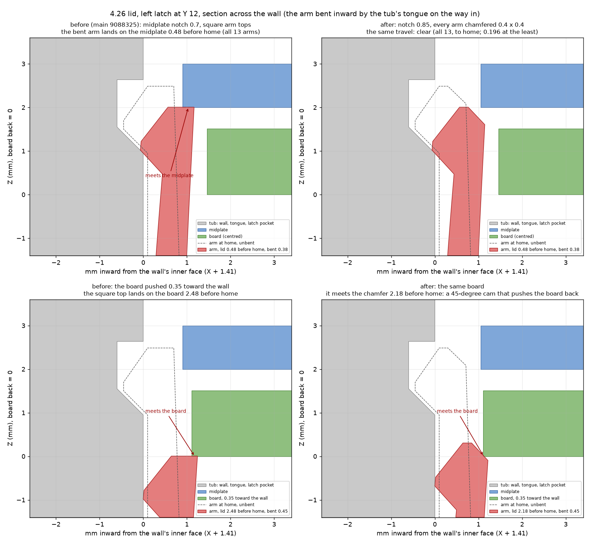
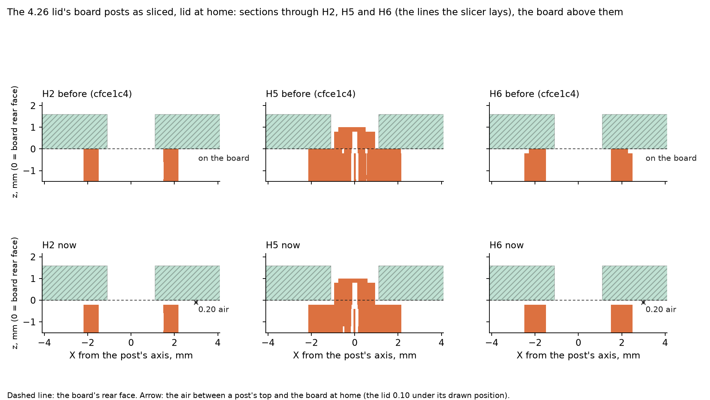

# Silkscreen enclosure

> [!IMPORTANT]
> AI-assisted, not the official Silkscreen enclosure: see the notice at the top of the
> [main README](../../README.md) and https://silkscreenreader.com/ai.

A 3D-printed case for Silkscreen, Ian Chasse's ESP32-S3 e-paper reader board, with its
GDEQ0426T82-FT01C touch and front-light panel and a 503035 LiPo. This file is the single reference
for the design:
- the hardware it wraps, and why that hardware is hard to enclose
- how each mechanism works
- how it is checked
- what each test print taught
- how to work with the code

It gathers what was spread across `src/params.py`'s comments, the module docstrings, each release
zip's README.txt, the showcase page and the working notes. It also takes the board facts from
an earlier audit of the 2026-09-16 board (not in this repo), checked against the current board. Numbers come from the
model's own outputs (`out/*.json`) as of Rev K.

**Status, 2026-09-23: Rev K.** Modelled, checked and partly sliced; not yet printed. Revs E to I
were printed (five prints). **2026-09-26: Rev L's bottom keys** (a bell crank and a sliding key, and a
chin 1 mm deeper) replace Rev K's rockers: modelled and checked; 2026-09-29, after Ian's first full print (the
keys jammed in their openings), the key alone is refit ([Bottom keys](#bottom-keys-rev-l-bell-crank-and-sliding-key)). The showcase, with a 3D viewer, section drawings and the downloads, is
built into the repo's `docs/showcase/` (its data files are generated, not in git; built by
`showcase/gen/adapt_426.py`, see the repo README). **This folder is `enclosures/case-426`**; what it makes to print is in the repo's `print/` folder, and the generic OrcaSlicer
projects the website serves are described in the [top-level README](../../README.md#print-a-case).

**Board parts named in this file.** The board prints its reference designators on its back (H5's on the front). The page keys are SW7
(left, upper), SW5 (left, lower), SW4 (right, upper) and SW1 (right, lower); SW10 is the power button (top of the right
edge) and SW11 the reset button; SW9, SW8, SW3 and SW2 are the bottom-row buttons, left to right (Back, OK, Left,
Right). J1 is the USB-C socket; J2, J3 and J4 the display, frontlight and touch connectors; J5 the battery connector;
J6 the dev header, the board's 12-pin expansion header on its top edge; J7 the microSD socket; U4 the ESP32-S3 module;
H1-H6 the mounting holes (H3 and H4 are the bottom two). Resistors and capacitors are named only where a step needs
them; silkscreen-pcb's README and docs/HARDWARE.md describe every part.

## Builds: 32 configurations from four choices

This project is the main home of the 4.26in case, and builds it from one code base in every combination of four
choices: 32 configurations (2026-10-07; before that six builds: standard and light-strip since 2026-09-26, chinless
and the no-dev-header option since 2026-10-04). Each configuration has one name, its *slug*, and its files go to
`out/<slug>/`.

| Choice | Options (the first is the default) | In the slug | Flag (`params.py`) | What it changes (where) |
|---|---|---|---|---|
| Panel | **touch**: GDEQ0426T82-FT01C, touch and frontlight; **light strip**: the plain GDEY0426T82 with the Silkscreen light strip ([Light-strip variant](#light-strip-variant)) | `standard` / `light-strip` | `LIGHT_STRIP` | the tub only: its window bevel (the light strip keeps Rev K's 45-degree one for now), the raised ceiling over the left border, hold-down and foot pads, wall relief, stop rails, ribbon gap (the pocket's front and left border) |
| Chin | **bottom keys** (4, bell crank; 125.0 mm); **chinless** (117.4 mm) | (the base) / `chinless` | `BOTTOM_KEYS` | the tub below y ~11 and the lid below y ~8 (the H3 / H4 blocks, the grip grooves), the back icon, the case's length; the bottom-key parts |
| Side keys | **all four**; **left pair**; **right pair**; **upper pair** (power on every case) | (none) / `-leftkeys` / `-rightkeys` / `-upperkeys` | `TAB_ROOTS` | per key left out: the tub's slot, nub window and tongue break, and the lid's key with its cut and groove break (the side walls, y 40-113) |
| Dev header | the dev header (J6) **fitted**; **not fitted** | (none) / `-nodev` | `DEV_HEADER` | the top wall of the tub and the lid, and a second top tongue run (y > 112.9) |

The four regions don't overlap, so each choice changes its own region and nothing else; the twin checks ("What the
builds share", below) prove it for every configuration.

```
slug  := base [ '-' sides ] [ '-nodev' ]
base  := standard | light-strip | chinless | light-strip-chinless
sides := leftkeys | rightkeys | upperkeys          (none: all four side keys)
```
- LEFT and RIGHT are as the case is held, screen toward you, top up (CAD +X is the user's right). The page keys:
  the left pair is the upper and lower keys on the left edge (SW7, SW5), the right pair the upper and lower keys on
  the right edge (SW4, SW1); the upper pair is the top key on each side (SW7, SW4).
- The power button (SW10) is on every case: the right edge, at the top. The USB-C port is lower on the same edge, below the right
  pair.
- Each configuration has exactly one slug: the words in this order, at most one side set, `-nodev` last, no aliases
  (`standard-chinless` and `standard-nodev-upperkeys` are refused). `src/variants.py` holds the grammar, the side sets
  and the list of all 32; `src/test_variants.py` tests them.

The four bases:

| Base | Panel | Board | Outside (x × y × z) | Wordmark (on the back since 2026-10-23) | In `print/` (plate of `print/silkscreen-426-plates.3mf`; the CC2 file `print/cc2-local/` has all four builds) |
|---|---|---|---|---|---|
| `standard` | GDEQ0426T82-FT01C, touch and frontlight | as assembled | 68.2 × 125.0 × 12.7 | `LOGO_BACK_WORDMARK` y 4.95, above the grip grooves; the chin is plain | plate 1 (CC2 file: 1): `tub-standard` and the shared parts |
| `light-strip` | plain GDEY0426T82 with the Silkscreen light strip | as assembled | 68.2 × 125.0 × 12.7 | y 4.95 | CC2 file only, plate 2: `tub-light-strip` and the shared parts |
| `chinless` (touch-centric) | GDEQ0426T82-FT01C; touch does OK/Back | **without the bottom-row buttons (SW9, SW8, SW3, SW2)** | **68.2 × 117.4 × 12.7** | **y 12.55**, above the grooves (at y 2 / 4 / 6) | plate 3 (CC2 file: 4): `tub-chinless`, `lid-chinless`, the shared `midplate` |
| `light-strip-chinless` (2026-10-07) | plain GDEY0426T82 with the Silkscreen light strip; no touch | **without the bottom-row buttons (SW9, SW8, SW3, SW2)** | 68.2 × 117.4 × 12.7 | y 12.55 | CC2 file only, plate 5: `tub-light-strip-chinless`, the chinless lid (`lid-chinless`), the shared `midplate` |

These four, with all four side keys and the dev header, are the *print builds*: their files are in the repo's `print/4.26/` and
the plate file. Every configuration, the print builds included, also gets its own OrcaSlicer project,
`out/configs/<slug>.3mf` ("One OrcaSlicer project per configuration", below). Light-strip chinless (Ian, 2026-10-07:
it "is the chinless build" with the light-strip front) has only the page keys and power to navigate with: no touch
and no bottom row ([light-strip-chinless](#light-strip-chinless)).

### The 32 configurations

In the board columns, SW9 SW8 SW3 SW2 are the bottom-row buttons, SW7 and SW5 the left page keys (upper, lower), SW4
and SW1 the right ones, and J6 the dev header.

| # | slug | panel | chin | side keys (as held) | dev header | length | prints the lid of | board must NOT have | may leave off | 3MF (CC2) | plate 1 as sliced (CC2) |
|---|---|---|---|---|---|---|---|---|---|---|---|
| 1 | `standard` | touch | bottom keys | all four | yes | 125.0 | (its own) | - | - | 1.24 MB | 39.6 g, 1 h 41 min |
| 2 | `standard-nodev` | touch | bottom keys | all four | no | 125.0 | (its own) | J6 | - | 1.24 MB | 39.8 g, 1 h 41 min |
| 3 | `standard-leftkeys` | touch | bottom keys | left pair | yes | 125.0 | (its own) | - | SW4 SW1 | 1.23 MB | 39.8 g, 1 h 41 min |
| 4 | `standard-leftkeys-nodev` | touch | bottom keys | left pair | no | 125.0 | (its own) | J6 | SW4 SW1 | 1.23 MB | 40.1 g, 1 h 41 min |
| 5 | `standard-rightkeys` | touch | bottom keys | right pair | yes | 125.0 | (its own) | - | SW7 SW5 | 1.23 MB | 39.9 g, 1 h 40 min |
| 6 | `standard-rightkeys-nodev` | touch | bottom keys | right pair | no | 125.0 | (its own) | J6 | SW7 SW5 | 1.23 MB | 40.1 g, 1 h 41 min |
| 7 | `standard-upperkeys` | touch | bottom keys | upper pair | yes | 125.0 | (its own) | - | SW1 SW5 | 1.22 MB | 39.8 g, 1 h 40 min |
| 8 | `standard-upperkeys-nodev` | touch | bottom keys | upper pair | no | 125.0 | (its own) | J6 | SW1 SW5 | 1.23 MB | 40.1 g, 1 h 41 min |
| 9 | `light-strip` | light strip | bottom keys | all four | yes | 125.0 | `standard` | - | - | 1.24 MB | 39.8 g, 1 h 42 min |
| 10 | `light-strip-nodev` | light strip | bottom keys | all four | no | 125.0 | `standard-nodev` | J6 | - | 1.25 MB | 40.4 g, 1 h 44 min |
| 11 | `light-strip-leftkeys` | light strip | bottom keys | left pair | yes | 125.0 | `standard-leftkeys` | - | SW4 SW1 | 1.23 MB | 39.8 g, 1 h 40 min |
| 12 | `light-strip-leftkeys-nodev` | light strip | bottom keys | left pair | no | 125.0 | `standard-leftkeys-nodev` | J6 | SW4 SW1 | 1.23 MB | 40.3 g, 1 h 42 min |
| 13 | `light-strip-rightkeys` | light strip | bottom keys | right pair | yes | 125.0 | `standard-rightkeys` | - | SW7 SW5 | 1.23 MB | 40.1 g, 1 h 42 min |
| 14 | `light-strip-rightkeys-nodev` | light strip | bottom keys | right pair | no | 125.0 | `standard-rightkeys-nodev` | J6 | SW7 SW5 | 1.23 MB | 40.4 g, 1 h 42 min |
| 15 | `light-strip-upperkeys` | light strip | bottom keys | upper pair | yes | 125.0 | `standard-upperkeys` | - | SW1 SW5 | 1.23 MB | 40.1 g, 1 h 42 min |
| 16 | `light-strip-upperkeys-nodev` | light strip | bottom keys | upper pair | no | 125.0 | `standard-upperkeys-nodev` | J6 | SW1 SW5 | 1.23 MB | 40.3 g, 1 h 42 min |
| 17 | `chinless` | touch | chinless | all four | yes | 117.4 | (its own) | SW9 SW8 SW3 SW2 | - | 0.86 MB | 31.8 g, 1 h 16 min |
| 18 | `chinless-nodev` | touch | chinless | all four | no | 117.4 | (its own) | SW9 SW8 SW3 SW2, J6 | - | 0.86 MB | 32.0 g, 1 h 17 min |
| 19 | `chinless-leftkeys` | touch | chinless | left pair | yes | 117.4 | (its own) | SW9 SW8 SW3 SW2 | SW4 SW1 | 0.85 MB | 31.7 g, 1 h 14 min |
| 20 | `chinless-leftkeys-nodev` | touch | chinless | left pair | no | 117.4 | (its own) | SW9 SW8 SW3 SW2, J6 | SW4 SW1 | 0.84 MB | 32.0 g, 1 h 14 min |
| 21 | `chinless-rightkeys` | touch | chinless | right pair | yes | 117.4 | (its own) | SW9 SW8 SW3 SW2 | SW7 SW5 | 0.84 MB | 31.8 g, 1 h 14 min |
| 22 | `chinless-rightkeys-nodev` | touch | chinless | right pair | no | 117.4 | (its own) | SW9 SW8 SW3 SW2, J6 | SW7 SW5 | 0.84 MB | 32.1 g, 1 h 14 min |
| 23 | `chinless-upperkeys` | touch | chinless | upper pair | yes | 117.4 | (its own) | SW9 SW8 SW3 SW2 | SW1 SW5 | 0.84 MB | 31.8 g, 1 h 14 min |
| 24 | `chinless-upperkeys-nodev` | touch | chinless | upper pair | no | 117.4 | (its own) | SW9 SW8 SW3 SW2, J6 | SW1 SW5 | 0.84 MB | 32.0 g, 1 h 14 min |
| 25 | `light-strip-chinless` | light strip | chinless | all four | yes | 117.4 | `chinless` | SW9 SW8 SW3 SW2 | - | 0.86 MB | 32.0 g, 1 h 18 min |
| 26 | `light-strip-chinless-nodev` | light strip | chinless | all four | no | 117.4 | `chinless-nodev` | SW9 SW8 SW3 SW2, J6 | - | 0.86 MB | 32.3 g, 1 h 18 min |
| 27 | `light-strip-chinless-leftkeys` | light strip | chinless | left pair | yes | 117.4 | `chinless-leftkeys` | SW9 SW8 SW3 SW2 | SW4 SW1 | 0.85 MB | 32.0 g, 1 h 15 min |
| 28 | `light-strip-chinless-leftkeys-nodev` | light strip | chinless | left pair | no | 117.4 | `chinless-leftkeys-nodev` | SW9 SW8 SW3 SW2, J6 | SW4 SW1 | 0.85 MB | 32.2 g, 1 h 15 min |
| 29 | `light-strip-chinless-rightkeys` | light strip | chinless | right pair | yes | 117.4 | `chinless-rightkeys` | SW9 SW8 SW3 SW2 | SW7 SW5 | 0.84 MB | 32.1 g, 1 h 15 min |
| 30 | `light-strip-chinless-rightkeys-nodev` | light strip | chinless | right pair | no | 117.4 | `chinless-rightkeys-nodev` | SW9 SW8 SW3 SW2, J6 | SW7 SW5 | 0.85 MB | 32.3 g, 1 h 15 min |
| 31 | `light-strip-chinless-upperkeys` | light strip | chinless | upper pair | yes | 117.4 | `chinless-upperkeys` | SW9 SW8 SW3 SW2 | SW1 SW5 | 0.85 MB | 32.0 g, 1 h 15 min |
| 32 | `light-strip-chinless-upperkeys-nodev` | light strip | chinless | upper pair | no | 117.4 | `chinless-upperkeys-nodev` | SW9 SW8 SW3 SW2, J6 | SW1 SW5 | 0.85 MB | 32.3 g, 1 h 15 min |

- **prints the lid of:** the lid never depends on the panel, so a light-strip configuration prints its touch twin's
  lid (the share check asserts it byte for byte). 32 tubs and 16 lids in all.
- **board must NOT have:** a hard rule; the case does not close over these. Chinless: the four bottom switches hang
  1.92 mm past the board's bottom edge, into the chin wall. `-nodev`: the lid's lip runs through the dev header's body.
- **may leave off:** the switches of the side keys the layout leaves out ([Side-key layouts](#side-key-layouts--leftkeys--rightkeys--upperkeys-any-base)),
  with their ladder resistors. A saving, not a rule: every layout is checked with all five side switches fitted, so
  a fully populated board (Ian's Rev 1.0 and 1.01 boards) fits every configuration.
- **3MF, plate 1 as sliced (CC2):** the configuration's OrcaSlicer project with the Elegoo CC2 presets
  (`out/configs-cc2/<slug>.3mf`) and its plate 1 as the OrcaSlicer CLI slices it (2026-10-07; grams vary by about
  ±0.3 g from one slice to the next). With bottom keys a second plate holds 4 crank-M for APEM MJTP1117 boards
  (0.71 g, 5 min). The generic projects the website serves (`out/configs/<slug>.3mf`, 2026-10-11) are the same size
  to within 1 % and slice to about 41 g (bottom keys) and 33 g (chinless); their time is the user's printer
  profile's (Orca's generic Marlin profile, at its cautious speeds: 3 h 18-24 min and 2 h 26-32 min).

**Board population per choice** (the group names are the site builder's BOM groups):

| Choice | Option | Must be fitted | Must NOT be fitted | Notes |
|---|---|---|---|---|
| Panel | touch (FT01C) | the touch group (J4 U7 R42 R44 R46 R52), the frontlight group and J3 | | |
| Panel | light strip | the frontlight group and J3 (the strip's tail plugs into J3) | | the touch group is not used |
| Chin | bottom keys | SW9 SW8 SW3 SW2 with R60 R18 R19 R20 R4 C27 | | light strip only: trim the Back button's (SW9's) left lug lead to Z 1.7 and cover it with Kapton ([Fitting the strip](#fitting-the-strip)) |
| Chin | chinless | | **SW9 SW8 SW3 SW2** | keep **R4** (IO1's pull-up), or the firmware must ignore IO1 |
| Dev header | J6 | J6 (with U8 CR2 CR3 F2 R65 R68 R69) | | |
| Dev header | no J6 | | **J6** | so no light attachment |
| Side keys | any layout | the layout's switches with their ladder resistors (SW1 + R61, SW4 + R11, SW5 + R35, SW7 + R36 + R73), and R28 C28 | | the left-out switches may stay fitted; SW10 (with R62 R76) and SW11 are on every board |

Light-strip chinless is the light-strip population plus the chinless one; no new rule.

### Building one configuration, or all of them

Run from this folder with a Python 3.11 virtual environment made from `requirements.txt`. This folder has no `.venv`
of its own; the 3.68 project's works too.

```powershell
python -B src/pipeline.py                     # all 32: every build and check, print/4.26/, the plate files and the
                                              # 32 OrcaSlicer projects (about 1 h from nothing, about 80 s when
                                              # nothing changed; "The pipeline and its cache", below)
python -B src/pipeline.py --builds six        # the six builds of before the variants, plus the print builds
                                              # (22-27 min cold at the old 6 jobs)
python -B src/pipeline.py --builds print      # the four print builds: print/4.26/ and the plate file
python -B src/pipeline.py --builds chinless-upperkeys-nodev   # one configuration, with the twins its checks compare with
python -B src/build.py                        # the four print builds' parts and checks, the shared-part checks,
                                              # then ../../print/4.26/ (through the pipeline: --steps build)
python -B src/build.py --only standard-nodev,chinless-nodev   # any other builds, side by side; print/4.26/ untouched
foreach ($v in 'standard', 'light-strip', 'chinless', 'light-strip-chinless') {
    $env:SILKSCREEN_VARIANT = $v              # every other script makes the one build named here (unset: light-strip)
    python -B src/mechanics.py; python -B src/dummy.py; python -B src/plates.py
}
Remove-Item Env:SILKSCREEN_VARIANT            # before build.py again, or it builds only that one
cd ..; python -B make_plates.py               # the plate file, from the four print builds' out/<build>/print/
python -B make_plates.py configs --builds standard,chinless-upperkeys   # their OrcaSlicer projects -> out/configs/
                                              # (generic; --printer cc2: the Elegoo CC2 ones -> out/configs-cc2/)
```

**One configuration:** `pipeline.py --builds <slug>` builds and checks it, runs its `mechanics.py`, `dummy.py`,
`plates.py` and `slice_check.py`, and writes and slices its OrcaSlicer project, `out/configs/<slug>.3mf`. It also
builds its twins (the same configuration with one choice at its default), as builds only, because its checks compare
with them: from none (`standard`) to 11 others. In the full cold run of 2026-10-10 (up to 12 CPU weights at once) a
build step took 5-6 minutes for a chinless touch case, 7-17 for a light-strip chinless one, 12-18 for a keyed touch
case and 19-29 for a keyed light strip; `mechanics.py` 2-12 more for the four print builds, and 20-50 s for the
others, which take its slow entries from them ("Shares", below). A configuration that is in the cache comes back in
seconds.

**All of them:** `pipeline.py` with no `--builds`. A configuration's print file is then `out/configs/<slug>.3mf` in
this folder (build output, not in git).

`SILKSCREEN_VARIANT` names a configuration by its slug, and its files go to `out/<slug>/` (unset: `light-strip`).
Examples: `chinless`, `standard-nodev`, `light-strip-chinless-upperkeys-nodev`.

What each script does with it:
- `src/build.py` with no variant set builds the four print builds (`params.PRINT_BUILDS`), one process each, into
  `out/standard/`, `out/light-strip/`, `out/chinless/` and `out/light-strip-chinless/` (logs in
  `out/<build>/build.log`). It then runs each build's own checks, asserts the shared parts and rewrites the repo's
  `print/4.26/` (with the case-368 crank check). Every configuration runs the common checks (insertion, later
  moves, the lid closing (`lid-close.json`), interference, mesh interference), and by choice:
  - **light strip:** the plain panel and the strip in the FT01C's place, and `strip_check`
    (`out/<build>/light-strip.json`).
  - **bottom keys:** `bottom_keys_check` (`bottom-keys.json`); **chinless:** `chin_check` (`chin.json`, below).
  - **a side-key layout:** `sides_check` (`sides.json`, below).
  - **`-nodev`:** `header_closed_check` (`header.json`, below).
- `build.write_print` writes exactly its declared list (`PRINT_JOBS`). It refuses a run that did not build every
  print build.
- A single build (`SILKSCREEN_VARIANT` set), or `--only a,b` (side by side), never touches `print/4.26/`.
- Every other script builds or reads the build named by `SILKSCREEN_VARIANT` and writes to
  `out/<slug>/`. That covers `mechanics.py`, `dummy.py`, `plates.py`, `slice_check.py`,
  `strip_sections.py` and the rest. Where the rest of this file says `out/...`, read
  `out/standard/...` for Rev K and `out/light-strip/...` for the light-strip build.

### The pipeline and its cache (`src/pipeline.py`, `src/cache.py`)

`python -B src/pipeline.py` runs the whole 4.26 pipeline: every configuration (all 32, `src/variants.py`;
`build.py`'s child for each), then for each build `mechanics.py`, `dummy.py`, `plates.py` and `slice_check.py`, then
`build.py --finish` (the shared-part and share checks, `print/4.26/`, the cross-project crank check),
`../make_plates.py`, and one OrcaSlicer project per configuration with its read-back slice (`../make_plates.py
configs`, `src/configs_slice.py`: "One OrcaSlicer project per configuration", below). All 32 took 58 minutes cold
(`--no-cache`, 2026-10-10, the defaults: 197 steps, CPU weights of at most 12 at once, up to 14 steps; 18.7 GB of
commit charge free at its start, and with less free fewer steps run at once; the pipeline's processes peaked at
6.7 GB of private memory together, and every file came out byte for byte as before), against 2 h 12 min before the
scheduler and the shares below (2026-10-07, 6 jobs; 20.7 GB). The steps' times add up to 10 h 3 min: the 32 builds
7 h 39 min, `slice_check.py` 42 min, `mechanics.py` 39, `dummy.py` 30, the share guards 24, `plates.py` 5. The six
builds of before the variants (`--builds six`) took 22-27 minutes at the old 6 jobs. A run where nothing changed
takes about 80 seconds (78 and 79 s, 2026-10-10): the 192 cached steps are restored in about 10 s, then the five
uncached steps run mostly one after another (`build.py --finish` for the print builds, with `print/4.26/`, 15 s; the
plate files 8; the other builds' share checks 9; the 32 projects 17 and their slices 22). Options:
- `--builds a,b` and `--steps build,mechanics,dummy,plates,slice`: run only part of it. `--builds` takes slugs and
  the presets `all` (the default), `six` (the six builds of before the variants, plus any print build not among
  them, so `print/4.26/` is always made) and `print`, in any mix. A step brings the steps whose files it reads, so a
  build always runs or is restored before its scripts; and a build brings its twins (the same configuration with one
  axis at its default: `variants.twins`), as builds only, because its checks compare with them. A twin proof never
  skips: if the twin is not built, it fails. So one derived configuration can bring up to 11 others; the presets
  bring none.
- `--quick`: for iterating (below).
- `--no-cache`: run every step again and store the results. Its memos are computed once in the run (every build
  that slices a shared part gets the same OrcaSlicer G-code of it, as in a cached run). `--verify`: rerun every
  cached step and fail if one gives different files (a determinism spot check).
- `--why`: for each step that runs, the inputs that changed since its last run (or, when its key is in the cache,
  why it runs anyway: `--verify`, `--no-cache`, a missing blob). `--dry-run`: list, run nothing.
- `--cpu N` (default: the physical cores, 12 here; `--jobs N` is its old name) and `--mem-floor GB` (default 8): the
  scheduler (2026-10-08). Every step that starts a process waits until the CPU weights of the running steps stay
  within N (a build, mechanics, dummy or guard step counts 1, the slicing and plate steps 0.5) and the free commit
  charge, less what the running steps may still take and its own estimate, stays above the floor + 0.5 GB (a step
  that would run alone: above the floor, so it waits while other programs leave less). Other programs' memory counts:
  the free commit charge is read live. The estimates are each step's own measured peaks (every step runs in a Windows
  job object, `src/jobs.py`; they are kept in its cache entry and `out/.cache/stats.json`, written as each step
  passes; a failed step or a `--quick` build records nothing; a `mechanics` step counts only the runs of the same script,
  `mechanics.py` or `mechanics_share.py`; an uncached step, whose cost depends on what its memos hold, is never
  estimated under the defaults). The share guards start first (they are short; a build that reaches a shared check
  before they have passed runs the check itself), then the step with the longest chain after it, and behind one that
  does not fit only short steps start. If
  the free commit charge still stays under the floor for 20 s (other programs grew: in the cold run of 2026-10-10
  they took 5 GB more within half an hour and left 7.5 GB free for a minute), the pipeline ends the youngest of its
  own steps that nothing waits on and that still holds memory, and runs it again later; it never touches another
  process. Throughput levels off at about the physical cores: 12 steps do about 1.5 times the
  work of 6.
- `--blas default`: by default every step runs with `OPENBLAS_NUM_THREADS=1`. OpenBLAS otherwise commits buffers for
  all 24 threads when numpy loads, about 2 GB per step instead of 0.4-1.3 GB, for the same CPU time and the same
  files. The setting is part of every step's key.
- `--unshared`: no shares (below): every build runs every check and `mechanics.py` itself. With `--verify` it is
  the audit of the shares: each build must give exactly the files of its cache entry, the shared reports included
  (a build's key is the same shared or not), and each `mechanics.json` that `mechanics.py` makes for a build whose
  mechanics the shares compose must equal the one `mechanics_share.py` made from the same inputs (the cache entries
  of the same parts, code, environment and owners' files; a build with none is named as not audited).
- `--prune N` (default 3): after a run that passed, keep each step's N most recently made or used cache entries and
  the blobs and memo files they name, and the other memo entries made or used in the last 14 days
  (`cache.MEMO_DAYS`; `cache.py prune --keep N` goes by the memos' dates alone); `--prune 0` never prunes.
- `--configs no`: no per-configuration projects (by default they are made for the builds asked for whenever their
  plates are).
- After `--`: arguments for the build children (for example `-- --no-check`).

A run that slices first checks the longest G-code path it would write (`out/<build>/slice/coupon-chin/plate_1.gcode`
for its longest build name, and `out/configs/slice/<slug>/plate_2.gcode`): OrcaSlicer cannot write one of 244
characters or more (it exits -100, which reads like a slicing error; measured: 243 works, 244 fails, since Orca
post-processes into `<path>.tmp.postprocess`), so a checkout that deep stops at once and says by how much to shorten
its path. Here the longest is 174 (`configs_slice.py` checks its own too: 170).

`build.py` with no variant set, and `build.py --only a,b`, run their builds through the pipeline (`--steps build`),
so they use the cache too; `build.py --no-cache` passes the flag on. A single build (`SILKSCREEN_VARIANT` set) and the
other scripts run directly, as before.

**Shares (2026-10-08).** A check whose inputs are the same in two builds runs once:
- The strip check (`light-strip.json`) and the bottom keys' (`bottom-keys.json`). A guard step per build
  (`src/guard.py`, cached like any step, after the build's parts) writes `out/.share/<build>.json`: the STL triangles
  within the regions each check reads (as a set: their order in the file is left out) and, for the strip check's
  booleans, whether each whole mesh is a closed volume; the face signatures of the solids in the regions it crops,
  the hardware near them, and every `params.py` value its code can reach (`src/deps.py`; `hw.DNP`, which `params.py`
  sets, is covered by the hardware lists). At each run the guard reads some of the checks' own crops from their
  code (strip_check's crops of the tub, the key shadows' clip, gate_check's clipped sections, the key-hook shadows)
  and stops if one leaves its region; the other regions (the chin box, strip_check's mesh margins and shifts, the
  key hooks' x-z clip) are numbers copied from the checks, so after editing strip_check, gate_check, key_hooks or the
  bottom-key code run `pipeline.py --unshared --verify` once (below). When a build child reaches the check it asks
  the pipeline.
  The first build it derives from (its slug with axes set back to their defaults) whose guard is the same is the
  source: the child leaves the check out, and the pipeline copies that build's report once both have ended. The
  build's cache entry is then the same as if it had run the check. In a full run 8 of the 16 strip checks and 8 to
  10 of the 16 bottom-keys checks are taken this way (10 have a matching guard; in the cold run of 2026-10-10 two
  builds reached the check before their candidate's guard had passed, and ran it themselves).
- `mechanics.py`: the four print builds run it. Every other build whose side-key and key-slot guards match theirs
  runs `src/mechanics_share.py`, which takes the slow sweeps from them and computes everything else as
  `mechanics.py` does (20-50 s instead of 2-12 min).
- Leaving a check out changes no other file of the build. Every shared report and composed `mechanics.json` is
  byte-identical to the one the build makes itself: all 32 compared, and `--unshared --verify` on four builds
  (2026-10-10; their composed `mechanics.json` compared by hand, and standard-nodev's since by the audit itself).
- Also exact, and not a share: `build.later_moves` sweeps each moving part against the fixed part cut down to the
  space the mover passes through (the lid to the part's raised box). The report is the same, in 61-101 s instead of
  183-536 s per build.

**What is cached, and when it is used.** A *step* is one of the processes the README's flow always ran: one
script for one build. It runs exactly as before (the same code, in the same order, on the same inputs, in a fresh
process), so its files are a function of its inputs. Every exact output came out the same in three runs. A step
is skipped when the cache has a run with the same *key*, and its files are restored byte for byte. The key is a
sha256 over:
- the source of every `src/` module the script imports, found by reading its imports (inside functions too).
  `params.py` is one of them, so **any parameter edit reruns every step**. A comment in `lid.py` reruns the steps
  that import it (every build, mechanics and slice_check), but not dummy.py or plates.py;
- every file in `hardware/` (but the ones the board tools regenerate and no step reads: `board.stl`,
  `mechanical.json`, `step-export.log`);
- the build's name and arguments, the Python and every installed package's version, the CPU, the project's path;
- the files it reads from the steps before it: a build's parts (for mechanics, dummy and plates), dummy's files (for
  plates), plates' files (for slice_check), each by content (a STEP without its export time); for slice_check also
  the OrcaSlicer executable and every profile file's size and date;
- for a chinless build, its keyed twin's `tub.step` and `lid.step` (the same configuration with bottom keys), which
  `chin_check` compares with; for a side-key layout, its all-keys twin's (`pipeline.cross_reads`). The build waits for
  those parts (the twin is always in the run).

Restoring copies only files that differ from the entry, removes the files the step deleted, and removes the files
the step's previous run owned but this one does not make. A step that did not exit 0 is never stored, so a killed run
is simply run again. Each step runs under `src/_step.py`, which records every file the process reads, lists and
writes: a read of anything outside its key, or a write outside its own files, fails the run and nothing is stored.
So a new input (mechanics.py reading `insertion.json`, say) is caught the first time it runs instead of going stale.
`_step.py`'s docstring lists what it can and cannot see. A step whose inputs change while it runs (any file of its key
whose size or date moved, so even an edit undone before it ends) is not stored either. The code and `hardware/`'s
small files are hashed on every run; only big files (the parts, `board.step`) are trusted by size and date
(`out/.cache/stat.json`; `--rehash` ignores it). The uncached steps always run: `build.py --finish` (for all 32,
finish-default 15-30 s; finish-only 9-25 s, through `src/finish_step.py`, which memoises each share claim by the
bytes of the files it compares) and `make_plates.py` (the plate files, 8-15 s) read case-368 and the git-tracked
`print/`. So do the per-configuration projects (`configs`, 17-24 s for all 32; `configs-slice`, about 22 s when
every slice is memoised, about 2.5 minutes when they all slice): `make_plates.py` lives outside `src/` and
reads the installed Orca profiles, which a key would miss, and `configs-slice`'s OrcaSlicer runs are memoised by each
file's bytes.

**Memos inside the steps** (`cache.memo`), shared by every build and script:
- *OrcaSlicer* (`cache.orca_run`): keyed by the STL's and the flattened presets' bytes, the command and the
  executable. A failed slice is never stored. At most two slices run at once, each in its own working folder. Since
  Orca's G-code differs from run to run, a cached slice also makes slice_check's output repeatable.
- *The Orca preset index* (`slice_check.index`, 4-120 s): keyed by every profile file's size and date.

**The store**, `out/.cache/`: `blobs/` (file bodies, by hash: a part that is the same in two builds is stored once),
`steps/` (one JSON per run: its key's parts, its files), `memo/`, `logs/` (each script step's console output; a
build's stays in `out/<build>/build.log`, with a line added when it is restored, and left alone when it already holds
that run's log), `runs/` (each run's step times).
`python -B src/cache.py stats` shows its size, `prune --keep 3` keeps each step's three most recently made or used
runs (a restore dates its run anew) and the blobs they name, and the memo entries made or served in the last 14 days
(`--memo-days D`; a hit dates its entry anew); it will not run while a `pipeline.py` runs in the checkout. `clear`
empties it.
Each step entry also names the memo files its run read or made (`memos`: a slice step's OrcaSlicer runs and the
preset index; since 2026-10-08), wherever the memo folder is (`_step.py` also records the cache and memo folders that
`SILKSCREEN_CACHE` or `SILKSCREEN_MEMO` puts outside the checkout). The pipeline dates them anew whenever it finds
the entry, and its prune after a run first dates those of every entry it keeps (`pipeline.keep_memos`), so the 14-day
memo prune never drops a G-code that a kept slice entry holds: `--verify` replays it. Without the memo a rerun slices
again, and a real OrcaSlicer G-code always differs (its header has the time), so `--verify` would fail.
`cache.py prune` by hand goes by the dates alone, and so does another checkout's prune of a shared memo folder (it
dates only what its own entries name): the pipeline then logs each entry whose memos are gone, and its build needs a
run with `--no-cache` (a new entry, new memos) before a `--verify`. A `--verify` first would slice again, fail, and
store new memos under the old names; from then on every `--verify` of that step fails until the `--no-cache` run.
`SILKSCREEN_CACHE=<dir>` moves it, and `SILKSCREEN_MEMO=<dir>` shares the memos between checkouts.
`SILKSCREEN_CACHE_MODE=off` turns every cache off (the scripts then run exactly as before it, and pipeline.py runs
every step and stores nothing); `refresh` computes everything and stores it, as `--no-cache` does.

**`--quick`, for iterating.** The builds write their parts exactly as in a full run (the same bytes), then run only
the checks that read a part that changed since this build's last full run. `pipeline.CHECK_PARTS` lists each check's
parts. Every check runs when `build.py`, `mechanics.py`, `refs.py`, `panel.py` or the hardware
changed. `--checks interference,strip` (or `none`) names them instead (`build.CHECKS`). By default a quick run makes
only the builds; `--steps` adds the scripts, which are cached and exact as in a full run, since they read only parts.
Three things to know:
- A quick build's check reports can differ from a full run's in a last digit: a check sees what the checks before it
  did to the shapes, and some of those were skipped.
- A check that reads a parameter but no changed part (a tolerance, say) is not rerun: name it with `--checks`.
- The lid is in nearly every check, so a lid change reruns nearly all of them. `--quick --checks none` (the parts
  alone) is the fast loop there.

A quick build is never stored. It is listed in `out/.cache/quick.json` until a full run, and print/ is not written.
The full run is the final pass.

### standard and light-strip

- **standard**: Rev K as released, for the GDEQ0426T82-FT01C touch and frontlight panel, with Rev L's bottom keys.
- **light-strip**: for the plain GDEY0426T82 with the Silkscreen light strip on its left border
  ([Light-strip variant](#light-strip-variant)).

**Shared:** the lid (with its five side keys), the midplate, the bottom keys (`key-426`) and their
cranks are the same parts in both builds. **Only the tub differs**, so a light-strip owner prints one
extra part.
`build.py` checks this whenever it builds both, and stops if it fails: each shared part's STL must be
byte-identical in both builds (or its STEP must have the same volume and no boolean difference). The
result is in `out/shared-parts.json`.

**What differs (the tub only):** the light-strip tub adds panel stops and hold-down pads. It raises
the ceiling over the left border, cuts a relief into the left wall, and removes the step wall along
the bar. Its window is Rev K's, with the left bevel 0.2, and its ribbon gap starts at X 7.7. Each is gated on
`P.LIGHT_STRIP` in `tub.py`, with its numbers in `params.py`'s light-strip block. The standard tub is
Rev K's but for its screen window: since 2026-10-10 a 35-degree bevel, 1.285 mm wide on the face, with round corners
([5.3](#53-outline-and-the-side-wall), "Screen window"). Until then, rebuilt here, it had no boolean difference from
the original project's `out/tub.step`. The light-strip builds keep Rev K's window for now (Ian, 2026-10-10: "leave
all light strip builds alone"), so their tubs are byte for byte as before.

### chinless (touch-centric)

> **The chinless case needs a board WITHOUT the four bottom switches (SW9, SW8, SW3, SW2) fitted.** They hang
> 1.92 mm past the board's bottom edge, through where the short chin's wall now is: each one would overlap the tub by
> 5.4 mm3 (`out/chinless/chin.json`, "DNP"), and the case would not close over them. Order the board with the bottom
> row off (the builder's "Bottom-row buttons (x4) + ladder" group), or remove them before fitting. It uses the FT01C
> touch panel (the standard tub's panel stack).

The standard build's FT01C touch panel with **no bottom keys**, and the shortest safe chin.
- **The chin: 68.2 × 117.4 × 12.7 mm outside** (standard: 125.0, so 7.6 shorter). The chin wall's inner face is at
  y -0.6 (`BOT_IN`; the keyed builds' is -8.2) and its outside at y -1.8 (`Y0`; keyed -9.4). That leaves 0.60 to
  the board's bottom edge, 0.40 with the board 0.2 toward it (the tub-to-board play), and 0.20 with the routed
  outline's ±0.2 on top (the same with the board ±0.2 in X). That is 0.15 more than the keyed tub's rail face, which
  stands 0.45 off the board's edge and has been printed and assembled. -0.4 would leave 0.0 at the worst stack, so
  -0.6 is as short as it safely goes.
- **The wordmark** is on the back since 2026-10-23, like every build's: `LOGO_BACK_WORDMARK` y 12.55 (ink y 9.00-16.11), above
  its grip grooves (at y 2 / 4 / 6, a groove's top edge at 6.4), and the chin face is plain. The back icon follows the
  case's centre (y 56.9, was 53.1), 44 mm above the wordmark's centre (31 mm clear of its ink). (Until then the wordmark was engraved on the face below the
  window, centred: `LOGO` y 6.605, computed from the 35-degree bevel; the light-strip chinless builds' y 6.95.)
- No keys, cranks, rod, gate, rail, key openings, hook slots or rim relief: the rim is square along the chin (there is no seam V since 2026-10-23). It
  needs no rod, no gate, no coupons and no `ROD.txt` steps. The five side keys are part of the lid, as in every build.
- **Prints:** plate 3 "Chinless case" of `print/silkscreen-426-plates.3mf` (plate 4 of the CC2 file): `print/4.26/tub-chinless`,
  `lid-chinless` (its side keys get the same supports as on the standard case) and the shared `midplate`. The
  OrcaSlicer CLI slices the plate in about 1 h 16 min (31.8 g), with supports only under the lid's five side-key
  hinges.
- What changes from the standard tub and lid (everything else is the same: `chin.json` compares the tub above y 11
  and the lid away from the chin and the back icon with the standard build's, 0.0 mm3 apart):
  - The side tongues start at y 2.4 (`TONGUE_RUNS`: `BOT_IN` + 3.0, the keyed corner's distance from the lid's
    R3.8 tray corner; the least is `BOT_IN` + 2.13).
  - The lid's Ø6 H3/H4 bosses would stand 0.6 from the chin wall, a slot narrower than two lines, so each runs into
    the wall as a 6 mm wide block of its own height. The screws' holes and counterbores are unchanged; their
    counterbores' wall to the back's edge round is 0.7 at the bed plane, 1.35 at the first layer's mid-plane and 2.7
    at their ceiling (the top screw's counterbore already runs into its round, and prints).
  - The grip grooves keep their distance from the bottom edge: y 2, 4 and 6, 2.15 clear of the counterbores.
- Every bottom-key feature is gated on `P.BOTTOM_KEYS`, and `chin_check` proves each one absent, the lid's blocks and
  grooves present, the logo centred and the board's clearance (`out/chinless/chin.json`). `slice_check.py` reads the
  sliced tub and lid back: chin wall, skin, empty cavity; the lid's blocks and grooves; and neither needs a support
  over the chin.
- Assembly: as the standard build, without the bottom keys' steps (keys, cranks, rod, gate).

### light-strip-chinless

The chinless chin with the light strip's front: the plain GDEY0426T82 panel and the Silkscreen light strip as in the
[light-strip build](#light-strip-variant), no bottom keys, 117.4 mm. Nothing new in it: its tub is the light-strip
tub's front and the chinless tub's chin (`chin_check` compares it with its keyed twin, `light-strip`, and
`strip_check` gives the keyed light strip's numbers without the SW9 rows), and it prints the chinless lid (the lid
never depends on the panel; the share check asserts the lid, the side keys and the midplate equal to `chinless`'s).
- **Board:** as chinless, **without the bottom-row buttons (SW9, SW8, SW3, SW2)**; keep R4 (IO1's pull-up), or tell
  the firmware it is chinless. No Back-button (SW9) lead to trim (the keyed light strip's fitting step).
- **Navigation:** the page keys and power only (no touch, no bottom row).
- **Prints:** plate 5 "Light-strip chinless case" of the author's CC2 plate file only (`print/cc2-local/`, not in git; the public file has no light-strip builds):
  `print/4.26/tub-light-strip-chinless`, `lid-chinless` (its side keys' supports as on the other cases) and the
  shared `midplate`.
- **Showcase:** the fourth 4.26 build, "Light-strip chinless" (`lc`, 2026-10-07), in the page built in
  `docs/showcase/` (the published page gets it when it is next republished): its tub, the chinless lid, the plain
  panel and the strip, and the strip card in place (no SW9 lead, no bottom-key step). The zip carries its tub's STL;
  the STEP stays in `print/4.26/` (with it the page's 4.26 model file would pass 16 MB).

### -nodev: no dev header (any base and layout)

**The dev header (J6, the board's expansion header) NOT fitted.** The header's opening in the tub's and the lid's top wall is closed, and a second
top tongue run (43.4-58.7, the first one mirrored) closes the joint to the right corner.
- The lid's new lip there passes through a fitted header's body (13.8 mm3), so the board must not have it. That also
  means no light attachment.
- `header_closed_check` proves the wall closed and the run there (`out/<build>/header.json`). All 16 -nodev
  configurations build and pass it (10 of 10 rows each).
- **The top screw's counterbore (2026-10-07):** the sliced nodev lid had a 0.151 mm2 piece printing in mid-air beside
  it (z 2.0 as printed, CAD x 42.5, y 113.1): the 0.4 mm side of its boss that J6's cut removes on the dev lid. On a
  nodev lid the boss's Ø6.2 wall now runs full round there and on into the end of the lip's second top run (x 43.4),
  1.0 thick (1.1 mm3 more, inside the lid). `slice_check.py`'s `top_no_support` reads the counterbore too: nothing
  floating there, on every nodev lid.
- **No print files** in `print/`: each -nodev configuration has its OrcaSlicer project in `out/configs/` (build
  output, not in git: "One OrcaSlicer project per configuration", in "What the builds share"). Without J6 the
  next-deepest part under the lid is J5 (z -4.935), so the lid could be at most 0.2 mm thinner (12.7 to 12.5 mm),
  which would un-share the side keys: not done.

### Side-key layouts: -leftkeys, -rightkeys, -upperkeys (any base)

Since Rev J each side key is part of the lid's wall, with a slot and a nub window for it in the tub. A key the layout
leaves out is the plain wall in both halves: nothing to see, nothing extra to print, no supports. Its switch may stay
fitted (it stays in the hardware model, and the lid's lip still ducks under it: `joint.switch_spans`), so every board
fits every layout. The power button (SW10, the right edge's top key) is on every case.

| Layout (slug) | Keys besides power, as held | Left out (plain wall) | With bottom keys | Chinless | GPIO wake from deep sleep |
|---|---|---|---|---|---|
| all four (none) | left: SW7 up, SW5 down; right: SW4 up, SW1 down | - | 4 bottom + 4 page + power | 4 page + power | SW2 (keyed only), SW1, power |
| left pair (`-leftkeys`) | left: SW7 up, SW5 down | SW4, SW1 | 4 bottom + 2 page + power | 2 page + power | SW2 (keyed only), power |
| right pair (`-rightkeys`) | right: SW4 up, SW1 down | SW7, SW5 | 4 bottom + 2 page + power | 2 page + power | SW2 (keyed only), SW1, power |
| upper pair (`-upperkeys`) | SW7 (left), SW4 (right) | SW5, SW1 | 4 bottom + 2 page + power | 2 page + power | SW2 (keyed only), power |

- **The board:** fit the layout's switches (with their ladder resistors: SW1 + R61, SW4 + R11, SW5 + R35, SW7 + R36
  + R73); the left-out ones may stay. R73 (the UP(2)-as-power strap) goes with SW7, so a right-pair board without SW7
  has none.
- **Firmware** (outside the case): today it maps SW4 and SW7 to up and SW1 and SW5 to down. The upper pair keeps two
  "up" keys, so it needs a map of its own, for example right upper = next page and left upper = previous. The IO4
  ladder tells the two apart, but both pressed together read like SW4 alone, so the pair can't be a chord. Only SW2,
  SW1 and power give a valid GPIO wake level (silkscreen-pcb docs/HARDWARE.md 9.1), so a chinless case with the left
  or the upper pair wakes on power only.
- The 13 latches stay where they are in every layout. Each kept key, and its cut in the lid, is the same as in the
  all-four case (the share check compares the kept keys' files); a layout only closes walls.
- `sides_check` (`out/<build>/sides.json`, asserted; only for a layout that leaves keys out) proves, per left-out key:
  the tub's slot and the sliver over the nub window solid, the tongue one run across the window, and the tub's and the
  lid body's wall over the key equal to the plain wall (the wall's section at y 32 / 29 extruded over the key's span);
  the tub and the printed lid equal to the all-keys twin's away from the left-out keys (by their faces: OCC's cut of
  two identical shapes can come back as the whole shape), the tub only gaining over them; no key part or file, and
  the printed lid = the lid body + the kept keys; the fitted switch's plunger at least 0.40 from the closed wall (0.20
  with the board 0.10 toward it and the face 0.075 proud; measured 0.4375-0.4875 and 0.26-0.31), the switch at least
  0.5 from the lid (0.91-0.96; 0.29 if the lip stood full height under it), and the lip ducking at every side switch.
  All 24 side-key configurations pass it (30 of 30 rows each). To repeat the comparison by hand, compare the STEPs'
  faces too: the lid STLs of two layouts differ by mesh facets even where the solid is the same (the back edge's
  round is one face when a key is left out, so its triangles lie differently: sections differ by up to about
  0.001 mm2, and 0.02 mm2 over a long window).
- `slice_check.py` reads the sliced tub and lid back over each closed wall: nothing floating, and no layer reaching
  further past the one below than over a plain stretch of the same wall (`side_wall_no_support`).
- The side-key details later in this file (the roots, the feel table, the tape advice) hold for the keys your layout
  has; a kept key is the same part in every layout.

### What the builds share

Every configuration is checked against its **twins**: the same configuration with one choice at its default
(`variants.twins`: panel touch, bottom keys, all four side keys, J6). Per choice that is not the default:

| Choice | Its twin | Must be the same files |
|---|---|---|
| light strip | the touch twin (`light-strip-chinless-leftkeys` -> `chinless-leftkeys`) | every part but the tub: the lid, the lid body, the side keys, the midplate and the bottom-key parts. So 16 lids serve all 32 |
| chinless | the bottom-key twin (`chinless-nodev` -> `standard-nodev`) | the midplate and the side keys (`chin_check` also compares the tub above y 11 and the lid away from the chin) |
| a side-key layout | the all-four twin (`standard-upperkeys` -> `standard`) | every part but the tub, the lid and the lid body: the side keys it keeps, the midplate and the bottom-key parts, both coupons included (`sides_check` compares the tub and lid away from the left-out keys) |
| `-nodev` | the J6 twin (`chinless-nodev` -> `chinless`) | every part but the tub, the lid and the lid body (`header_closed_check` proves the top wall closed) |

- `out/<build>/shared.json` holds one of these claims, as before the variants: the twin on the slug's last word
  (`<x>-nodev` -> `<x>`, `<x>-<side set>` -> `<x>`, `light-strip-chinless` -> `chinless`, `chinless` -> `standard`).
  `standard` and `light-strip` have none; their rule (every part but the tub the same) is `out/shared-parts.json`.
- `out/shares-all.json` holds every claim of every configuration in the run, asserted (`build.py --finish`). A print
  build asked for without the rest of the print set (`--builds light-strip-chinless`, say) gets its claims checked in
  `finish-only`; with the whole set, `finish-default` checks them.
- Each part is compared by its STL bytes, or, when they differ, by its two STEPs: the same faces (every face's type,
  area and centre: `build.same_faces`, as the sides check uses) and the same volume, never by a boolean (OCC's cut of
  two identical shapes can come back empty or whole). The right-pair keyed builds' `coupon-gate` takes that path: the
  same 768 faces, but one quad of its STL is split along its other diagonal, so its six claims read `STEP face
  signatures` (about 3 s each).
- A twin check never skips: if the twin is not built it fails. That is why `--builds <slug>` brings the twins.
- Distinct printed parts over all 32: 32 tubs, 16 lids, one midplate, one bottom-key set (`key-426`, `crank-T`,
  `crank-M`, `gate`) and the rod jig.

Parts the board does not have (`hw.DNP`: the bottom switches for chinless, J6 for nodev) leave the 3D hardware
model, so no check sees them. A side-key layout's switches stay in it (they may stay fitted). The footprints, and so
the midplate's lead holes, are never filtered.

**Print files:** they are in the repo's [`print/`](../../print/) folder, committed (see its README).
`print/4.26/` has each part as an STL oriented and placed as sliced, and as a STEP in the CAD frame (the
gate's STEP is in its print pose, like its STL):
- `lid`, `midplate`, `key-426` (×4), `crank-T` or `crank-M` (×4, the one for your switches), `gate`
  (x2, one spare), the chin coupon (`coupon-chin`: the hook keys' optional fit check, with one `key-426`) and the
  gate coupon (`coupon-gate`) are shared: print one set either way.
- `tub-standard` or `tub-light-strip`: the one that matches your panel.
- `tub-chinless` and `lid-chinless`: the chinless build's own tub and lid (with the shared midplate; no bottom-key
  parts). **Board without SW9/SW8/SW3/SW2** (above).
- `tub-light-strip-chinless`: the light-strip chinless build's tub; with `lid-chinless` and the shared midplate.
  **Board without SW9/SW8/SW3/SW2** (above).
- `ROD.txt`: the bottom keys' rod (63.25 mm of 1.75 filament, tapered tip) and its printed gate. No
  screw but the lid's three.
- `print/silkscreen-426-plates.3mf` (one level up, beside the 3.68's): a generic OrcaSlicer project with the released builds
  laid out (since 2026-10-21; Generic Marlin Printer 0.4 nozzle, 0.20mm Standard, Generic PLA, a 220 x 210 mm bed, no brim, a
  one-loop skirt; keys, cranks and gates at elephant-foot compensation 0, the cranks with Arachne walls, and every key and
  crank on a 2-layer raft; it holds OrcaSlicer's whole key set, because OrcaSlicer 2.3.2 and later crash on a project without
  `filament_colour`). Plate 1 is the standard case (tub, lid, midplate, 4 keys, 4 crank-T, 2 gates, the rod jig); plate 2 holds
  4 crank-M for APEM MJTP1117 boards; plate 3 is the chinless case (its tub and lid, and the midplate); plate 4 the test prints
  (the chin coupon with a key, the gate coupon with a gate, the PCBA dummy). Print the gate coupon first (the chin coupon is
  an optional fit check for the hook keys), then the plate for your panel; the chinless case needs no coupon. These are the
  plates of the `standard` and `chinless` per-configuration projects, one after the other. The light-strip builds are not
  in it: the author's Elegoo CC2 file, `make_plates.py --printer cc2` into `print/cc2-local/` (git-ignored), has all four
  builds (plate 1 standard, 2 light-strip, 3 test prints and extras, 4 chinless, 5 light-strip chinless).
  Regenerate with `enclosures/make_plates.py` after `plates.py` has run for all four print builds.

**One OrcaSlicer project per configuration** (2026-10-07; `enclosures/make_plates.py configs`): each of the 32
configurations gets `out/configs/<slug>.3mf`, with what that configuration prints and nothing else. These are build
outputs: not in git and not in `print/`; they are what the website serves. Plate 1 "Case: <the configuration in
words>" holds its tub, its lid with one support enforcer per side key it has (5, or 3 for a side-key layout) and the
midplate; with bottom keys also 4 `key-426`, 4 `crank-T`, 2 gates (one spare) and the rod jig. Plate 2 (bottom keys
only) holds 4 `crank-M`, only for APEM MJTP1117 boards. There are no test prints (they stay on plate 4 of the plate
file).
*OrcaSlicer, any printer (2026-10-11; Ian: "orca slicer generic files as the default, at least for what I serve on
the website. Other non-orca slicers can go screw"):* `make_plates.py configs` (`--printer generic`, the default)
gives each project OrcaSlicer's generic presets, which every Orca install ships: the printer `MyMarlin 0.4 nozzle`
("Generic Marlin Printer", 250 mm bed), the process `0.20mm Standard @MyMarlin` and the filament `Generic PLA
@System`, with no brim and (since 2026-10-13, as in the plate files) a one-loop skirt 3 mm out, listed in
`different_settings_to_system`, so that each job starts on the skirt, not on a side key's hinge support. Its plates fit a 220 x 210 mm bed with 5 mm to spare (Ender-3 class 220 x 220, Prusa MK4
250 x 210, Bambu 256), centred on the 220 x 210 corner at the bed's origin, so they stay on the bed when the user
picks their printer: the tub and the lid side by side at the back, the midplate turned crosswise in front of them
(turned by its 3MF item's transform only: its library file is the CC2 projects' one, and the recipe marks it
`"rot": 90`), the keys', cranks' and gates' columns beside the midplate and the rod jig beside the lid: x 28-192,
y 8-202 with bottom keys, x 37-183, y 12-198 chinless; plate 2's cranks x 107-113, y 75-135. What the parts need is
set on the objects, which a printer or process change keeps: the plate file's per-object settings (EFC 0, Arachne on
the cranks, the raft under every key and crank, LID_SUPPORT on the lid) and three more: no brim on every object, the
CC2 process's 1 mm support grid on the lid (the generic process has 2.5), and on the keys and cranks the support type
tree(auto), which with supports off only picks how Orca builds the raft: with normal(auto) (the generic process's
and many printers') Orca 2.4 leaves out the object's raft first-layer expansion of 1, and the raft's first layer runs
4.25 mm past the part instead of 2.25, into its neighbours' (configs_slice found it). The user keeps a 0.4 nozzle and
0.2 mm layers (the keys are exactly 50 layers; the rafts' and the lid supports' air gap is one layer). Other slicers
are not supported. `make_plates.py configs --printer cc2` writes Ian's Elegoo Centauri Carbon 2 versions into
`out/configs-cc2/` (the plate file's presets and 256 mm layout; byte for byte the files of before 2026-10-11): only
when asked, never by the pipeline. The library's part files are the same in both folders; only the settings file,
the recipes and the 3MFs differ.
Each file is about 1.24 MB with bottom keys
and 0.86 MB chinless, because every copy of a part points at the part's one model file (`out/configs/library/`: one
file per distinct part, 54 for all 32: 32 tubs, 16 lids and one each of the midplate, key-426, crank-T, crank-M,
gate and rod jig; `recipes/<slug>.json` lays each project out, and `index.json` lists the files). A part's object
ids are fixed by its role, so a file's bytes never depend on which other configurations a run writes. The pipeline
writes them once the builds, plates and share checks have passed (step `configs`); a run updates the configurations
it builds and keeps the others' last files. Each `index.json` entry records the code that made it (`code`: a hash
of the `src/` modules that make the parts, `build.py`'s and `plates.py`'s imports, and `make_plates.py`), and a run
that leaves entries of other code names them: make all 32 again (after their builds) before publishing the files.
Then `src/configs_slice.py` (step `configs-slice`) slices each with the OrcaSlicer CLI, as a user would open it,
and reads the G-code back into `out/configs/slice-report.json` (`--printer cc2`: the `out/configs-cc2/` ones). Orca must exit 0 and slice every plate (grams,
layers and time are recorded), every object must print, and every extrusion must lie on an object. Supports may
appear only in the rafts under the keys and cranks (no higher than 0.5) and under the lid's side keys, inside its
enforcers (one per side key it has, each one used). All 32 pass (2026-10-07 CC2; 2026-10-11 generic, and the CC2
ones again). Since 2026-10-12 it also reads each lid's side keys, once `make_plates.py configs` has written their
zones into `index.json` (`key_zones`): in a key's zone nothing of the lid or its support may float, and nothing may
reach more than 0.5 past the layer below or the support under it (but 0.25 mm² a layer). That is the 3.68 lid's
fault (`../case-368/README.md`, "The side keys' first layer"); the 4.26's 64 slices then on disk (32 generic, 32
CC2) pass it, read with the zones of their own builds. Since 2026-10-13 every plate's job must start on the skirt, not
in a side key's zone, and once a run the first configuration's lid printed alone (its project with every other
object unprintable, plate 1) must too, with its side keys read as on the full plate. They are checked with the OrcaSlicer CLI only: open one in the OrcaSlicer GUI, pick a printer, before
publishing them. To get one configuration's
file: `src/pipeline.py --builds <slug>`, or `make_plates.py configs --builds <slug>` once its build and `plates.py`
have run; the file is `out/configs/<slug>.3mf`.

The PCBA dummy is per build, in `out/<slug>/print/` after `dummy.py` and `plates.py` (and on plate 4 of the plate
file). The rod jig is `print/rod-jig.stl`, the same for both sizes. The lid closing (2026-10-12) and the socket head
screws (2026-10-13) come next, then the bottom keys' section, then the light-strip build's; the numbered sections
after them describe Rev K as it was, which is the standard build, except where they point to Rev L's bottom keys and
its 1 mm deeper chin.

## The lid closing (2026-10-12)

The 4.26 lid closed only under the screws' force. The 3.68 had the same fault (its first print would not shut; the
case-368 README's *The lid closing*), and a read-only check of the 4.26's built parts found it here too. Ian: "sure,
go for it". `src/lid_close.py` now checks it on every build.

- **What stopped it.** Over the last ~7 mm each latch barb rides the tub's tongue and sliver, which bends its arm
  0.45 mm inward (0.54 at its top) until the barb drops into its pocket 0.1 before home. The midplate's notch for the
  arm was only 0.7 deep. Bent, every arm's flat top met the plate's back face 0.48 mm before home, 0.27 over the
  notch's edge (0.47 with the plate pushed its 0.2 of play toward the arm): all 13 arms, on both side walls, so the
  lid stopped short along both sides and the screws had to crush the rest. With the board pushed toward a wall (0.15
  of play on the snap posts, plus the midplate's 0.2), ten arms' square tops also landed on the board's back face
  2.48 before home. The build's sweep (`build.later_moves`) moves the lid as a rigid body with its arms unbent, so it
  never saw this.
- **Lid: every latch arm's inner top corner is chamfered 0.4 x 0.4** (`params.SNAP_INNER_CHAMFER`;
  `joint.snap_profile`). That is the most that keeps a 0.2 flat on the arm's 0.6 tip. It ends 0.39 above the barb's
  flat, so the barb, its catch and lead-in, and the latch forces are as before (`mechanics.latches`: 2.67 N on and
  3.92 N off each). A board pushed toward a wall now meets the chamfer, a 45-degree cam that pushes it back
  (2.18-2.23 before home), never the flat top.
- **Midplate: the latch notches are 0.85 deep** (were 0.7; `SNAP['notch']`). Every arm now clears the plate all the
  way home: 0.196 at the least, 0.052 with the plate pushed 0.2 toward the arm (0.042 at left Y 83 and 102, where the
  battery rail stands 1.26 in). Over each notch's 5.1 mm the plate now stops 0.825 inside the nominal glass's edge
  (was 0.675).
- **Right Y 100.3: the notch runs on into the Y-102 spring's window.** The window stood 0.51 behind the old notch and
  would stand 0.36 behind the new one, under one printed line. Sliced, a 0.36 or 0.41 web printed in none of the
  plate's three lower layers (OrcaSlicer's classic walls drop it), only under the spring's strip in the top two. So
  where a notch would leave less than `midplate.MIN_WEB` (0.5) to a spring window, it runs on into the window over
  their common span (X 59.9-61.21, Y 100.0-102.85), and the notches are cut again after the springs are added, which
  takes 0.56 mm³ off the end of that spring's strip and nothing else. (That spring was already out of use: see
  §11, *the Y-102 spring*. Since 2026-10-24 the spring and its window are gone, and the run-on with them: the right Y-100.3
  notch is the plain 0.85 notch.)
- **Beside a detent strip the notch's last 0.1 mm stays 0.7 deep.** Four notches end less than `MIN_WEB` short of a
  click-in detent strip's root on the same wall: both Y-12 notches (0.35 short of the Y-14.9 strips) and left Y 83 and
  right Y 82.3 (0.45 short of theirs). The old 0.7 notch was flush with the strip's inner edge; at 0.85 the Y-14.9
  strips hung on a 0.15 x 0.35 neck, and OrcaSlicer printed them as loops of their own, 0.155 from the plate's in
  every layer, so two of the four detents would have printed loose. Over their last `midplate.DETENT_HOLD` (0.1,
  Y 14.45-14.55 at Y 12) those notches are held at the strip's width (`midplate.detent_holds`), and the strips' lines
  touch the plate's again in layers 2-5 (0.006, as before the fix; the first layer is not joined on either). Each
  arm ends 0.3 short of its notch's end, so the step stands 0.2, the plate's play, past it: the arm meets only the
  0.85, even with the plate shifted along the wall (a hold of 0.15 would let the four arms land on it 0.48 before
  home).
- **The case is no thicker** and the tubs, keys, cranks, gate and side keys are unchanged. The lid and midplate are
  shared by every 4.26 configuration, the light-strip ones included, so all of them change the same way.
- **Reprint the lid and the midplate** (`lid` or `lid-chinless`, and `midplate`). They print as before: the standard
  lid in 31 min 55 s, 15.10 g (was 32 min 3 s, 15.11 g), the midplate in 17 min 47 s, 7.57 g (was 7.59 g), and nothing
  over the arms needs a support. Quick test on the old parts first:
  shave each latch arm's inner top corner (the corner facing into the case) about 0.4 x 0.4 mm with a knife, centre
  the board between the side walls, and close the lid. The chamfer alone clears the old 0.7 notch by about 0.09 with
  the midplate centred, but not with it pushed toward a wall.

What the check finds (`lid_close.py`; `out/<build>/lid-close.json`, in the build's log):

| | Before (main 9088325) | Now |
|---|---|---|
| Latch arms bent; midplate nominal and pushed 0.2 toward the wall | all 13 land on it 0.48 before home | all 13 clear all the way home (0.196 / 0.052 at the least) |
| Board centred | clear | clear |
| Board 0.35 toward a wall | 10 arms' flat tops land on it 2.48 before home (all but left Y 39.5, 83, 102) | the same 10 meet it on the chamfer, a cam, 2.18-2.23 before home |
| Board 0.15 toward a wall | clear | clear |
| Reported only: panel 0.2 thicker (the plate 0.2 further back) | the arms land on it 0.68 before home | clear by 0.059; with the plate also pushed 0.2 toward the wall the chamfer grazes its edge 0.65 before home (0.008 mm² in section, a cam the plate's play takes up; a 1.0 notch would clear even that) |

The check, for each latch: the arm's section through its centre (the built lid, above its root) is bent as a
cantilever from its root, loaded at the barb, by the least amount that clears the tub's section, at every step of the
lid's last 8.5 mm (0.1 steps, 0.01 in the last 3), and held against the midplate's and the board's sections taken at
five places across the arm's 4.5 mm width. Pass: the plate (nominal, pushed 0.2 toward the arm's wall, and pushed
toward the wall and shifted 0.2 along it, read also 2.44 from the arm's centre, past its ends) and the centred board
clear all the way home; a board pushed 0.15 or 0.35 toward the wall may meet the chamfer, never the
flat top. About 33 s a build (60 s in the pipeline's full run). It fails on main's parts (13 of 13 blocked) and passes on these. `slice_check.py` reads
the chamfered arms and the notches back from the G-code (§7).



## Socket head screws (2026-10-13)

Ian's screws are socket head caps (ISO 4762 / DIN 912, M2: head 3.8 across, 2.0 tall), not the pan heads (ISO 7045:
4.0 x 1.6) the lid was drawn for. Its three counterbores were 1.8 deep, so each head stood 0.2 mm proud of the back.

- **Lid: the counterbores are 2.0 deep** (`params.M2_HEAD_CB_DEPTH`, 10 layers; was 1.8, 9). A socket head's top is
  flush with the back, a pan head's 0.4 below it. Their diameter (4.2) is unchanged, so the back's first layer is too.
- **The same M2 x 10** (`params.SCREW_L`), one layer further in: H3 / H4 3.6 mm in the pilot (3.3 with the lid 0.3
  open; was 3.4 / 3.1), the top screw 9.0 (8.7; 3.6 (3.3) since 2026-10-23, see Emily B's edit), each tip 0.2 short of its pilot's end and 0.8 from the front face (was
  0.4 and 1.0). Every configuration has the same three screws and the same numbers, the light-strip ones included.
- **The stepped bridge** over each counterbore is one layer higher and prints as before: the same Bridge and
  Overhang-wall lines, nothing floating. The H3 / H4 Ø6.0 bosses (and on a chinless lid their blocks) now run up to
  the bridge's top (-4.3, was -4.5), so both bridge layers still land on them. The top screw's Ø6.2 wall follows the
  bridge up, but under the midplate's top battery cleat it still stops 0.3 below the cleat (one layer under the new
  ceiling), so the lid's least gap to the midplate stays 0.4 (0.2 with the thickest panel).
- **The check** (`slice_check.as_printed`, with `asprinted.py`, the 3.68's module; every build): the lid and the tub
  as sliced, the lid at its as-printed home (0.100 behind CAD), each screw read from the G-code: the seat of a socket
  head and of a pan head (the first layer each cannot pass), neither head's top proud of the back, and the M2 x 10 on
  its seat at least 3.0 mm in the pilot (also with the lid 0.3 open), its tip short of the pilot's end and at least
  0.8 from the face. A FAIL makes `slice_check.py` exit 1, which stops the pipeline. On main's slices it fails all 32
  configurations (each screw's socket head 0.2 proud); on these it passes all 32.
- **Reprint the lid** (`lid` or `lid-chinless`) for flush heads; with pan heads it is optional. The lid prints as
  before (the standard lid 31 min 57 s, 15.10 g; was 31 min 55 s); nothing else changes.

## Emily B's edit (2026-10-23)

Emily B (mixmastermouse), from the Silkscreen community, edited the 4.26 standard case in Onshape and sent the result. Ian took six of the changes, and
they are re-made here in this project's CadQuery from measurements: none of the member's files is in the repo, and the
lid, tub and midplate they sent are not used (their tub was an older one, from before the USB fix). Thanks, Emily!
Every row below is read back by
`community.py` (build time, `out/<build>/community.json`) and by `slice_check.py` (as laid), and each check was run on
main's built parts first and failed there (§8).

- **Top screw relief, all 32 configurations.** The top screw thread-formed through a Ø1.70 pilot from the rim to
  the front, 9.0 mm as printed (8.7 with the lid 0.3 open); Emily reports it stripped heads. It now has an M2_CLEAR (Ø2.4)
  clearance bore from the rim to z 1.6 (`params.TOP_SCREW_CLEAR_TO` = `PCB_FRONT`, a layer line of the face-down tub:
  the 1.4-1.6 layer is clearance and the 1.6-1.8 layer is pilot), so the screw bites the last 3.8 mm of the pilot:
  **3.6 mm in the pilot as printed, 3.3 with the lid 0.3 open**, the same as H3 / H4, which bite on Ian's prints. The
  tip is still 0.2 short of the pilot's end and 0.8 from the front face, and the head seat is unchanged. No taper (each
  0.2 of taper would cost 0.2 of a 3.6 that is already close to the 3.0 floor). `asprinted.PILOT_R` is (0.5, 1.0)
  now, in both cases (was 1.2): the pilot lays at r 0.85 and the clearance bore at r 1.19, and at 1.2 the relief read
  as pilot and failed on its laid Ø2.388. The tub changes; the lid and the midplate do not. The 3.68 takes the
  `PILOT_R` change only (its screws read as before: 7.2 / 6.9 at the corners, 6.2 / 5.9 at the tops).
- **Two-colour logo, a switch that is off (2026-10-24; first an opt-in set of separate files, 2026-10-23).** `logo.inlay` builds
  the body that exactly fills each back engraving (the wordmark and the book icon: 0.4 deep, two whole layers), exported as
  `inlay_wordmark` and `inlay_icon` and into `print/4.26/` as `lid-inlay-*` and `lid-chinless-inlay-*`. The lid itself is unchanged.
  Every lid in every OrcaSlicer file the case project writes (both plate files, the CC2 plate files, the 32 projects, generic and
  CC2) carries the two bodies as **modifier parts** of the lid object, with a name and a place and no setting of their own, not even
  a filament (`logo wordmark: change type to Part + filament 2 for a two-colour logo`, `logo icon: ...`). A modifier with nothing set
  changes nothing, so the lid slices as the single-colour lid does and the engraving stays an empty recess. There is one plate file
  and one project per configuration, with the whole case on one plate (the separate `-2colour` files are gone). To switch the logo
  on, in OrcaSlicer: expand the lid in the object list, right-click each logo part's row in turn -> Change type -> Part
  (one part at a time: ElegooSlicer 1.5 and OrcaSlicer 2.3.x leave Change type out of the multi-selection menu), then select
  both, right-click -> Set Filament for selected items -> the second filament, and set filament 2's colour (in the 3MF that is `subtype="normal_part"` and `extruder` 2 on
  the two parts; `configs_slice.logo_switch` makes exactly that edit). The projects define two filaments (preview colours
  `#E8E1D0` for the case and `#000000` for the logo), have `enable_prime_tower` 0 and `support_filament` / `support_interface_filament` 1
  (with 0 the first layer lays the key hinges' supports in whichever filament is loaded, and that is the logo's), and name the
  clearest free point of each plate in `wipe_tower_x` / `wipe_tower_y` (`make_plates.tower_point`).
  **Why the parts carry no filament and the tower is off** (OrcaSlicer 2.4 CLI, 2026-10-24; the first plan was modifiers on
  filament 2 with the tower on): a modifier that carries a filament makes the plate use it, so OrcaSlicer wants a prime tower, and
  it refuses a tower on a plate whose objects print over different numbers of raft layers ("The prime tower requires that all
  objects are printed over the same number of raft layers"). The keys and cranks sit on rafts, so the keyed 4.26 plate, the 3.68
  plate and the CC2 standard plate did not slice at all, even with the logo off; on the chinless plate the tower moved the lid's
  side-key supports; with the tower off the CC2 lid still changed (an internal bridge became solid infill). So a keyed plate cannot
  have a prime tower, and the colour change relies on the printer's own purge (the CC2 profile purges in the machine, with
  `M6211`; AMS-style systems and tool changers do; the generic Marlin profile does not purge at all). A printer that can only purge
  into a tower takes the lid onto an empty plate first (`print/README.md`). Read back (OrcaSlicer CLI, `configs_slice.logo_switch`,
  both printers, the keyed and the chinless lid; the other 30 projects carry the same parts at the same place to 0.01): the
  shipped project (OFF) is the same job as the same project without the parts (same layers, time and filament within the
  CLI's noise, no extrusion bucket by object, role and layer 0.3 mm apart); with the two clicks made (ON) both filaments print;
  filament 2 lays only the two logo layers and only inside the inlays (0.0 mm of line outside); every support and raft line stays
  filament 1; no filament-1 line lies inside a glyph; filament-2 lines cover 92 % of the ink in each layer (every glyph 0.82-0.96
  except the i's 1.5 mm dot, 0.74 / 0.68: the limits were set from the first in-lid slice, 80 / 85 % of all the ink and 65 % of
  each piece). ElegooSlicer (the CC2's own slicer) is untested with the clicks; the site does not list the logo yet: Ian's later call.
- **Plain pins instead of the snap posts.** The midplate's posts through H1, H2 and H6 are plain Ø1.90 pins, their
  tip edge rounded (`BOARD_SNAP['style'] = 'pole'`; the barb style stays as an option). As printed the slotted post
  laid two fingers 1.42-1.52 wide in X (±0.36 of play in the 2.2 hole) and its barb caught only in Y, 0.09 a side; the
  pin lays 1.89 round and locates the board to ±0.155 both ways. **The PCBA no longer clicks onto the midplate before
  the lid goes on**: keep the stack face down until the lid is on. With the lid on nothing changes (the barbs were
  slack at home). The pin's tip is at -1.00, not -0.95: the midplate prints screen side down, so -1.00 is a whole
  number of layers from the bed and lays the pin's top where the barbs' tip laid, so the lid's bore floor (-1.40) and
  every overlap read stay as they are.
- **Side pads 1.2 proud** (`TAB_PAD_PROUD`, was 1.5), our 45-degree faces and plan fillet kept; the nubs and the rest
  gaps are unchanged. At the click the pad stands 0.80 (+X) / 0.70 (-X) proud (was 1.10 / 1.00); Rev E's 0.5 was the
  one that needed the thumb to sink in.
- **The wordmark on the back, above the grip grooves.** `LOGO_BACK_WORDMARK`: 40.0 mm wide, 7.11 tall, 0.4 deep,
  mirrored so it reads from behind, centred on x 30, `y = max(GRIP_GROOVES_Y) + 6.55`: **y 4.95 on the keyed
  builds (ink y 1.40-8.51, 2.6 above the top groove's edge), y 12.55 on the chinless builds (ink 9.00-16.11)**. It is
  4.1 clear of the H3 / H4 counterbores and 35 / 31 mm below the book icon (keyed / chinless). The back is solid to
  +1.2 under it (0.8 of floor left). The chin is plain (`LOGO = None`, the old place kept as `LOGO_CHIN` for the
  checks); the grip grooves stay.
- **The parting line is square** on both halves (`SEAM_CHAMFER` = 0; it was a 0.4 x 45 degree V on each half, left
  off the tub over the key row). The side keys' bars lost their own V with it (`TAB_BAR_V` is derived from
  `SEAM_CHAMFER`: 0.25 with the 0.4 V, 0 without). The side gate's 0.2 mm top chamfer, drawn to end level with the
  old V, is a separate part and stays (`GATE['top_chamfer']`; `OPEN-WORK.md` asks whether to square it).

**Not taken** (each is in the plan Ian approved): the nub cut-back (the member's rest gap of 0.65-0.75: by the reach
model four of the five keys could not click, and test 1 already failed at a 0.39 gap); their reshaped pads (a 1.15 mm
shelf over air, and the plate build would stop on it); the lid posts 1.0 shorter, the flat H5 pin and the removed
battery springs (the pin would no longer enter the board, and the screen's hold at the top end falls about 5x on a
thin panel; a smaller version of the idea was taken on 2026-10-24, see *The lid's bulge and the board's posts*); filling the grip grooves; any taper on the top screw; and
their tub. Questions for the member (which keys click, a photo of the bulge, their screws, the old USB edge in their
tub, credit) are in `../OPEN-WORK.md`.

## The lid's bulge and the board's posts (2026-10-24)

Emily B (mixmastermouse) shortened the lid's four board posts by 1.0 mm, cut H5's pin down to its post and removed the battery
springs, and reports about 90 % less bulge in the middle of the lid. Ian did not take that as it was. A study of the stack
(the lid and the board as printed, each modelled and then re-derived independently with a 3-D finite-element model; the notes are
local, not in git) found that the same change also takes the screen's hold at its top end down about five times on a thin panel,
takes H5's pin out of the board, and leaves J6, J1 and the board with new places to rest. Ian took the smallest part of it that keeps all
three.



**What changed (4.26 only; the lid and the midplate).**
- **H2, H5 and H6 stop one layer short of the board** (`params.BOARD_POST_TOP`: H1 0.0, the others -0.1). As laid their tops are at
  -0.10 (they were +0.10); with the lid home (-0.100) that leaves **0.20 of air** under a nominal board. **H1 is unchanged**: it
  lays +0.10 and the board sits on it at home. The lid is 3.24 mm3 lighter, exactly the three 0.1-thick rings.
- **H5's pin keeps its own absolute top** (`params.H5_PIN`, +1.19), so it reaches into the board exactly as before: its full
  section (laid 1.79 across) runs to +0.90, **0.80 into the board at home**, tip at +1.00. The board's top end is still located by
  it, and the pin has at least 0.79 of full section in the board in every tolerance case of the study.
- The battery springs, the nubs, the latches, the side keys and the rest of the lid are as before, so `lid_close` and
  `side_key_reach` give the same reports.
- **The midplate's x-axis spring at (53.0, 102.0) is gone** (`midplate.SPRINGS`: six springs, was seven). It was already out of use
  (section 11, *the Y-102 spring*): J6's lead holes cut its strip through at every pin column, so as sliced it was six loose
  islands over the open window and a nub that was a sliver of one. The midplate gains 11 mm3 (7.58 g to 7.60 g), the window being
  plate again, and the right Y-100.3 latch notch no longer runs on into that window.

**Why H1 stays.** The four upper springs push the panel onto the lip and the board onto the lid's posts with the same force. The
board is soft (0.6 to 1.2 mm/N at the posts), so it carries little of that force back to the screws: anything that takes force
off the lid's middle also takes it off the screen's top end, unless it moves the force to a stiffer part of the lid. The lid is
about twice as stiff under H1 (0.03 mm/N: 17 mm from the top screw and the top wall) as under H2 or H5 (0.06), and three times as
stiff as under H6 (0.09 to 0.10). So the board now lands on H1 first and reaches H2, H5 and H6 only in a thick stack, when the load is
shared. Lowering all four posts (Emily's change, or -0.1 or -0.3 on all four) leaves the top end's hold at 0.3 to 0.4 N on a thin
panel, against 1.8 N today.

**Result.** These are **model estimates, not measured on a print**: nothing here has been checked against a real lid, and it is
unproven that a 4.26 bulges visibly today (Ian has not reported it).
- **The lid's bow (y > 15) goes down about 37 / 40 / 46 %** for a nominal / a thick (+0.2 panel, +0.16 board) / the worst stack
  (the thick one with the printed stack +0.1 too): **0.133 / 0.216 / 0.361 mm to 0.083 / 0.131 / 0.196 mm** in the re-check's model
  (the first model gave 0.148 / 0.239 / 0.385 to 0.091 / 0.141 / 0.205, -38 / -41 / -47 %). The force into the lid's middle falls from
  4.2 to 3.1 N at nominal, and most of what is left goes to H1 (2.0 N).
- **The screen's top end is still held.** On a thin panel the four upper springs hold it with 1.46 N (1.8 N today), against 1.18 N
  at the bottom edge today. **On a thin board (-0.16) the top end's hold is a tie with today's bottom edge, not a margin**: it
  runs from 0.04 N under to equal in the model, and from 0.20 N under to 0.11 N over as the springs' stiffness varies by 25 %.
- The latches' least catch left (of 0.45) rises from 0.22 to 0.29. The cell's hold is unchanged.
- **Not changed (and not made worse):** in the thinnest stack (-0.2 panel, -0.16 board, -0.1 print) every spring is free, and the
  screen and board rattle, today and now.

**What it costs.**
- **No cost at the side switches.** The first model had SW5's body touching the lid's lip in the two thickest stacks; that was a
  bounding-box artifact. The switch bodies' lowest face (-4.493) stands over the lid's floor (-5.50), 1.1 mm of room.
- **J1's shell takes a little load in the one worst corner** (+0.2 panel, +0.16 board, +0.1 print): about 1.2 N, against 0.14 N today.
- **On Rev 1.0 boards the USB opening's far side drops by up to 0.08 mm** (the board sits a little further back at J1). One of the
  27 tolerance cases (+0.2 panel, nominal board, +0.1 print) falls under the 0.10 floor of `usb_fit`: 0.14 to 0.07 in the
  re-check, 0.134 to 0.080 in the first model. Over the nine panel x board cases the least stays at 0.12. Rev 1.02 has 0.14 more
  everywhere. (`usb_fit` itself still puts the board on the H3 / H4 posts, which is optimistic at J1: the springs push it back.)
- **Reprint the lid and the midplate** (`print/README.md`, 2026-10-23 entry).

**Checked.** `slice_check.board_posts` (a row of `as_printed`, every build) reads the posts from the lid's G-code: H1's top laid +0.10,
H2, H5 and H6 -0.10, and H5's pin full to at least 0.79 into the board at home. It FAILs on cfce1c4's lid slice (H2, H5, H6 at +0.10)
and passes on all 32 builds now. Against cfce1c4's reports the 32 builds differ only where this change should: the lid's volume
(-3.24 mm3; 24 builds also in `sides.json`; `chin.json`'s volumes), the midplate's, the spring count in `mechanics.json` (7 to 6; the
light strip's `plain_stack` totals 6.5 / 4.1 / 8.8 N become 5.6 / 3.6 / 7.6 N), the dummy PCBA's overlap with the midplate (the
springs' preload, 6.25 to 5.93 mm3), the midplate's overlap with the thick display model (the filled window, 1152.4 to
1155.8 and 149.8 to 150.2 mm3, both expected) and the notch's run-on read-back, which is gone. `lid-close.json`, `insertion.json`,
`community.json`, `bottom-keys.json`, every read-back of the lid, the home, the screws and `usb_fit` are unchanged (the top screw's
laid hole diameter reads 2.387 or 2.388 in six builds, as a seam falls: noise).

## Bottom keys (Rev L): bell crank and sliding key

**Status, 2026-09-27: modelled and checked in both builds, with the fixes from two independent checks
(the crank's crossbar, nose back, cheeks and first layer, the rod bores, the drag numbers); not yet
printed. 2026-09-28: the rod's M2.5 side screw is replaced by a printed side gate (SPEC2 rev 3), so
the case uses only the lid's three M2 screws.** This replaces Rev K's
rocker keys (its §5.7, now a pointer here), which pressed too hard: 1.64 / 2.28 / 3.18 N at the cap's
chin edge / centre / top edge on a 1.86 N switch. The spec is the crank SPEC.md (stage 4, reviewed);
every number is in `params.py`'s "keys (bottom row)" block, and `src/keys.py` builds the parts.

**Test 1 (2026-09-29).** The cranks' open C ("hook") cracked off at the bore and some cranks came off the rod. The C's
jaw was a curved cantilever loaded across the print layers: about 8 MPa per newton per cheek, 8-30 MPa at an ordinary
click. Each cheek is now a closed ring round the rod over its outer 1.20 mm. Today's C is left only in the inner 0.30,
beside the TS365's housing. The top is taller (R 2.20) and there is a fill under the ring. After the test-1 print
(2026-09-30, thicker where it holds the rod) the ring's bore is round, with 0.80 of wall over the rod (four layers;
0.75 at the least, from 0.57), and the fill runs forward under the rod. That is 1.26 MPa per newton, 1.2-4.6 MPa at
a click, and the crank can no longer leave the rod. The cranks print with Arachne walls (per
object; the plate file sets it): classic walls left voids in the 1.5 mm cheeks. The key's slit showed on the button
face, so the key now prints on its -X end, and the slit stops 0.70 under the face below a closed roof. The chin, tub,
rod, gate and key travel are unchanged. Reprint the 4 cranks, and the 4 keys if you want the slit gone; the old keys
work with the new cranks. Both still print with supports off: every piece of every layer stands on the one below,
and nothing reaches more than 0.48 mm past it (the crown of the crank ring's round bore, closed from both sides;
`slice_check.no_support`).

**Test 2 (2026-09-30): hook keys.** In the test-2 print the keys tilted, sat low, stuck or fell out, and the cranks
were out of place until the lid went on. The drag leaf held a key wherever it was left, tilted or not, and some keys
touched the wall with their bump while others did not; the only hook was one small detent at the key's +X end. Ian
chose the design study's recommendation ("C4-A", keystab `RECOMMENDATION.md`):
- **Key:** the leaf, its slit and its bump are gone (the leaf's zone is solid, and above the pusher's stop the key's
  chin side is the cap's chin face). Two rigid hooks stand on its chin side, one at each end (|dx| 3.95-5.00, 8.95
  apart, 0.80 tall, reaching to y -8.40). Nothing on the key flexes or rubs. Over its first 0.60 from the -X end (the
  bed) the chin side is solid out to the hooks' tip (`KEY_ROOT`), so the bed end's chamfer leaves nothing thin.
- **Tub:** two slots per key in the chin wall's inner face (|dx| 3.20-5.40, the outer side flush with the web's face;
  0.60 deep, to y -8.80), open to the rim, up to a flat roof: the skin's underside (z 4.98). The hooks run in them.
- **In use,** face up or held tilted back, each key rests on its crank and the crank on its switch, as before: it clicks
  after the same 0.41 mm with no free travel first, and the force is the old one less the drag. **Face down** it drops
  `KEY_W_OUT` = 1.00 outward onto both hooks, level, 2.37 proud (the first press then travels 0.5-1.5 before the
  click), and falls back when the case is turned over. It cannot come out through the face: its +Y face rides the
  rail, so a hook can only move toward the chin, deeper under the roof.
- **The cranks, rod, gate, lid, midplate and board are unchanged.** Reprint the tub and the four keys.
- Three things differ from the study: the slots' outer side is at 5.40, flush with the web's face as built (the
  study's 5.30 is the opening's side, which would leave a 0.10 fin of chin wall beside the web); the hooks reach
  -8.40, 0.40 off the slots' back like the pusher off the chin wall (the study's -8.45 left 0.35, which prints 0.00 at
  the worst of `KEY_FDM`: all of the key's Y error lands on the chin side), so they bear 0.45 under the skin; and the
  root at the key's bed end (without it the bed end's chamfer cut the -X hook's first layer to a 0.20 stub, which the
  slicer drops, and the next layer hung 1.07 mm off nothing).

**2026-09-29: the key fit (Ian's first full print).** The keys needed a lot of force to go in and then would not
press freely. The cause was in Y, not X. The key's +Y face rides the rail with no play,
so every bit of print error in Y lands on the chin side. There, the foot and the cap's chin face had only 0.15, and
a print takes 0.15-0.35 of it: 0.10 of interference, typically, against the rigid chin wall. The key's square
first-layer edges also flared as they were pushed through.

Only the key changes (reprint the four keys; the tub, cranks, rod, gate and lid stay):
- The chin side now has 0.40 at the pusher's chin end (the foot is gone) and 0.42 at the cap's chin face (Orca
  slants the opening's chin edge a little, so the skin reads 0.012 short at the key's -X end; 0.42 covers it).
- The sides have 0.35 per side (cap 9.90 wide; 0.45 to the webs); 0.30 since 2026-10-03 (cap 10.00, 0.40 to the
  webs: the 50-layer key, below).
- The key's body between the crank's cheeks is 6.60 wide, 0.45 off each cheek: more than the key's 0.30 of side
  play, so a key pushed sideways stops on the opening, never on its crank.
- The drag bump was drawn 0.07 short of the chin wall, so as printed it pressed 0.08-0.28 into it (until test 2).
- The key's first-layer X ends were chamfered (0.4 at +X, 0.2 at -X). Since test 1 the key prints on its -X end
  instead, its bed end chamfered 0.4 x 45 all round (`KEY_BED_END`).

As printed, at worst, the key keeps 0.05 on the chin side (0.07 at the cap; since test 2 its hooks keep 0.05 off
their slots' back too), 0.20 per side (on its end the key's X is its layers: 50 of them, 10.00 long, and does not
grow; 0.30 a side from 49 layers, 9.8, before 2026-10-03), and 0.275 from each cheek (the body's face as printed, 3.40).
(`mechanics.key_fit`, `slice_check.key_fit`.) A caliper check on a new key: cap length 10.0
(X, along its layers), cap depth (chin face to +Y face) 3.35-3.46 (CAD 3.305), hook tip to +Y face 4.22-4.33 (CAD 4.175).

**2026-10-03: the 50-layer key** (Ian, of his printed hook keys: "a bit too much left-right wiggle"; his choice
from the key-fit audit). `KEY_SIDE_GAP` 0.35 -> 0.30: the cap is
10.00 across (`KEY_CAP` half 5.00) and the hooks' outer ends follow it (|dx| 3.95-5.00). The key prints on its -X
end, so its X is a stack of 0.20 layers: at 9.90 Orca dropped the 50th layer and printed 9.80, 0.40 a side (0.79 of
side slide as sliced); at 10.00 it prints all 50, 0.30 a side (0.59 of slide), 0.20 a side as printed at the model's
worst. Nothing in Y or Z changes (the hooks' height, `KEY_W_OUT` and the cap's 1.50 proud are as before), and nor do
the tub, cranks, rod and gate: reprint the four keys. The body's ±3.30 faces now fall on layer mid-planes, and Orca
prints them out to ±3.40, so `mechanics.key_fit` takes 3.40 for the body-to-cheek pair (0.275 at worst, still 0.075
beyond the key's side play); `mechanics.key_sweep` now also pushes the key sideways along its travel.

**2026-10-03: the cap 0.15 lower** (Ian: the keys stand "a small fraction of a mm too high"). `KEY_CAP` proud 1.50 ->
1.35: face up the cap stands 1.35 proud (cap top z 7.35), face down on its hooks 2.37 (2.52 before). Only the cap's
top moves: the hooks hang from the slot's roof, so `KEY_W_OUT`, the stop and the travel do not change. At the click
the median key stands about 0.90 proud (1.05 before), and the finger loses about 2.5 % more of its force to the case
face (about 17.5 % at the median, from 15.4; `../BUTTONS.md`'s 3-19 % for 1.9-0.8 proud). **1.35 is the floor; never
go lower:** the crank spec wants the key 1.0-2.0 proud with the board ±0.2 off and the matching crank, and the board
0.2 away takes 0.33 off, so 1.35 leaves 1.02 (a cap under about 1.34 fails). `mechanics.key_proud` now checks it, in
`build.py`'s PASS / FAIL list. Reprint the four keys; nothing else changes. To undo, set `KEY_CAP` proud back to 1.50.

**2026-10-12: the crank well** (Ian, from his printed and assembled cases: "The crank hits a friction point when
rotating from its button side to its switch side. I think it may be the loop colliding with the tub. Perhaps the well
where this area sits can be made deeper?"). He was right.
- **Where it rubs.** In the open tub, face down before the board is in, a crank turned by hand swings from lying on
  its key (-11.25°) to its nose on the rail's +Y face (about +98° for crank-M, +106° for crank-T). At about +40° the
  corner where each cheek's flat top (z 2.5) meets its second trim passes under the roof of the cheek's slot in the
  rail. That corner is 2.42 from the rod, and 2.48 as sliced.
- **Why it rubbed.** The roof was at z 3.15 and printed at 3.20, on the face-down tub's layer grid. Face down,
  gravity takes the crank and the rod through their bores' play toward the roof (up to 0.195), and each face of the
  crank prints up to 0.075 large. So the corner scraped it: -0.15 at worst, against 0.13 clear as drawn.
- **Not in use.** The board's switch stops the crank at +16° at most, where the roof was still 0.31 away (drawn), so a
  key pressed in the closed case never met it.
- **The fix.** `SLOT_ROOF` 3.15 -> 3.60: the slot is 0.45 deeper. 3.60 is a layer boundary (6.00 - 12 x 0.2), so it
  prints at 3.60. 1.38 of rail and the 1.02 skin are still over it.
- **What did not change.** The rod's rings and open seats, the hooks and their slots, and the switch side. The key's
  guide is unchanged in its body band; over the cheeks the strip's flush face now starts 0.45 higher, where the key's
  cheek zone already passes.
- **The new check** (`build.crank_free_swing`, in `bottom-keys.json` and the PASS / FAIL list) sweeps the crank over
  its cheeks against the tub across the whole free swing. Both parts are taken as sliced, and the crank is grown 0.075
  a face and sagged 0.195 toward the face. Pass: >= 0.05. It reads 0.250 at +39.75° (0.520 as sliced on the axis,
  0.580 drawn); the old 3.15 roof fails it at -0.150.
- **Reprint the tub** (`tub-standard` or `tub-light-strip`; every keyed configuration's tub changed the same way). The
  cranks, keys, rod, gate, lid and midplate stay. The tub is 24.5 mm³ lighter (8 strips of 1.80 x 3.775 x 0.45). The
  chin coupon (`coupon-chin`) carries SW3's two strips, so it follows the tub (6.1 mm³ less); it needs no reprint.

### How it works

```
 section through a hook (|dx| 3.95-5.00, the key's ends), at rest (y up the board, z toward the screen)
            chin wall   key            rail          board
   z 7.35       |    KKKKKKKKKKKK                         cap top: 1.35 proud of the face (6.0)
   z 6.0  ======|=]  KKKKKKKKKKKK  [=====skin=========     opening: y -7.95 .. -4.225
   z 5.0   roof +--+ K           K RRRRRR                 the slot's roof: the skin's underside, 4.98
   z 4.0   slot |hhhhK           K RRRRRR                 hook y -8.40..-7.53, z 3.18-3.98: 1.00 under the roof
   z 2.5   slot |    K    body   K RR  o  RR <- the rod, 1.75 filament, at (y -2.50, z 0.60)
   z 1.6   slot |    KKKKKKKKKKKK RRRRRR
   z 0.0   slot KKKKKKK pusher      crank cheeks round the rod, in slots in the rail
  z -3.75  rim  (the slot, y -8.80..-8.20, is open to the rim; the lid's rim covers it)
                    (stop: the pusher's chin end, y -7.80, 0.40 off the chin wall; the hooks 0.40 off the slot's back)
  z -0.2        |   ( pad crown )CCCCCCCCCCC            ___ PCB (z 0 .. 1.6)
  z -2.35       |      crossbar     CCC nose ) -> plunger (+Y)
            -9.4  -8.2     -7.45     -4.225  -2.5   0
```

- **The key** slides straight toward −Z. Its +Y face runs on one straight guide at y −4.225: the
  rail's face and, flush with it, the skin opening's edge. Its flat pusher rests on the crank's pad.
- **The crank** turns on the rod. Each cheek is a closed ring round it over |dx| 4.05-5.25, the open C only in
  the inner 0.30, beside the TS365's housing (test 1). The key presses its crowned pad 4.95 mm from the rod; its
  crowned nose pushes the plunger +Y, 2.95 mm from the rod. So the finger pushes 0.596 × the switch force before
  friction, and the key travels 0.41 mm to the click (0.73 to the switch's bottom).
- **No take-up, no drag (test 2).** The key rests on its crank and the crank on its switch, so the key sits where
  its switch puts it and clicks after the same 0.41 mm, with no free travel, face up or held tilted back to read
  (gravity closes the chain: 0.003 N at the key). Nothing rubs. A tub-set rest would turn the switch's scatter
  (±0.34 mm of key height per 0.2 of board or plunger) into free travel on every press, and a PLA spring to take it
  up needs 17-24 mm of leaf; there is no room (the design study, C1-C3).
- **Retention: two hooks.** The hooks' tops sit `KEY_W_OUT` = 1.00 under the slots' roof at rest, more than the
  rest's worst high (0.84: TS365 tip and board, through the lever, and the chain's print), so the stop never presses
  a plunger. Face down the key drops onto both, level, 2.37 proud. They bear 0.45 flat under the skin, 8.95 apart; the
  rail locks the key in +Y, so a hook cannot cam out. Keys go in and come out from inside only.
- **The rod** is fed in along X, tapered tip first, from the tub's -X side: along a channel in the
  floor of a slot in the side wall, through the wall's last sliver and the rail. The rail beside each
  crank (the two ends and the three webs between keys) is a closed ring; under each switch it is an
  open seat, because the TS365's housing comes within 0.065 of the bore. A small printed **gate**
  dropped into the slot from the open back (its flat inner face) and the +X wall's inside face close
  its end play (0.3-0.7 mm); the lid's rim closes 0.20 over the gate's top. An axial knock goes rod -> gate ->
  the two tub lips beside the slot's mouth, never into the lid. Nothing snaps and nothing has to flex
  to hold it.
- **Over-press.** There is no hard stop: any stop fixed to the tub or the crank lies inside the rest
  scatter (±0.34 mm of key height across the board's ±0.2 mm, ±0.68 with the TS365's tip tolerance).
  The switch takes it: a 20 N press puts 33.6 N on the plunger. Every part in the path is checked at
  20 N (below).
- **The chin is 1.0 mm deeper** (Ian's +1 mm bezel): the tub's and the lid's chin walls moved −1.0 in
  Y (inside −8.2, outside −9.4). The crank's input arm needs it.

Two nose variants, one per switch family (only the nose differs):

| crank | nose front | for | rest key height with it |
|---|---|---|---|
| **crank-T** | y −2.20 | SHOU HAN TS365ZJ (1.96–2.94 N): every JLC board | 1.35 proud |
| **crank-M** | y −1.92 | APEM MJTP1117 (1.27–1.86 N): the DigiKey build | 1.35 proud |

The wrong one shifts the key's rest height by ±0.48 mm.

### What to print

| file in `print/4.26/` | how many | orientation | notes |
|---|---|---|---|
| `key-426` | 4 | on its -X end (+X up), on a 2-layer raft, elephant-foot compensation 0, no supports | the same part in both builds (face at 6.00); 10.0 tall on 15.5 mm²; two hooks on its chin side |
| `crank-T` or `crank-M` | 4 | on its pad end (the y −7.70 face), +Y up, on a 2-layer raft, elephant-foot compensation 0, Arachne walls | the one for your switches; 7.00 tall, first layer 1.1 × 10.5 |
| `gate` | 1 (print 2: one spare) | inner face down, elephant-foot compensation 0 | the rod's left stop; the same part in both builds and in the 3.68 case |
| `coupon-chin` | optional: the hook keys' fit check | face down | the chin around the Left key's (SW3's) opening with its two slots; test it with one `key-426` (assembly, step 0) |
| `coupon-gate` | once per printer and filament | face down | the gate coupon: fit, cam and a 5.5 kg push (below) |
| `tub-standard` or `tub-light-strip` | 1 | face down | carries the rail, webs, openings, the hook keys' slots, the rod's channel and the gate's slot |

- No supports, no brim (turn off the CC2 profile's auto brim). Every −Y face of the crank is at 45° or
  steeper, the back of the nose included; the ring's round bore closes over the rod from both
  sides, and the lip's bore has a 0.53 flat. Since 2026-10-06 every crank and key prints on a 2-layer raft
  (0.2 gap; Ian: "so that they don't unstick from the build plate"); up to 0.1 of residue on the pad end is fine.
- **The raft** (the plate file sets it per object; `make_plates.RAFT`): *Raft layers* 2, *Raft contact Z distance* 0.2
  (one 0.2 layer of air: it lifts off; Orca's default is 0.1), the raft's *Initial layer expansion* 1 (Orca's 2 runs
  neighbouring rafts on the plate into each other), *Raft expansion* left at 1.5. Orca lays a 0.2 base layer and a 0.3
  interface layer, and the part starts 0.2 over it: sliced from the plate file, the key is still 50 layers, 10.00, and
  its fit, the cranks' cheeks and bores and the no-supports read-backs are what they were on the bed (`slice_check.py`
  slices them on the raft and reads them from their own bed face). Only the first layer differs: laid with the layers'
  own 0.42-0.47 lines instead of the bed's 0.5, to the same outline.
- **Elephant-foot compensation 0 for the keys and the cranks, and Arachne walls for the cranks.** In OrcaSlicer:
  right-click the object, Add settings → Quality → Elephant foot compensation, 0, and (cranks) Wall generator, Arachne
  (the tub, lid and midplate keep the profile's 0.1 and classic walls). With 0.1 the crank's 1.10 bed face printed
  0.96 wide; at 0 it prints 1.09. With classic walls Orca drops the inner loop in the 1.5 cheeks (under the 1.74 two
  loops need) and leaves 0.25-0.70 mm² of void per layer at the ring's root; with Arachne the sliced cheek covers
  0.909 or more of its section in every layer through the bore. `slice_check.py` slices these parts that way, with no
  brim; the plate file carries both settings per object.
- **The key prints standing on its -X end.** Its bed end has a 0.4 x 45 chamfer all round (`KEY_BED_END`: the outline
  0.30 in on layer 1, 0.10 on layer 2), so its elephant foot stays inside the cap; the first layer is
  15.5 mm² on the bed, 15.8 over the raft (since 2026-10-06), inside the outline both ways. Over the raft the first
  layer does not flare (no squash, no 0.5 lines), but `KEY_BED_END` stays: it costs the fit nothing, and the key is
  still right printed without a raft. The -X hook starts on the bed with the key's root (0.60 of solid chin side out to the
  hooks' tip, so the chamfer leaves nothing thin); the +X hook's -X face and the body's -X step are 45 degrees; the
  hooks' sections lie in the layers, so their bending is in-layer; the seams sit inside, off the button face and the
  chin face. Each key takes 3m 1s and 0.28 g with its raft (2m 52s, 0.26 g without).
- The button face is a side wall in this pose (fine layer lines, not the PEI texture). Nothing on the key flexes.
- The plate file's case plates carry 4 keys, 4 crank-T and 2 gates, and plate 2 has 4 crank-M (0.1 g
  each), so the board in hand decides.
- **The gate** (6.2 x 3.4 x 1.75, 24 mm3) prints on its inner face: the flange is its first layers,
  the bevel a 45-degree overhang, the 1.3 mm pull hole vertical, every wall 0.6 or more.

### The rod (not printed) and its gate (`print/4.26/ROD.txt`)

- **Rod:** 1.75 mm PLA filament, cut to **63.25 ± 0.2 mm**, one per case.
  - **Make it in the rod jig** (`print/rod-jig.stl` at the repo root, also on plate 1 of
    `print/silkscreen-426-plates.3mf`; `../rod_jig.py` makes it): an 86 x 12 x 5 bar with a straight groove and two slots for the printer
    scraper's razor blade, 63.5 apart (the rod plus one blade's thickness). Cut about 80 mm of filament
    and warm it until it goes limp: about 10 s in hot water (a kettle left to stand a minute), or lay it
    in the groove and set the jig on the bed at 60 °C for 5 minutes. Press it into the groove and let it
    cool there for half a minute. While it is still warm, cut at both slots: it comes out straight,
    63.25 long and square at both ends (a bowed rod binds the cranks; the tail bears on the gate). Lift
    it out at the window in the middle. The jig prints in 9 minutes (3.9 g).
  - **Tip** (the end that goes in first): taper it in a pencil sharpener, stopping while the tip still
    has a flat about 0.8 mm across (about half the rod's width). Not a chamfer (it would not find a
    crank 0.45 off), not a needle point (a 1.5 m drop would dent the +X wall with it).
  - It runs from X -2.34 (the gate's flat) to 61.41 (the +X wall), with 0.3-0.7 mm of end play
    (0.05-0.95 with the gate, slot and squareness stack).
- **Gate:** a small printed T (`gate`) in a slot in the case's left side, beside the chin. Its web
  (2.5 x 6.2, with a 1.3 mm pull hole) fills the slot's mouth in the side face, 0.10 each side; its
  flange sits behind the two lips beside the mouth; its flat inner face is the rod's stop; its
  45-degree bevel pushes the rod the last 1.75 mm home as it goes in; the lid's rim caps it. At a
  1.5 m drop (27 N) the lips run at SF 2.3 (2.1 at the worst position the gate can take) on 25 MPa
  and the gate at 3.7 (3.0) on 50 (`mechanics.json`, `rod_gate`).
- **Crank bores:** ream both of each crank's bores with a 1.9 mm drill. The rod must slide and turn
  freely.

### Assembly (tub face down)

0. **The chin coupon (optional fit check, about 15 minutes; nothing is chosen from it, and a first case can go
   straight to the full print).** Print `coupon-chin` (the tub's chin around the Left key's (SW3's) opening: the chin wall with its two
   hook slots, the ledge, the slots' roof and the rail face) and one `key-426`. Face down, drop the key in from inside
   with its hooks in the two slots: it should slide out with no binding and stop on both hooks, 2.4 proud and level
   (within 0.2 end to end). A firm thumb push outward from inside (about 5 N) should leave no whitening at the hooks
   or behind the slots. If the key binds, the printer prints holes more than 0.20 small: raise both `KEY_CHIN_GAP`
   values (skin and pocket) by 0.05 and rebuild.
1. **Prep:** make the rod in the rod jig and taper its tip; ream the 8 crank bores. Print two gates.
2. **Display, then the midplate** with its battery, as §6 (steps 2, 4, 5).
3. **Support the tub face down** so the caps can hang out 2.4 mm: a spacer about 3 mm thick under the screen
   area, the chin over the table's edge, or a soft cloth. **From here keep the tub face down until the board is in
   (step 8).** Turned face up before that, the keys sink (up to 2.2 mm below the face once the rod is in, or fall
   inward before it); turning it face down again puts them back.
4. **Keys:** each from inside, cap first, hooks toward the chin, one in each of the two slots at the key's ends; let
   it slide out until both hooks stop under the skin. It stands 2.4 proud and level. It fits one way only (turned
   round, its hooks meet the rail). It should slide with no force; if one binds, check its bed end (its -X end) for a
   lip. Keys go before the cranks: at rest height they block the cranks' path.
5. **Cranks:** drop each in from the open back, cheeks into their slots, at 0 to +10 degrees (pad
   toward the face, nose toward the board side), and let go. It tips pad-first onto its key, which sits on its
   hooks, and lies there (about -10 degrees; all four alike). Don't hold or straighten them:
   the rod's tapered tip picks each one up.
6. **Rod:** tub still face down. From the left side, lay the tapered end in the channel at the bottom
   of the slot beside the chin. Push it straight in (hole, rings, four cranks) until its square tail is
   flush with the case side or just inside it; a fingertip leaves it about 0.3 mm in. You can watch it
   cross the slot from above. Go straight on to step 7: until the gate is in, only friction holds the
   rod.
7. **Gate:** drop it into the slot from the open back, bevel down, small hole outward, and press its
   top level with the rim. Its bevel pushes the rod the last 1.75 mm to its stop. If it stops proud,
   lift it out, push the tail a little further in and press again. Check that the gate's web fills the
   opening in the case side, flush, with its small hole showing. From here the rod and cranks stay put
   however you tilt or lift the tub, as long as its back never faces down.
8. **PCBA:** as §6 step 6. Let the cranks hang: in the face-down tub each swings until its pad meets its key on
   its hooks (-11.25°, pads toward the face) and the plungers pass the noses without touching them,
   even with the board's edge 0.4 mm out. Don't hold them up while the board goes in (see the open items). From
   here nothing can fall out in any orientation.
9. **Lid** and its three screws. The lid's rim closes over the gate. If the case side shows an open
   slot instead of the gate, the gate is missing: the rod would walk out.
10. **Turn it over:** face up, each key settles onto its switch (about 1.35 proud) and clicks after a short, equal
    press with no free travel. Face down (on a table, or reading lying on your back) the keys drop 1.0 onto their
    hooks, all level, and the first press travels 0.5-1.5 mm before the click; turned back over they settle again.

**Taking it apart:** lid off, board screws out, lift the board. Hook a straightened paperclip into
the small hole in the gate's outside face and lift the gate out toward the back. Push the rod's right
end (bare at X 56.3-61.4) toward -X with a small screwdriver until it stops at the last ring. 2.7-3.1
mm of rod then stands out of the slot: pull it out with fingers or flat-nose pliers. Lift out the
cranks, then slide each key down its slots (inward) and out. A rod can be re-used if it still rolls straight.

### Forces and travel (`mechanics.py`: `key_forces`, `key_hooks`, `key_fit`, `key_overpress`, `key_sweep`)

Finger force to click, μ 0.3, at the cap's chin edge / centre / top edge (y −7.45 / −6.20 / −4.60, the 3.68's points
too, so the showcase can compare the two sizes; the chin-edge point is 0.08 in from the cap's chin face, −7.53). Since
test 2 there is no drag to add (it was 0.02-0.07 N):

| switch | chin edge | centre | top edge |
|---|---|---|---|
| MJTP 1.27 N | 0.93 | 1.04 | 1.24 |
| MJTP 1.86 N | 1.36 | 1.53 | 1.81 |
| TS365 1.96 N | 1.44 | 1.61 | 1.91 |
| TS365 2.94 N | 2.15 | 2.42 | 2.87 |
| *Rev K rocker, 1.86 N* | *1.64* | *2.28* | *3.18* |

- At μ 0.45 the centre rises about 18 %. The guide never jams: 2μe/Lg ≤ 0.32 (0.48 at μ 0.45), and the
  tilt factor is 1.33 at the top edge (1.54 at μ 0.45).
- Travel at the key: 0.40 / 0.41 / 0.42 mm to the click and 0.71 / 0.73 / 0.75 to the switch's bottom,
  for the board 0.2 mm in, nominal and 0.2 out. No dead travel.
- **Hooks** (`key_hooks`, test 2). The rest's worst high is 0.84 above nominal (the TS365's tip
  −2.4 and the board 0.2 toward the key, 0.70 through the lever, plus the chain's print 0.14;
  0.49 RSS), so `KEY_W_OUT` 1.00 clears it with the stop's print 0.10 and 0.05 to spare
  (0.986). As printed the roof lands on its layer at 5.00 and the key grows 0.05-0.15, so W_OUT is
  0.97 / 0.92 / 0.87 (best / typical / worst), still 0.034 over the worst high:
  the stop never presses a plunger. At 5 N outward (a firm thumb from inside), 2.5 N a hook: root shear
  3.0 MPa, bending 14.4 (in the layers: the key prints on end), bearing 17.0 on the
  0.14 of flat left under the skin once the as-printed corners are rounded (the hook's tip R0.21, the
  skin's edge R0.10; 0.45 gross). The key weighs 0.269 g and the crank 0.143 g; per pose, at the key
  (+ closes the chain on the switch): face up +0.0032 N, face down
  -0.00057 (the key drops onto its hooks, the crank follows onto it), on edge chin down
  -0.00046 (the key's friction holds it, 1.7×), chin up
  +0.00046.
- **Key proud** at rest (`key_proud`): 1.02 / 1.35 / 1.69 mm for the board 0.2 in / nominal / 0.2 out, with the
  matching crank (the spec's 1.0–2.0: checked since 2026-10-03; 1.17 / 1.50 / 1.84 before the cap came down 0.15);
  printed on end the key's height grows 0.05-0.15, so 1.07–1.84 as printed. At the click the median key stands
  about 0.90 proud. The wrong crank shifts it −0.46 (MJTP, crank-T) / +0.48 (TS365, crank-M).
- **At a 20 N over-press on one key:** 33.6 N on the plunger, 39.1 N on the rod. Rod bending 14.2 MPa
  (18.0 with bearings a third as stiff), shear 5.6, deflection 8 µm; cheek and seat bearing 7.6 MPa.
  Over the rod's whole new span (X -2.34 to 60.91, on the sliver and the rail, `mechanics.rod_span_fe`)
  the centred press gives 14.2-14.6 MPa (SW2, whose last ring ends at 56.3, is the highest). **Edge
  press** (the finger on the cap's edge; the coupled rod-crank-key FE of SPEC2 rev 3's edge study,
  recorded in `mechanics.json`, not re-run): 18.9-19.6 MPa with the bearings at 1x and 24.4-26.9 at
  0.3x (against 15-20), 2.0-2.1 MPa at a TS365 click. The gate changes none of this.
  Crossbar (with the belly), a beam between the cheeks: 20.7 MPa in its layers. Its twist, solved as
  Prandtl's stress function on the section (`mechanics.torsion`, finite differences, h 0.01): torsion
  3.6 + shear 3.5 = 7.05 MPa (≤ 8; 7.02 on the 9.9 key), just outboard of the leg. The first build's section
  (underside at −1.8, sharp re-entrant corners) gave 10.6–12 MPa and did not converge, so the underside now runs 45° from
  the bed face's lower corner down to z −2.2 and every re-entrant corner is rounded (R0.4 / 0.4 / 0.3).
  Crossbar root 5.6 MPa (1.6 deep at y −6.2), leg root 6.7, across the layers.
- **The cheeks** (test 1; `mechanics.cheek_stress`, in `key_overpress`). The ring is closed round the rod at |dx|
  4.65. Its bore is round (2026-09-30; the lip keeps the teardrop): 0.80 over it, from its top at y −1.50 (a layer
  boundary) to the cheek's +Y face at −0.70 (on the layer grid: four layers; ≥ 0.80), and 0.75 at its least
  (≥ 0.70; 0.57 before). Across the layers, from the ring study's 2D FE of the cheek's section (recorded, not re-run:
  1.26 MPa per N of pin load on one cheek; 1.32 before, the open C 8.0): 4.6 MPa at the largest click (3.74 N at the
  cap's top edge), ≤ 12. At the 20 N over-press the band's layer average is 18.8 MPa (24.5 peak; 19.7 / 25.8
  before): over the 12 the crank roots are held to, and accepted: the band cannot grow (the key's cheek zone and the
  45° roof leave 0.142 at 16°), clicks are 2.6× under 12, and a band cracked by a jab still holds the rod (the ring
  is closed, its fill side holds). The least layer area per cheek through the rod is 3.87 mm² (≥ 3.4; 3.51
  before, the open C had 1.3).

### Checks (`build.bottom_keys_check` → `out/<slug>/bottom-keys.json`; `slice_check.py`)

Each key is cut into X bands where neither part changes; in each, the crank's and key's exact profiles
move against the shadow of the built tub, lid and midplate, the board, the switch envelopes and the rod.
Both builds give the same numbers:
- **At rest** (board −0.2 / 0 / +0.2, each switch with its crank): no overlaps but the designed
  contacts (key on the guide and on the crown, nose on the plunger); the hooks touch nothing.
- **Crank sweep −13…+16°:** smallest gaps: leg and belly to the rail 0.067 at −13° (0.236 over
  −4…+13°), key to crank 0.142, cheek to a board edge at −0.4 0.134, crown to chin wall 0.196. The cheek is
  checked in two X bands (test 1): its lip (|dx| 3.75-4.05, the open C) and its ring (4.05-5.25). The ring is beyond
  both housings' ends in X (the MJTP envelope's 4.04), so it is also held against the MJTP housing as if that reached
  it, the crank 0.15 toward it in its slot and the board 0.2 nearer: 0.052 (≥ 0.03; 0.234 board nominal). The
  plungers, following the nose, stay ≥ 0.45 from the rest of the crank.
- **Where the cranks hang** in the face-down tub before the board: each swings pad-first onto its key, which sits
  on its hooks (test 2), at -11.25° (both variants; before test 2 they swung on to −17.25°, the belly on the
  rail). That is inside the −13…+16° sweep above, so its gaps hold there, and the board goes in past the noses
  without touching them. `build.py` prints a PASS / FAIL / ACCEPTED line for each of the spec's criteria.
- **Free swing** (`crank_free_swing`, 2026-10-12: the crank well, above). The board is out and the tub face down, as
  in assembly. Each crank turns from where it hangs (-11.25°) to its first tub contact going + (CAD on the axis:
  +97.94° crank-M, +106.19° crank-T, the nose on the rail's +Y face).
  - What is swept: the crank across its cheeks' bands, against the tub's shadow there (the slot, its roof, the skin),
    in 0.5° steps.
  - Both parts as sliced: the face-down tub in 0.2 layers from the face, the crank in 0.2 layers from its pad end,
    each layer its mid-plane's section. That puts the roof on its printed layer (3.15 printed at 3.20; 3.60 prints at
    3.60) and the cheek's top corner on its stair (r 2.48, the CAD's 2.42).
  - The crank grown 0.075 a face (`KEY_FDM` part / 2) and moved 0.195 toward the face, the bores' play:
    (1.90 - 1.72)/2 + (1.93 - 1.72)/2.
  - Pass: >= 0.05. It reads 0.250 at +39.75° (as sliced on the axis 0.520, drawn 0.580; the roof over the rod 3.60
    drawn and as sliced), both builds and all four keys. The old tub (roof 3.15) fails it: -0.150 (0.120 / 0.130).
- **Key sweep** from its stop (1.00, on its hooks) to −3.4: no overlap with the tub, the hooks included; its +Y face
  stays on the guide over at least 4.13 mm (in the bands of the body's -X step, cut 45° for the print
  on end, 3.01 at rest and pressed, 2.01 at the stop, reported); nothing of it but the crown
  meets the crank (0.1462) while the crank follows it to 16°; at the stop the hooks meet the roof in
  every hook band (0.45 of them under it lifted 0.05 more, nothing touching 0.02 below). The same sweep with the key
  pushed across by its side play, its ends 0.01 off the opening's sides (±0.29; 2026-10-03): no overlap with the
  tub, the hooks included, at any lift (the centred sweep is 2-D at the key's middle; an as-sliced 3-D sweep of both
  tubs, by hand on 2026-10-03, found the skin the key's side stop down to about −1.9, ±0.30, and the webs below, ±0.40).
- **Hooks and slots** (`mechanics.key_hooks`, test 2; the design study's missing checks): the chin wall behind each
  slot is 0.457 or more at every layer the tub prints, the rim's included (≥ 0.45: over the key row the tub had no
  seam chamfer (`KEY_SLOT` relief; with it the rim layer printed nothing behind the slots, a one-layer slit into
  them in the seam's V), and since 2026-10-23 there is no V anywhere; the CAD's own least, 0.43, is in its top 0.08 under the roof, which no layer prints), 0.569 over the roof at
  the slot's back (≥ 0.50), and nothing is left in a slot. X-tilt (about Y): free, the guides alone allow
  7.5° (1.31 end to end; 8.6° and 1.48 on the 9.9 key, as before test 2); face down on both hooks it is
  0.0°, 0.64° if one hook prints 0.1 off (1.28° both ways), and a pull at the cap's end stays
  inside the hooks (they reach its ends); face up the crown (10.5 long) runs under the whole 10.0 cap. The crank turned
  −20…+60° with the key lowered onto it (both noses): the key always rests on its pusher (or, below about −12°, the
  crank rests on the key at its stop), the hooks stay 2.60 or more off the crank, and the key never
  overlaps the tub.
- **Key fit** (`mechanics.key_fit`, also in `bottom-keys.json`; 2026-09-29): every key/tub pair as a tolerance
  stack, in CAD and as printed best / typical / worst (holes 0.10-0.20 small, parts 0.05-0.15 large; on its -X
  end the key's X is its layers, 50 of them, 10.00, and does not grow). Cap to opening side 0.30 per side (0.30 as
  layered, 0.20 as printed at worst), key to web 0.40 (0.30); key body to crank cheek 0.45 (0.275: the body's ±3.30
  faces fall on layer mid-planes and are taken as printed out to ±3.40, as Orca prints them), which stays 0.075 or
  more beyond the key's side play in CAD and as printed, so the opening is the key's side stop; cap chin face to
  opening edge 0.42 (0.07), the pusher's chin end to the chin wall 0.40 (0.05) and the hooks' tip to the slots'
  back 0.40 (0.05); the hooks 0.10 off their slots' sides with the key pushed across by its play; the hooks' top
  1.00 under the roof at rest (0.87 as printed at worst: the roof prints at 5.00, the key grows); the hooks 0.45 under
  the roof (0.14 net of the as-printed corner radii); the key tilts at most 2.6° in Y. (The cap-down key's
  first-layer rows are gone: on its end the key has no first-layer lip past its outline.)
- **Paths:** a 1.90 cylinder along the rod's axis is clear of the tub and all cranks, and the rod +
  0.1 meets nothing but the gate's flat (a touch at X -2.34); each crank drops in at 0 and +10° with
  ≥ 0.33 to the rail and the keys on their hooks; each key goes in from inside, from below the rim to its
  stop, its hooks in their slots, touching nothing until the hooks meet the roof at the stop;
  the board goes in past cranks hanging free without touching them (checked with the board's edge 0.2
  and 0.4 mm out).
- **Pickup and drop-in** (`build.crank_pickup`, SPEC2 rev 3 checks 2-3): each crank dropped at 0 / +4
  / +10 degrees and 0.4 either way in Y, the keys on their hooks, lands on belly-1/tub (its belly on the open
  seat; until the deeper slot roof of 2026-10-12 some landed on the roof, cheek-1/tub) and
  slides (frictionless) to rest (cheek-1/key, -10°); its bore is then 0.208 or less from the rod's
  sagged tip (the 0.3 lead-ins take it). It lands at most 0.445 off (0.437 before) and stays within 0.627 (0.625)
  on the way (the tip's flat lands in the 2.5 mouth up to 0.80).
- **The gate** (`build.gate_check`, checks 1 and 5-7): it touches the tub (no volume) on its floor
  and the lip faces only; lowered centred from the open back it stays 0.075 from the slot's walls, 0.125
  from the lid (0.20 on its lips, 0.05 at its far end on the sliver) and more than 0.5 from everything
  else; its bevel meets a flush (or 0.3 in) tail first
  and seats the rod at -2.34 with the flat past the rod's axis, and a tail 0.2 proud stops it 2.75
  proud; in plan (every chamfer and the round ends) it bears flat on each lip, 0.30 centred and 0.20 /
  0.40 at the 0.10 its web allows, with no overlap and no travel.
- **3D** (`build.interference`): keys, cranks, rod and gate against everything; the only new contact
  is the gate on its floor and lip faces (a touch, no volume).
- **Slices** (`slice_check.py`, the CC2 profile, no brim; keys, cranks and the gate at elephant-foot compensation 0,
  the cranks with Arachne walls, read back from the G-code's own header; since 2026-10-06 the keys and cranks on their
  2-layer raft, each read from its own bed face, the raft's layers left out): the G-code is read back over the rail's
  rings and seats, the webs, the ledge and lead-in, and each hook slot (open from the rim to its roof, the wall behind it
  and the roof present, the wall across the slot's whole width in the rim's layers, no bridge; `coupon-chin`'s two
  as well); the key on its end: both hooks in every layer through
  them (their section covered 0.97 or more; tip and top within 0.000 of the CAD), the old leaf zone
  solid, the chin side cut back above the pusher's stop, the pusher's chin end, its first layer (15.8 mm² over the raft, 15.5 on the bed, none of it
  outside the outline), the seams inside (none on the button face or the chin face above the face); the crank's bore
  walls, crown, nose, belly and first layer (the part's own
  lines: not the purge line or a brim), its ring closed where the C was, the fill, the lip's C still open, and its
  cheek as sliced against the design (≥ 0.90 of it in every layer through the bore; 0.909 worst). The bores' printed
  free diameters are measured from the toolpaths, each layer's chord taken at its edge nearer the axis (the step's
  corner is what the rod meets): tub rings and the sliver's hole 1.93 (≥ 1.90), crank bores 1.82 before reaming (≥
  1.80). Crank first layer 1.23 wide as laid, on the raft as on the bed (its lines at their own widths; until
  2026-10-06 it read 1.09, the line centres plus 0.5, but Arachne lays the bed's first layer as one 0.63 loop). The gate's slot (tub and `coupon-gate`): its mouth, cavity and round ends open
  from the rim to the floor (the round ends' boxes read with round-cornered line widths: their corners are 0.06 inside
  the R0.40 arcs, and the lines stay 0.03 or more clear of them), the floor under the flange and both lips present, no
  bridge; the gate: the flange is its first layer, the bevel steps 45 degrees at most, the pull hole prints 1.28 free
  (≥ 1.15). tub 99/99 (since 2026-10-10, with the window bevel's read-back; the light-strip tub, which keeps Rev K's
  window, 98/98), coupon-chin 11/11, coupon-gate 13/13, gate 8/8, key-426 8/8, crank-M 22/22.
- **Supports off** (`slice_check.no_support`, test 1: Ian's rule for the keys and cranks; since test 2 the tub and
  `coupon-chin` too, over the chin: the chin wall, the hook slots and the ledge across the four keys). In every layer
  each piece of material (the lines at their widths) stands on the layer below, and no layer reaches more than 0.5
  past the one below unless Orca lays it as an anchored bridge ≤ 5 mm; Orca's own overhang and bridge lines are
  listed. Read back: no floating piece in any layer of the key, the two cranks or the tub's and coupon's chin (0
  found); the most any layer reaches past the one below is 0.48 (the key 0.30, the
  cranks 0.48, the tub's chin 0.25, coupon-chin 0.25); Orca's lines there: key none, tub's chin none.
  Over the whole tub the rule is not held: Orca lays bridges up to 40 mm in it and it reaches 0.53-0.87 past a layer
  in a few places (by the gate slot, at a top corner), all older than the slots, and it has printed. Since 2026-10-10
  the 16 touch tubs are also read over the screen window's 35-degree bevel (`slice_check.window_bevel`: the right, top
  and bottom edges and the top-right corner, from just above the lip to the face) by the same rule: no floating piece,
  no layer more than 0.39 past the one below (0.29 a layer, 0.39 on the second with the elephant-foot compensation),
  no overhang-wall or bridge lines, so the bevel needs no support. The light-strip tubs keep Rev K's window and are not
  read there. On the model (`plates.py`, faces flatter than 45° off the bed): the key's only
  ones are its bed end's steps (the +X hook's lead is exactly 45°); the crank's are the crown of the ring's round bore
  (an arch closed on both sides) and the lip's 0.53 flat (a 0.26 ledge). Key 2.65 mm² (≤ 3.5), cranks 2.2.
- **Key fit as sliced** (`slice_check.key_fit`, in `slice-report.json` under `_key_fit`; 2026-09-29): each layer's
  lines, thickened by half their `;WIDTH` (round ends and joins) and merged, taken back to the device frame, for the
  tub at all four openings with `key-426` and for `coupon-chin` with `key-426`. Only widths and depths within
  one part are used, so where Orca places a part cancels. The chin side is read every 0.1 across the cap (dx
  −4.9…+4.9), the opening at its narrowest against the key at its deepest: Orca simplifies the opening's R0.2 corners
  and its chin edge reads slanted, 0.012 narrower at the key's −X end. The key prints on its -X end, so it is read the
  same way: each layer a (y, z) section at its dx, its X the layers' span. Both builds read the same: cap to opening
  side 0.297 per side (CAD as layered 0.30), to the webs 0.399, chin side 0.408 in the skin (CAD 0.42) and
  0.400 in the pocket (CAD 0.40), the hooks' tip to the slots' back 0.400 (CAD 0.40), the hooks
  0.451 under the roof (0.141 net of the corner radii), W_OUT 1.020 (the roof on its layer), the
  ledge 0.256. Less the model's worst (on end: X less hole/2 only), that is 0.197 per side, 0.058 /
  0.050 on the chin side and 0.050 at the hooks (limits 0.15 and 0.05, no allowance), and W_OUT
  0.870 (≥ the rest's worst high, 0.836). The strip reproduces the tub's opening and slots to 0.03.
  The key itself reads as drawn: 50 layers (X -5.00 .. +5.00), chin face -7.53, pusher -7.80, hook tip
  -8.40 and top 3.98, +Y face -4.225.

### Open items

- **TS365ZJ geometry is from paper:** body width (±3.65 assumed), plunger width (up to 3.7) and
  height. Measure a real part (tip to signal-pin row, plunger height and width) before cutting crank-T.
- **Switch over-press:** neither switch publishes a static limit. At 20 N the plunger sees 33.6 N;
  the SKHL's 29.4 N is reached at a 17.5 N press. Accepted and reported.
- **Face-down free travel (test 2):** face down (on a table, or reading lying on your back) every key drops 1.0 onto
  its hooks, so the first press travels 0.5-1.5 mm (1.8 at worst) before the click. It is the same on all four and
  harmless. `KEY_W_OUT` is the one number that sets it; it can drop to about 0.70 if the TS365's tip holds ±0.05
  (measure the four keys' rest heights face up: a spread within about ±0.15 says so), and to about 0.46 with a board
  Y datum near the switches.
- **Rest height still follows the switch:** ±0.37 key to key with the datasheet's TS365 tip tolerance (±0.17 if it
  holds ±0.05), and the whole row ±0.34 with the board's position. A low key sits still and clicks in the same place.
- **On edge** (chin down, face vertical) only the key's friction on its chin side (μ 0.3 × its 0.269 g) holds the
  chain closed against the crank's pull: 1.7 × that pull, tiny in absolute terms. In the usual tilted-back reading
  pose gravity closes it.
- **The gate shows** on the left side: its flush 2.5 x 6.2 web and 1.3 mm pull hole.
- **The gate coupon first** (`coupon-gate`, `coupons.py`): the gate should slide in at 0.10 per side,
  cam a 20 mm rod piece home and lift out with a paperclip. Proof test: stand it on its feet on a
  kitchen scale, tape over the rim for the lid, press the rod piece (at most 8 mm out) straight down
  with a flat tool: at 2.8 kg (27 N) no crack, no visible set, the gate still lifts out; then to 5.5 kg
  (54 N): nothing breaks. If the fit is too tight, go to 0.15 per side; if the gate cracks where the
  web meets the flange, lips 1.05 / flange 0.70; a cracked lip reopens the concept (SPEC2 rev 3,
  section 10).
- **Until the lid is on, only gravity holds the gate:** don't turn the tub back-down before then
  (assembly never does). The tail must be square, and end play can reach 0.95 at the worst stack.
- **Crank knock-off** on its 1.1 × 10.5 first layer (with elephant-foot compensation 0): fall back to a raft. Since
  2026-10-06 the cranks and keys print on a 2-layer raft (Ian's practice; the plate file sets it).
- **Key on its end** (test 1): 10.0 tall on 15.5 mm², like the cranks' 7.00 on 11.5, which stood fine
  in test 1. The button face is a side wall now (fine layer lines, not the PEI texture).
- **Rod straightness:** the rod jig sets it (untested in print: check the first rod rolls freely).
- **Accepted: held at 0°, a crank-M on a TS365 board** meets the worst plunger at 31.8° from the
  board's direction of travel (the spec's 40° now applies where the cranks hang free, on their keys at −11.25° since
  test 2, and there nothing touches). 31.8° is still above the 16.7° friction angle, so the plunger cams the crank
  aside, and crank-M on a TS365 board is the wrong variant anyway.
- **Deviations from the spec:**
  - the webs stop 0.15 short of the cheeks, like the rings (the spec's webs came within 0.05 of the
    cheek's roof);
  - the key openings' corners are R0.2 at the chin and square at the rail (R0.5 left the cap's corners
    0.04 from the skin);
  - the rod's hole in the side wall, the rings and the open seats is 2.10, not 1.95: read back from the
    G-code (each layer's chord taken at its edge nearer the axis), 1.95 printed 1.77 free (a horizontal
    hole prints in steps), and the rod needs 1.90;
  - the crank's crossbar is deeper (underside z −2.2, from the bed corner at 45°, corners rounded) for
    its torsion; the leg's 45° underside is tangent to each variant's nose, and the belly's is 45° too
    (the spec's was 42° as printed); the cheeks carry a second trim for the free-hang angle. The crank
    is the same solid as the 3.68 project's (`keys.py` between `# >>> shared crank` and `# <<< shared
    crank` is copied from its `crank.py`);
  - keys and cranks print with elephant-foot compensation 0 (the spec said 0.1), the cranks with Arachne walls,
    and the key on its -X end with no slit on the face (test 1);
  - the hook keys (test 2): the slots' outer side at 5.40, flush with the web's face (the study's 5.30), and the
    hooks' tip at -8.40, 0.40 off the slots' back (the study's -8.45, 0.35), and the key's 0.60 root at its bed end;
  - the key's chin-side gaps are 0.40 at the pusher and 0.42 at the cap, and the foot is gone (the spec's 0.15
    jammed as printed); the cap is 0.30 per side off the opening (the spec's 0.20; 0.35 from the refit to
    2026-10-03), its bed end is chamfered (it prints on its -X end since test 1), and its body is 3.30 a side
    (3.45 before the refit), 0.45 off the cheeks;
- **The showcase** is built from this project by the repo's `showcase/gen/adapt_426.py`, with Rev L's parts,
  drawings and downloads. The Rev K page generator (`src/showcase*.py`, `package.py`) was retired on
  2026-09-28; it is in git history.


## Light-strip variant

The light strip (`silkscreen-light-strip`) is a 2.3 mm flex bar with six warm/cool pairs of
XINGLIGHT XL-4008 side-view LEDs. It is taped on the panel's left border ("above the screen") and
shines +X under the lip into the window. Its tail wraps round the glass's bottom edge, goes through
the board's ribbon slot and runs along the back into J3, the FT01C frontlight's connector. The
light-strip build of the Rev K case holds:
- the **plain GDEY0426T82**: 0.926 +-0.1 mm, made of 0.5 TFT glass, 0.17 FPL and 0.256 PS. It has no
  touch and no frontlight. The FT01C (1.98) does **not** fit this tub: the new stops would press on
  its touch film.
- the strip on its left border.

The **lid, midplate, bottom keys, cranks and side keys are the standard build's**, and `build.py` asserts it.
Only `tub.py` builds different geometry, gated on `P.LIGHT_STRIP`. Every new number is in
`src/params.py` under "light-strip variant (4.26in)", with its reason.

**Every new Z face is on a layer boundary.** The tub prints face down in 0.2 layers from its face
(Z 6.0), and the slicer moves any face that is not on a boundary to one. So the stops, pads, ceiling
and wall relief are modelled at `layer_z(k)` = 6.0 - 0.2k, and the numbers below are what prints.
The G-code confirms each one (see Print notes).

### What changed, and why

| Change | Where (CAD mm) | Why |
|---|---|---|
| **Panel stops**: three rails hanging from the lip onto the PS | right X 58.44-59.30, Y 11.0-109.1; top X 2.2-59.3, Y 108.5-109.1; bottom X 14.3-59.3, Y 11.0-14.5; bottom face at **Z 4.00** | The plain panel is 1.054 thinner than the FT01C. The springs push it onto these stops, so its PS face sits at 4.00 and its rear at 3.074. 4.00 is the layer boundary nearest where the FT01C's rear would put it (3.926). Each rail stays on the PS at the panel's worst size and position in the pocket. The bottom rail starts 0.54 right of the strip's neck. It stays clear of the ledge, the COG IC and the EPD FPC bond, which are all below the PS edge (Y 9.285). `P.LIP` is unchanged, because `keys.py` and `NECK_Z` derive from it. |
| **Raised ceiling** over the left border | skin underside 4.98 -> **5.40** for X -1.41 (pocket wall) to 1.56 (window edge), Y 12.5-109.6 | The LED tops are at 5.185, 0.205 above the old lip. Their light has to pass under the skin all the way to the window. This leaves **0.215** over the LEDs and 0.60 of skin (three layers). |
| **Left window edge**: 0.2 bevel instead of 0.6 | X 1.56, Y 14.5-108.5 | With the ceiling at 5.40, Rev K's 0.6 bevel (which starts at 5.40) left a knife edge in front of the LEDs. It was one 0.2 layer thick over X 1.45-1.56. Now the skin in front of the LEDs is 0.6 thick to X 1.36 and 0.4 at the edge. The other three edges keep Rev K's 0.6 bevel. (The touch builds' window became a 35-degree, 1.285 mm bevel with round corners on 2026-10-10; the light-strip builds keep this one for now.) |
| **Step wall removed** along the bar and the foot | X -1.41..-1.185 above Z 4.05, Y 8.7-109.6 | As drawn the bar overhangs the glass edge by 0.055, and its top (4.385) is above the old pocket step. |
| **Wall relief** in the pocket's left wall | 0.3 into the wall (to X -1.71), Y 8.7-109.6, from Z 3.68 at the wall face up to 4.60. Its roof rises 0.32 over the 0.3 depth, 43 degrees from vertical. | This keeps the strip from ever being the panel's left stop. The bar's left end (X -1.24) is 0.17 from the wall at nominal. With the panel 0.225 left in its pocket and the strip 0.2 left on it, it would reach 0.255 into the wall, where only its tape holds it. The glass still bears on the wall below 3.68, which is 0.106 above its top face. With the placement rule (fitting step 3) the bar never gets past the wall face, so the relief is now a backstop for a strip laid past the glass edge. |
| **Hold-down pads** on the bar's flex top | X -1.41..**0.90** (0.60 before the retention review), bottom at **Z 4.40**, 0.015 over the flex top (4.385). Y 13.3-15.35, 28.5-30.9, 44.05-46.45, 59.6-62.0, 75.15-77.55, 94.0-94.55, 107.7-108.5. Plus a foot pad X 2.0-7.2, Y 9.8-12.2. | With the ceiling raised, only these keep the panel's left edge down. They are sized from the LEDs' **solder pads**, not their bodies: each LED's copper runs from 1.05 to 2.65 either side of its centre. A pad starts 0.65 above the copper of the LED below it and ends 0.6 below the copper of the LED above it. Within a pair the copper gap is only 1.3, so no pad goes there. On the top piece, one pad sits just under D1 and one over the round top end. **In X they end at 0.90**, which shortens their lever on the PS/FPL edge: the FPL's edge is 2.0 +-0.2 in from the glass edge (0.815 with the glass centred), so the pads' bearing edge moves from 0.215 outside it to 0.085 inside it with the glass centred (none inside it once the glass is more than 0.085 right of centre). Ending at 0.60 they pressed the bar only over the PS's outer 1.2 (the overhang, held up only by the edge seal) and the bare glass, where the bar levers on the PS flap and its tape. They stay behind the LED faces (0.96 as drawn, 1.115 as placed) with the glass centred or to the right. The foot pad sits over the midplate's bottom-left spring (8, 11.5). |
| **Ribbon gap** left edge | 8.285 -> 7.7 | The neck (X 8.247-13.76) was 0.04 inside the old edge. It now has 0.546 of clearance. |

### Measured (in `out/light-strip/`: build.py's `light-strip.json`, `interference.json` and `insertion.json`, and `mechanics.json`)

Where the strip sits across the bar:
- **As drawn** is the strip's own export, which the model uses as its reference: the bar 0.055 past the glass's
  left edge (X -1.24), with the panel centred.
- **As placed** is fitting step 3: the bar 0.1 inside the glass's edge, which is the drawn strip moved
  +0.155 (`P.STRIP_DX_FIT`).
- **The placement box** (`P.STRIP_SWEEP`) is X -0.17..+0.58 and Y -0.45..+0.55 from the drawn position. In X
  that is the glass anywhere in the pocket (62.37 +-0.1: its left edge -0.225..+0.325) plus the bar 0.0-0.2
  inside its edge. Before the placement rule it was X +-0.425.

| Check | Result |
|---|---|
| Stops on the plain panel's PS | contact: gap 0, overlap 0 |
| Hold-downs to the bar's flex top | 0.015 |
| LED tops to the raised ceiling | 0.215 |
| Hold-downs to the LEDs' solder pads / bodies | 0.60 / 1.25, as drawn and as placed (moving across the bar does not change them). Over the whole placement box the worst is **0.10** / 0.75, at Y +0.55, and there is never an overlap. |
| Bar to the left wall and relief, seated | as drawn **0.274**, at the wall face just above the relief (-1.41, 4.60). As placed 0.39. Worst 0.215, with the glass against the left wall and the bar on its edge (X -0.17). Never touching. |
| LED faces behind the window edge (X 1.56) | as drawn 0.60, as placed 0.445; 0.02 at the right end of the box (the smallest glass against the right wall, the bar 0.2 inside) |
| LED faces ahead of the hold-downs' end (X 0.90) | as placed 0.215; 0.115 with the glass centred and the bar on its edge. At the left end of the box (the glass against the left wall, the bar on its edge) the pads' end is 0.11 past the faces, beside the LEDs and 0.75 or more from a body along the bar. Nothing of the tub is inside a +-60 degree cone from any LED face to the window edge, at the box's corners and middle (a one-off check on the STEP, not in `build.py`). |
| Hold-downs over bar with FPL under it | 0.085 wide, 1.1 mm2 over the seven pads with the glass centred; 0-3.7 mm2 with the FPL's +-0.2 from centred to 0.125 right. At the FPL's nominal inset they reach none once the glass is more than 0.085 right of centre, which includes fitting step 5's nominal position (+0.125, the glass on the USB-C port floor); there it is 2.08 mm2 only with the FPL at -0.2. Ending at 0.60 they reached none from centred to the right. |
| Foot to the bottom stop rail | as drawn 1.07, as placed 0.93; worst 0.31 (X +0.58, Y +0.55) |
| Foot to the skin / its left end to the wall above the relief | 0.595 / 0.274 (as drawn) |
| Springs (`mechanics.py` `plain_stack`) | deflection 0.276 of 0.6 for a nominal panel, 0.93 N each and 5.6 N for all 6 (6.5 N for 7 until 2026-10-24). A -0.1 panel gives 0.176 (0.59 N, 3.6 N); a +0.1 panel gives 0.376 (1.26 N, 7.6 N). A nominal FT01C gives 0.35 (1.18 N). Every other `mechanics.json` entry is identical to Rev K's. |
| Tail (nominal; furthest-reaching U) to the tub | 0.546 (the neck to the gap edge), as drawn and as placed; 0.377 at the left end of the box (X -0.17) |
| to SW9's left mounting-lug lead, as it comes | as drawn 0.100 / 0.102; as placed 0.255 / 0.256. At the left end of the box (the glass against the left wall, the bar on its edge) they still **overlap**: 0.007 / 0.005 mm3 (0.030 / 0.033 before the placement rule, at X -0.425). See fitting step 1. |
| to that lead trimmed to Z 1.7 and covered with Kapton | as drawn 0.11 / 0.037; as placed 0.218 / 0.192. At the left end of the box the nominal U clears it by 0.104 and the largest rests on the tape (0.012 mm3). |
| to the plain panel's EPD FPC | as drawn 0.505. The FPC moves with the glass, so only the strip's placement on the glass counts: 0.45 with the bar on the glass edge, 0.35 at 0.1 inside, 0.25 at 0.2 inside. The FPC's own position (15.45 +-0.3 from the glass edge) is not in these. |
| to R50 / midplate / R60 / Q5 | 0.564 / 0.654 / 0.967 / 1.37 |
| to the lid | 3.19 / 3.02; the diodes: 4.02 to the lid, 0.352 to the board |
| to the PCB and the glass ledge; tip in J3 | touching by design (expected) |
| The U | nominal 1.72 past the glass edge (outer face Y 3.57), lower leg 0.26 over the board. Reach case (R1 0.9): 2.07 past (Y 3.21), 0.06 over the board. The key (SW9's) is 2.67 / 2.31 away. |
| Insertion (plain panel's layers, strip pieces, LEDs, U, from the back), centred at the drawing's largest | all clear |
| Insertion across the pocket (`insertion.json` `_across`) | see the table below |
| Tub against Rev K | only the changes in the table above differ: +305 mm3 (stops, pads, the skin at the left window edge), -152 mm3 (ceiling, step, relief, gap). Nothing else moved. |

**Insertion across the pocket.** The stack is pushed in with the largest plain glass (62.47) at four places
across the pocket, and the strip at both ends and the middle of its placement. Each path runs from beyond
the parting plane to the seat, so each figure holds over the whole stroke. The table gives the bar's gap to
the pocket's left wall:

| Glass | bar on the glass edge (0.0 in) | 0.1 in (placed) | 0.2 in |
|---|---|---|---|
| against the left wall (its left edge at -1.41) | **0: touching, no overlap** | 0.10 | 0.20 |
| centred (-1.235) | 0.175 | 0.275 | 0.375 |
| toward the right: its right edge on the USB-C port's floor (61.31) | 0.25 | 0.35 | 0.45 |
| pressed on the right wall itself (61.41) | 0.35 | 0.45 | 0.55, but the glass hits the port floor's end (4.19 mm3) |

- In every case the strip, LEDs and U are clear of the tub and the keys.
- The only contact is the bar on the glass edge with the glass against the left wall. There the bar is in the
  glass's plane and slides along the wall beside it, with no overlap.
- **Pressed on the right wall.** The USB-C port's floor is Rev K's and unchanged. It stands 0.1 inside the right
  wall (X 61.31, the insertion corridor's edge) over Y 34.95-47.65, from the parting plane (a square end at
  Z -3.75) up to Z 1.645. A glass pressed hard on the right wall meets that end face. So fitting step 5 says
  *toward* the right wall, not pressed on it.
- The G-code agrees: the printed left wall face is at -1.41 on every layer from CAD Z 3.40 down to -5.0.
- **No lead-in was added to the left wall.**
  - The tub's back rim (Z -5.15) already has a 0.2 x 45-degree chamfer on the inside.
  - The one contact is along the wall's face at X -1.41, where no lead-in at the rim changes anything.
  - At the rim, the bar goes in 0.811 ahead of the glass. A lead-in wider than the bar's inset would therefore push
    on the bar, through its tape, before the glass reached it.
  - The rim is also the lid joint: the lid's latch arms stand 0.10-0.15 inside the wall face there.

The tail is modelled (`refs.StripPath`) as a drape from the foot to the ledge, a U round the glass
edge, a turn down the slot, a turn onto the back, and the stiffened 14 mm end tilted up into J3's
mouth. Whatever length the path does not use goes into the U. There are two cases:
- `nominal`: R 0.8 throughout.
- `reach`: R1 0.9 (the U's lower leg 0.06 over the board), the tip 0.3 short, and 0.5 more flex than drawn.

### Print notes
- **Files:** `print/4.26/tub-light-strip.stl` (oriented face down, as sliced) and
  `print/4.26/tub-light-strip.step` (CAD frame), or plate 2 of the author's CC2 plate file. Every other
  part is shared with the standard build: the rest of `print/4.26/`.
- Same orientation and settings as Rev K: face down, no supports. The ceiling is a shallow pocket in
  the skin's inside face, and the stops and pads stand up from it as posts. The wall relief's roof
  is a 43-degree chamfer. The overhang audit gives 454.8 mm2, less than Rev K's 478.4, because the
  left bevel is smaller.
- OrcaSlicer (`slice_check.py tub` in the light-strip build) gives 28m37s, 11.34 g, 56 layers. The G-code prints:
  - **Ceiling:** at 5.40. Layer 4 (Z 5.2-5.4) is empty over the left border.
  - **Skin in front of the LEDs:** three layers to X 1.36, then two to the edge at 1.56. Layer 1 is
    0.2 back: that is the 0.2 bevel plus Orca's first-layer compensation.
  - **Pads:** end at 4.40, and at X 0.90 (the outer wall's centre line at 0.69). The narrow pad at 94.0-94.55
    prints as 0.42 lines.
  - **Stops:** end at 4.00. That includes the 0.6-wide top rail.
  - **Wall face:** -1.71 from Z 4.0 to 4.6, -1.62 and -1.43 on the roof's two layers, and -1.41 elsewhere.
- Over the left border the skin is 0.60 thick, with the LEDs 0.215 under it. In a light filament it
  may glow. Print the tub in a dark or opaque colour, or line the ceiling with black tape before
  fitting (0.05 tape leaves 0.165).

### Fitting the strip
1. **Trim the Back button's (SW9's) left mounting-lug lead first.** It stands on the board's front at CAD X 7.77-8.15,
   Y 3.8-4.8 (KiCad about 52.2, 143.9), next to the strip's neck. As it comes, its tip is 0.71 proud
   of the board (Z 2.31). The U clears it by 0.255 with the strip placed as in step 3. But with the glass
   against the left wall and the bar on its edge, the U's lower leg still lands on that tip (0.007 mm3).
   - Cut the lead flush, at most 0.1 proud of the board (Z 1.7).
   - Cover it with Kapton. `mechanical-fit.md` section 4 already asks for Kapton on this lead.
   - Trimmed and taped, the U clears it, or at worst rests on the tape.
2. Use the plain GDEY0426T82. Peel its PS protective film (0.065) at least where the stops and the
   strip land: the 0.926 thickness, and the stops, are without it.
3. **First measure the stack the hold-downs land on**: flex + PI stiffener + 9077 tape, with a micrometer
   at 2-3 points on the bar between LED pairs. The tape comes on the strip under its liner, so measure with
   the liner on and subtract the liner's own thickness. It should be **0.37-0.40**. The pads' faces stand
   0.40 over the PS, only 0.015 over the nominal 0.385 stack, and JLC holds a stiffened area's thickness
   only to +-0.1, so an unchecked strip can leave the left edge up to 0.115 free to lift, or be pressed up
   to 0.085 into the pads.
   - Thinner than 0.37: put 0.05 Kapton tape on each pad face, the seven hold-downs and the foot pad (two
     layers below 0.32).
   - More than 0.03 thicker (over 0.43): scrape or sand each pad face back by the excess over 0.40,
     keeping it flat.

   Then tape the strip as in silkscreen-light-strip's `docs/ASSEMBLY.md`. Across the bar, **lay the bar's outer edge
   0.1 inside the left glass edge (0.0-0.2 inside, never on or past it)**, not flush. In this tub the
   bar goes in 0.811 ahead of the glass, and nothing of the pocket's left wall stands inside X -1.41
   for the whole 8.6 mm stroke; it only steps out, at Rev K's latch windows (to -2.01, with square top
   ends) and lid-tab slots. A bar on or past the glass edge is the first thing to meet that wall: it
   rides the wall held only by its tape, and could drop into a window and hit its square top end.
   - One way to set it: stand the panel against a straight fence (a steel rule on edge), lay a 0.1
     feeler or a strip of printer paper along the fence, and butt the bar against it.
   - Along the bar nothing changes: the round top goes about 1.3 below the top edge. The foot goes on
     the PS, and the neck crosses the bare ledge left of the EPD FPC (0.35 gap at 0.1 inside).
   - `P.STRIP_PLACE`; in the model this is the drawn strip moved +0.155 (`P.STRIP_DX_FIT`).
4. Wrap the U round the bottom glass edge (**inside R 0.7-0.9**, never creased). Take the tail through
   the slot and along the back into J3. The spare stays in the U. This tub has room for about R 0.93 only. With the panel on the 4.00 stops, the U's lower
   leg is at 3.464 - 2 R1: 1.664 at R 0.9, 0.06 over the board, and at R 1.0 it would lie on the board.
5. Stack the panel with the strip, then the midplate, then the PCBA, and push the stack into the tub
   as in section 6. **Keep the glass toward the right wall (the side away from the strip) all the way
   in, but don't press it hard against that wall.** Over Y 35-47.7 the USB-C port's floor stands 0.1
   inside the right wall, from the parting plane up, and the glass's edge would catch on its square end.
   - From centred to the right, the bar stays at least 0.175 from the left wall, or 0.275 placed at 0.1.
   - Only with the glass against the left wall does the bar reach that wall: 0.1 clear at 0.1 inside,
     and touching (no overlap) if it went on at the glass edge.
   - The same applies if the panel goes in on its own (section 6 step 2).

   The hold-downs land between the LED pairs, off their solder joints.

### Checks and files
- In the light-strip build, `build.py` uses the plain panel and the strip in place of the FT01C and its
  ribbons. That covers insertion, interference, mesh interference and `EXPECTED`. `strip_check` writes
  `out/light-strip/light-strip.json`:
  - the contacts and clearances above
  - `sweep`: the strip moved over its whole placement box (`P.STRIP_SWEEP`, X -0.17 / 0 / +0.155 / +0.58 by
    Y -0.45 / 0 / +0.55). It checks the pads against the LEDs' solder pads
    (`refs.strip_front()['strip_copper']`) and bodies, the bar against the wall and its relief, and the foot
    against the bottom stop rail. Over the relief the wall is measured between two pads (Y 15.95-28.0), where
    the crop reaches the wall face. The fix round's crop stopped at X -1.43 and read 0.287 for the true 0.274.
  - `tail_sideways`: the tail as placed (+0.155) and at both ends of the box, against SW9 as it comes and
    trimmed (`build.sw9_trimmed`), and against the tub. Also the tail at the placement's ends against the
    EPD FPC, which moves with the glass.
- Hardware parts are meshed per solid from their BREP, cropped round the tail; both builds'
  `mesh_interference` does this. SW9's whole mesh is not a closed volume, so its overlap came back NaN
  before. A mesh that still is not closed is checked exactly: the tail is sewn into a BREP
  (`build._mesh_solid`).
- `insertion_check` adds `_across`, the stack pushed in across the pocket (`P.STRIP_INSERT_GLASS_X0`, the strip at
  `P.STRIP_PLACE`'s ends and middle). See the table under Measured.
- In the light-strip build, `src/mechanics.py` adds `plain_stack`, which gives the springs with the
  panel on the 4.00 stops.
- `src/strip_sections.py` draws the sections to `out/light-strip/light-strip-sections/`. Sections 9 and
  10 show the pads against the LEDs' copper along the bar; section 11 shows the wall relief.
- `refs.py` builds the plain panel (`plain_body`, `plain_display`, `plain_fpc`) and the strip
  (`strip_front`, `StripPath`, `strip_tail`) from `hardware/reference/light-strip/strip-geometry.json`.

### Open items (Ian)
- **SW9's lug lead must be trimmed and taped** (fitting step 1). The tub cannot move away from it.
- Some of the load goes onto PS that overhangs the FPL edge. The PS overhangs it by 1.2 mm on each
  long side and 1.2 at the top, and that PS is carried only by the panel's edge seal:
  - the outer 0.12 of the right rail and 0.19 of the top rail at nominal, more if the panel sits
    left or low in the pocket
  - the hold-downs, through the bar, wherever they do not reach the FPL. Ending at 0.90, with the glass
    centred they reach 0.085 past its edge: 1.1 mm2 over the seven pads, 0-3.7 with the FPL's +-0.2. A
    plate model of the panel (the retention review's, not in this repo) then puts most or all of the pad
    load there, 1.1-1.3 of 1.3 N at nominal. With the glass more than 0.085 right of centre and the FPL
    at its nominal inset they reach none of it, as before; fitting step 5's nominal position (+0.125) is
    in that band. That is a lever on the PS edge, not a lift risk: loaded by the pads, the PS overhang
    bends at most 0.025 even with all 1.3-1.6 N at its outer edge (a cantilever of the PS alone, E 2 GPa),
    so the pads still hold the left edge within their 0.015 gap. What the 0.90 end buys is the shorter lever.

  Check after a test fit that the PS edge is not marked.
- The pad under D1 (Y 94.0-94.55) bears on the top piece only while the strip sits at most 0.025 above
  nominal in Y. Higher, its lower part is over the hinge's bare flex, and at +0.55 only a 0.025 sliver
  is on the piece. The top piece between the hinge and D1's solder pads is too short to move it
  (`P.STRIP_HOLD`). Without it, the pads either side are 30 mm apart (Y 77.55 to 107.7).
- The springs push a little less than with the FT01C: 5.6 N in all at nominal (six springs since 2026-10-24), against 7.1 N.
- The plain panel's EPD FPC is modelled from its width at the glass (31.3) and the FT01C's taper
  beyond that.
- Light bleed through the 0.60 skin; see the print notes.
- The left window edge looks slightly different from the other three: a 0.2 bevel against their 0.6.
- silkscreen-light-strip's `docs/ASSEMBLY.md` already agrees with fitting steps 3 and 4: the bar 0.1 inside the glass edge,
  and the U at R 0.7-0.9. That change is uncommitted in the strip's repo and was not made from here.
  Commit it together with this variant.
- The neck to the EPD FPC is 0.35 as placed and 0.25 with the bar 0.2 inside. The FPC's own position (+-0.3)
  can close that to -0.05, where the neck would lie on the FPC's edge on the ledge. Before the rule it could
  reach +0.005. Check it when taping the strip; aim for 0.1 inside, not 0.2.
- With the smallest glass against the right wall and the bar 0.2 inside, the LED faces are only 0.02 behind
  the window edge, so a sliver of an LED may show at an angle.
- The USB-C port's floor stands 0.1 inside the right wall from the parting plane up (Rev K). This is why
  fitting step 5 says toward the right wall, not pressed against it. A 0.1 lead-in on its end would let the
  glass ride over it, but that end is not on a layer boundary and the change is to Rev K's port. It is left
  as is.

## Contents

1. [At a glance](#1-at-a-glance)
2. [The hardware](#2-the-hardware)
3. [Why this board is hard to enclose](#3-why-this-board-is-hard-to-enclose)
4. [Requirements](#4-requirements)
5. [The design, Rev K](#5-the-design-rev-k)
6. [Assembly and service](#6-assembly-and-service)
7. [Printing](#7-printing)
8. [How the design is checked](#8-how-the-design-is-checked)
9. [History: what each print taught](#9-history-what-each-print-taught)
10. [Design rules learned](#10-design-rules-learned)
11. [Open items](#11-open-items)
12. [Working with the code](#12-working-with-the-code)
13. [Sources](#13-sources)

---

## 1. At a glance

| | |
|---|---|
| Envelope | 68.2 × 125.0 × 12.7 mm (Rev L: the chin +1.0); 71.2 mm across the side-button pads. Chinless build: 68.2 × 117.4 × 12.7 |
| Printed parts | 11, in PLA: tub, lid (the five side keys are part of it), midplate, four bottom keys and their four cranks. Plus an optional printable PCBA dummy for test fits, and the chin and gate coupons |
| Hardware | 3 × M2×10 socket head cap (ISO 4762; a pan head, ISO 7045, also fits), thread-forming into printed holes; 63.25 mm of 1.75 mm PLA filament for the cranks' rod (held by a printed gate, no screw); a straightened paperclip for service. No foam, tape, inserts or other bought parts |
| Printer | Elegoo Centauri Carbon 2, 0.4 mm nozzle, 0.20 mm layers, Elegoo PLA. Supports only under the side keys' hinge notches (§7) |
| Board | Silkscreen, Ian's revision of 2026-09-21 (adds mounting hole H6, moves H5) |
| Units and frame | mm. X = KiCad X − 44.24, Y = 148.25 − KiCad Y, Z = 0 at the PCB's rear face, +Z toward the screen |

For scale:
- Xteink X4: 69 × 114 × 5.9 mm (spec)
- the X4 in fusselich's retro case: 73.8 × 122.7 × 9.8
- Codex's P03 design: 71.6 × 125.0 × 15.3

This case's side bezels are 4.9 mm (retro case 8.1), to the window's edge 0.4 mm behind the front face, where
`compare.py` measures both cases. The top bezel is 6.4 mm and
the chin 23.2 mm (Rev L with the 35-degree window bevel, 2026-10-10; before it, and on the light-strip builds, which
keep Rev K's window, 5.5 / 6.9 / 23.7; the chin was 22.7 in Rev K).

| Part | What it does | Prints |
|---|---|---|
| tub | front half: screen bezel and pocket, chin with the bottom keys' guides and the cranks' rail, side walls down to the parting line, USB-C divot, reset pinhole | face down |
| lid | back half: tray below the parting line, board posts, screw bosses, battery springs, the groove for the tub's tongue, 13 latch arms, and the five side keys | back face down |
| midplate | 1 mm plate between screen and board: screen springs, board snap posts, battery slot, stack detents | screen side down |
| key-426 (×4) | bottom-row keys: slide toward −Z, held by two hooks in slots in the chin wall | on its -X end |
| crank-T or crank-M (×4) | bell cranks on a filament rod: turn the press into the plungers' +Y push | on the pad end |
| pcba-dummy | test stand-in for the board (optional) | board face down |

---

## 2. The hardware

### Coordinate frame

Everything uses one frame, the same one Codex's handoff used, so old and new data compare directly:
- **X** = KiCad X − 44.24
- **Y** = 148.25 − KiCad Y, so +Y points to the top edge, the J6 end
- **Z** = 0 at the PCB's rear face, +Z toward the screen

All components sit on the rear face, at negative Z.

### Board

- **Outline:** 60.0 × 111.25 mm (X −0.003…59.997, Y 0…111.25), 1.6 mm thick as fabricated.
- **Battery notch:** at the upper left. Its bottom edge is at y 80.75; its inner corner is an R4.43 arc centred at (35.75, 85.0).
- **Ribbon slot:** X 7.02–54.06, Y 5.75–7.05 (1.3 mm wide), near the bottom edge.
- **Mounting holes:** all 2.2 mm drill.

| Hole | X | Y | Used for |
|---|---|---|---|
| H1 | 50.00 | 96.60 | midplate snap post; lid post Ø4.4 |
| H2 | 9.66 | 77.75 | midplate snap post; lid post Ø4.4 |
| H3 | 3.75 | 3.00 | M2 clamp screw |
| H4 | 56.25 | 3.00 | M2 clamp screw |
| H5 | 50.36 | 76.05 | lid post Ø4.3 with a Ø1.9 locating pin (sets X and Y) |
| H6 | 24.96 | 30.75 | midplate snap post; lid post Ø5.0 (new on the 2026-09-21 board) |

### Display: GDEQ0426T82-FT01C

Taken from the supplied drawing, `hardware/reference/GDEQ0426T82-FT01C.pdf`. `hardware/reference/extract/`
reads its vectors, and `src/panel.py` rebuilds the panel and ribbons 1:1.

| | |
|---|---|
| EPD outline | 62.37 ± 0.15 × 105.33 ± 0.20 mm, centred at (30.0, 57.95): X −1.185…61.185, Y 5.285…110.615 |
| Thickness | 1.98 ± 0.20: touch film 0.30, OCA 0.18, light guide 0.40, OCA 0.18, EPD 0.92 (glass 0.64) |
| Touch panel, light guide | 61.50 × 99.70 and 61.40 × 103.60 (±0.15 / ±0.20), inset about 0.45 from the glass edge |
| Active area | 55.68 × 92.8, centred at (30.0, 61.5), 3.55 above the panel's centre |
| Ribbons | three tails leave the glass's bottom edge: touch flush with the front surface (z 4.93), front-light 0.44 below it (4.54), EPD 1.28 below it (3.70) |

The ribbons fold round the glass edge and pass through the board slot. They plug into J4 (touch),
J3 (front-light) and J2 (EPD) on the back. The drawing puts the EPD tail's centre 0.64 mm right of
J2's centre and the front-light tail 0.54 mm right of J3's; the touch tail lands within 0.06 mm of J4.

### Battery

The site's 503035 model (`hardware/battery-connected-mm.stl`): 37.20 × 31.10 × 5.18 mm with its
wrap and protection board. The case places it at x 1.11–38.31, y 82.0–113.1, z −3.18…2.0:
- It stands in the board's notch, through the board plane, resting on the midplate.
- It is 1.25 mm clear of the notch's bottom edge and 0.3 mm under the tub's top wall.

Its lead plugs into J5. The site's own placement overlaps the notch edge. Codex found this and moved
the cell up 1.8 mm; this design does the same, plus 0.30 mm in X and 0.61 mm in Z so it rests on the
midplate (`params.BATT_MODEL_SHIFT`).

### Switches

All ten are APEM MJTP1117:
- operating force 1.57–1.86 N; travel 0.25 (+0.20/−0.10) mm
- plunger face 2.88 × 1.50 mm, standing 1.24 mm proud of its collar
- pins stand 0.71 mm proud of the board's front face

| Ref | Role | Plunger face | Pushed |
|---|---|---|---|
| SW9, SW8, SW3, SW2 | bottom row, left to right | X 11.50 / 23.50 / 36.50 / 48.50, Y −1.92, Z −2.71 | +Y: they are right-angle parts pointing at the bottom edge |
| SW1, SW4, SW10 | right side (SW10 is power) | X 60.92 / 60.97 / 61.19, Y 61.5 / 75.5 / 93.5, Z −2.71 | −X |
| SW5, SW7 | left side | X −0.97, Y 61.5 / 75.5, Z −2.71 | +X |
| SW11 | reset, right side | X 56.44, Y 30.23 | −X |

The side switches' bodies reach z −4.49 and, on the right, x 61.19.

### Connectors and deep parts (current board, from its STEP export)

| Ref | What | X / Y / Z bounds | Why it matters |
|---|---|---|---|
| J1 | USB-C receptacle, right edge | 52.02–61.20 / 36.83–45.77 / −3.54…2.03 | mouth at x 61.195, at the screen's edge; the shell's bottom (−3.535) sets the parting line |
| J2, J3, J4 | ribbon connectors, rear | mouths at y 20.35–20.6 | the folded ribbons end here |
| J5 | battery, JST PH side entry, mouth facing −X at x 44.36 | 44.36–51.96 / 78.8–84.7 / −4.94…3.32 | second deepest part; its leads stand 1.72 proud of the front |
| J6 | expansion header, top edge | 42.88–58.62 / 100.31–113.15 / −5.17…3.07 | the deepest part; overhangs the board's top edge by 1.9; leads 1.47 proud |
| J7 | microSD, push-push, rear | 12.32–28.76 / 63.30–79.15 / −1.54…0.52 (the real MEM2075 model; see §11) | the card ejects +Y toward the cell, 3.4 mm away |
| U4 | ESP32-S3-WROOM-1 | 0.51–26.01 / 36.75–54.75 / −3.19…−0.08 | its antenna: keep metal away |

---

## 3. Why this board is hard to enclose

Each item is a fact about the hardware, what it forces, and where the design answers it.

1. **The screen is wider than the board and covers the whole front.**
   - The panel overhangs the board by 1.19 mm each side. A case needs a bezel lip in front of the
     glass, so the glass can't go in from the front: it goes in from the back, into a face-down tub.
   - Everything in the tub between the parting line and the screen pocket must be at least as wide
     as the pocket. That includes the walls beside the side buttons, the tub-to-lid joint and the latches.
   - From y 5.0 to y 110.9 nothing in the tub may reach inside the panel's path, so no screw boss
     can stand along either side. Those 106 mm have to be held some other way (§5.3, §5.5).

2. **All the depth is behind the board.** The deepest parts are J6's header, 5.17 mm behind the rear
   face, then J5 at 4.94 and the side switches at 4.49. The 12.7 mm total:

   | Front skin | Panel | Midplate | Air | PCB | Rear parts (J6) | Clearance | Back | Total |
   |---|---|---|---|---|---|---|---|---|
   | 1.02 | 1.98 | 1.00 | 0.40 | 1.60 | 5.17 | 0.33 | 1.20 | 12.7 |

   Lowering J6 alone saves 0.23 mm. A real cut needs lower-profile parts for J6, J5 and the side
   switches, or a board with the battery connector and header beside the cell.

3. **The parting line has little room.**
   - It sits at z −3.75, 0.215 under J1's shell, so the port hole is wholly in the tub and the lid
     only closes its lower edge.
   - The side switches' bodies reach 0.74 below that. So along each of them the lid's groove wall
     has to duck to −4.70, and there it holds only the tongue's last 0.45 mm (§5.5).

4. **The bottom switches point the wrong way.**
   - SW9/SW8/SW3/SW2 push along the board (+Y) at its bottom edge, but the keys have to be pressed
     from the front (−Z). That needs a mechanism in the chin that turns the force, returns the key
     and stops an over-press.
   - The pivot would ideally sit high up the board, but the switches' own pins stand proud of the
     front face at y 1.8, so it can't go there (§5.7).

5. **The side switches sit at the very edge, level with the screen's edge.**
   - Their plungers end at x 60.92–61.19, against the panel's 61.185. So a key has to reach them
     through the side wall.
   - That same wall also has to stay at the pocket's width inside, carry the tub-to-lid joint,
     and stay closed.
   - The wall is 2.68 mm, and a flexing key has to live in it. Printing a flexure out of a wall
     cleanly was the hardest single problem in this case: prints 3, 4 and 5 were about it (§5.6, §9).

6. **The USB-C port sits at the screen's edge.**
   - J1's mouth is at x 61.195; the panel's largest outline passes at 61.26 on its way in.
   - A mated plug's overmold sits 0.45 mm in front of the mouth, which is Ian's "official clearance"
     of 0.35–0.4 mm. The case face is 2.9 mm out, so the port needs a recess for the overmold (the
     "divot").
   - It also needs a floor round the port, and the tub can bring that no closer than the panel's
     path, 0.115 mm in front of the mouth.
   - J1's STEP model is only 4.55 mm deep, against the spec's 6.20 (§5.9).

7. **The ribbons fold round the glass and through the board.**
   - The drawing gives the tails' lengths but no bend radius.
   - The folds pass the H3/H4 corners, where the only edge screws go. The pocket wall must be open
     there, and a screw must never be driven while the stack is out of place (§5.8, §5.10).

8. **Only two holes are at an edge.**
   - H3 and H4, at y 3.0, are the only holes a clamp screw can reach from the back without crossing
     the screen. H1, H2, H5 and H6 are well inside the outline.
   - Screwed only at the bottom, the board's top end lifts, and it takes the side-switch plungers
     away from their keys (print 2; §5.8).

9. **The panel's ±0.2 mm thickness tolerance is a whole layer.** A rigid clamp either crushes the
   glass or leaves a gap at the bezel. Something has to take up 0.4 mm behind the glass, and nothing
   that holds the board may fight it (§5.8).

10. **The battery passes through the board, next to the card slot.**
    - The cell sits in the board's notch.
    - J7's card ejects straight at the cell's bottom edge from 3.4 mm, so the cell has to move before
      a card can come out.
    - J5's plug sits beside the cell, and a real lead is longer than the 16 mm run to it (§5.8).

11. **Through-hole leads stand out of the front, under the glass.**
    - The switches' pins stand 0.71 mm proud. As modelled, J5's leads stand 1.72 and J6's 1.47.
    - The display's rear sits at z 3.0, on a 1 mm midplate from z 2.0 that is cut clear of every lead.
      That assumes leads trimmed to about 0.75 mm proud (tips at z ≤ 2.35, `params.LEAD_TIP`).
    - J5's and J6's leads, left untrimmed, reach the back of the glass. This is an assembly
      requirement (§6, §11).

12. **Some models are missing or approximate.**
    - The current board gives J7 only a VRML, so the case models it as a box. The older board's
      real MEM2075 STEP was checked against Rev K on 2026-09-23 (§11).
    - The older STEP export draws the board 1.51 mm thick; the current kicad-cli export draws 1.6,
      like the fabricated board.
    - J1's socket is shallower in its model than in the spec.
    - The drawing's tails are off their connectors' centres.

13. **The ESP32-S3 antenna.** The only metal in the case is the three screws, and each is more than
    30 mm from the module.

14. **FDM in PLA.** With a 0.4 mm nozzle:
    - walls under about 0.45–0.5 mm, and bumps narrower than two line widths, vanish in the slicer
    - any feature cut free from a part, but printed as part of it, starts over air
    - PLA is stiff (E ≈ 3000 MPa), brittle (flexures stay under about 1.5 % strain) and creeps

    See §7 and §10.

---

## 4. Requirements

These are Ian's, gathered from his reviews and his five prints.

**From his review of Codex's P03 (2026-09-17)**
- Everything must be realistically printable. Tight-tolerance pegs are what made P03 unconvincing.
  Fix the joining method rather than dropping layers.
- No invented bill-of-materials items: printed parts and ordinary screws only. P03's cut-foam strips
  were the example ("as if I can just go to the foam strip store"). Ask before adding any material
  or bought part.
- Bottom buttons must be robust. Buttons may stand proud by a fraction of a mm; forcing them flush
  cost width and screws.
- Simplicity above all. Through-hole leads are minimal or pre-trimmed.

**From the first showcase (2026-09-18)**
- Side buttons large enough that you don't have to aim.
- Screen and ribbons 1:1 with the FT01C drawing; the ribbons are "a big part of design".
- No visible bezel gap from the screen springs.
- The battery held on the midplate while the lid goes on, with a way out for its cable.
- Use the supplied battery and panel models, and the logo SVG from the site repo.
- Edges rounded enough to print as smooth curves.

**From Ian's reply to Rev D**
- A capable 3D viewer.
- The tub and lid interlock, not just the screws.
- Downloads for every part, including a printable PCBA dummy.
- Comparisons with the Xteink X4 and its retro case.

**From the prints** (§9 has the detail)
- **Panel:** the real panel drops in without force.
- **Buttons:**
  - Easy presses matter more than flush: side pads about 1.5 mm proud, and no key stuck in after a press.
  - Side-button contact needn't be precise, but must work more than 95 % of the time.
  - "A functional button is better than a stylistic button."
- **Board and shell:**
  - The PCBA slots in and stays.
  - The halves must not pry open at the sides; more screws or latches are fine.
  - The screen, midplate and PCBA can go in as one stack and stay put, so the bottom screws line up.
- **USB-C:** at most 0.35–0.4 mm in front of J1's mouth, with only the port showing: a divot sized
  for typical cables, floored by the case.
- **Dummy:** every switch site open; a J1 a cable can enter; printable walls; the switch-site rims
  kept; no antenna printed in mid-air.
- **Service:**
  - A path for the microSD card to eject.
  - The battery slides or clicks in, with somewhere to wind a long lead.
  - Room to pull J5's plug.
- **Looks:**
  - Side-key bottoms rounded like the rest of the lid.
  - The wordmark readable, then later quieter, accepting some print artifacts.

**Reversed along the way**
- **USB-C:** "no divot" (2026-09-18), then "keep the divot" after print 1, then a printed bezel,
  then a divot floored by the tub after print 4.
- **Side keys:** part of the tub (Revs D–H), then separate parts at Ian's suggestion (Rev I), then
  part of the lid (Rev J).
- **Wordmark width:** 40, then 50, then 40 mm.

---

## 5. The design, Rev K

### 5.1 Overview

The case splits at z −3.75 into a front tub, printed face down, and a back lid, printed back face
down. Everything goes into the face-down tub from behind, in one direction:
1. the display
2. the bottom keys
3. the midplate with its battery
4. the PCBA

(Or the display, midplate and PCBA go in together as one stack.) Then the lid goes on, carrying the
side keys, and three screws go in from the back.

Two datums, and what sets each:
- **The glass's front face** sets Z for the screen. It is always against the bezel lip, and every
  tolerance is taken up behind it.
- **The board** is what the keys work from. It clips onto the midplate, and the lid's posts, the H5
  pin and the H3/H4 clamp screws locate it.

### 5.2 Z stack

| z (mm) | What |
|---|---|
| 6.00 | front face (a 1.02 skin over the glass) |
| 4.98 | glass front face = the bezel lip's underside (nominal) |
| 3.00 | display rear, resting on the midplate |
| 2.00 | midplate rear: 0.4 above the board, cut clear of every lead |
| 1.60 | PCB front face |
| 0 | PCB rear face (the datum) |
| −3.535 | J1's shell, bottom |
| −3.75 | parting line |
| −4.49 | side switch bodies |
| −5.17 | J6 header, the deepest part |
| −5.50 | lid floor, inside (0.34 behind J6) |
| −6.70 | back face |

### 5.3 Outline and the side wall

- **Screen pocket:** the panel's largest size plus 0.15 mm a side: X −1.41…61.41, Y 5.035…110.865.
  Above the glass (z 4.05) the pocket steps in to 0.45 mm from the touch film's edge, over the inset
  light guide and touch layers. That thickens the wall under the front round.
- **Insertion corridor:** X −1.31…61.31, the largest panel or the midplate plus 0.05 mm. Below the
  pocket nothing in the tub reaches inside it; `build.insertion_check` proves this.
- **Side wall:** 2.68 mm, in three layers from the inside out:
  - **sliver, 0.93:** continuous the whole length, except where a side key's nub crosses it. It
    closes the inside of the case, it is the side keys' hard stop, and below the parting line it
    becomes the tongue.
  - **void, 0.70:** the side key's travel, which is the left keys' 0.25 gap plus the switch's full
    travel, so the case takes an over-press, not the switch. The right-hand keys' gap is 0.15, because
    under a press their board backs off 0.10 more (§5.6).
  - **outer layer, 1.05:** the case face. At a button it is the side key.

  Rev G grew the wall outward only, so the corridor is untouched.
- **Top and bottom walls:**
  - Top wall 2.2 mm; the inside at y 113.4 clears J6's face (113.15) and the battery's top (113.1).
  - Chin: inside at y −7.2, wall 1.2 mm.
  - Plan corners R5.
- **Screen window** (2026-10-10, Ian: "go for 35 on the 4.26"; `tub.window`, `params.py` `WINDOW_*`):
  - It runs 0.6 mm beyond the active area at the lip (the panel's driven border ring). From there one 35-degree slope
    runs out to the face: 1.285 mm wider each side on the face (1.24 as printed), 0.9 deep, from the face down to the
    last skin layer's mid-plane (z 5.10), so that layer prints on the lip line; below it the window goes straight down
    to the lip (0.12). Corners R0.5 at the screen (the X4 retro case's) and R1.785 on the face: a cone, tangent to the
    sides, so it prints like them.
  - Rev K had a 0.6 mm bevel at 45 degrees down to a 0.42 mm straight land, with sharp corners: as printed, its last
    two skin layers stood straight at the screen's edge. The screen you see and the panel's fit do not change.
  - It prints face down with no supports: each 0.2 layer steps 0.29 in over air (0.39 for the second, with Orca's
    elephant-foot compensation), laid as an ordinary outer wall at 36 mm/s. `slice_check.window_bevel` reads it back
    on every tub but the light-strip ones (nothing floating, no reach past the layer below over 0.5). The screen's
    edge is one 0.2 layer for its first 0.29 mm (Rev K's was two), resting on the touch film. The standard tub
    slices in 32 min 27 s, 11.98 g (Rev K's window: 32 min 35 s, 12.13 g); the touch tubs are 120.7-120.8 mm3 smaller.
  - The light-strip builds keep Rev K's window for now (left edge 0.2: [Light-strip variant](#light-strip-variant)).
  - The lip overlaps the touch film by 1.7 mm (top) to 4.0 mm (bottom).
  - The visible border beyond the active area is 0.6 mm, and it doesn't change with tolerance.

### 5.4 Tub

The tub (`src/tub.py`) holds:
- the screen bezel and pocket
- the chin with the four key openings, each with a 0.3 mm chamfer on its front edge
- the key seats' ribs and the 45° spring ledges
- the side walls down to the parting line, with the tongue below them
- the latch pockets, and the slots the side keys rise into
- the USB-C divot and its floor
- the reset pinhole
- the H3/H4 clamp bosses, Ø4.4 and flattened at the pocket's bottom edge, and the top screw's boss
- the J6 opening in the top wall
- the openings for the ribbons' folds
- the four detent pockets for the midplate

Every surface inside that faces the screen is either on the bed or a slope of 45° or less, so it
prints face down without supports.

### 5.5 Lid, and the tub-to-lid joint

The lid (`src/lid.py`) is a shallow tray: the outer body below the parting line, hollowed to 1.2 mm
walls and floor. It carries:
- **Posts under the board:** H1 Ø4.4, H2 Ø4.4, H5 Ø4.3 with a Ø1.9 locating pin, and H6 Ø5.0.
  H1, H2 and H6 have Ø3.0 bores that the midplate's pins (snap barbs until 2026-10-23) go into. Since 2026-10-24 H1 stands on
  the board's rear face and H2, H5 and H6 one layer (0.2 at home) short of it, which takes load off the lid's soft middle;
  H5's pin keeps its reach (*The lid's bulge and the board's posts*).
- **Screws:** the H3/H4 screws pass through it, the board and into the tub bosses. The top screw at
  (40.2, 112.8) goes lid to tub, between the battery's corner and J6. The heads' counterbores print
  with no supports (§5.8 Screws).
- **Two bridge springs** that press the battery lightly forward: about 0.8 N at the nominal pack,
  0.3–1.3 N across ±0.3 mm of pack thickness.
- **USB-C:** the block that rises into the notch under the port hole.
- **Reset:** the trough that guides the pin onto SW11.
- **Back:** the book icon, and three shallow grip grooves across the back's lower edge.
- **Side keys:** the five side keys (§5.6).

**The joint** (`src/joint.py`):
- **Tongue and groove:**
  - The tongue is on the tub: the wall's sliver carried 1.4 mm below the parting line, 0.93 mm
    thick, with a 0.2 mm lead on both faces.
  - It runs in a closed groove in the lid's rim, 0.15 mm clearance a face, with a 0.3 mm lead-in
    mouth.
  - The groove needs no cutter. It is the gap between the rim's outer leg and a new inner lip
    (0.85 mm), and its floor is the lid's own floor.
- **Where it runs:**
  - The tongue covers 220.8 mm of the parting line. It stops only at the USB port and where each
    side key's nub crosses the sliver (about 7 mm each).
  - Alongside the side switches the lip ducks to z −4.70 and still holds the tongue's last 0.45 mm.
  - Along a side key the groove's outer leg is the key's travel, so there the lid holds the tongue
    from inside only.
  - The chin has no tongue (its wall is 1.2 mm), but the two clamp screws sit 10.2 mm inboard of it.
- **Thirteen latches:**
  - Left wall at y 12, 26, 39.5, 54, 68.5, 83 and 102; right wall at y 12, 24, 54.7, 68.5, 82.3
    and 100.3.
  - Each is an arm 4.5 mm wide, tapering from 0.85 to 0.6 mm, standing 8 mm tall from the lid's
    floor.
  - Its barb has a 35° lead and a 45° retaining face and catches 0.45 mm in a 0.6 mm pocket.
  - Every pocket sits above the side keys' slots, where the wall behind the sliver is solid: the
    catch starts at z 0.95 and the slots stop at 0.8. The midplate's edge is notched 0.85 mm where
    each arm's tip passes it (0.7 until 2026-10-12), and each arm's inner top corner is chamfered
    0.4 × 0.4 ([The lid closing](#the-lid-closing-2026-10-12)).
  - About 2.7 N each to push on and 3.9 N to pull off (34.7 N and 50.9 N for all thirteen), at
    0.91 % strain. The longest run of wall with no latch or screw is 19 mm.
- **Why this way:**
  - The tongue is on the tub because the tub is the half with wall to spare at a button.
  - There is only one registration scheme; two X datums in series would bind or rattle.
  - There are no side screws, because an M2 boss needs 4.4 mm of plan area inside the panel's
    corridor (§3.1). Latches, unlike screws, can go anywhere.

### 5.6 Side keys

`src/sidekeys.py`; the lid fuses them in `lid.build(keys=True)`. Each side button is the lid's own
side wall, cut free on three sides, and from just before the pad it rises past the parting line
into a slot in the tub. The lid prints back face down, so each key stands on the bed and finishes
with its top edge as the last layer. No layer of it is ever laid over air.

**Parts of a key**
- **Bar, the flexure:**
  - It is the wall's outer 1.05 mm, flush with the case face, from the back face up to 0.15 mm
    under the tub's rim (z −3.90), so the rim can't pinch it. It carries the parting line's V.
  - It is 0.95 thick from the root to the block, full thickness at the root and at the nub (that
    stretch is the hard stop), and relieved up to 0.40 toward the free end, which swings further
    than the nub.
- **Rounded bottom (Rev K):**
  - The bar's bottom edge follows the lid's R2.0 back round.
  - The round meets the bed 2 mm in from the face, so a 45° **foot**, 1.05 deep, runs along the
    key's inside at the bed. The key's first layer is a strip about 0.5 mm wide there, and every
    layer above steps out along the round or in along the 45°.
  - Behind the foot the lid is cut back 0.75 mm at the bed, opening to 1.2 at the free end, also at 45°.
- **Hinge notch (Rev K):** for the first 3 mm from the root, the round and the foot are notched away
  up to the foot's height, so the key bends there over the plain wall section. The notch's roof is a
  3 mm bridge.
- **Block:** from 0.3 mm before the pad to the free end, the key rises to z 0.6 into the tub's slot:
  7.3 mm tall, so it barely bends. The slot clears it by 0.2 mm above and 0.3 mm at the free end.
- **Pad:**
  - 10 mm long (SW10, power: 7 mm), 1.2 mm proud (1.5 until 2026-10-23), with a 7.1 × 2.4 mm flat face (z −3.4…−1.0)
    and rounded ends.
  - Its lower face is 45°, because in the lid's print it is an overhang.
- **Nub:**
  - 6.0 × 2.3 mm (SW10 5.0 wide), against the 2.88 × 1.50 plunger, with a 45° gusset under it.
  - It passes through a window in the sliver, and its rest gap to the plunger is 0.15 mm on the
    right-hand keys (SW1, SW4, SW10) and 0.25 mm on SW5 and SW7 (`TAB_GAP_SIDE`; test 1, below).
  - The gusset's foot never goes below the lid's floor (z −5.5). Past the plunger the nub swings
    further than the relieved key face behind it; SW1's longer nub would otherwise catch the floor's
    edge about 0.1 mm before the stop.
- **End slot:** the free end is a 0.3 mm slot down through the lid's wall, chamfered 0.4 mm at the
  bed so first-layer squash can't close it.

**Roots:** SW1 at y 49.5, SW4 87.3, SW10 106.0 (right); SW5 46.0, SW7 91.0 (left). A side-key layout has only its
own keys and SW10 ([Side-key layouts](#side-key-layouts--leftkeys--rightkeys--upperkeys-any-base)); every number in
this section holds for each key it keeps, which is the same part in every layout.

**Feel** (only the keys your layout has)

| Key | Root to plunger | At the pad's centre | Near the root end | At the far end | Strain at the stop |
|---|---|---|---|---|---|
| SW1 | 12.0 mm | 2.21 N | 3.79 N | 1.56 N | 1.06 % |
| SW4 | 11.8 | 2.22 | 3.86 | 1.56 | 1.09 |
| SW10 | 12.5 | 2.17 | 3.01 | 1.69 | 0.98 |
| SW5, SW7 | 15.5 | 2.08 | 3.07 | 1.57 | 0.71 |

- The switch clicks after 0.40 mm of pad travel on the right-hand keys (SW1, SW4, SW10) and 0.50 mm on
  SW5 and SW7.
- In CAD the key bottoms at 0.69–0.70 mm, 0.3 mm past the click on the right-hand keys and 0.2 mm on
  the left.
- The switch's plunger returns the key; nothing else needs a spring.

**The side keys' base (2026-10-19; built, sliced on both profiles, not printed).** Ian's photos showed scraggly keys on both
sizes. Read from his 2026-10-14 G-code, every key of the 4.26 stood from its hinge's end to its free end on one 0.52 mm
bead (the back's 2.0 round meets the foot's 45 degree face 2.0 in from the case face), its second layer 43 % on it
(`../case-368/README.md`, "The side keys' base", has the study and the 3.68's results). `params.TAB_BASE` fills
the round's corner under each key from the hinge's end to the free end (`sidekeys.bar`). On 2026-10-19 it was `'square'`:
CAD-checked on all five keys, the bed under each ran from the case face to the foot's edge (2.0 wide, from y_root + 3.0
to the free end), the key stayed one watertight solid, the hinge untouched. **2026-10-20: teardrop.** Ian chose
`'teardrop'` (2026-10-20): the square edge looked sharp next to the bevels everywhere else, and the round had printed fine
most of the time. The back's R2 round is kept down to its 45 degree point (0.59 over the bed), then a 45 runs to the bed
1.17 in from the face and the bed runs on to the foot's edge: **0.83 mm** of bed in two beads, the second layer **76 %**
on it, on both the CC2 and the generic presets (the round 0.52 mm / 43 %, the square 1.70 / 94 %); the key's bottom edge
outside is the lid's round with a 0.6 mm 45 at the bed. The read-back's width limit is now 0.68 mm (0.75 before: midway
between the round's 0.523 and the teardrop's 0.818 at its narrowest), FAIL on the round (all 16 mock-up reads), PASS on
the teardrop and the square. **Rebuilt on 2026-10-20 for the teardrop:** `src/pipeline.py` ran all 32 builds (197 steps,
0 cached, 62 min with about 24 GB of commit charge free), then the plate files, the 32 projects per printer and
`configs_slice.py` on both printers: every configuration slices ok and `side_key_base` PASSes on all 112 key reads a
printer plus the lid-alone read (5 keys), 0.828 mm / 100 % of the length / 76 % on both printers, `side_key_read` OK on
all of them (nothing floats; the largest over-air area is 0.142 mm², CC2, 0 on the generic project). The press moves
back a little from the square: k 0.87 / 0.91 / 0.77 / 0.44 N/mm for SW1 / SW4 / SW10 / SW5 and SW7 (square 0.90 / 0.94 /
0.80 / 0.47; round 0.86 / 0.90 / 0.76 / 0.44), the force at the pad's centre 2.21 / 2.22 / 2.17 / 2.08 N, the strain at
the stop 1.06 / 1.09 / 0.98 / 0.71 % (*Feel* above). Only the lid changed (the `print/4.26/lid*` files, 4 object models
in the plate file, the lid model in each project: 16 lid files in `out/configs*/library/` have new names, everything
else is byte-identical). Both lids are ready to reprint; nothing is printed.

**The 2026-10-19 square rebuild, for the record:** `src/pipeline.py` ran all 32 builds on this source (3 h 37 min), then the plate files, the 32 projects
and `configs_slice.py` on both printers. The new read-back (`configs_slice.side_key_base`, the key's first layer at
least 0.75 mm wide then, 0.68 now, over 95 % of its length, its second layer at least 60 % on it) FAILed on every key of the old build
(112 key reads a printer across the 32 configurations, each 0.523 mm and 43 %) and PASSes on all of them now (plus the
lid-alone read of the standard project, 5 keys): the CC2 presets lay 1.70 mm of bed with the second layer 94 % on it, the
generic project 1.90 mm and 99.9 %. The square's press was a little firmer: k 0.86 / 0.90 / 0.76 /
0.44 -> 0.90 / 0.94 / 0.80 / 0.47 N/mm for SW1 / SW4 / SW10 / SW5 and SW7, the force
at the pad's centre +0.01 to +0.02 N, the strain at the stop +0.04 to +0.05 points. Only the lid changed: `print/4.26/lid`
and `lid-chinless`, 4 object models in the plate file, and the lid model in each of the 32 projects per printer.

**Why the sides differ (test 1, 2026-09-29)**
- In test 1, with a 0.25 mm gap on both sides, the three right-hand keys did not click; SW5 and SW7 did.
- The lid holds the board in X only by the H5 pin (1.9 in the board's 2.2 hole) and by J1's mouth on
  the lid's USB block, both on the board's +X half. A press on a -X key pushes J1 onto the block at
  once. A press on a +X key lets the board back off until the pin bears, about 0.10 mm more.
- So the +X nubs stop 0.15 from their plungers and the -X nubs 0.25 (`TAB_GAP_SIDE`), and every key
  has the same travel left for its switch. `mechanics.side_key_reach` checks it (at least 0.39 mm in a
  typical print and 0.34 in the worst, and a rest gap of at least 0.09); with 0.25 on both sides it
  gives the right-hand keys 0.30 / 0.275 and fails, as test 1 did.

**What it costs**
- The keys ride on the lid, and the board sits on the lid's H5 pin and against its USB block, so the
  gap to each plunger before a press moves with the board: 0.095–0.25 mm on the right-hand keys and
  0.10–0.255 mm on the left, over every print and wherever the tub sits in its groove
  (`side_key_reach`'s `gap_range`).
- The key bottoms on the tub's sliver, at about 0.60 mm of nub travel as printed. Under a press every
  key has about 0.40 mm left for its switch (0.345–0.375 in the worst print), which covers the
  MJTP1117's 0.25 mm to its click and most of its +0.20 tolerance. At most it takes the plunger
  0.425 mm in, inside the switch's 0.45.
- From the back, the round runs along each key except at the 3 mm notch, and a 0.75–1.2 mm slot
  sits on the flat just inside the round.

### 5.7 Bottom keys

Rev L replaced Rev K's rocker keys with a bell crank and a sliding key: see [Bottom keys (Rev L)](#bottom-keys-rev-l-bell-crank-and-sliding-key) near the top of this file.

### 5.8 Midplate: screen springs, board capture, battery slot, stack detents

`src/midplate.py`. The midplate is a flat 1 mm plate between the screen and the board, cut clear of
every lead. It backs the whole glass, so neither touches nor the battery load it through a point.

- **Screen springs:**
  - Six bridge springs (seven until 2026-10-24; 0.4 mm strips across windows in the plate) have nubs that rest on the
    board and push the plate, and so the glass, against the bezel lip.
  - They take up the panel's ±0.2 mm: 0.15 mm of deflection with a thin panel, 0.55 with a thick
    one, out of 0.6 available. That gives 0.5 N to 1.85 N per spring, and no gap in front of the glass.
  - The two beside SW5 and SW10 also press the board down where the side buttons need it.
- **Board location:**
  - The midplate carries plain pins through H1, H2 and H6, a triangle that spans the board (since 2026-10-23; before,
    two-finger snap posts with a barb that clipped the board on). Each is a Ø1.90 pin in the 2.2 mm hole, its tip
    rounded R0.3 and 1.0 mm past the board's rear face, into a Ø3.0 bore in the lid's post.
  - As printed it lays 1.89 round: the board is located to ±0.155 in X and Y. Nothing clicks, and nothing holds the
    board in Z until the lid is on: keep the stack face down.
  - **It locates, it does not clamp.** With the lid on, the board sits on the lid's posts, as before. H5's pin sets
    X and Y at the top end.
- **Battery slot:**
  - The slot is on the plate's back and stands up through the board's notch. A continuous left rail
    has a lip 0.9 mm over the cell's edge, 0.2 mm off its back.
  - On the right, two posts are 45° snap barbs, 0.5 mm over the other edge. Tuck the left edge under
    the lip and press the right side down, or slide the cell in from the plate's flared top edge.
  - Two more right-hand posts are **cleats** (y 89.5 and 108.2, 18.7 mm apart), capped along their
    length, for winding spare lead. The lower one sits 3 mm clear of J5's plug, so a thumbnail can
    get at the plug.
  - The **bottom stop** is only 1 mm tall (z 1.0–2.0). It sits in front of the board's rear face,
    1.35 mm clear of where the card travels, so the microSD card ejects past it once the cell is
    swung aside.
  - The tub's top wall closes the slot 0.3 mm above the cell.
  - Every lip and barb has a 45° underside, so the plate prints without supports.
- **Stack detents (Rev K):**
  - At four places (right y 14.9 and 85.3, left 14.9 and 86.0) the plate's edge is a spring strip:
    0.7 mm of the 1 mm plate, cut free by a 0.5 mm slot behind it and across its tip, so it bends
    in the plate's own plane over 5.1 mm.
  - Near the strip's tip, a bump 1.6 mm long stands 0.45 mm past the edge, with a 45° lead. The
    wall is 0.2 mm away, so on the way in the bump rides 0.25 mm into it.
  - The bump then snaps into a pocket 0.35 mm deep in the wall, whose roof is 45° (it is a roof in
    the face-down tub).
  - They hold 0.9 N each, 3.6 N in all, at 1.0 % strain, with the plate 0.15–0.55 mm short of home.
    A firm pull still takes the stack out.
  - The pocket runs on 1.1 mm toward the front, enough for the panel's ±0.2 mm, so with the lid on
    the bumps are free and fight nothing.
  - Held there, the H3/H4 screws pass 1.29 mm from the glass's edge and at least 4.3 mm from every
    ribbon.

**Screws:** three M2×10 socket head caps (ISO 4762); a pan head (ISO 7045) also fits.
- They thread-form into 1.7 mm printed pilots, pass 2.4 mm clearance holes, and their heads sit in
  4.2 mm counterbores, 2.0 deep from the back: a socket head's top flush with it, a pan head's 0.4
  below (1.8 deep until 2026-10-13, when a socket head stood 0.2 proud: [Socket head
  screws](#socket-head-screws-2026-10-13)).
- The lid prints back face down, so each counterbore's ceiling is printed over air, with the clearance
  hole in it. It prints with no supports as a two-layer stepped bridge (`lid.counterbore`,
  2026-09-30): the first layer over the ceiling leaves only a 2.4 slot across the counterbore, so its
  lines bridge wall to wall along the slot; the next leaves only a 2.4 square, so its lines bridge
  across the slot's ends; the round hole goes on from there. The seat is unchanged; the hole is
  square for those two layers (0.4 mm).
- The top screw's boss is Ø5.0, which left only 0.4 of wall round its counterbore, too thin for the
  slicer to print, so the ceiling had nothing under it. Up to the bridge's top the boss is Ø6.2 on
  the sides where there is room (not toward J6, not into the joint's groove, 0.3 clear of the
  midplate's top battery cleat), so the bridge lands on a
  1.0 wall. On its J6 side the wall stays 0.3–0.4 and does not print; the square layer's wall there
  spans about 2 mm between the thick wall and the top wall.
- H3 and H4 clamp the lid, board and tub bosses together at the bottom edge; the top screw closes
  the top edge.

### 5.9 USB-C

`tub.usb_features`.
- **The divot:** the port is a recess for the plug's overmold, 11.5 × 6.16 mm R1.5 (z −4.955 to 1.20), sized
  for typical cables, with a 45° lead-in that opens it to 13.1 × 7.76 at the case face.
- **Its floor is the tub itself:**
  - a 0.5 mm wall whose inside is the insertion corridor (x 61.31) and whose face is 0.615 mm in
    front of J1's mouth
  - so a typical plug seats to within about 0.17 mm of full depth
  - 0.5 mm is about the thinnest wall a 0.4 mm nozzle lays as one line
- **The hole** is J1's opening (8.34 × 2.56) plus 0.1 mm a side, so the plug passes and nothing of
  the board shows, but its edge toward the board is one layer further out (see *Both boards* below):
  8.54 × 2.94 mm, z −3.335 to −0.40, R1.1.
- **Under the hole:** the floor is open to the parting line, so the face-down tub doesn't have to
  bridge the hole's lower edge. A block on the lid rises into that notch and closes it, 0.055 mm in
  front of the mouth.
- **Larger overmolds** stop at the case face.
- **Both boards (2026-10-22).** The port fits board Rev 1.0 (through-hole USB4085) and Rev 1.02 (surface-mount
  USB4105, whose opening sits 0.14 mm nearer the board: z −1.815, was −1.955).
  - **Why it moved.** As drawn, a Rev 1.02 plug's board-side face was 0.04 mm from the hole's edge; as printed 0.015
    (the edge, drawn at −0.575, printed at −0.60 on a layer's mid-plane), and KiCad seats both J1s about 0.085 mm deeper
    than a real board rests, so a real plug hit that edge by about 0.07.
  - **The change.** The hole's board-side edge is one layer further out, at z −0.40 (6.0 − 0.40 = 5.6 mm from the
    face, 28 whole layers), and the recess's at 1.20 (was 1.045, which printed at 1.00; 4.8 mm, 24 layers). Width
    (8.54), corner radius (1.1) and the hole's far edge, the lid block's top (drawn −3.335, printed −3.30), are unchanged.
    The parts that change are the tub and nothing else: the lid, midplate, keys, cranks and gate are the same.
  - **As printed, read back** (`asprinted.usb_fit`, every build's `slice_check`; the lid at its home −0.100, the board on
    the lid's posts, a 8.25 × 2.40 plug centred in each board's socket, seated 0.085 nearer the board than KiCad draws it):
    Rev 1.0 0.27 / 0.33 / 0.145; Rev 1.02 0.13 / 0.47 / 0.145 (board side / far side / each side, mm; all 32 configurations alike). `slice_check` fails under 0.10 on any of
    those four flats, for either board, and failed on the old tub (Rev 1.0 0.07 / 0.33 / 0.145, Rev 1.02 −0.07 / 0.47 / 0.13).
    A real plug's corners are not graded (their radius is between 1.0 and a full stadium): at the hole's corners
    Rev 1.02 has 0.06 mm for an r 1.0 plug and 0.13 for a full stadium.
  - **Open until a sample is measured:** the real seat height of the USB4105 (the clearance is 0.03 at the board side
    if it sits a further 0.1 mm nearer the board than KiCad's model; the next step would be a second layer there, edge at
    −0.20). The case is drawn for the frozen Rev 1.0 board copy, so the numbers above are for it
    (`tub.usb_features` asserts it); regenerating the case from the Rev 1.02 board needs `body.usb()` fixed first (it
    raises on the USB4105 model, whose shell is drawn in two mirrored halves) and the layer lines redone.
  - **The overhang is not backed by the case.** Both boards' J1 overhang the board's edge by 1.2 mm (board edge at x
    59.9975, mouth at 61.195): the through-hole USB4085 is held there by its legs, the SMD USB4105 by its pads and
    shield stakes. Nothing in the tub or lid carries that front part: the tub has no material beside or under it, and the
    lid's port block stops 0.3 to 0.4 mm below the shell (one more layer there would leave Rev 1.0's shell 0.07 from it).
    A tab on the board under J1 is the clean fix if a sample needs it.

### 5.10 Reset, ribbons and J6

- **Reset (SW11):** a 1.2 mm hole through the right wall, countersunk outside so a paperclip finds
  it. A trough in the lid carries the pin the last few mm onto the plunger. There is nothing to wear.
- **Ribbons:**
  - Modelled 1:1 (`src/panel.py`), each folds over the glass edge on an assumed R0.65, drops
    through the slot's centre and turns along the back to its connector.
  - The tub's pocket wall is open from the front-light tail to the touch neck, full height.
  - The keys and their ribs sit 3.7 mm clear.
  - The tails reach their connectors with 1.1–2.0 mm of slack, so they can be plugged in with the
    panel already in the tub.
- **J6:** a mating opening in the top wall for the header, which overhangs the board's top edge.

### 5.11 Edges and logos

- **Edges:**
  - Front edge R1.8, which is nine 0.2 mm layers and so prints as a smooth curve; the first layer
    starts about 1 mm in, which hides elephant's foot.
  - Back edge R2.0.
  - A square parting line since 2026-10-23 (it was a 0.4 mm V from a chamfer on each half, which read as deliberate and
    hid a tenth of misalignment).
- **Wordmark:** the site's logo SVG (`hardware/logo/silkscreen-logo.svg`), lettering only, 40 mm wide
  and engraved 0.4 mm deep in the lid's back, above the grip grooves (since 2026-10-23; before, in the tub's chin). It is
  mirrored so it reads from behind; `LOGO_BACK_WORDMARK` y 4.95 (ink y 1.40-8.51), y 12.55 on the chinless builds. The
  chin face is plain. With the two-colour logo switched on its recess is filled by a part in filament 2 (below).
  - A 0.055 mm bold keeps the e's crossbar at about 0.38 mm.
  - Features under 0.24 mm are filtered out, because a face-down first layer can't make them.
  - At this size the s and the c just touch.
- **Book icon:** the site's `silkscreen-icon.svg`, 30 mm wide, engraved 0.4 mm deep in the centre
  of the back and mirrored so it reads from behind.
  - Its line work is thickened 0.10 mm so the screen outline prints; the fine page lines drop out.
- **The logo code:** `src/logo.py` reads SVG paths itself and composites the icon in drawing order
  (black adds, white cuts).

### 5.12 The PCBA dummy

`src/dummy.py` writes `out/pcba-dummy.stl`, a printable stand-in for trying the case before a real
board is at risk.
- **Components:** each is a solid hull fused to a 1.6 mm board (154 parts). Through-hole legs are
  trimmed flush, because a slicer would drop them and leave bodies floating.
- **Board:** vias are filled; the five original mounting holes and the ribbon slot are kept.
- **Switch sites:** all ten are empty, for real switches.
  - Each keeps its four lead holes, 0.2 mm oversize, and low rims (0.8 wide, 1.2 deep) clipped
    0.3 mm clear of the kept holes.
  - A switch pushed in from the component side stands its leads 0.7 mm out of the front, as on the
    real board.
- **J1** is a printable socket a real plug can enter:
  - shell widened to 9.50 mm with 0.55 mm side walls
  - bore 8.40 × 2.62 mm, 6.6 deep
- **J7** is a block.
- **U4** stops at the board edge, so its antenna isn't printed in mid-air.
- **J6** overhangs the top edge by 1.9 mm, a short overhang that prints without support.

---

## 6. Assembly and service

**Before you start**
- Trim the through-hole leads of the battery connector (J5) and the dev header (J6) to about 0.75 mm proud of the
  board's front face.
- Measure the battery pack's thickness (see §11).

**Assembly**
1. Tub face down on a soft cloth.
2. Display straight down into the pocket, glass against the lip, the three ribbons standing up
   through the opening in the pocket's bottom wall. Nothing narrower than the pocket is in its way.
3. The four bottom keys, cranks, rod and its gate: see [Bottom keys](#assembly-tub-face-down) (Rev L). The
   keys and cranks can also go in after the midplate.
4. Battery into the midplate's slot: left edge under the lip, press the right side down past the
   two snaps. Or slide it in from the plate's top edge.
5. Midplate onto the back of the display; it clicks in at its four detents.
6. PCBA in:
   - Feed the tails through the board slot into the display, frontlight and touch connectors (J2, J3, J4).
   - Set the board onto the three pins (through mounting holes H1, H2, H6); they locate it, nothing clicks, so keep the
     stack face down until the lid is on. The plungers pass the
     cranks' noses (the cranks hang clear in the face-down tub).
   - Plug the battery into the battery connector (J5) and wind any spare lead round the two cleats.

   **Or, instead of steps 5 and 6:** put the display, the midplate with its battery, and the PCBA
   together first, and push that stack in until the midplate clicks at its detents.
7. Lid on. As it goes on:
   - each side key slides up its slot, its nub up the window beside its switch
   - the tongue drops into the groove
   - four posts take the board
   - thirteen latches click
8. Three M2×10 socket head cap screws from the back (pan heads also fit).

**MicroSD card:** screws out and lid off. Unwind the lead, lift the cell's right side past its snaps
and swing it out from under the lip; it stays on its lead. Push the card, and it ejects and pulls free.

**Taking it apart:** as above, then lift the board off the pins while holding
the midplate down through the battery notch (it was 13 N a snap post until 2026-10-23).

**Noise:** most of the click is the switch's own dome. Tape on the plungers softens the rest. The side
keys' gap is 0.25 mm on the two-button side (SW5, SW7), more than a layer of electrical tape (0.13–0.18),
but only 0.15 mm on the power side (SW1, SW4, SW10): don't tape those plungers, or the tape can hold a
switch pressed. The bottom keys have no gap face up (each rests on its crank, and the crank on its switch).

---

## 7. Printing

| Part | Orientation | Notes |
|---|---|---|
| tub | face down | every inward surface facing the screen is on the bed or ≤ 45° |
| lid | back face down | the side keys stand on the bed; the book icon and the wordmark print as 0.4 mm gaps in the first layers; the floor under them stays 0.8 thick (two-colour logo switched on: the gaps are filled by filament 2); supports under the side keys' hinge notches only (below) |
| midplate | screen side down | springs are short bridges; lips and the battery slot's barbs have 45° undersides; the board pins stand up from the plate (rounded tip); every slot is 0.5 mm so first-layer squash can't close it |
| bottom keys (`key-426`) | on its -X end (+X up) | the -X hook on the 2-layer raft (since 2026-10-06), the +X hook's -X face a 45° lead; no supports; elephant-foot compensation 0 (per object) |
| cranks | on the pad end, +Y up | every −Y face ≥ 45°; on a 2-layer raft (since 2026-10-06) |
| pcba-dummy | board face down | the dev header's (J6's) 1.9 mm overhang prints unsupported |

- 0.2 mm layers, three or more perimeters, no supports, except under the lid's side keys (2026-09-30, Ian):
  for TAB_HINGE (3.0) from each key's root the foot is cut away up to TAB_FOOT (1.05) above the bed, and the bar
  over that notch prints over air (laid as overhang wall, not bridge). Each notch gets a 4-layer grid with one 0.2 air
  layer under the bar, no interface, 0.4 off the walls. The plate file sets it: the lid alone has manual supports
  and one support enforcer per key (`make_plates.py`, LID_SUPPORT and side_key_enforcers). Nothing else on any part
  is supported; the screw counterbores print as stepped bridges (§5.8 Screws). `print/README.md` has the settings
  for slicing the loose STL.
- `src/plates.py` writes print-oriented STLs to `out/<slug>/print/`, audits overhangs, and checks that
  everything, the dummy included, fits one 256 × 256 mm plate. `enclosures/make_plates.py` lays those STLs
  out in the plate file, `print/silkscreen-426-plates.3mf`.
- The flexures are placed so their long edges are the bed and the last layer (§10.2).
- The rev-K lid and midplate were sliced with Ian's profile and read back into the model:
  - Each side key's first layer is on the bed, and its round prints line for line like the lid's own
    back edge.
  - The only other overhang in a key is the hinge notch's short roof.
  - No toolpath crosses the gap behind a foot, an end slot or a notch.
  - Every detent slot stays open in every layer.
- The lid's chamfered latch arms and the midplate's latch notches (2026-10-12, [The lid closing](#the-lid-closing-2026-10-12))
  are read back on every build (`slice_check.latch_readback`, `latch_no_support`): nothing over each arm's inner top
  corner in its top two layers, the arm present below them, nothing over any arm that would need a support; each
  notch open to 0.85 in every layer (until 2026-10-24 the right Y-100.3 notch also ran on into the Y-102 spring's window), and the four
  detent strips beside a notch's end joined to the plate (their lines within 0.02 of the plate's in every layer
  above the first; `detent_join`).
- Rev I's slices stand for the rest:
  - the USB-C floor is one continuous line
  - the latch barbs print to 0.47 mm (0.45 designed)
  - the battery lip and snaps are plain walls
  - (Rev K's bottom-key spring arm is gone; the Rev L keys and cranks are read back by `slice_check.py`)

---

## 8. How the design is checked

The model is code, so the checks are too. None of them replaces a print, but each exists because a
print failed without it.

| Check | Where | What it does | Rev K result |
|---|---|---|---|
| Interference | `build.interference` | every printed part against every board solid (J7's stand-in included), the display at nominal and +0.2 mm thickness, and the battery; and every part against every other part, in the assembled position | only the designed contacts: the lid's battery springs (12 mm³ preload), the midplate's spring nubs on the board, the midplate against a +0.2 panel (the take-up) |
| Cables | `build.mesh_interference` | the folded ribbons, the battery's leads and its plug against every part and board solid | only the ribbon tips and the plug seated in their connectors |
| Insertion path | `build.insertion_check` | each panel layer at the drawing's largest outline, and the midplate's outline, swept from beyond the parting line to their seats in the face-down tub | nothing in the way (the detent bumps ride the wall by design) |
| Later moves | `build.later_moves` | the PCBA stepped in 0.25 mm at a time (J1, SW11 and the side switches against the tub, keys and midplate), the whole board past the battery slot, then the lid with its keys, and each key up its slot (each sweep against the fixed part cut down to the space the mover passes through, since 2026-10-08: the same report, about 3 times faster) | clean |
| Lid closing | `lid_close.latch_arms` → `out/<build>/lid-close.json` | 2026-10-12: each latch arm bent by the tub's tongue on the way in (the rigid sweep above moves it unbent), against the midplate (nominal, pushed 0.2 toward the arm, and that shifted 0.2 along the wall) and the board (centred; pushed 0.15 or 0.35 toward the wall: the chamfer only) ([The lid closing](#the-lid-closing-2026-10-12)) | all 13 clear on all 32 |
| Bottom keys | `build.bottom_keys_check`, `mechanics.key_sweep`, `mechanics.key_fit`, `mechanics.key_proud`, `slice_check.key_fit` | Rev L: rest for the board ±0.2 with each switch (the key 1.0–2.0 proud there, since 2026-10-03), the crank swept −13…+16°, the key from its stop to over-travel, the assembly paths (rod, cranks, board, keys), and the key's fit in its opening as printed (a tolerance stack, and read back from the G-code): see [Bottom keys](#checks-buildbottom_keys_check--outvariantbottom-keysjson-slice_checkpy) | only the designed contacts |
| Chin | `build.chin_check` → `out/<build>/chin.json` | chinless configurations: every bottom-key feature absent, the lid's blocks and grooves present, the chin face plain, the board's clearance to the chin wall; the tub above y 11 and the lid away from the chin equal to the keyed twin's | 25 of 25 on all 16 (2026-10-07) |
| Dev header | `build.header_closed_check` → `out/<build>/header.json` | `-nodev`: the top wall closed, the second top tongue run, and a fitted J6 against the lid's lip | 10 of 10 on all 16 |
| Side-key layouts | `build.sides_check` → `out/<build>/sides.json`; `slice_check.side_wall_no_support` | a layout's left-out keys: the plain wall in tub and lid, nothing else changed against the all-four twin, a fitted switch never pressed; read back from the G-code | 30 of 30 on all 24 |
| Twins | `build.share_check`, `build.twin_shares` → `out/<build>/shared.json`, `out/shares-all.json` | each configuration's parts against its twins' ("What the builds share") | every claim equal |
| Per-configuration projects | `configs_slice.py` → `out/configs/slice-report.json` | each configuration's OrcaSlicer project sliced by the CLI and read back: every object prints, supports only in the rafts and the lid's enforcers; since 2026-10-12 the lid's side keys stand on what is under them | 32 of 32 |
| Screws as printed | `slice_check.as_printed` (`asprinted.py`) | 2026-10-13: the lid and the tub as sliced, the lid at its as-printed home; each screw's seat for a socket head and a pan head (neither proud of the back), and the M2 × 10's thread in its pilot, tip and face ([Socket head screws](#socket-head-screws-2026-10-13)); a FAIL stops `slice_check.py` | 3 of 3 on all 32 (main: every socket head 0.2 proud) |
| Board posts as laid | `slice_check.board_posts` (a row of `as_printed`) | 2026-10-24: the lid's G-code: H1's top laid +0.10, H2 / H5 / H6 -0.10 (0.20 of air at home), H5's pin full section at least 0.79 into the board at home; a FAIL stops `slice_check.py` | passes on all 32 (cfce1c4: H2, H5, H6 at +0.10) |
| Side-key sweep | `mechanics.side_key_sweep` | each side key swung about its root to 115 % of its stop | only the plungers and the intended stops are touched |
| Side-key reach | `mechanics.side_key_reach` | test 1: under a press, the travel each side key has left for its switch, with the board free on the lid's H5 pin and USB block, the screws, print growth (`KEY_FDM`) and the tub in its groove; and the rest gap with the board toward the key | at least 0.39 mm typical / 0.34 worst, rest gap at least 0.09 |
| Forces | `mechanics.py` | beam models from each part's own sections, PLA E = 3000 MPa, μ = 0.3: key forces, spring rates, latch, snap and detent forces and strains | as quoted in §5 |
| Dummy | `dummy.checks` | a real switch in each of the ten sites touches nothing; the dummy touches no printed part except the midplate springs' preload | clean |
| Slicing | `slice_check.py` and targeted scripts | OrcaSlicer's CLI with the CC2 profile; the G-code is mapped back onto the model | §7 |
| Overhangs | `plates.py` | every downward face steeper than 45° off the bed, summed per part | reviewed by eye |
| Sections | `showcase/gen/adapt_426.py` | sections through every mechanism, drawn and read | the drawings on the showcase |

**Not checked by the pipeline**
- **Board against display:** the display is checked against printed parts, but not against the
  board's own parts. That hides the lead-trim requirement in §11.
- **Physical properties:** friction beyond μ = 0.3, creep, fatigue, layer adhesion, real print
  tolerances, cable handling.

---

## 9. History: what each print taught

| Rev | Date | Printed? | Triggered by |
|---|---|---|---|
| C and earlier | 2026-09-17/18 | no | first model and showcase, after an analysis of Codex's P03 (an analysis document that is not in this repo) |
| D | 2026-09-18 | no | Ian's seven-point review of the first showcase |
| E | 2026-09-18 | print 1 | Ian's reply to Rev D |
| F | 2026-09-19 | print 2 | print 1 |
| G | 2026-09-19 | print 3 | print 2 |
| H | 2026-09-21 | print 4 | print 3 and a new board revision |
| I | 2026-09-21 | print 5 | print 4 |
| J | 2026-09-22 | no | print 5 |
| K | 2026-09-22 | no | Ian's questions on Rev J |
| community | 2026-10-23 | no | Emily B (mixmastermouse)'s edit of the 4.26 standard case (see Emily B's edit) |
| community, bulge | 2026-10-24 | no | the lid-bulge study of that edit: the lid's H2, H5 and H6 posts one layer lower, the dead Y-102 spring dropped (see The lid's bulge and the board's posts) |

**Rev D**
- **Screen:** panel and ribbons rebuilt 1:1 from the drawing's vectors, and the site's battery model
  used.
- **Side pads:** 10 mm, 7 for power.
- **Edges and logo:** rounded front and back, the seam V (over the key row only the lid's half: the tub's rim is
  square there so the wall behind the hook slots prints to the rim, `KEY_SLOT` relief), and the wordmark from the SVG.
  (The V went on 2026-10-23, and the wordmark moved to the back.)
- **Bottom keys:** the pivot was redesigned after a free-body check. The first design hung the ridge
  in a bar under the skin that touched it only from above and behind, so a press pulled the ridge out
  of its seat. It now sits in the V-seat described in §5.7.

**Rev E**, then print 1: "a very great first print".
- **What Rev E added:**
  - a tub-to-lid fit: lid tongues in tub rebates, and two latches
  - the downloads and the printable dummy
  - the X4 comparisons, the back icon and the 3D viewer
- **What print 1 showed:**
  - **The real panel wouldn't drop in.** The walls below the pocket stood 1.2 mm inside its edge,
    so Ian had to force the midplate. Every assembled-position check had passed; nothing checked
    the path in.
  - **Side tabs stuck in.** Their 45° top slot closed as the tab moved and wedged it, and a sliver
    of wall sat flush with each tab's free end.
  - **Buttons took too much pressing.** The thumb had to sink in: the side pads were 0.5 mm proud.

**Rev F**
- The case grew 1 mm each side, and the walls below the pocket stand at the pocket's width.
  `insertion_check` was added.
- Side pads went to 1.5 mm proud; the tab slot and flush sliver were fixed.
- **USB-C went back and forth:**
  - Ian first asked for a plain opening. Then, after print 1, he wanted the divot back.
  - A straight-through overmold opening got "woah woah woah": too far from the port, and it showed
    the board.
  - So Rev F used a printed USB-C bezel, an eighth part that sat on J1's rim.

Print 2: "a noticeable improvement", with the bottom buttons "just about as reliable as you can get".
Everything left was on the long sides:
- the side buttons weren't aligned, because the board's top end lifted
- the PCBA didn't slot in and stay
- the halves could be pried open at the sides
- the wordmark printed "silkscrccn"

**Rev G**
- **Three-layer side wall:** a continuous sliver behind every tab.
- **Joint inverted:** the tongue moved to the tub, into a closed groove in the lid.
  - Rev F's lid-tongue-into-tub-rebate had no wall to cut into at a tab. Over 79 mm of the right
    wall and 46 mm of the left, nothing held the parting line.
  - Rev F's lid also cut 0.30 mm off the rim's full width under every tab: 90.8 mm of seam open by
    design.
- **Latches:** 2 went to 11.
- **Nubs:** now 6.0 × 2.75 mm. This was unlocked by measuring the plunger standing 1.24 mm proud of
  its collar.
- **Board capture:** snap posts through H1 and H2, so the board clips onto the midplate. It captures
  rather than clamps, so the panel's tolerance is still free. (Plain locating pins since 2026-10-23.)
- **Wordmark:** the cause of "silkscrccn" was the model's own thin-feature filter, which deleted the
  e's 0.273 mm crossbar before the STL was written. The mark went to 50 mm wide.
- **Dummy:** a J1 socket a plug can enter.

Print 3 came out warped at the corners (a bed temperature problem), but "the side hinges really
worked". The side tabs' top edges had printed over air, sagged and fused, so each needed a first
press to break it free. Ian also sent a new board adding H6.

**Rev H**
- **New board:** diffed against the old one. Outline, switch plungers, J1, J5 and J6 are identical;
  H6 is new, H5 moved 0.5/−0.2 mm, and a few small parts were added or moved. J7, never modelled
  before, went in as a box.
- **Snap posts:** H6 took a third.
- **Battery bay:** became a slot the cell slides into, with a low stop so the card can eject, and
  cleats for spare lead.
- **Side tabs:** got a flat top over 1.4 mm of air.
- **Dummy and slicing:** the dummy's walls were made printable, and `slice_check.py` was added.

Print 4: "Big stranding at the air gap, just not something we can count on printers to do
consistently cleanly."
- The latches still didn't hold.
- The bottom keys pressed too hard.
- Ian couldn't keep the USB-C bezel on the dummy's J1: "go with the divot after all".
- He suggested the side buttons become separate parts.

**Rev I**
- **Side keys became separate parts:** a bar, pad and nub, held in a tub slot by a root block with
  crush ribs.
- **Why the latches failed:** eight of Rev G/H's eleven barbs hooked a 0.8 mm skin with a tab's void
  behind it, which just bowed away, and each caught only 0.2 mm. The pockets moved above the key
  slots, into solid wall: 13 latches catching 0.45 mm.
- **Bottom keys** became 9 % lighter with the pivot ridge at R0.6. A first cut also thinned the
  spring arm to 0.4 mm; Ian's slice showed Orca dropping half of it, so it went back to 0.5.
- **USB-C:** the divot is now floored by the tub.
- **Battery:** a lip and snaps.
- **Plate and forces:** the plate includes the dummy, centred. Every force was redone for PLA; Revs
  D–H had assumed PETG, a third too light, and Rev H's bottom-key preload could have tripped the switch.

Print 5: the bottom buttons are "good". The side keys were not: "relying on tiny tabs to snap fit
was definitely not a great foundation". Ian asked for them built in again, printed without air,
open to a taller button face or supports. "A functional button is better than a stylistic button."
- The lower battery cleat was also in the way of pulling J5's plug.

**Rev J**
- **Side keys became part of the lid**, the lid's own wall standing on the bed.
- **Battery:** the lower cleat moved up 3 mm.
- **Rejected:**
  - a flap hinged at the front side: the wall is 7–8 mm, so a 10 mm flap is 4–15 N/mm
  - a 45°-edged key in the tub: its length is capped by the wall's height
  - a key extended to the front face: it would be cut free through the bezel's round, next to the
    screen, and at 9.6 mm tall be twice as stiff
  - slicer supports in the gap
  - a first cut that rooted the key's full height only below the seam, which concentrated stress at
    its root

**Rev K**
- **Key bottoms** rounded like the lid, standing on a 45° foot (since 2026-10-20 the round's last 0.6 mm under each key
  is a 45° to the bed, a teardrop: *The side keys' base*). That doubled their stiffness
  (2.8–3.0 N, 2 % strain), so a 3 mm hinge notch at each root brings them back to 2.1–2.3 N and 1.1 %.
- **Wordmark** back to 40 mm.
- **Stack detents** added, after Ian described assembling screen, midplate and PCBA together: "very
  dangerous if you accidentally puncture a screen panel or ribbon cable with a screw".
- **Detent tuning during design:**
  - a 0.3 mm bump caught only 0.1, so it went to 0.45
  - the pocket's roof interfered with a thick panel, so it came down to z 1.4
  - a 0.4 mm slot could close from first-layer squash, so it went to 0.5

---

## 10. Design rules learned

1. **Check the assembly path, not just the assembled position.** Sweep each part along its way in,
   in assembly order, against what is already there. Check moving features across their full
   travel, both ways, with tolerance. Check that a tape layer or a print error can't close a rest
   gap. (Print 1.)
2. **Print order decides what a flexure's edges print on.** A flexure cut free from a part is free
   along both long edges. In any orientation, one of those is laid over air unless it is the bed or
   the last layer. Choose the part and orientation so the long edges are the bed and the top: that
   is why the side keys live on the back-down lid. Supports can't get into a narrow slot, and a 45°
   edge only helps near an anchor. (Prints 3–5.)
3. **The slicer drops what a line can't make.** Walls under about one line (0.45–0.5 mm), and bumps
   narrower than two line widths, vanish, because a wall's centre line is the outline offset half a
   line in. Verify in the sliced G-code mapped back onto the model, and re-slice any part whose
   printed thickness changes. (0.4 mm crush ribs, the 0.4 mm spring arm.)
4. **Model the material actually printed.** PLA, E ≈ 3000 MPa, under about 1.5 % strain. Check each
   preload at its stiff end: a thick print scales stiffness by t³. (Revs D–H used PETG.)
5. **Capture, don't clamp,** anything that floats with the panel's tolerance. (Board snap posts,
   stack detents.)
6. **One registration scheme per axis.** Two datums in series bind or rattle. (Rev G's joint.)
7. **A snap needs solid wall behind its pocket,** and a catch of at least a line width (about
   0.45 mm). (Rev G/H latches.)
8. **Material far from a flexure's neutral axis stiffens it.** Recheck the force after any cosmetic
   change, and notch where it should bend. (Rev K's hinge.)
9. **Measure the hardware in its STEP model, not its footprint.** Examples: the plunger's 1.24 mm
   stand-off, J1's 4.55 mm socket, the switch pins proud at y 1.8, J7 missing from the export.
10. **Free-body check every pivot and seat.** A seat has to be where the load goes. (Rev D's keys.)
11. **Sweep a flexure as it flexes.** A snap arm bent by what it rides over stands further in than its drawing; a
    rigid sweep with the arm unbent misses where it lands. (The lid closing, 2026-10-12: both cases.)

---

## 11. Open items

**Found 2026-09-23 while writing this: lead trimming.**
- As modelled, J5's leads stand 1.72 mm and J6's 1.47 mm proud of the board's front face. They reach
  z 3.32 and 3.07, against the display's rear at z 3.0 (2.8 for a +0.2 mm panel).
- The design assumes every lead trimmed to about 0.75 mm proud (`params.LEAD_TIP`, tips at
  z ≤ 2.35). That follows Ian's "through-hole leads are all minimal or pre-trimmed", but no download
  or assembly note says it.
- The interference check tests the display only against printed parts, so it never flagged this.
- The switches' pins, at 0.71 mm proud, are fine as they are.
- Fixes to make: say it in the zip README and on the page, and add display-against-board to
  `build.interference`.

**Found 2026-10-12 (the lid closing): the Y-102 spring is out of use.**
- `midplate.build` cuts a clearance (pad radius + `LEAD_CLR`, 1.262) round every through-hole lead after it adds the
  springs. J6's twelve pins (2.54 pitch, rows at Y 100.28 and 102.82, X 44.50-57.20) sit under the spring at
  (53.0, 102.0), so their holes cut its strip into slivers between them and take its nub: the nub's centre is 1.20 from
  the (52.12, 102.82) pin. About 0.3 mm² of nub is left between four holes. J6 is not DNP on the board, so the
  `-nodev` builds cut the same holes (the midplate is shared).
- The six other springs are whole. Whether the board needs a spring there (it is beside the right side switches) is
  for Ian; moving it is not simple, since the header's two rows fill that end of the plate.
- **Resolved 2026-10-24:** the spring is dropped from `midplate.SPRINGS` (it printed as six loose islands and a nub sliver, and
  pushed on nothing); the plate is whole there and the notch's run-on went with it (*The lid's bulge and the board's posts*).
- Not changed by the lid fix, which only takes the end of its strip off where the right Y-100.3 latch notch now runs
  into its window.

**Resolved 2026-09-23: the real microSD socket.**
- Ian's 2026-09-16 board gave J7 two models, a VRML and `MEM2075-00-140-01-A.step` (from a
  Downloads path). The 09-18 and 09-21 boards give it only the VRML, so kicad-cli exports nothing
  for it, and `hw.WRL_ONLY` models it as a box.
- Codex's copy of the older board's STEP export (not in this repo)
  has the real solid. J7's footprint hasn't moved.
- Checked against Rev K, the real part:
  - touches nothing: the nearest part is the lid, 1.08 mm away; the midplate is 1.34 mm away
  - reaches 0.51 mm further toward the cell and 0.27 further in X than the box, but 0.5 mm less deep
- The showcase's "check the real socket clears the lid's H2 post" is answered.

**Not yet printed (Revs J and K)**
- the side keys on the lid: hinge notch, rounded bottom, feel
- the stack detents: are the clicks firm enough, or too firm
- the 40 mm wordmark
- the 2.0 mm counterbores (2026-10-13, [Socket head screws](#socket-head-screws-2026-10-13)): a socket head flush
  with the back, and each M2 × 10, now 0.8 mm from the front face, biting with no bulge or whitening on the front over
  H3, H4 and the top screw

**The 32 configurations (2026-10-07): built and checked, not printed**
- No side-key layout, `-nodev` case or light-strip chinless case has been printed yet.
- The per-configuration OrcaSlicer projects were sliced with the OrcaSlicer CLI only, not opened in the OrcaSlicer
  GUI, ElegooSlicer or Bambu Studio.
- Open (Ian): where the 32 projects are published, and how the site's builder offers the side keys and the light
  strip (it reaches 16 of the 32 today: the touch panel only, and only when its side toggles match a layout).
- Outside the case: the upper pair's key map in the firmware, R4 on chinless boards ([Side-key
  layouts](#side-key-layouts--leftkeys--rightkeys--upperkeys-any-base), [Builds](#builds-32-configurations-from-four-choices)).

**To measure before printing**
- **The real battery pack:** the lip and snaps sit 0.2 mm off the model's back, so a pack much
  thicker than 5.2 mm won't go under them.
- **The panel's thickness,** and the switches' travel.
- **The ribbons:** the folds assume R0.65; the drawing gives none.
- **USB cables:** overmolds up to 11.5 × 6.16 mm fit, and a plug seats about 0.17 mm short. Try them
  on the dummy.
- **Tape:** it must be thinner than the side keys' rest gap (on the keys your layout has): 0.15 mm on the
  right-hand keys (0.095 at the least), 0.25 on the left.
- **Lid seating:** if a side key clicks with no free travel, or needs a long press, the lid is
  sitting to one side. Check the tongue is fully down in its groove all round.

**For the next board spin**
- The drawing's EPD and front-light tails are 0.64 and 0.54 mm off J2's and J3's centres.
- Lower-profile J5, J6 and side switches are the only real route to a thinner case.

---

## 12. Working with the code

### How the geometry is made

This is CAD without the mouse. The parts are Python scripts using
[CadQuery](https://cadquery.readthedocs.io/), which drives OpenCascade, the same solid-modelling
engine FreeCAD uses. Each part is built from simple solids (boxes, extruded profiles, cylinders,
lofts), combined by union, cut and intersect, then filleted. The lid starts like this:

```python
body = outer_body()                                   # the whole case: a rounded box, filleted edges
lid = body.intersect(box(..., P.Z_BACK - 1, P.SEAM))  # keep what is below the parting line
lid = lid.cut(rbox(...))                              # hollow it; posts, screws and keys follow
```

The numbers come from the board:
- `prepare_hardware.py` exports its STEP with kicad-cli.
- `hw.py` splits that into one solid per reference designator, plus footprint positions.
- `panel.py` rebuilds the screen from the drawing's vectors.
- `params.py` derives almost every dimension from those.

So a board change flows through when the scripts are rerun; that is how H6 got its post.

### Setup

- A Python 3.11 virtual environment (built with uv) with `requirements.txt`: cadquery 2.8.0, trimesh
  5.1.0, ezdxf, manifold3d, shapely, lxml, networkx, scipy, matplotlib (vtk and pymupdf for the optional
  tools). Make one from this folder's `requirements.txt` (`python` below).
- KiCad 9 for `prepare_hardware.py` (`C:\Program Files\KiCad\9.0\bin\kicad-cli.exe`).
- OrcaSlicer for `slice_check.py` (`C:\Program Files\OrcaSlicer\orca-slicer.exe`), optional.

### Pipeline

Run from this project's folder (`enclosures/case-426`), in this order:

```bash
python -B src/prepare_hardware.py   # board STEP, footprints, outline -> hardware/ (only when the board changes)
python -B src/hw.py                 # cache the board's solids per refdes; prints a summary (and writes hardware/board.stl)
python -B src/pipeline.py           # all of the below for all 32 configurations, cached and in parallel (Builds, above)
python -B src/build.py              # the four print builds -> out/<build>/*.stl + *.step; their checks; ../../print/4.26/
# the scripts below make one build each: SILKSCREEN_VARIANT=<slug>, e.g. standard (see the top of this file)
python -B src/mechanics.py          # key forces, hooks, sweeps, springs -> out/<slug>/mechanics.json (after build.py)
python -B src/dummy.py              # PCBA dummy -> out/<slug>/pcba-dummy.stl + checks
python -B src/plates.py             # print orientation, overhang audit, one-plate fit check -> out/<slug>/print/
python -B src/slice_check.py tub key-426 coupon-chin   # slice (OrcaSlicer) and read back, key fit included (after plates.py; no names: every part)
python -B src/compare.py            # X4 and retro case comparison -> out/<slug>/compare.json
# then, from enclosures/: make_plates.py (the plate file, after plates.py for the print builds; `configs`: one
# OrcaSlicer project per configuration, src/configs_slice.py slices them); and the showcase's
# adapter, python -B ../../showcase/gen/adapt_426.py (the repo's showcase/API.md)
```

- **Reading the results:**
  - `out/interference.json` should list only the designed contacts in §8.
  - Every `hits` in `out/insertion.json` should be empty.
  - `out/mechanics.json` has every force and strain.
- **Renders and slices:**
  - `review.py` and `render.py` render the STLs into `out/<slug>/shots/`; `render.py` takes a section
    plane with `--clip`. They are diagnostics outside the pipeline: they need vtk and `hardware/board.stl`
    (`python -B src/hw.py`), and `review.py`'s part list predates the cranks and the gate.
  - `slice_check.py` slices with the stock CC2 profile, flattened, because Orca's CLI doesn't
    resolve profile inheritance.

### Module map

| Module | Makes or checks |
|---|---|
| `params.py` | every fit, stack height and feature size, with its reason and history in comments. Start here |
| `variants.py`, `test_variants.py` | the 32 configurations: the slug grammar, the side-key sets, the twins, the build order (standard library only, so `pipeline.py` reads it too); its tests |
| `hw.py`, `prepare_hardware.py` | the board: solids per refdes, footprints, outline, the frame |
| `panel.py`, `refs.py` | the display and ribbons (1:1 from the drawing), the battery and its lead and plug |
| `geom.py` | small CadQuery helpers: boxes, prisms, cylinders, unions |
| `body.py` | the shared outer body, the parting-line V, the side-key layout, J1's measured shell |
| `tub.py` | the front half |
| `lid.py` | the back half, fusing the side keys in |
| `sidekeys.py` | the side keys and the lid cuts around them |
| `joint.py` | tongue, groove, latches, the midplate's latch notches |
| `keys.py` | the bottom keys and cranks (Rev L), the rail's profiles, the rod and its side gate, and the YZ band geometry their checks use |
| `midplate.py` | the midplate: springs, board pins (snap posts until 2026-10-23), battery slot, detents |
| `logo.py` | the wordmark and icon from SVG; `inlay()`: the bodies that fill their recesses (two-colour) |
| `community.py` | the 2026-10-23 changes' checks (`community.json`) and their slice read-backs |
| `build.py` | builds and exports every part; the interference and assembly-path checks |
| `lid_close.py` | the lid closing: the latch arms bent on the way in, against the midplate and the board (a build check, 2026-10-12) |
| `mechanics.py` | sweeps and force models |
| `dummy.py` | the printable PCBA dummy |
| `plates.py`, `slice_check.py` | print orientation and the one-plate fit check, the slicer read-back |
| `configs_slice.py` | slices each per-configuration OrcaSlicer project (`../make_plates.py configs`) and reads it back |
| `compare.py` | X4 and retro-case comparison |
| `review.py`, `render.py` | diagnostic renders (not in the pipeline) |
| `pipeline.py`, `cache.py`, `_step.py` | the whole pipeline in one command, cached and in parallel; the cache and its memos; one step's process with its file audit ("The pipeline and its cache", above) |
| `coupons.py` | the bottom keys' chin coupon (the hook keys' fit check) and the side gate's coupon (`coupon-gate`), both exported by `build.py`; the USB coupons |

### Changing the design

- **Where to start:** most changes are a number in `params.py`, which works like a CAD tool's
  parameter table. For example, `TAB_GAP_SIDE` sets the side keys' rest gap, `MID_DETENT['bump']` how
  hard the stack clicks, and `LOGO_BACK_WORDMARK['width']` the wordmark.
- **After a change:** rerun `build.py` and `mechanics.py`, and read the three JSON files.
  - A new overlap or a non-empty `hits` means the change broke a fit or a path.
  - A strain over about 1.5 % means a flexure is too stiff for PLA.
- **Features:** a new feature goes in its part's module, as an add or a cut in that module's `build()`.
- **Checks:** if the change adds a moving part or a new assembly step, extend
  `build.later_moves` or the sweeps in `mechanics.py`.
- **Viewing:** there's no live 3D view in this setup. OCP CAD Viewer for VS Code or CQ-editor would
  show a part update as its script changes (neither is installed).

### Taking it into a CAD tool

- **Where the files are:** the repo's `print/4.26/*.step` (every printed part once, both tubs), and each
  build's `out/<slug>/*.step`.
- **How they're placed:** each printed part is in the assembly frame above, so it lines up with a
  STEP export of the board (`hardware/board.step`).
  - `lid.step` includes the side keys.
  - Each bottom key and crank is exported as assembled (`key_SW*.step`, `crank_SW*.step`, at rest on
    an MJTP1117), and once as printed at its key's centre (`key-426.step`, `crank-M.step`,
    `crank-T.step`).
- **What you get:** they open in Fusion, Onshape, FreeCAD or SolidWorks as plain solids with no
  feature history. Direct edits (push a face, move a hole) work for tweaks, but a rerun of these
  scripts won't carry them: editing the STEP is a fork.
- **A full rebuild** in a feature-based tool, with `params.py` as its parameter table and this file
  as its spec, is the route to a design most people can fork. It loses the link to the board, so
  each board revision becomes a manual update.

---

## 13. Sources

**Board revisions.** Three copies of Ian's board have been used:

| Copy | Where | Differences from the current board |
|---|---|---|
| 2026-09-16 | Codex's handoff hardware folder (not in this repo) | J1 was 8.95 mm higher up the right edge and 0.35 mm further in; J5 was rotated 60°, in a different place; no H6; H5 at the old position; J7 had a MEM2075 STEP model |
| 2026-09-18, commit 18d026a | `hardware/frozen/` until 2026-09-28, now in git history only | Rev D–G's board. No H6; H5 at the old position |
| 2026-09-21 | `hardware/board-2026-09-21/` | the current board (`prepare_hardware.BOARD_PCB`), with its licence files |

**Codex's documents** (its own project, not in this repo; about 25,000 words):
- the handoff `README.md`
- `design/MECHANICAL-AUDIT.md`
- `design/REVIEW.md`, `VALIDATION.md`, `ASSEMBLY.md`, `PRINTING.md`

They describe the 2026-09-16 board and Codex's P03 design, which has 11 screws, foam strips and is
15.3 mm thick. What still holds from them:
- the panel's dimensions and tolerances
- the bottom plungers' faces
- the switch specification
- the hole positions except H5 and H6
- the battery's +1.8 mm shift
- the J7 double-model note
- that J5's and J6's leads reach z 3.3 and 3.07

Their J1 and J5 positions are out of date.

**Other sources**
- The FT01C drawing: `hardware/reference/GDEQ0426T82-FT01C.pdf`.
- The battery model, logos and icon: the Silkscreen site repo, copied into `hardware/`.
- The X4 reference model: by Zorian22, Thingiverse thing:7287950, CC BY-NC-SA.
- The retro case's print files: fusselich's X4 case. Both are in `hardware/compare/` and not
  redistributed.
- Board hardware: Ian Chasse / idc LLC, CERN-OHL-S-2.0 (`hardware/board-2026-09-21/LICENSE`, `NOTICE`).

**Other records of this design**
- The showcase page (link above) and its download zip's `README.txt`. Both are generated by the repo's
  `showcase/gen/adapt_426.py`.
- The comments in `src/params.py`.

Where they disagree with this file, this file is the more recent check.
