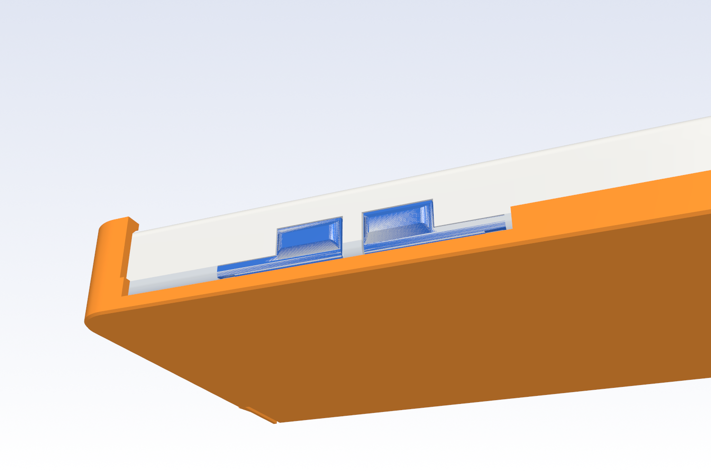
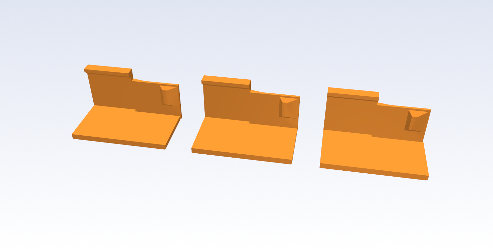

# Slide-on cover (2026-11-01)

> [!IMPORTANT]
> AI-assisted, not the official Silkscreen enclosure: see the notice at the top of the
> [main README](../../README.md) and https://silkscreenreader.com/ai.

> [!WARNING]
> **Nothing here has been printed.** The cover is checked in CAD, against the real case STLs, and sliced with the OrcaSlicer CLI;
> the forces below are beam estimates, not measurements. **Print the fit coupons first** (plate 1 of
> `print/silkscreen-cover-plates.3mf`), try them on your case, then print the cover.

A TI-84 style reversible cover, one printed part. It goes over the screen to carry the reader, and over the back while you read.
It slides on **sideways, along the case's width** (X), gripping the case's top and bottom end walls. It does not touch the
case's long sides, and **the case itself does not change**, so it fits every case already printed.

## Which cover fits which build

| Cover (`print/cover/`) | Fits | Plate | Size (mm) | Print time, generic / CC2 | PLA |
|---|---|---|---|---|---|
| `4.26/cover-keyed` | the 16 4.26 builds with bottom keys: `standard` and `light-strip`, each with all four side keys, the left pair, the right pair or the upper pair, with or without J6 | 2 | 72.2 x 128.8 x 17.0 | 1 h 08 / 31 min | 20.8 g |
| `4.26/cover-chinless` | the 16 chinless builds: `chinless` and `light-strip-chinless`, every layout | 3 | 72.2 x 121.2 x 16.4 | 1 h 01 / 28 min | 18.7 g |
| `3.68/cover-standard` | the 3.68 standard build | 4 | 72.2 x 111.8 x 17.4 | 1 h 04 / 30 min | 19.3 g |

The 4.26 light-strip builds share the standard's envelope (same length, thickness, faces, corners and edges: for the same side-key
layout the built tub + lid bounding boxes are identical), so one cover serves both. The 3.68 light strip is unreleased and has no cover. The side-key layouts and J6 do
not need separate covers: the stop wall has gaps for the union of every layout's keys, and J6 is not in the cover's way. Times and
grams are the OrcaSlicer 2.4 CLI's for the plate file's presets (generic: Generic PLA, 0.20 mm Standard; CC2: Elegoo CC2 presets).

`print/silkscreen-cover-plates.3mf` (generic OrcaSlicer presets, 220 x 210 bed) holds plate 1 "Test prints: the slide cover fit
coupons", then one plate per cover. Ian's CC2 twin is `print/cc2-local/silkscreen-cover-plates.3mf` (git-ignored). The covers are
not in the case plate files or the per-configuration projects. Every object has wall_loops 4 (the channel wall is four 0.4 lines);
nothing else differs from the stock process, and no supports (below).

## Using it

**On the front (screen covered).** The cover has a tall wall at one end (the stop side) and two thin prongs at the other (the open
end). Turn the plate outer face up with the stop wall on the **right**, the power-key side (SW1, SW4, SW10 and the USB-C). Put the
open end on the case's right edge so the cover's two channels (its top and bottom ends) slip over the case's top and bottom end faces,
and push the cover **left** until the stop wall meets the case's right side. From the first touch at the right-hand corner the
ridges on the prongs rub along the end faces (a light drag); at the end they drop into the case's left rounded corners with a gentle
click, and the cover is held.
The brief said to slide it on from the left; a rigid stop wall can only be at the cover's trailing end (a leading wall would have to
pass through the case), so with the stop on the right the cover goes on moving left. The stop is on the right as asked.

**On the back (reading).** Turn the cover over **about its long axis** (like a page: top stays top). The stop wall is now on the
**left** (SW5, SW7). Put the open end on the case's left edge and push **right** until the stop wall meets the left side; same click.
The screen, the USB-C, the page keys and the power key are all clear. Do not turn it top to bottom: the stop wall's gaps are at
the case's key positions, which are not symmetric from top to bottom.

**Taking it off.** Pull the cover away from its stop side with a firm pull (about 3 N at the cover, estimated). The prongs flex
outward and the ridges climb out of the corners. It cannot be lifted straight off: the lips hook the case's end edges, and they
would have to spread more than a millimetre.

**Keys with the cover on.** The page keys and the power key can be pressed either way: on the front the stop wall's bottom is at
least 1.0 above the USB-C recess and clear of the pads (they stand at z <= 0.6), on the back the wall has gaps over every side
key. The bottom keys are covered on the front (the plate's slot over them never touches a cap: 0.25 clear with the plate on the
face); on the back they are free. J6 (the developer header) is covered by the cover's end wall either way: take the cover off to
use it (see "What it does not do").


## How it works

Drawn on the case, in its own axes (`model.py`; Z up toward the screen, cover on the front at home):

- **Plate** over the face, inner face 0.35 off it. 2.4 mm thick (keyed), 1.8 (chinless), 2.6 (3.68): whole layers, and the
  thickest the key pocket needs. The outer face prints on the bed. Over the screen the plate is relieved to 1.2 mm (the display
  is never touched even by a bowed plate), and over the bottom keys there is one **slot along the whole slide path** (a pocket that
  was only at home hit the caps while the plate slid over them: the swept check found it).
- **Two end channels**, one at each end: a wall 0.30 off the end face, 1.6 thick, and a **lip** that hooks the opposite face's end
  edge. The lip's case side is a 47-degree face that follows the edge round at 0.45 normal clearance (0.37 to the front's smaller
  round), then a 0.26 flat; its tip is 1.1 past the end face. It prints as a plain slope: nothing overhangs more than 0.35 mm.
- **Stop side** (+X on the front): the channels turn the corner on the case's R5 plan arc (inner radius 5.2) and run on 2.7 mm along
  the long side at full height; between them a **low stop wall** (3.4 mm tall on the 4.26, 2.4 on the 3.68, so its bottom stays 1.0
  above the USB-C recess) touches the case's side at home. It has **gaps over every side key** of every layout, both sides, 1.2 mm
  either side of each key's bar and pad (the 4.26: y 44.8 to 107.2; the 3.68: 48.3 to 88.5).

  
- **Retention: a prong in each channel at the open end.** The channel wall there is cut free of the plate by a 1.0 kerf, so it is a
  free cantilever 0.8 mm thick (two lines, thickening to the full wall over 4 mm at its root), standing on the bed: no overhang.
  It bends in the layer plane, along the printed lines. It carries a tall **ridge** on its inside face (1.0 off the wall, 7.4 mm
  tall at its base and 5.4 at its tip, 45-degree ends; ramps of 18 degrees going on and 45 degrees coming off). Sliding, the ridge
  rides the flat end face with the prong deflected 0.7 mm. At home the case's R5 corner arc falls away under it and the prong
  springs back to within 0.15 of free; pulling the cover off, the ridge has to climb the arc again. The stop wall stops it going
  further. At home the prongs push the cover into its stop and keep it centred between the two end faces, so it is held without rattle in
  X and Y.
- **Why a tall ridge.** J6's opening is in the top end wall at x 42.75 to 59.1, z -5.5 to +0.25. Turned over about the long axis the
  cover's z band becomes z -> -0.7 - z, so any short bump that clears J6 one way sits in it the other. A ridge centred on the case's
  mid-plane keeps at least 2.4 mm of its contact on intact wall above J6 in both orientations (at the worst Z play), so the prong
  never drops into it: the deflection read off the real end faces is 0.70 mm flat along the whole straight face, J6 included.

  

## The numbers

| | design | notes |
|---|---|---|
| channel wall to the end face | 0.30 per side | FDM: parts come out 0.05-0.15 large (the case's own `KEY_FDM`), the case's end face and the cover's wall both, so as printed 0.20 / 0.10 / 0.00 per side (best / typical / worst). The coupons try 0.40 |
| stop wall to the long side | 0.30 drawn; closed (touching) at home | the prongs preload the cover into it |
| plate to the face, lip flat to the back face | 0.35 each (G = 0.70 total; 0.695 on the 3.68) | whole layers: plate + channel is 15.8 mm (15.2 chinless) |
| lip 47-degree face to the back round / front round | 0.45 / 0.37 normal (0.23 / 0.15 at the stop side, home) | |
| lip tip past the end face | 1.10 | the front's key caps start 1.87 in |
| prong | 0.8 thick, 11.0 from its root to the ridge's centre | beam model: 4.3 N/mm (soft bound, ridge-height wide) to 7.8 N/mm (the whole prong wide), E 3000 MPa |
| ridge | 1.0 high, stands 0.7 inside the end face on the flat | the prong deflects 0.7; 0.15 left at home; strain at the root 0.9 % (soft bound; PLA along its lines, so well under its limit) |
| forces, one prong (beam estimates) | sliding drag 0.9 N; push on, peak 1.4 N; pull off, peak 1.4 N (0.9 to 3.6 over E 2500-3500, both stiffness bounds, mu 0.2-0.4); home preload 0.64 N | two prongs: about 3 N to take it off (1.9 to 7) |

Not measured: every force and the fit as printed. The coupons exist to settle them before a whole cover is printed.

## The fit coupons

`print/cover/4.26/cover-coupon-A, -B, -C` and `print/cover/3.68/cover-coupon`: 30 mm of the top channel from the prong's tip, with
the plate strip, wall, lip, prong and ridge; about 8 minutes each (5 on the CC2); the letter (the 3.68's is a 3) is engraved in the outer face. They are the end of
the cover, so to feel the slide and the snap, start one with its prong end at the case's **top-right** corner (the plate strip over the
front, the lip under the back) and push it left along the top end: it rubs the end face, passes J6 without catching, and clicks
into the top-left corner. Try it on the back too (turn it over). There is no stop wall on a coupon, so it is the click you judge.

| Coupon | Channel clearance | Ridge depth | Try it for |
|---|---|---|---|
| A | 0.30 | 0.7 | the cover as designed |
| B | 0.40 | 0.7 | a looser slide, if A is tight or sticks |
| C | 0.30 | 1.0 | a firmer snap (estimate 2.3 N a prong, strain 1.3 %) |



## What was checked, and how

`check.py` (run: `python -B check.py`) works on the **real STLs** of every build the covers serve: tub, lid with its side keys and
the bottom-key caps from `case-426/out/<build>/` and `case-368/out/standard/`, 33 builds in all, in both orientations, with
manifold3d (overlap volumes, least distances) and vtk ray casts of the end faces. All 1140 rows pass.
- **Home**: the cover's rigid frame has no overlap with the case (front and back), least distance 0.30 with the stop 0.5 off,
  still none with the cover moved a play-width in Z or Y. The ridge's overlap at home (0.5 mm3) is the snap, not a collision.
- **Slide**: the frame swept along the whole path, cover entirely off the case to home, 1 mm steps, both orientations: zero overlap.
- **Ridge on the real end faces**: deflection 0.70 mm flat along the straight face (spread 0.00 at the extremes of the Z play), peak
  0.70, preload 0.15 at home, top and bottom ends, front and back: nothing catches in J6.
- **Access**: the USB-C recess plus 30 mm of plug room is clear in both orientations; the screen window is clear with the cover
  on the back; the plate clears the bottom-key caps by 0.25 with the plate touching the face.
- **It can fail**: a cover without the stop-wall gaps fails (it hits the left keys' pads on the back, 8.7 mm3 at home); a cover with the
  ridge moved down into J6's band fails (the deflection dips from 0.70 to 0.00 over the opening). Both are built by
  `build_cover.py` and run by `check.py --wrong`.
- **Print**: `printcheck.py` reads every layer of the STLs: nothing hangs more than 0.35 mm past the layer below (the lip's flat).
  `slice_read.py` slices the plate file with the OrcaSlicer CLI (never a GUI), generic and CC2, and reads the G-code back: **no support
  extrusion on any plate**; the lip, the prong and the ridge lie where the mesh puts them to 0.02 mm on every layer they stand in; the
  only bridges are over the coupon letters.

## What it does not do

- **J6.** A window in the end wall for J6 would have to be at x 42.75 to 59.1 on the front and, turned over, at the mirrored place
  (the prong's zone). It is not cut: take the cover off to use the developer header. The USB-C is clear either way.
- **Z clamp.** None. The plate and the lip leave 0.70 mm of Z play and the channel walls 0.60 of Y play; the prongs take up the Y and X
  play at home, not Z. A wedge preload on the lip would be tolerance-sensitive (the walls are soft), and ribs on the plate would have
  to dodge the screen window, the key openings, the back's grooves and the top screw. If it rattles in Z, coupon A will show it.
- **Top-to-bottom turn.** Not supported (the key gaps are placed for the turn about the long axis).
- **Not proven:** the as-printed fit, the forces, the long-term strain in PLA, and warping of the big plate.

## Rebuild

From `enclosures/cover`, with the 4.26 Python of `CLAUDE.local.md` (cadquery, trimesh, manifold3d, vtk; it also reads the 3.68's params):
```
python -B build_cover.py        # print/cover/4.26 and 3.68 (.stl and .step) and out/design/ (what check.py reads)
python -B check.py              # 33 builds, both orientations (5 to 10 minutes); --group keyed|chinless|x3, --builds a,b, --wrong
python -B printcheck.py         # the layer audit of the STLs
python -B make_cover_plates.py  # print/silkscreen-cover-plates.3mf; --printer cc2 for print/cc2-local/
python -B slice_read.py         # slice it with the OrcaSlicer CLI and read the G-code back; --printer cc2
python -B pictures.py           # docs/images/cover-*.png
```
`case_info.py` reads each case's envelope from its `params.py` (imported in a subprocess with `SILKSCREEN_VARIANT` set) and from the
built STLs; run the case builds first, and delete `out/case_info.json` after a case change. Nothing under `case-426/src` or
`case-368/src` is read for write or edited. The cover files are in `print/cover/`, not `print/4.26` or `print/3.68`: both case
builds delete any file in their size folder that they did not make.

Files: `model.py` (the geometry and every number), `case_info.py`, `build_cover.py`, `check.py`, `snap.py` (force and strain
estimates), `printcheck.py`, `make_cover_plates.py`, `slice_read.py`, `pictures.py`, `render.py`, `raycast.py`, `variants_list.py`.
