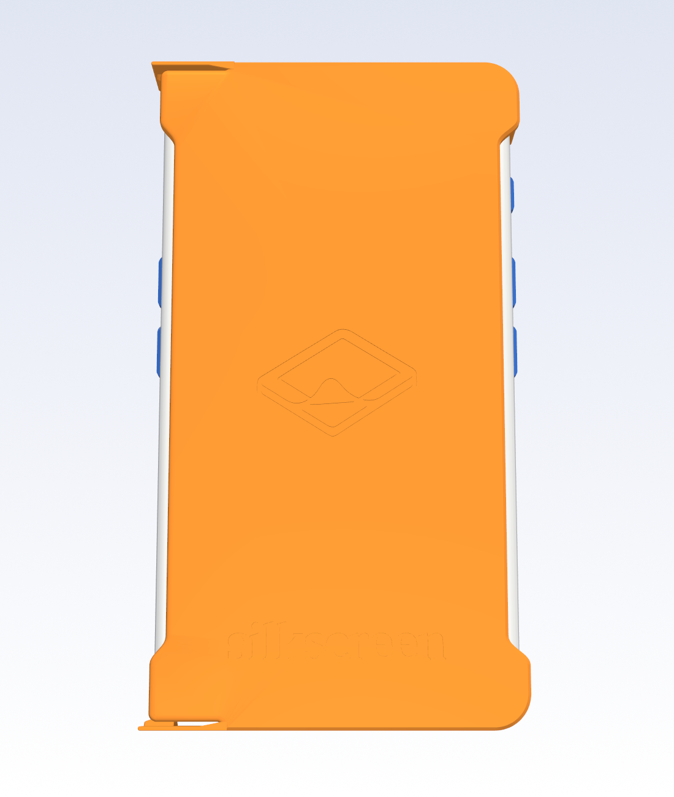
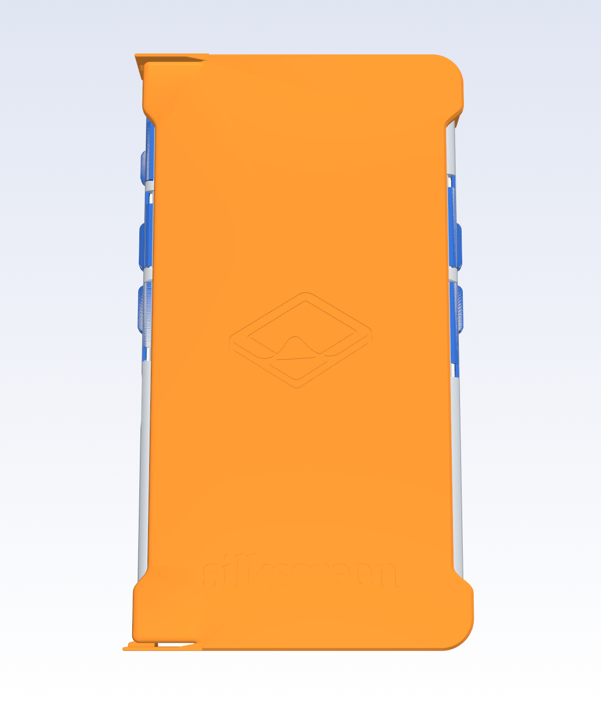
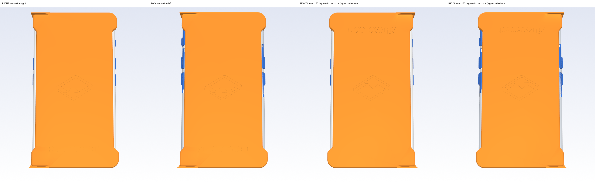
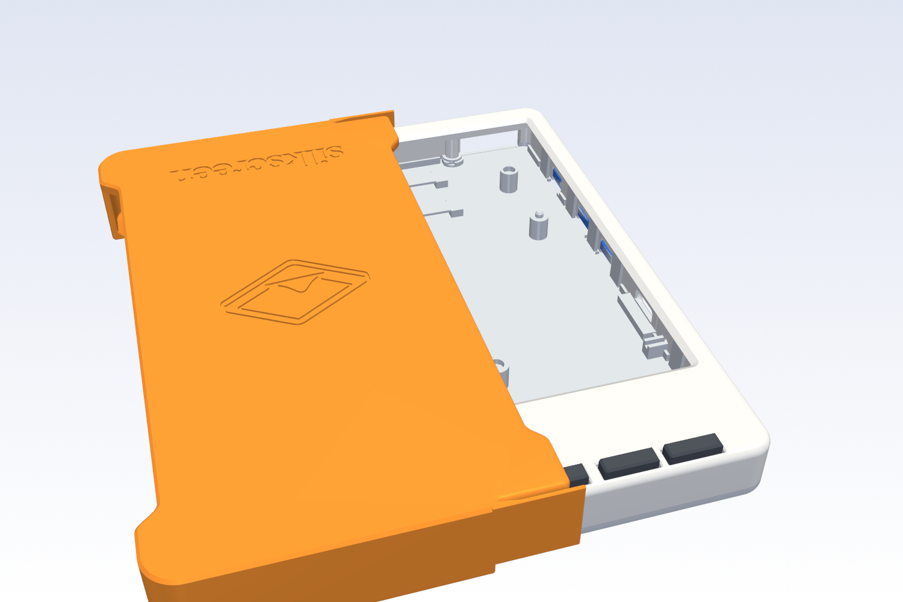
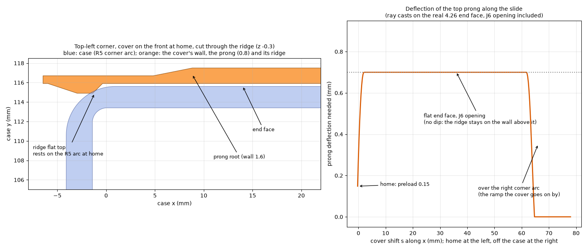
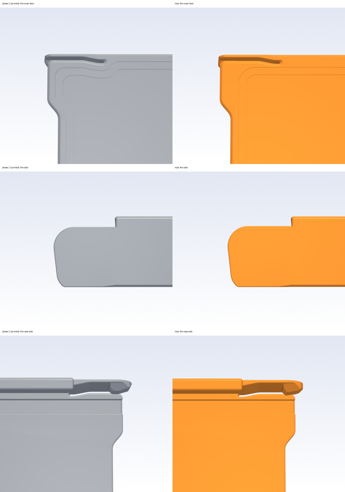
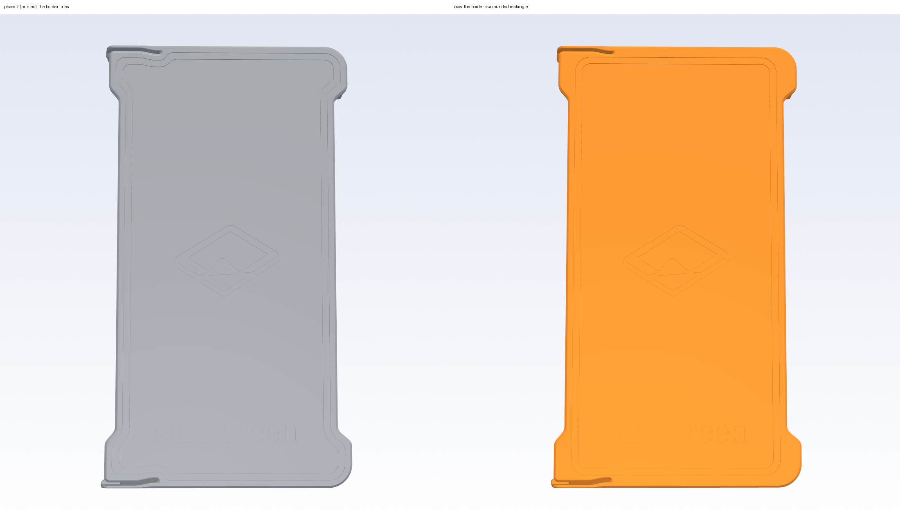
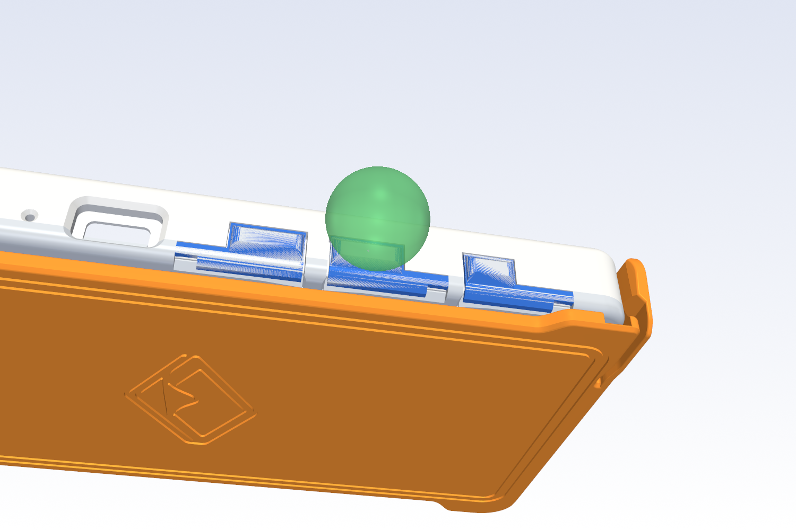
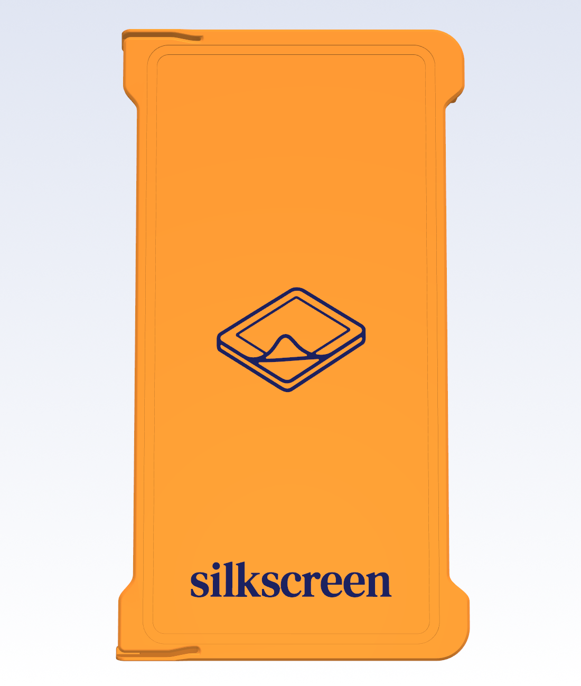

# Slide-on cover (round 2, 2026-11-01)

> [!IMPORTANT]
> AI-assisted, not the official Silkscreen enclosure: see the notice at the top of the
> [main README](../../README.md) and https://silkscreenreader.com/ai.

> [!WARNING]
> **What has been printed:** the first round's fit coupon A (found fine) and, on 2026-11-01, Ian's print of the **phase-2 cover**. His verdict on it is the
> only measurement of a whole cover: the border lines should be a rounded rectangle, the fit "isn't quite there" (the room top to bottom a tiny bit more strict,
> more so on the 3.68), the snap tab a bit more secure. **The covers described here (phase 3, which answers that) have not been printed**, and nothing in them is
> tested or proven. They are checked in CAD against the real case STLs and sliced with the OrcaSlicer CLI; the forces are beam estimates. The plate files in `print/`
> are **temporary** (one cover per plate) until the covers go into the case plate files.

A TI-84 style reversible cover, one printed part. It goes over the screen to carry the reader, and over the back while you read.
It slides on **sideways, along the case's width** (X), gripping the case's top and bottom end walls. It does not touch the
case's long sides, and **the case itself does not change**, so it fits every case already printed.

**Round 2 (Ian, 2026-11-01), two phases.** Phase 1: the cover carries the Silkscreen icon and wordmark engraved on its outer face; every edge
you can touch is rounded; it goes on **any of four ways**; and its long sides curve inward over the side keys. Phase 2: the plate is **solid over
the screen** (no relief), the key slots' roof edges are flared away, **two engraved border lines** run round the outer face (grip, and a
book-cover look), the snap tab's end is **rounded down in side view** and the slit between the tab and the plate is **one uniform slit** that
ends in a round end. What did not change is the working geometry Ian printed as coupon A: the channel, the lip, the tab's thickness
profile, length and root, the ridge's height and ramps (the snap figures are compared below). The cover stays inside phase 1's footprint
(72.0 mm wide, the same length: the tab does not stand further out).

**Phase 3 (2026-11-01, after Ian printed the phase-2 cover).** (1) The two border lines are now a **rounded rectangle** that centres the logo and the wordmark: straight long
sides along the scallop's narrow middle, straight ends, concentric rounded corners; they no longer follow the plate's edge or bow out into the wide ends. (2) **Less room
top to bottom (Y)**: the channel walls sit 0.20 per side off the end faces instead of 0.30 (0.15 on the 3.68), and the corner pieces 0.14 off the case's corner arcs instead of
0.20 (0.12), which cuts the cover's rigid Y travel at home from 0.338 mm to 0.234 mm (0.165 on the 3.68). The room front to back (Z) is as in phase 2. (3) A **firmer snap**: the
ridge stands 0.9 mm inside the end face instead of 0.7, with a longer, softer prong; the pull-off peak is up about 22 %, the push-on and sliding drag by less than 15 % (beam estimates).

## Which cover fits which build

| Cover (`print/cover/`) | Fits | Plate | Size (mm) | Print time, generic / CC2 | PLA |
|---|---|---|---|---|---|
| `4.26/cover-keyed` | the 16 4.26 builds with bottom keys: `standard` and `light-strip`, each with all four side keys, the left pair, the right pair or the upper pair, with or without J6 | 1 | 71.7 x 128.6 x 17.4 | 1 h 17 / 40 min | 22.6 g (23.7 g CC2) |
| `4.26/cover-chinless` | the 16 chinless builds: `chinless` and `light-strip-chinless`, every layout | 2 | 71.6 x 121.0 x 17.0 | 1 h 11 / 37 min | 20.8 g (22.0 g CC2) |
| `3.68/cover-standard` | the 3.68 standard build | 3 | 71.7 x 111.5 x 17.8 | 1 h 11 / 36 min | 20.5 g (21.4 g CC2) |

The 4.26 light-strip builds share the standard's envelope, so one cover serves both. The 3.68 light strip is unreleased and has no cover.
Times and grams are the OrcaSlicer 2.4 CLI's for the plate file's presets (generic: Generic PLA, 0.20 mm Standard; CC2: Elegoo CC2 presets). The solid plate and the
border lines cost against phase 1 (generic / CC2): keyed +13.6 min and +4.6 g / +9.2 min and +5.9 g, chinless +11.4 min and +4.3 g / +8.5 min and +5.5 g, 3.68
+11.1 min and +3.5 g / +8.2 min and +4.6 g.

`print/silkscreen-cover-plates.3mf` (generic OrcaSlicer presets, 220 x 210 bed) holds one plate per cover; Ian's CC2 twin is
`print/cc2-local/silkscreen-cover-plates.3mf` (git-ignored). **Temporary:** the covers are not in the case plate files or the
per-configuration projects yet. Every object has wall_loops 4 (the channel wall is four 0.4 lines); nothing else differs from the stock
process, and no supports (below). The coupons are gone (coupon A confirmed the fit; the channel section is unchanged).

**Two-colour logo.** Each cover carries its two logo bodies as modifier parts with no filament, named like the lid's ("logo wordmark: ...",
"logo icon: ..."): the switch is OFF and the cover slices as one colour with the engraving empty. To switch it on, do what the lid's switch asks
(`print/README.md`, "Two-colour logo": one logo part at a time, Change type -> Part, then Set Filament -> 2); the logo is the cover's first two
layers (the outer face is on the bed), so you need a printer that changes filament by itself. `inlay_check.py` does that to a copy of the plate
file and reads the G-code back.

## Using it

The cover is **symmetric about its own mid-length and mid-plane**, so there are four legal poses (`check.py` checks all four, on every
build). In each the plate's outer face (the one with the logo) faces away from the case.

| Pose | How | Stop side |
|---|---|---|
| front | on the screen | right: the power-key side (SW1, SW4, SW10 and the USB-C) |
| back | turned over about the long axis (like a page) | left (SW5, SW7) |
| front, turned | on the screen, turned 180 degrees in the plane: top and bottom swapped, it goes on from the other side | left |
| back, turned | on the back, turned 180 degrees in the plane | right |

Put the cover's open end on the case edge on the **side opposite the stop**, so its two channels slip over the case's top and bottom end
faces, and push toward the stop until the stop pieces (the two corner pieces, with nothing between them) meet the case's side. The ridges on the
prongs rub along the end faces (a light drag); at the end they drop into the case's rounded corners with a gentle click, and the cover is held.
Taking it off: pull it away from the stop with a firm pull (about 3.4 N at the cover, estimated). It cannot be lifted straight off: the lips hook
the case's end edges.

**The logo reads upside down in the two turned poses** (it is engraved once, on one end of the plate). In every pose it faces away from the
case. With the cover on the **back** (the un-turned back pose) it sits exactly over the case's own back logo and reads the same way.

**Keys.** The page keys and the power key can be pressed in every pose: the cover has no wall along the long sides except the two corner
pieces and their short extensions (4.7 mm on the 4.26, 4.2 on the 3.68), cut back so that no key pad of any layout in any pose touches
them, and both long sides **curve inward** over the side keys and the power key (the scallop below). The bottom keys are covered with the
cover on the front, in both front poses (the plate's slot over them never touches a cap: 0.25 clear with the plate on the face); on the back
they are free. J6 (the developer header) is covered by the end wall either way: take the cover off to use it (see "What it does not do").






## How it works

Drawn on the case, in its own axes (`model.py`; Z up toward the screen, cover on the front at home):

- **Plate** over the face, inner face 0.35 off it. **Solid over the screen** (phase 2: no relief). 2.8 mm thick (keyed), 2.4 (chinless: up from 1.8, the
  outer face moves out 0.6), 3.0 (3.68): whole layers, and (keyed, 3.68) the thickest the key slots need (the slot roof is at least 1.2 thick, six
  layers, so the bed chamfer, the logo's engraving and the border lines fit). The outer face prints on the bed. With the relief gone the plate
  is **8 to 13 times stiffer** over the glass and its rest gap to the display glass is **1.37 mm** (1.35 on the 3.68): the glass lies 1.02 below the front face and the plate
  is 0.35 off it. A press has to bend the plate that far before it touches the glass: my estimate (Navier's series for a plate simply supported on
  the screen opening, 59.2 x 96.0 mm (55.1 x 81.0 on the 3.68), uniform thickness, E 3000 MPa, Poisson 0.35, central point load, bending only, the tub's skin as the support
  and the glass itself ignored) is **155 N keyed, 98 N chinless, 225 N on the 3.68** (stiffness 113, 71 and 167 N/mm); phase 1's 1.2 mm over the window gave 8.9 N/mm and 27 / 18 / 37 N by the same method.
  Each end of the plate has a **key slot** that runs out through the leading edge (the plate passes over the caps on its way, and either end of
  the plate may land over the bottom keys); its roof leaves the face in a **45-degree flare of 0.5 mm** (the slot's cutter is flared, not filleted
  afterwards: the roof edge is no longer a 90-degree edge).
- **Two end channels**, one at each end: a wall 0.20 off the end face (0.15 on the 3.68; phase 2 and coupon A had 0.30), 1.6 thick, and a **lip** that hooks the opposite face's end
  edge (47-degree face following the back round at 0.375 normal clearance, 0.34 on the 3.68; coupon A had 0.45: see "Play"; the tip is a half round of 0.6).
- **Stop side**: the channels turn the corner on the case's R5 plan arc (inner radius 5.14, i.e. 0.14 off the arc; 5.12 on the 3.68; phase 2 had 5.2) and run on 4.7 mm along the long side at
  full height; **no wall between them** (the round-1 stop wall had gaps for each layout's keys, and it could not serve the turned poses).
  The extension is as long as stays clear of every pad's y range **and its mirror about mid-length**, after a 3 mm finger margin and the ease.
- **Scallop.** Both long sides of the plate curve inward between the corner pieces: a quintic ease (tangent- and curvature-continuous,
  6 mm in and 6 mm out) over the union of every pad's y range and its mirror, plus the 3 mm margin. One curve where the zones are close
  (the 3.68's). Inset: **2.4 mm** inside the case's side face on the 4.26, **3.0 mm** on the 3.68, limited by the screen: with the cover on
  the front the plate still reaches 2.0 mm or more past the screen opening on each side (measured from the tub STL).
- **Retention: a tab in each channel at the open end**, a free cantilever 0.8 mm thick (two lines, thickening to the full wall over 4 mm
  at its root), standing on the bed: no overhang. The thinning is on its **inner** side, so the outside of the cover is one smooth surface; the ridge
  is raised to match. The **ridge** rides the flat end face with the tab deflected **0.9 mm** while sliding (phase 2: 0.7); its lead-in is 4.2 mm long, a ramp with a gentler last stretch (so the push-on does not
  rise with the pull-off), the removal ramp about 50 degrees (phase 2: 45); at home the
  case's R5 corner arc falls away under it and the tab springs back to within 0.2 of free (phase 2: 0.15). Pulling the cover off, the ridge climbs the arc again. The prong is 0.55 mm longer from its root to the ridge (11.55) so the taller ridge stays soft.
- **The tab's end (phase 2).** In side view the tab no longer ends in a tall square end: its outline is a **tongue**: the top edge curves down in an R5
  arc from the full height, the end is an R4 round, and the bottom edge leaves the bed at 45 degrees (it prints without support). The ridge's **lead-in is trimmed to the same outline**, so it
  shrinks in height toward the tip; only the flat top keeps the full height that bridges J6 (the contact during the slide is the ridge apex). In phase 3 the lead-in is 1.2 mm longer and the tongue starts 0.6 mm after
  the ridge's start, so the tab's tip ends 0.2 mm short of it; the cover stays inside phase 1's footprint (71.7 mm wide). The push-on still meets the case's corner as a ramp: the angle at
  first touch along the swept path is **22.8 to 22.9 degrees** on the 4.26 covers (21.2 on the 3.68), all four poses, both ends, at every Z play (phase 2 and 27bbdaf: 18.5; the limit is 25).
- **The slit (phase 2).** Between the tab and the plate there is one **uniform slit**, 0.8 wide, that follows the tab's inner face as it thickens toward the root (the plate edge is one
  slit away, the bends rounded to R8) and ends at the root in a **round end** (a semicircle, tangent to both walls). The plate's edge along the slit has the 0.6 chamfer on the outer face and the
  0.5 fillet on the inner face; the tab's bed foot is rounded and **grows into the plate's chamfer over the taper** (one plane, no step), so the slit is the only break.
- **Border lines (phase 3: a rounded rectangle).** Two engraved lines, 0.8 wide (the case's grip groove width) and 0.4 deep (two whole layers), 2 mm apart, like a book cover's tooled border. Phase 2's followed the
  plate's outline; Ian printed that and asked for a rounded rectangle that centres the logo and the wordmark. The **long sides are straight**, parallel to the long axis, their centre lines 2.5 and 4.5 mm in from the scallop's
  narrow middle, and run the whole length without bowing out into the wide ends; the **ends are straight** across, 1.0 mm clear of each slit's round end (the outer line's near edge); the **corners are concentric** (R4 outside,
  R2 inside). The frame is symmetric about the logos' axis, 6.4 mm or more from the logos (the need is 2), and the plate behind the lines is solid 0.8 mm (the key slots' roofs included). Not part of the two-colour switch.
- **Why a tall ridge.** J6's opening is in the top end wall at x 42.75 to 59.1, z -5.5 to +0.25. A ridge centred on the case's
  mid-plane keeps at least 2.4 mm of its contact on intact wall above J6 in all four poses, so the prong never drops into it.



### Edges and rounds

45-degree **chamfer 0.6** round the whole outer-face perimeter (it is also the printed bed's elephant-foot relief), along the slit too; every other exposed edge a
**fillet of 0.5** or more (wall top, lip, corner pieces, plate edges; some slot-mouth fillets are 0.2 to 0.3); the open-end plan corners **R3** (R1.5 where the key slot leaves through the leading edge);
the tab's whole side outline a **0.3 round** (the 0.8 plate keeps a 0.2 flat; 0.38 left the first layer's foot 0.55 wide, which the CC2 would not lay).






`edges.py` is the sharp-edge check: every convex mesh edge of the STL that turns more than 50 degrees, grouped by place, and whether a hand
can reach it (the two face normals traced out from the edge against the cover and the case at home). On **27bbdaf's cover** (coupon A's
geometry, kept as `ref/old-27bbdaf-keyed.stl`) it finds 291 convex edge segments turning more than 50 degrees, **275 of them touchable**, 1437 mm of edge (226 segments on the wall, lip and corner pieces, 28 on the prong and ridge, 15 on the plate's edges, 22 elsewhere). The round-2 results are in "Sharp-edge result".

## The numbers

| | design | notes |
|---|---|---|
| channel wall to the end face | 0.20 per side (0.15 on the 3.68) | phase 2 and coupon A: 0.30 (coupon A "feels fine"); the walls touch only if the cover yaws, the stop end sets the rigid travel: see "Play" |
| corner pieces to the case's R5 arcs | 0.14 radial (0.12 on the 3.68) | phase 2: 0.20; this and the wall clearance together set the stop end's Y travel |
| stop pieces to the long side | 0.30 drawn; closed (touching) at home | the prongs preload the cover into them |
| plate to the face, lip flat to the back face | 0.35 each (G = 0.70 total; 0.695 on the 3.68) | whole layers; as phase 2 (Z travel 0.709 mm measured, phase 2 0.712; the lip face is 0.375 off the back round, 0.34 on the 3.68, only to hold that) |
| tab (prong) | 0.8 thick, 11.55 from its root to the ridge's centre (phase 2: 11.0) | beam model: 3.8 N/mm (soft bound), E 3000 MPa (phase 2: 4.3) |
| ridge | stands 0.9 inside the end face on the flat (phase 2: 0.7) | 0.2 left at home; strain at the root 1.03 % (0.89); first touch on the way on at 22.8-22.9 degrees (21.2 on the 3.68; limit 25), all four poses |
| plate over the screen | solid: 2.8 keyed, 2.4 chinless, 3.0 on the 3.68 | rest gap to the glass 1.37 mm (1.35); estimated press to touch it 155 / 98 / 225 N (stiffness 113 / 71 / 167 N/mm; Navier, simply supported on the opening, E 3000, Poisson 0.35, central point load) |
| border lines | a rounded rectangle, 0.8 wide, 0.4 deep, 2.5 and 4.5 mm in from the scallop's narrow middle, R4 / R2 corners | 6.4 mm from the logos; at least 1.0 mm from the slits' round ends; plate behind them 0.8 mm solid or more |
| footprint | 71.7 x 128.6 / 121.0 / 111.5 mm | phase 1: 72.11 x 128.8 / 121.2 / 111.8; the tab's tip is 0.2 mm short of the ridge's start |
| forces, one prong (beam estimates) | sliding drag 1.0 N; push on, peak 1.5 N; pull off, peak 1.7 N (1.1 to 4.6 over E 2500-3500, both stiffness bounds, mu 0.2-0.4) | two prongs: about 3.4 N to take it off (phase 2: 1.4 N each, 2.8 N) |

### Play: how much the cover can move at home (phase 3, `play.py`)

Ian: the fit "isn't quite there", the room **top to bottom** (Y, along the case's long axis) a tiny bit more strict, more so on the 3.68. `play.py` moves the rigid cover (the frame without its
ridge; the prongs are springs) from home along Y until it first touches the real case STLs, in all four poses, for the whole cover and for each end alone (the half with the corner pieces = the stop end;
the half with the tabs = the open end):

| mm per side (+Y / -Y equal), sum in brackets | phase 2 | phase 3 |
|---|---|---|
| 4.26 (keyed and chinless): whole cover, rigid travel | 0.169 (0.338) | **0.117 (0.234)**, -31 % |
| 4.26: open end alone (channel walls on the end faces) | 0.300 (0.600) | 0.200 (0.400) |
| 4.26: stop end alone (corner pieces on the R5 arcs) | 0.169 (0.338) | 0.117 (0.234) |
| 3.68: whole cover, rigid travel | 0.169 (0.338) | **0.082 (0.165)**, -51 % |
| 3.68: open end alone | 0.300 (0.600) | 0.150 (0.300) |
| 3.68: stop end alone | 0.169 (0.338) | 0.082 (0.165) |

What it found: (1) the rigid travel is set by the **stop end's corner pieces**, not by the channel walls; the first touch is on the case's R5 corner arc about 25 degrees round from the straight face,
because phase 2's pieces (0.20 off the arc) were centred 0.1 mm off the case's arc centres in Y (the walls were 0.30 off the end faces). The walls (0.30 per side, 0.60 in all) only matter if the cover yaws, which the
prongs' preload resists at the open end. (2) **The 3.68's travel was not larger than the 4.26's** (0.338 both; the stop end and the walls are the same numbers): the case's end faces, corner radius (R5) and lip rounds are the same, so
no feature of the 3.68 explains "more so"; its cover is 17 mm shorter between the channels (108 against 125 mm), so the same play is a larger tilt over its length, and I took the 3.68 to half the travel as asked. (3) The Z room (front to back) is as phase 2:
the plate gap and the lip flat gap 0.35 each, travel **0.709 mm measured on all three** (phase 2: 0.712, 0.712, 0.711); as laid by a 0.2 slicer (the lip's 47-degree face is a staircase) 0.649.
Tightening Y alone had loosened Z (the corner arcs became more concentric, so the lip had more room there: 0.819 and 0.871 mm), so the lip face's normal clearance went from 0.45 to 0.375 (0.34 on the 3.68) to hold Z where it was.

The wall clearance is the nominal 0.20 / 0.15 and the corner pieces' 0.14 / 0.12 (the floor is 0.12 nominal per side); the sliding drag is the prongs' alone (below): the walls clear the end faces by 0.20 / 0.15 and carry no load
in CAD. **As printed**: the slicer reads the walls where the mesh puts them to 0.04 mm (`slice_read.py`), but the printer takes clearance off a gap: round 1's design note (not measured) allowed 0.10 to 0.30 per side off a nominal
gap. Taken at face value that leaves **0.00 to 0.10** at the new 0.20 walls and **less than 0.05** at the 3.68's 0.15 (the stop end's effective 0.117 / 0.082 shrinks the same way), so **the covers may bind or need a pass with a file if the printer is on the tight side**;
phase 2's 0.30 would have been 0.10 to 0.20. Only Ian's print can say. The one number to move is `cy` (and `corner_clr` with it) in `model.py`.

### The snap, against coupon A and phase 2

Through the same ray casts on the real standard 4.26 end faces (`check.py --snap`), each cover with the snap numbers it was built with; one prong, nominal (E 3000 MPa, ridge width, mu 0.3):

| | coupon A (27bbdaf) | phase 2 (printed) | phase 3 |
|---|---|---|---|
| deflection on the flat, mm | 0.70 | 0.70 | **0.90** |
| stiffness, N/mm | 4.30 | 4.30 | 3.79 |
| pull-off peak, N (range over E, width, mu) | 1.41 (0.94-3.97) | 1.38 (0.92-3.92) | **1.68** (1.14-4.57), +21.9 % on phase 2 |
| push-on peak, N | 1.40 | 1.38 | 1.47, +6.0 % |
| sliding drag, N | 0.90 | 0.90 | 1.02, +13.2 % |
| preload at home, N | 0.62 | 0.63 | 0.80 |
| strain at the root, % | 0.89 | 0.89 | 1.03 |
| first touch on the way on | 18.5 degrees | 18.5 | 22.8-22.9 (21.2 on the 3.68) |

Ian asked for a pull-off peak 25 to 35 % higher with the push-on and the drag within 15 %: with the drag capped at +13 % the model gives +22 %. Raising the deflection further lifts the drag first (it is linear in the deflection,
the pull-off superlinear but bounded by the same stiffness), so I stopped at 0.9. The removal ramp's steeper angle (45 to 50 degrees) is the other lever: the beam model does not see it (the peak is set at the
corner arc's knee), so it is in the geometry but unquantified. The prong's thickness profile is the same 0.80 free span blending to 1.60 at the root, 0.55 mm further along. The push-on and the pull-off are beam estimates on one coupon-A-calibrated model;
nothing about the new tab is printed.

## What was checked, and how

`check.py` (run: `python -B check.py`) works on the **real STLs** of every build the covers serve: tub, lid with its side keys and
the bottom-key caps from `case-426/out/<build>/` and `case-368/out/standard/`, 33 builds, in **all four poses**, with manifold3d (overlap
volumes, least distances) and vtk ray casts of the end faces and of the cover's own ridge. **Run of record: phase 2's final STLs 2511 rows over the 33 builds, 0 failing; the first phase-3 STLs 2709 rows, 0 failing. Ian then asked for the full run to be dropped: after the last change (the ridge's root, which only touches the tab) the keyed standard, chinless and 3.68 standard builds were checked again in all four poses (85 + 79 + 85 rows, 0 failing), and `--snap`, `--angle`, `--plate`, `--wrong` (all caught), `edges.py`, `printcheck.py` and the slice read-back were rerun on the final STLs.**
- **Home, every pose**: the frame has no overlap with the case, least distance 0.20 (0.15 on the 3.68) with the stop 0.5 off, none with the cover moved a
  play-width in Z or Y; the rigid Y travel at home is measured (0.117 per side on the 4.26, 0.082 on the 3.68) and the nominal Y clearances are held to the 0.12 floor. The ridge's overlap at home (about 1 mm3) is the snap, not a collision.
- **Slide, every pose**: the frame swept along the whole path, cover entirely off the case to home, 1 mm steps: zero overlap.
- **Ridge on the real end faces**, read through the cover's own ridge mesh: deflection 0.90 flat along the straight face (spread 0.00 at
  the extremes of the Z play), peak 0.90, preload 0.20, at both ends in all four poses: nothing catches in J6.
- **Access**: the USB-C recess plus 30 mm of plug room is clear in every pose; the screen window is clear with the cover on the back; the
  plate clears the bottom-key caps by 0.25 in both front poses at home and along the path; the plate stays 2.0 mm or more past the screen
  opening (4.26: 2.1 to 3.2 mm at the left and 2.08 to 2.78 at the right over the 32 builds; 3.68: 2.8 and 4.3).
- **The screen** (the plate is solid over it): the cover rests 1.02 from the glass with the plate on the face and 1.37 at rest (1.35 on the 3.68; the light-strip builds' glass lies deeper), in both front poses, every build.
- **Fingertip**: an r 7 mm sphere touching each pad face's centre, swept in from the side along the face's normal, is clear of the cover in
  every pose, every pad, every build: least clearance 4.82 mm on the 4.26, 6.18 on the 3.68. For comparison, the same approach to a cover without the scallop (`out/design/keyed-noscallop.stl`) clears by 2.71 mm: the scallop gains 2.1 mm.
- **Logo**: with the cover on the back, its engraving lies over the case's own logo (area overlap with the lid STL's section, 1.000 for the icon and for the wordmark, centroid offset 0.00 mm, in
  every build) and the plate behind the engraving is solid for at least 0.8 (0.8 to 1.0 on the 3.68) mm below its floor everywhere (a slab test: the engraving never
  breaks into a key slot; the need is 0.6). **Border lines**: a rounded rectangle on the plate, 1.00 mm or more in from its edge (the slits' round ends are the nearest), 6.4 mm or more from the logos, straight long sides (x spread 0.005 mm), centred on the logos' axis, and the plate solid
  behind them for 0.8 mm (0.8 on the keyed cover and the 3.68, the key-slot roofs included; 2.0 on the chinless). **Footprint**: x 71.66 / 71.64 / 71.68 mm against phase 1's 72.11, y 128.6 / 121.0 / 111.5 against 128.8 / 121.2 / 111.8.
  **Tab**: the ridge's flat-top band lies inside the tongue outline in every build.
- **It can fail**: the wrong covers must fail, and do. A key slot at one end only fails in the front-turned pose (the plate meets the caps: 124 mm3 at home on the standard build). A 16 mm corner extension meets a pad (all 16 keyed builds, the two poses with the stop on the right, 8.75 mm3 each: 32 failures). The ridge moved into J6's band fails (deflection 0.00 to 0.70 along the straight face, spread 0.70 against the 0.12 limit). 27bbdaf's cover fails the sharp-edge scan (275 touchable segments). `check.py --wrong`.
- **Print**: `printcheck.py` reads every layer of the STLs: nothing hangs more than 0.31 mm past the layer below (the tab's bottom blend to the bed is R1.2: a bigger blend is a near-flat overhang
  in the first layers, 0.9 mm). `slice_read.py` slices the plate file with the OrcaSlicer CLI (never a GUI), generic and CC2, and reads the G-code back: **no support extrusion on any plate**; the lip, the tab and the ridge
  lie where the mesh puts them to 0.04 mm on every layer they stand in (probes: the lip, the tab's free span, the tongue, the taper and the ridge), including the tab's first layer on the CC2 (the foot's rounded
  to 0.3 where a 0.38 round left a first-layer line 0.55 wide that the CC2's classic walls and EFC 0.1 would drop); on the generic preset's Arachne walls two layers of the 1.2 mm taper leave a 0.28 mm gap
  between two lines (the CC2's classic walls fill it); the only bridges are one layer (z 0.6, or 0.4 and 0.6 on the 3.68) over the engravings' 0.2 to 0.4 deep voids (the logos and the border lines), where a line
  hangs at most 1.0 mm past the layer below (0.76 before the logos' strokes were widened on 2026-11-07; the lid's own logos do the same). Generic presets: 1 h 17 / 1 h 10 / 1 h 11 and 22.6 / 20.8 / 20.5 g; CC2: 40 / 37 / 37 min and 23.7 / 22.0 / 21.4 g (keyed, chinless, 3.68).
  `inlay_check.py` switches the logo on in a copy of the plate file: filament 2 is laid only inside the two logo boxes on layers 0.2 and 0.4 (0.34 g on the keyed plate, the skirt included) and filament 1 uses 22.12 g against 22.61 g with the switch off
  (the border lines are not part of the switch). Since the strokes were widened, OrcaSlicer starts this plate file's first layer with filament 2, so the skirt is laid in the
  logo's colour (a priming loop that is thrown away; `inlay_check` counts it apart). The per-configuration projects still lay it in filament 1.

### Sharp-edge result

`python -B edges.py keyed|chinless|x3` (convex mesh edges turning more than 50 degrees, grouped; "touchable" = a face normal escapes), on the STLs as built:

| Cover | Engraving rims (logo and border lines) | Anything else |
|---|---|---|
| 4.26 keyed | 1276 segments, 1972 mm | 46 facets under 0.06 mm (1.7 mm of edge in all) at the slit's round end, a mesher fan, not geometry; 2 segments of 2.9 mm each on the ridge (the 90-degree saddle edge where the removal ramp meets the 45-degree end) |
| 4.26 chinless | 1276 segments, 1911 mm | 16 such facets (0.9 mm), 3 segments of 0.4 mm in all at 50 to 51 degrees, and the same 2 ridge segments |
| 3.68 | 1259 segments, 1778 mm | 46 such facets (1.7 mm), the same 2 ridge segments |

**No touchable sharp edge is left on any cover but the engraving rims and, new in phase 3, two short segments of the ridge**: the ridge's edge rounds are partly built (6 of 34 edges at 0.45 on the covers; OCC's rounds of the new compound lead-in
did not mesh closed on the rest), and the 3.68's slot mouths are rounded on 10 of 16 edges (0.12). The ridge edges sit on the tab's inner side, inside the channel, and the slot mouths on the plate's case side. In phase 1 the key slots' roof edges (2 x 4.1 mm on the keyed, 2 x 4.4 on the 3.68, 90 degrees), the 0.5 mm step where the tab's
foot met the plate's chamfer (5.3 mm of edge on the keyed cover) and the chinless cover's mesher fans were left; phase 2 removed them: the slot cutter is flared at the mouth, the tab's foot grows into the
plate's chamfer over the taper, and the plate has no relief to leave fans at its seams. What is left, and why:
- **Engraving rims** (the case's two logos, 0.4 and 0.2 deep with strokes down to about 0.6 wide since 2026-11-07, 0.36 before, and the border lines, 0.8 wide, 0.4 deep): the case's own treatment of its logos and grip grooves; a stroke that narrow cannot take a fillet.
- **Mesher facets**: tiny facets the STL writer puts at the slit's round end; zero-width slivers, no geometry.

27bbdaf's cover, the same scan: 275 touchable segments (1437 mm).

## What it does not do

- **J6.** A window in the end wall for J6 is not cut: take the cover off to use the developer header. The USB-C is clear in every pose.
- **Z clamp.** None. The plate and the lip leave 0.70 mm of Z play (0.709 measured); the Y room at home is 0.234 mm (0.165 on the 3.68), the channel walls alone 0.40 (0.30); the prongs take up the X
  play at home, and centre the open end in Y, not Z.
- **Not proven:** the as-printed fit of a whole cover, the forces, the long-term strain in PLA, warping of the big plate, and the two-colour
  switch on a real printer (the CLI read-back is the only test).

## Rebuild

From `enclosures/cover`, with the 4.26 Python of `CLAUDE.local.md` (cadquery, trimesh, manifold3d, vtk; it also reads the 3.68's params):
```
python -B build_cover.py        # print/cover/4.26 and 3.68 (.stl, .step, inlay bodies) and out/design/ (what check.py reads)
python -B check.py              # 33 builds, four poses (about 40 minutes); --group keyed|chinless|x3, --builds a,b; --wrong; --snap; --angle; --plate
python -B play.py               # the rigid Y travel at home (--axis z: the Z travel; --where, --var cy=0.2,corner_clr=0.14, --layered)
python -B edges.py [keyed|chinless|x3|old]   # the sharp-edge scan
python -B printcheck.py         # the layer audit of the STLs
python -B make_cover_plates.py  # print/silkscreen-cover-plates.3mf; --printer cc2 for print/cc2-local/
python -B slice_read.py         # slice it with the OrcaSlicer CLI and read the G-code back; --printer cc2
python -B inlay_check.py        # the two-colour switch switched on, sliced, read back
python -B pictures.py           # docs/images/cover-*.png
```
`case_info.py` reads each case's envelope, pads, window and logos from `params.py` / `logo.py` (imported in a subprocess with
`SILKSCREEN_VARIANT` set) and from the built STLs; run the case builds first, and delete `out/case_info.json` after a case change. Nothing
under `case-426/src` or `case-368/src` is edited. The cover files are in `print/cover/`, not `print/4.26` or `print/3.68`: both case builds
delete any file in their size folder that they did not make.

Files: `model.py` (the geometry and every number), `case_info.py`, `logo_dump.py`, `build_cover.py`, `check.py`, `edges.py`, `snap.py` (force and
strain estimates), `printcheck.py`, `make_cover_plates.py`, `slice_read.py`, `inlay_check.py`, `pictures.py`, `render.py`, `raycast.py`,
`variants_list.py`, `play.py` (the cover's travel at home, Y and Z).
